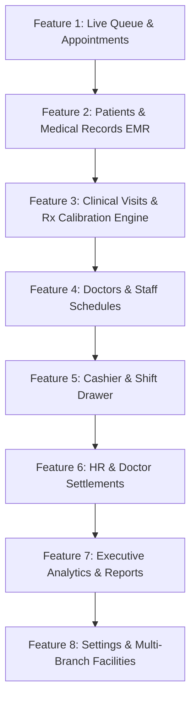

# Eyadty Clinic SaaS — Feature-by-Feature Engineering Execution Plan

This master plan details the exact architectural, domain, data, and UI implementation for every feature in the **Eyadty (عيادتي)** Clinic & Medical Group SaaS platform. It strictly enforces all architectural rules defined across:
- `dashboard-feature-scaffold`
- `eyadty-design-system`
- `dashboard-table-system`
- `dashboard-dialog-form`
- `dashboard-section-builder`
- `dashboard-shell-routing`

---

## 🏛️ Absolute Architectural Rules (Applied to ALL Features)

1. **NO Entity Classes:** `{Name}Model` is used across all 3 layers (Data, Domain, Presentation). No `domain/entities/`.
2. **100% Nullable Models:** Every field is `final Type? property;`. No `required` constructor parameters. Pure Dart, no code-gen (`build_runner` / `freezed` strictly forbidden).
3. **Exactly ONE Cubit Per Feature/Page:** Single `SafeCubit` managing list, pagination, filters, dialog mutations, and details. Zero secondary Cubits.
4. **Zero Hardcoded Strings:** Mandatory `easy_localization` (`'key'.tr()`) in both `ar-EG.json` and `en-US.json`.
5. **Standardized camelCase Keys:** `id`, `patientId`, `doctorId`, `createdAt` (never snake_case, no fallback chaining).
6. **Mobile Fullscreen Dialogs:** Every form dialog opens in `Dialog.fullscreen` on mobile (`<= 700px`), and centered modal (`maxWidth: 650-700`) on tablet/desktop.
7. **Strict Ban on `setState`:** All logic and async mutations reside in the single feature Cubit state.
8. **Warm Layered Minimalism Design:** 
   - Primary: Terracotta Coral (`#E0583E`).
   - Secondary: Eucalyptus Sage (`#2D6A4F`).
   - Pitch Obsidian: (`#111111`).
   - Radii: 24-28px for cards, 100px stadium pills for buttons/chips, 14-16px for squircle table rows.

---

## 📋 Complete Feature-by-Feature Blueprint



---

### 🩺 Feature 1: Live Queue & Appointments (طابور العيادة والمواعيد الحية)
> **Goal:** Complete replacement of `features/bookings` (purging all car wash / cleaning concepts). Transform into an assistant-managed live clinic queue with estimated wait time, instant calling, and consultation workflows.

#### 1.1 Directory Structure
```text
lib/features/bookings/
├── data/
│   ├── models/
│   │   ├── appointment_model.dart            # (100% nullable, patient, doctor, queue info)
│   │   ├── appointment_summary_model.dart    # (Metric summary counts for SummaryCard)
│   │   └── create_appointment_param.dart
│   └── repo/
│       └── bookings_repo_impl.dart
├── domain/
│   ├── repo/
│   │   └── bookings_repo.dart
│   └── use_cases/
│       ├── get_appointment_summary_use_case.dart
│       ├── get_live_queue_use_case.dart
│       ├── call_patient_use_case.dart        # (Update status to in_consultation + sound/screen trigger)
│       ├── change_queue_status_use_case.dart # (waiting, in_consultation, completed, postponed, cancelled)
│       ├── create_appointment_use_case.dart
│       └── delete_appointment_use_case.dart
└── presentation/
    ├── manager/
    │   ├── bookings_cubit.dart               # The ONLY Cubit for this feature
    │   └── bookings_state.dart
    ├── pages/
    │   ├── bookings_page.dart                # Main Landing Queue Screen
    │   └── booking_details_page.dart         # Detailed Consultation & Timeline View
    └── widgets/
        ├── booking_summary_section.dart      # (4 Themed SummaryCards with ambient glow)
        ├── live_queue_filter_bar.dart        # (Doctor filter, Visit type chips, Date picker)
        ├── live_queue_table.dart             # (Desktop high-radius data table)
        ├── live_queue_card.dart              # (Mobile/Tablet responsive squircle card)
        ├── adaptive_bookings_view.dart       # (Responsive table/card switcher)
        ├── queue_status_badge.dart           # (Pill badge with status dot)
        ├── queue_actions_menu.dart           # (Call next, Start visit, Postpone, Cancel)
        └── add_appointment_dialog.dart       # (Mobile fullscreen, Desktop 650px modal)
```

#### 1.2 Data Model: `AppointmentModel` (100% Nullable)
- `String? id`
- `int? queueNumber` (رقم الدور بالعيادة، يبدأ يومياً من 1)
- `String? patientId`, `String? patientName`, `String? patientPhone`
- `String? doctorId`, `String? doctorName`, `String? clinicRoom`
- `String? branchId`, `String? branchName`
- `String? visitType` (`new_visit` كشف جديد، `revisit` استشارة ومتابعة، `emergency` طارئ)
- `String? queueStatus` (`waiting`, `in_consultation`, `completed`, `postponed`, `cancelled`)
- `DateTime? appointmentTime`, `DateTime? arrivalTime`, `DateTime? consultationStartTime`
- `int? estimatedWaitMinutes` (محسوب آلياً بناءً على متوسط مدة كشف الطبيب وعدد المرضى بالانتظار)
- `num? consultationFee`, `String? paymentStatus` (`paid`, `unpaid`, `partially_paid`)
- `String? notes`

#### 1.3 UI Workflow & Actions
1. **Summary Cards:**
   - كشف اليوم (Total Visits Today)
   - صالة الانتظار (In Waiting Room)
   - داخل الكشف (In Consultation)
   - كشوفات مكتملة (Completed)
2. **Assistant Live Controls:**
   - زر **📢 استدعاء (Call Next)**: يفعّل نداء المريض على شاشة صالة الانتظار ويحول الحالة إلى "داخل الكشف".
   - زر **⏱️ تأجيل (Postpone)**: ينقل الدور للأسفل مع إعادة حساب وقت الانتظار المتوقع.
   - زر **➕ حجز كشف سريع**: يفتح `AddAppointmentDialog` لاختيار المريض أو إضافته سريعاً برقم الهاتف فقط.

---

### 👥 Feature 2: Patients & Medical Records / EMR (سجلات المرضى والملف الطبي الموحد)
> **Goal:** Transform `features/customers` into an Enterprise EMR Patient Management module.

#### 2.1 Directory Structure
```text
lib/features/customers/
├── data/
│   ├── models/
│   │   ├── patient_model.dart                # (100% nullable, blood type, chronic diseases, debts)
│   │   ├── patient_family_member_model.dart  # (Family tree linkage: parent, spouse, child)
│   │   └── patient_attachment_model.dart     # (Labs, Radiology X-rays, PDFs)
│   └── repo/
│       └── customers_repo_impl.dart
├── domain/
│   ├── repo/
│   │   └── customers_repo.dart
│   └── use_cases/
│       ├── get_patients_use_case.dart
│       ├── get_patient_by_id_use_case.dart
│       ├── create_patient_use_case.dart
│       ├── update_patient_use_case.dart
│       ├── link_family_member_use_case.dart
│       └── upload_patient_attachment_use_case.dart
└── presentation/
    ├── manager/
    │   ├── customers_cubit.dart              # Single Cubit
    │   └── customers_state.dart
    ├── pages/
    │   ├── customers_page.dart               # Patients Directory Page
    │   └── customer_details_page.dart        # Full Unified EMR File
    └── widgets/
        ├── patient_filter_bar.dart
        ├── patient_table.dart
        ├── patient_card.dart
        ├── adaptive_customers_view.dart
        ├── patient_clinical_summary_card.dart # (Blood type, Allergies, Chronic diseases pill box)
        ├── patient_family_tree_widget.dart   # (Linked family accounts)
        ├── patient_visits_history_list.dart  # (Past visits, diagnoses, prescriptions)
        └── add_edit_patient_dialog.dart      # (Comprehensive form with validation)
```

#### 2.2 Key Patient Fields
- `String? id`, `String? nationalId`, `String? fileNumber` (رقم الملف الورقي الموحد)
- `String? name`, `String? phone`, `String? gender`, `DateTime? dateOfBirth`, `int? age`
- `String? bloodType` (A+, B+, O+, AB-, إلخ)
- `List<String>? chronicDiseases` (الضغط، السكري، أمراض القلب)
- `List<String>? drugAllergies` (حساسية البنسلين، السلفا، مضادات الالتهاب - تظهر بوميض تحذيري أحمر)
- `num? totalBalanceDue` (الديون أو المستحقات المالية المتبقية على المريض)
- `String? emergencyContactName`, `String? emergencyContactPhone`
- `String? parentFamilyId` (لربط حساب الأب أو الأم بأبنائهم في ملف عائلي موحد)

---

### 💊 Feature 3: Clinical Visits & Prescription Calibration Engine (الكشوفات والروشتة الذكية)
> **Goal:** The core clinical tool used by doctors during consultations, featuring the **Canvas Calibration Engine** for printing directly on pre-printed physical clinic letterheads without misalignments.

#### 3.1 Directory Structure
```text
lib/features/visits/
├── data/
│   ├── models/
│   │   ├── visit_model.dart                  # (Clinical visit: symptoms, diagnosis, vitals)
│   │   ├── prescription_model.dart           # (Rx medications, dosage, frequency, duration)
│   │   └── prescription_template_model.dart  # (Bounding box calibrations: top, left, width, font size)
│   └── repo/
│       └── visits_repo_impl.dart
├── domain/
│   ├── repo/
│   │   └── visits_repo.dart
│   └── use_cases/
│       ├── get_visit_details_use_case.dart
│       ├── save_consultation_notes_use_case.dart
│       ├── save_prescription_use_case.dart
│       └── calibrate_print_template_use_case.dart
└── presentation/
    ├── manager/
    │   ├── visits_cubit.dart                 # Single Cubit
    │   └── visits_state.dart
    ├── pages/
    │   ├── visits_page.dart                  # Active Consultations Directory
    │   ├── doctor_consultation_screen.dart   # Doctor Consultation Workspace
    │   └── prescription_calibration_page.dart # Interactive Canvas for Bounding Box Overlay
    └── widgets/
        ├── patient_vitals_banner.dart        # (Blood pressure, Pulse, Temp, Weight, BMI)
        ├── diagnosis_selector_widget.dart    # (ICD-10 / Common Diagnosis Auto-complete)
        ├── prescription_rx_table.dart        # (Medication, Dose, Form, Frequency, Instructions)
        ├── prescription_pdf_preview.dart     # (Real-time overlay on doctor's scanned letterhead)
        └── print_action_button.dart          # (Direct print via `printing` package)
```

#### 3.2 Prescription Bounding Box Calibration Engine Architecture
1. **Scanned Letterhead Background:** Doctor uploads a photo/scan of their physical paper pad (A5 or A4).
2. **Interactive Calibration Canvas:** Doctor drags interactive bounding boxes to define:
   - `headerMarginTop` (مساحة لوجو وهيدر الورقة المطبوعة مسبقاً)
   - `patientInfoBox` (إحداثيات كتابة اسم المريض وتاريخ الكشف)
   - `medicationsBox` (إحداثيات كتابة الأدوية والجرعات)
   - `footerMarginBottom` (مساحة الفوتر وتوقيع الطبيب المطبوع مسبقاً)
3. **Printing Output:**
   - **Mode A (Blank Paper):** Prints complete prescription (Clinic logo + Patient data + Meds + Footer).
   - **Mode B (Pre-printed Letterhead):** Generates transparent PDF containing ONLY the dynamic text positioned at exact calibrated X/Y coordinates, printing flawlessly over physical letterheads!

---

### 👨‍⚕️ Feature 4: Doctors & Staff Schedules (الأطباء والكوادر وجداول العيادات)
> **Goal:** Transform `features/technicians` into a comprehensive Doctor Management module.

#### 4.1 Directory Structure
```text
lib/features/technicians/
├── data/
│   ├── models/
│   │   ├── doctor_model.dart                 # (Specialty, clinic room, fee structure, commission %)
│   │   ├── doctor_schedule_model.dart        # (Working days, shift hours, max patients per shift)
│   │   └── doctor_leave_model.dart
│   └── repo/
│       └── technicians_repo_impl.dart
├── domain/
│   ├── repo/
│   │   └── technicians_repo.dart
│   └── use_cases/
│       ├── get_doctors_use_case.dart
│       ├── get_doctor_by_id_use_case.dart
│       ├── create_doctor_use_case.dart
│       ├── update_doctor_schedule_use_case.dart
│       └── toggle_doctor_availability_use_case.dart
└── presentation/
    ├── manager/
    │   ├── technicians_cubit.dart            # Single Cubit
    │   └── technicians_state.dart
    ├── pages/
    │   ├── technicians_page.dart             # Doctors Directory
    │   └── technician_details_page.dart      # Doctor Profile & Weekly Schedule Matrix
    └── widgets/
        ├── doctor_filter_bar.dart
        ├── doctor_table.dart
        ├── doctor_card.dart
        ├── adaptive_technicians_view.dart
        ├── doctor_schedule_calendar.dart     # (Visual weekly shift slot editor)
        ├── doctor_financial_badge.dart       # (Fee percentage, fixed fee per visit)
        └── add_edit_doctor_dialog.dart
```

#### 4.2 Key Doctor Fields
- `String? id`, `String? name`, `String? title` (استشاري / أخصائي / ممارس عام)
- `String? specialty` (باطنة، أطفال، عظام، جلدية، جراحة عامة، أسنان، نساء وتوليد)
- `String? licenseNumber`, `String? phone`, `String? email`
- `List<String>? assignedBranchIds` (الفروع المصرح للطبيب العمل بها)
- `num? consultationFee`, `num? followUpFee`, `int? followUpValidityDays` (فترة السماح للاستشارة)
- `String? commissionType` (`percentage` نسبة مئوية، `fixed` مبلغ ثابت للكشف)
- `num? commissionValue` (مثلاً 60% للطبيب و 40% للمركز)
- `int? avgConsultationDurationMinutes` (لتغذية حاسبة وقت الانتظار التقديري بالطابور)

---

### 💰 Feature 5: Cashier & Shift Drawer (الخزينة والورديات اليومية)
> **Goal:** Complete financial drawer management for receptionists and cashiers.

#### 5.1 Directory Structure
```text
lib/features/cashier/
├── data/
│   ├── models/
│   │   ├── shift_drawer_model.dart           # (Opening balance, cash in, cash out, closing balance)
│   │   ├── invoice_model.dart                # (Invoice items, discounts, tax, multi-payment methods)
│   │   └── cash_transaction_model.dart
│   └── repo/
│       └── cashier_repo_impl.dart
├── domain/
│   ├── repo/
│   │   └── cashier_repo.dart
│   └── use_cases/
│       ├── get_active_shift_use_case.dart
│       ├── open_shift_drawer_use_case.dart
│       ├── close_shift_drawer_use_case.dart
│       ├── create_invoice_use_case.dart
│       └── record_drawer_expense_use_case.dart
└── presentation/
    ├── manager/
    │   ├── cashier_cubit.dart                # Single Cubit
    │   └── cashier_state.dart
    ├── pages/
    │   └── cashier_page.dart                 # Shift Dashboard & Invoices Ledger
    └── widgets/
        ├── shift_status_card.dart            # (Active cashier name, open time, current drawer balance)
        ├── cashier_summary_metrics.dart      # (Total Cash, Visa, Bank Transfer, Insurance)
        ├── invoice_ledger_table.dart         # (Table of issued invoices)
        ├── open_close_shift_dialog.dart      # (Drawer reconciliation: counted vs system balance)
        └── create_invoice_dialog.dart        # (Bill items, patient debt payment, receipt printing)
```

#### 5.2 Key Cashier Workflows
1. **Shift Opening (فتح الوردية):** Cashier enters starting drawer cash (العهدة الافتتاحية).
2. **Transaction Recording:** Every patient consultation fee, medication, or lab test is billed with multi-payment breakdown (Cash, Card, Tabby/Tamara, Medical Insurance).
3. **Shift Closing Reconciliation (إغلاق الوردية والتقفيل):**
   - System calculates: `Expected Cash = Opening Cash + Cash Payments - Drawer Expenses`.
   - Cashier enters actual counted cash.
   - System flags difference (عجز / زيادة) and produces signed shift closure report.

---

### 📋 Feature 6: HR & Doctor Settlements (الموارد البشرية وتسويات الأطباء)
> **Goal:** Automatic calculation of doctor fee shares, procedure splits, salary deductions, and advances.

#### 6.1 Directory Structure
```text
lib/features/hr/
├── data/
│   ├── models/
│   │   ├── doctor_settlement_model.dart      # (Calculated visits, total collected, doctor share, clinic share)
│   │   ├── employee_model.dart               # (Receptionists, nurses, cleaners, admin staff)
│   │   └── payroll_item_model.dart           # (Base salary, allowances, deductions, advance payments)
│   └── repo/
│       └── hr_repo_impl.dart
├── domain/
│   ├── repo/
│   │   └── hr_repo.dart
│   └── use_cases/
│       ├── calculate_doctor_settlement_use_case.dart
│       ├── confirm_settlement_payout_use_case.dart
│       ├── get_staff_payroll_use_case.dart
│       └── record_advance_payment_use_case.dart
└── presentation/
    ├── manager/
    │   ├── hr_cubit.dart                     # Single Cubit
    │   └── hr_state.dart
    ├── pages/
    │   └── hr_page.dart                      # Doctor Settlements & Staff Payroll
    └── widgets/
        ├── hr_filter_bar.dart                # (Date range picker, Doctor selector)
        ├── doctor_settlement_table.dart      # (Visits count, Total revenue, Clinic cut, Net payable)
        ├── settlement_breakdown_dialog.dart  # (Itemized audit of every visit included in payout)
        └── print_settlement_sheet_button.dart
```

---

### 📊 Feature 7: Executive Analytics & Statistics (التقارير والإحصائيات)
> **Goal:** High-level executive business intelligence for medical group directors.

#### 7.1 Directory Structure
```text
lib/features/analytics/
├── data/
│   ├── models/
│   │   ├── clinical_analytics_model.dart     # (Visits per branch, peak hours, cancellation rates)
│   │   └── financial_analytics_model.dart    # (Revenue per specialty, top doctors, payment methods)
│   └── repo/
│       └── analytics_repo_impl.dart
├── domain/
│   ├── repo/
│   │   └── analytics_repo.dart
│   └── use_cases/
│       ├── get_clinical_analytics_use_case.dart
│       └── get_financial_analytics_use_case.dart
└── presentation/
    ├── manager/
    │   ├── analytics_cubit.dart              # Single Cubit
    │   └── analytics_state.dart
    ├── pages/
    │   └── analytics_page.dart               # Executive Analytics Hub
    └── widgets/
        ├── analytics_metric_grid.dart        # (Average wait time, patient return rate, total revenue)
        ├── branch_comparison_chart.dart      # (Revenue and patient volume across branches)
        ├── doctor_performance_leaderboard.dart
        └── peak_hours_heatmap.dart           # (Identifies rush hours by hour of day and day of week)
```

---

### ⚙️ Feature 8: Facility & Multi-Branch Settings (إعدادات المنشأة والفروع)
> **Goal:** Full administrative control over medical facilities, branches, consultation rooms, and print templates.

#### 8.1 Directory Structure
```text
lib/features/settings/
├── data/
│   ├── models/
│   │   ├── facility_model.dart               # (Medical group name, tax ID, commercial registration)
│   │   ├── branch_model.dart                 # (Branch name, address, phone, rooms count, open hours)
│   │   ├── clinic_room_model.dart            # (Room number, assigned doctor, specialty)
│   │   └── print_setting_model.dart
│   └── repo/
│       └── settings_repo_impl.dart
├── domain/
│   ├── repo/
│   │   └── settings_repo.dart
│   └── use_cases/
│       ├── get_facility_profile_use_case.dart
│       ├── update_facility_profile_use_case.dart
│       ├── create_branch_use_case.dart
│       ├── update_branch_use_case.dart
│       └── manage_clinic_rooms_use_case.dart
└── presentation/
    ├── manager/
    │   ├── settings_cubit.dart               # Single Cubit
    │   └── settings_state.dart
    ├── pages/
    │   └── settings_page.dart                # Tabbed Settings Canvas
    └── widgets/
        ├── facility_profile_tab.dart         # (Branding, official medical license, tax info)
        ├── branches_management_tab.dart      # (Add/Edit branches, rooms, operating hours)
        ├── roles_permissions_tab.dart        # (Owner, Manager, Doctor, Receptionist, Nurse, Accountant)
        └── print_templates_tab.dart          # (Prescription pads, receipt printers, invoices)
```

---

## 📅 Chronological Execution Roadmap

| المرحلة | الموديول | الحالة المستهدفة | معيار الاكتمال |
| :--- | :--- | :--- | :--- |
| **المرحلة 1** | **🩺 طابور العيادة والمواعيد الحية** (`bookings`) | إزالة بقايا الغسيل والنظافة بالكامل + بناء جدول الطابور الحي والحجز السريع والاستدعاء | `flutter analyze` = 0 أخطاء، عمل الطابور كاملاً |
| **المرحلة 2** | **👥 سجلات المرضى والملف الطبي** (`customers`) | تحويل العملاء إلى مرضى EMR مع السجل المرضي وربط العائلات والحساسية الدوائية | شاشة الملف الطبي الشامل مع أحدث التحاليل والزيارات |
| **المرحلة 3** | **💊 الكشف والروشتة ومعايرة الطباعة** (`visits`) | شاشة كشف الطبيب + محرك معايرة إحداثيات الطباعة على ورق الروشتات الفعلي | تجربة طباعة PDF مطابقة لهوامش الورق المطبوع |
| **المرحلة 4** | **👨‍⚕️ الأطباء والكوادر** (`technicians`) | تحويل الفنيين لأطباء بعياداتهم وتخصصاتهم وجداولهم ونسب أتعابهم | جدول الأطباء الأسبوعي ونظام العمولات |
| **المرحلة 5** | **💰 الخزينة ودرج الورديات** (`cashier`) | فتح وتقفيل درج الكاشير، الفواتير، وحسابات النقد والشبكة | تقرير إغلاق الوردية ومطابقة العجز والزيادة |
| **المرحلة 6** | **📋 تسويات الأطباء والرواتب** (`hr`) | حساب تلقائي لمستحقات الأطباء من الكشوفات والعمليات | كشف تسوية الطبيب وطباعة إيصال الصرف |
| **المرحلة 7** | **📊 التقارير والإحصائيات** (`analytics`) | مؤشرات الفروع، أوقات الانتظار، والإيرادات | لوحة مؤشرات تفاعلية مع الرسوم البيانية |
| **المرحلة 8** | **⚙️ إعدادات المنشأة والفروع** (`settings`) | تخصيص الفروع، غرف الكشف، والصلاحيات | دعم إضافة فروع وغرف لا نهائية وتبديلها بسلاسة |
