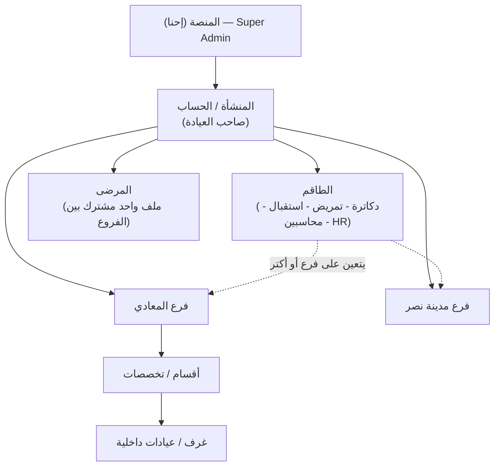
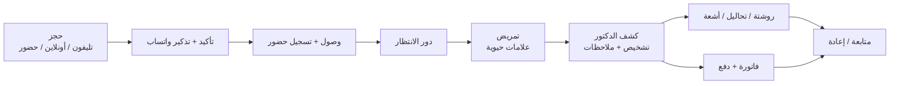

# عيادتي — الخطة الرئيسية للمنتج (Product Master Plan)

> الملف ده **من غير أي تفاصيل تقنية**. الهدف: نتفق على **المنتج** نفسه، وبعد كده نقرر التقنية.

---

## 1. الرؤية

**نظام SaaS لإدارة المجموعات الطبية والعيادات الكبيرة اللي ليها أكتر من فرع.** صاحب العيادة يشوف ويتحكم في كل حاجة من مكان واحد: الفروع والدكاترة والموظفين والمرضى والفلوس.

**هنتميز في إيه (عشان ننافس، مش MVP):**
1. **تعدد الفروع من الأساس:** ملف المريض واحد في كل الفروع، والدكتور ممكن يشتغل في أكتر من فرع بجداول مختلفة.
2. **رحلة مريض كاملة:** من الحجز للدفع للمتابعة، مش مجرد "جدول مواعيد".
3. **صلاحيات دقيقة جدًا:** مين يشوف إيه، في أنهي فرع، ويعمل إيه.
4. **فلوس واضحة:** إيراد كل فرع وكل دكتور، ومستحقات الدكاترة تتحسب لوحدها، والمرتبات، والخزنة اليومية.
5. **سرعة الاستقبال:** حجز في أقل من 30 ثانية، وشاشة دور (Queue)، وتذكير واتساب.
6. **السيستم بيتشكل حسب التخصص:** أسنان، جلدية، أطفال... كل تخصص ليه نموذج كشف خاص بيه.

---

## 2. هيكل النظام (مين جوه مين)

| المستوى | يعني إيه |
| :--- | :--- |
| **المنصة** | إحنا: الاشتراكات، العملاء، الدعم الفني |
| **المنشأة** | حساب صاحب العيادة (مثلًا "مجموعة د. أحمد الطبية") |
| **الفرع** | مكان فعلي ليه عنوان ومواعيد وعطلات وأسعار خاصة بيه |
| **القسم / التخصص** | باطنة، أسنان، أطفال... |
| **الغرفة** | العيادة الداخلية اللي الدكتور بيكشف فيها (مفيدة عشان نمنع التعارض) |

---

## 3. الأدوار والصلاحيات

### الأدوار الافتراضية
| الدور | بيعمل إيه |
| :--- | :--- |
| **صاحب العيادة (Owner)** | كل حاجة في كل الفروع + الاشتراك + التقارير المالية |
| **مدير فرع** | كل حاجة في فرعه بس |
| **دكتور** | مواعيده، ومرضاه، والكشف والروشتة، ومستحقاته |
| **ممرض / ممرضة** | استقبال المريض جوه، والعلامات الحيوية، وتجهيزه للدكتور |
| **استقبال** | الحجز، والدور، وتسجيل المرضى، وتحصيل الفلوس |
| **محاسب** | الفواتير، والخزنة، والمصروفات، والمرتبات |
| **HR** | الموظفين، والحضور، والإجازات، والمرتبات |

### كل صلاحية بتتحدد بـ 3 حاجات
1. **العملية:** عرض / إضافة / تعديل / حذف / طباعة / تصدير.
2. **المكان:** كل الفروع / فروع معينة / فرعه بس.
3. **الملكية:** كل البيانات / بياناته هو بس (الدكتور يشوف مرضاه بس مثلًا).

> صاحب العيادة يقدر **يعمل أدوار جديدة** ويعدل أي دور. وكل عملية حساسة بتتسجل في **سجل نشاط (Audit Log)**: مين عمل إيه وإمتى.

---

## 4. رحلة المريض (قلب النظام)

كل خطوة فيها حالة واضحة، فصاحب العيادة يقدر يشوف **لحظيًا** حال كل فرع: كام واحد مستني، وكام واحد بيكشف، وكام واحد خلص.

---

## 5. الموديولات

**الرموز:** 🟢 لازم يبقى موجود في الإطلاق — 🔵 ميزة تنافسية في الإطلاق — ⚪ مرحلة لاحقة

### 5.1 المنشأة والفروع
- 🟢 بيانات المنشأة واللوجو، وإضافة فروع، ومواعيد وعطلات لكل فرع
- 🟢 الأقسام / التخصصات، والغرف
- 🔵 أسعار مختلفة لكل فرع
- ⚪ تقييم الفروع ومقارنتها ببعض

### 5.2 الطاقم (دكاترة / تمريض / استقبال / إداريين)
- 🟢 ملف كامل لكل واحد: البيانات، والمستندات، والدور، والفروع اللي بيشتغل فيها
- 🟢 **جدول الدكتور:** أيام وساعات لكل فرع، ومدة الكشف، وأقصى عدد كشوفات
- 🟢 الإجازات وطلبات الإجازة والموافقة عليها
- 🔵 الدكتور البديل لما الدكتور الأصلي ياخد إجازة، ونقل حجوزاته له
- ⚪ تقييم أداء الطاقم

### 5.3 المرضى
- 🟢 ملف موحد: بيانات، ورقم قومي، وتاريخ ميلاد، وفصيلة دم، وحساسية، وأمراض مزمنة، وأدوية مستمرة
- 🟢 منع التكرار (التعرف على المريض من رقم التليفون أو الرقم القومي)
- 🟢 **التايم لاين الطبي:** كل الزيارات والروشتات والتحاليل والفواتير في مكان واحد
- 🔵 ملف عائلي (أب + أولاده تحت حساب واحد)
- 🔵 المرفقات: صور، وتحاليل، وأشعة
- ⚪ بوابة المريض (يشوف روشتاته ونتايجه)

### 5.4 المواعيد والدور
- 🟢 كاليندر لكل دكتور / فرع / غرفة، ومنع التعارض، واحترام الإجازات والعطلات
- 🟢 أنواع الزيارة: كشف، وإعادة، واستشارة، وجلسة، وكل نوع ليه مدته وسعره
- 🟢 الحالات: محجوز، ومؤكد، ووصل، ومستني، وبيكشف، وخلص، ولم يحضر، وملغي
- 🟢 **شاشة الدور (Queue)** في إيد المساعد: يرتب بالسحب والإفلات، ويحط الوقت المتوقع لكل حالة، والنظام يحسب معاد كل مريض لوحده + شاشة عرض في صالة الانتظار
- 🔵 تحديث المريض بشكل تلقائي بمعاده المتوقع لو الدور اتأخر أو اتقدم
- 🔵 الحجز المتكرر (جلسات علاج طبيعي مثلًا) — **موجود في Purexo فعلًا**
- 🔵 قايمة انتظار: لو موعد اتلغى، أول واحد في القايمة يتبلغ
- 🔵 تذكير واتساب / SMS، وتأكيد الحضور من الرسالة
- ⚪ صفحة حجز أونلاين لكل عيادة

### 5.5 الكشف والسجل الطبي
- 🟢 نموذج الكشف: الشكوى، والتاريخ المرضي، والفحص، والتشخيص، والخطة
- 🟢 العلامات الحيوية (يدخلها التمريض)
- 🔵 **نماذج كشف حسب التخصص:** أسنان (رسمة الأسنان)، وأطفال (منحنى النمو)، ونسا (متابعة الحمل)...
- 🔵 قوالب جاهزة للدكتور (تشخيصات وملاحظات متكررة بضغطة واحدة)
- ⚪ أكواد التشخيص الدولية (ICD-10) للتأمين

### 5.6 الروشتة والطلبات
- 🟢 الروشتة: الدوا، والجرعة، والمدة، والتعليمات، وتتطبع بشكل احترافي بهيدر العيادة والفرع والدكتور
- 🟢 قاعدة أدوية، وروشتات مفضلة لكل دكتور
- 🔵 تكرار روشتة قديمة بضغطة واحدة، وتحذير لو الدوا فيه حساسية عند المريض
- 🔵 طلب تحاليل وأشعة وطباعتها
- 🔵 إرسال الروشتة للمريض على واتساب (PDF)
- ⚪ ربط مع معامل وصيدليات

### 5.7 الفواتير والمالية
- 🟢 فاتورة لكل زيارة: الخدمات، والخصم، والمدفوع، والباقي
- 🟢 طرق الدفع: كاش، وفيزا، ومحفظة، وآجل
- 🟢 **الخزنة اليومية لكل فرع:** فتح وقفل الوردية وتسليمها
- 🟢 المصروفات (إيجار، ومستلزمات، وغيره)
- 🔵 الباقات والعروض (مثلًا 10 جلسات بسعر مخفض) ورصيد المريض
- 🔵 التأمين وشركات التعاقد: نسبة تحمل، ومطالبات
- ⚪ الفاتورة الإلكترونية الحكومية

### 5.8 HR والمرتبات
- 🟢 **نظام أجر مرن لكل فرد:**
  - مرتب ثابت
  - نسبة من الكشوفات أو الخدمات
  - مبلغ ثابت على كل حالة
  - مزيج (ثابت + نسبة)
- 🟢 كشف المرتب الشهري: الأساسي + المستحقات + مكافآت − خصومات − سلف
- 🟢 الإجازات وأرصدتها
- 🔵 الحضور والانصراف، وخصم التأخير بشكل تلقائي
- 🔵 كشف مستحقات الدكتور التفصيلي (كل حالة بكام ونصيبه منها كام)
- ⚪ تصدير للبنك أو للتأمينات

### 5.9 المخزون (مستلزمات طبية)
- ⚪ أصناف، ورصيد لكل فرع، وتحويل بين الفروع، وتنبيه نقص، وصرف على الزيارة

### 5.10 التقارير ولوحة التحكم
- 🟢 لوحة صاحب العيادة: إيراد النهارده / الشهر لكل فرع، وعدد المرضى، ونسبة الحضور
- 🟢 تقارير: الإيراد حسب الدكتور / الفرع / الخدمة، والمرضى الجدد، ونسبة عدم الحضور، والمصروفات
- 🔵 مقارنة الفروع والدكاترة، وأوقات الذروة
- ⚪ تنبؤات وتحليلات متقدمة

### 5.11 التواصل
- 🔵 قوالب رسائل: تأكيد، وتذكير، ومتابعة، وتهنئة
- ⚪ حملات تسويقية للمرضى

---

## 6. طبقة الـ SaaS (البيزنس بتاعنا)

- **لوحة المنصة (إحنا):** العملاء، والاشتراكات، والتجارب المجانية، والدعم
- **باقات الاشتراك:** حسب عدد الفروع والدكاترة والموديولات (مثلًا: Basic / Pro / Enterprise)
- **التسجيل والتجهيز (Onboarding Wizard):** صاحب العيادة يسجل، ويضيف فروعه وطاقمه، ويبدأ في دقايق
- **فصل كامل** لبيانات كل عيادة عن التانية، ونسخ احتياطي
- **التطبيقات:** لوحة ويب / ديسكتوب (موجودة من Purexo)، وبعدين تطبيق موبايل للدكتور وصاحب العيادة

---

## 7. هنستفيد من Purexo في إيه

| من Purexo | هيبقى في عيادتي |
| :--- | :--- |
| Bookings (كاليندر، حجز متكرر، تفاصيل، حالات) | المواعيد والدور |
| Customers (ملف، إحصائيات، سجل حجوزات) | ملف المريض والتايم لاين |
| Technicians + Leaves | الطاقم والإجازات والجداول |
| Settings (أيام العمل، العطلات) | إعدادات الفرع |
| Layout (Sidebar، الهيدر، الجداول، الدايلوجات) | شكل النظام كله |
| — (جديد بالكامل) | الفروع، والصلاحيات، والكشف، والروشتة، والمالية، وHR، والتقارير، وطبقة الـ SaaS |

> **الخلاصة:** Purexo هيدينا **حوالي 30% من الشغل** (شكل النظام والمواعيد والملفات). الـ **70% الباقيين** هما اللي هيفرقونا عن المنافسين.

---

## 8. الترتيب المقترح للبناء

| المرحلة | المحتوى |
| :--- | :--- |
| **1. الأساس** | المنشأة، والفروع، والأقسام، والغرف، والأدوار والصلاحيات، وسجل النشاط |
| **2. الناس** | الطاقم وجداولهم، والمرضى |
| **3. التشغيل** | المواعيد والدور وشاشة الانتظار |
| **4. الطبي** | الكشف، والسجل الطبي، والروشتة والطباعة |
| **5. الفلوس** | الفواتير، والخزنة، والمصروفات |
| **6. HR** | نظام الأجر، والمرتبات، والإجازات، والحضور |
| **7. التحكم** | لوحة صاحب العيادة والتقارير |
| **8. SaaS** | الباقات، والتسجيل، ولوحة المنصة |
| **9. النمو** | واتساب، وحجز أونلاين، وموبايل، ومخزون، وتأمين |

---

## 9. هنتناقش في إيه بالترتيب (واحدة واحدة)

1. ✅ **هيكل المنشأة والفروع والصلاحيات**
2. ✅ **الطاقم وجداول الدكاترة**
3. ✅ **ملف المريض**
4. ✅ **المواعيد والدور**
5. ✅ **الكشف والروشتة والطباعة**
6. ✅ **الفلوس والفواتير والخزنة اليومية**
7. ✅ **نظام الـ HR، حساب أجور الدكاترة والمرتبات**
8. ✅ **لوحة التحكم والتقارير**
9. ✅ **بيزنس الـ SaaS وباقات الاشتراك**

> **تم الانتهاء من جميع القرارات الأساسية واعتماد وثيقة المنتج بالكامل!**

---

## 10. سجل القرارات

### ✅ القرار 1: هيكل المنشأة والصلاحيات
| الموضوع | القرار |
| :--- | :--- |
| ملف المريض | **ملف واحد في كل الفروع**، وكل زيارة مكتوب عليها الفرع اللي اتعملت فيه |
| الدكتور والفروع | يشتغل في **أكتر من فرع**، ويبقى ليه **جدول وسعر كشف مختلف في كل فرع** |
| الصلاحيات | **أدوار افتراضية جاهزة**، وصاحب العيادة يقدر يعمل أدوار جديدة ويحدد صلاحيات كل دور **في كل فرع** |
| التخصصات | **مجمع متعدد التخصصات**: نموذج كشف عام في الأول، ونماذج للتخصصات الأشهر بعدين |
| مستوى الفرع | بيانات الفرع، ومواعيده وعطلاته، والأقسام، والغرف — مفيش حاجة زيادة مطلوبة دلوقتي |

### ✅ القرار 2: الطاقم والجداول
| الموضوع | القرار |
| :--- | :--- |
| طريقة الحجز | **بالدور**، والدور **في إيد المساعد / الاستقبال**: هو اللي بيرتب الدور وبيحدد **الوقت المتوقع لكل حالة** |
| الدكاترة | نوعين: **دكتور صاحب العيادة** (دور المالك + دور الدكتور في نفس الوقت)، و**دكاترة موظفين** |
| أجر الدكتور | **مرن**: مرتب ثابت، أو على عدد الكشوفات، أو أي طريقة تانية (نسبة، مزيج...)، وبيتحدد لكل دكتور في كل فرع |
| التمريض | **بيخدم الفرع كله** من غير تعيين على دكتور |
| الإجازات | الموظف يطلب من حسابه ← مدير الفرع يوافق ← لو دكتور عنده حجوزات، النظام ينبه ويقترح بديل |
| الحسابات | **كل الطاقم ليهم حسابات** حسب صلاحياتهم، والشخص الواحد ينفع يبقى ليه أكتر من دور |

> **اللي ده بيغيره في المنتج:** شاشة الدور بقت أهم شاشة في النظام. المساعد يرتب بالسحب والإفلات، ويحط مدة تقديرية لكل حالة، والنظام يحسب **المعاد المتوقع لكل مريض** لوحده، ويبعتهوله (ويحدثه لو الدور اتأخر).

### ✅ القرار 3: ملف المريض
| الموضوع | القرار |
| :--- | :--- |
| المساعد والاستقبال | **نفس الدور**، وبيخدموا الفرع كله (يمسكوا دور أي دكتور في الفرع) |
| التسجيل | **سريع**: الاسم + التليفون، والباقي يتكمل بعدين من الاستقبال أو التمريض |
| التعرف على المريض | التليفون **ممكن يتكرر** (العيلة بتشترك في رقم)، وكل مريض ليه **رقم ملف** خاص بيه، والنظام ينبه لو فيه مريض شبهه |
| التاريخ الطبي | **أي دكتور في المنشأة يشوفه كله**، وكل دكتور يقدر يكتب **ملاحظات خاصة** محدش يشوفها غيره، و**كل فتح للملف بيتسجل** |
| الاستقبال | يشوف البيانات الشخصية والمواعيد والفواتير بس، **من غير الكشف والتشخيص** |
| مطلوب في الإطلاق | **ملف عائلي** + **مرفقات** (صور وتحاليل) مترتبة حسب التاريخ ومربوطة بالكشف اللي اتطلبت فيه + **رصيد المريض** (مديونية أو مقدم) ظاهر في ملفه |

### ✅ القرار 4: المواعيد وإدارة الدور
| الموضوع | القرار |
| :--- | :--- |
| قنوات الحجز | **الكل في إيد المساعد / الاستقبال حصراً**: هو اللي بيسجل الحجز سواء المريض حضر بنفسه (Walk-in) أو اتصل تليفونياً |
| شاشات صالة الانتظار (TV) | **غير مطلوبة حالياً**، التركيز بالكامل على شاشة المساعد وشاشة الدكتور |
| سياسة الإعادة والاستشارة | **نظام مرن وقابل للضبط**: لكل دكتور/عيادة تحديد سياسة (مثلاً: عدد كشوفات إعادة مجانية محدد خلال فترة زمنية X أيام، وما بعد ذلك بسعر مخفض أو كشف جديد)، والنظام يحسبها تلقائياً |
| رسائل وتنبيهات المريض (واتساب/SMS) | **مؤجلة لمرحلة قادمة** لتسريع الإطلاق، مع تصميم البنية لدعمها لاحقاً |

### ✅ القرار 5: الكشف والروشتة ومحرك الطباعة
| الموضوع | القرار |
| :--- | :--- |
| قاعدة الأدوية | **قاعدة أدوية شائعة مدمجة** للبحث السريع + إمكانية كتابة أي دواء جديد وحفظه في مفضلة العيادة فوراً |
| قوالب الروشتات | **نعم، قوالب بروتوكولات جاهزة** لكل دكتور (مثلاً: روشتة نزلات معوية، بروتوكول حشو عصب) بضغطة زر لملء الأدوية والجرعات وتوفير وقت الكشف |
| محرك طباعة الروشتة (ميزة تنافسية قوية) | **نظام معايرة لقالب الروشتة (Template Calibration)**: الطبيب يرفع صورة الروشتة/الهيدر المطبوع الخاص به، والنظام يتعامل بأبعاد ومساحة محددة (Bounding Box) لملء بيانات الكشف والأدوية بدقة داخل المكان المخصص لها |
| مقاس الورق | **مقاس A5 قياسياً** (حجم الروشتة المعتاد) مع دعم A4 إذا رغبت العيادة |
| التحاليل والأشعة المتقدمة والعلامات الحيوية | **مؤجلة حالياً** للتركيز التام على سرعة الكشف والروشتة وطباعتها |

### ✅ القرار 6: الفواتير والخزنة اليومية
| الموضوع | القرار |
| :--- | :--- |
| توقيت الدفع | **مرن بالكامل**: الاستقبال يقدر يحصل قبل الكشف أو بعده، مع إمكانية دفع جزئي وتسجيل الباقي كمديونية على المريض |
| نظام الخزنة (Cash Drawer) | **نظام ورديات وشفتات (Shifts)**: موظف الاستقبال يفتح الوردية برصيد عهدة ويقفلها آخر الشفت بمطابقة الكاش والفيزا مع النظام لتسليم العهدة بدقة |
| المصروفات النثرية اليومية | **نعم، تسجيل خروج مصروفات فورية من الخزنة** مع ذكر السبب والمستلم لتسوية الحساب اليومي للفرع بدقة |
| طرق الدفع | **تصنيفات حسابية فقط (Ledger Tags)**: لتحديد نوع الدفع (كاش، فيزا/POS، محافظ إلكترونية، آجل) بدون الحاجة لبوابات دفع إلكترونية معقدة |
| إيصال الدفع (Receipt) | **عند الطلب فقط**: لا يشترط طباعة إيصال ورقي لكل مريض إلا إذا طلب ذلك |

### ✅ القرار 7: الـ HR وحساب أجور الدكاترة والمرتبات
| الموضوع | القرار |
| :--- | :--- |
| محرك حساب أجر الدكتور | **عقد مالي محدد لكل دكتور بكل فرع**: النظام يدعم بدقة (راتب ثابت + مكافآت، أو مبلغ محدد لكل كشف، أو نسبة مئوية، أو مزيج) والنظام يحسب المستحقات تلقائياً بناءً على الحالات المنفذة |
| تصفية حساب الدكتور | **مرن بالكامل وفي أي وقت**: تصفية فورية (يومية/أسبوعية/شهرية) بضغطة زر وإصدار سند صرف/تسوية حساب وتصفير أو ترحيل الرصيد |
| بنود المرتبات الإضافية | **تسجيل شامل ومبسط**: سلفيات، مكافآت، خصومات/جزاءات — كلها تتسجل بسبب وتاريخ وتتخصم أو تضاف تلقائياً في مسير مرتبات نهاية الشهر |
| الحضور والانصراف | **تسجيل يدوي سريع وسهل**: (حاضر / غائب / متأخر) من شاشة موظفي الفرع بدون تعقيدات ربط ماكينات بصمة |

### ✅ القرار 8 و 9: لوحة التحكم والتقارير وبيزنس الـ SaaS
| الموضوع | القرار |
| :--- | :--- |
| لوحة صاحب العيادة (Executive Dashboard) | **مؤشرات حيوية فورية**:  1. إجمالي إيراد اليوم والشهر (لكل فرع ومجمع للمنشأة كلها) 2. صافي أرباح العيادة بعد خصم مستحقات الدكاترة والمصروفات 3. إجمالي مديونيات المرضى غير المحصلة 4. عدد الكشوفات وحالات الحضور والانتظار اللحظية في الفروع |
| تصدير التقارير | **دعم كامل للتصدير إلى Excel و PDF** لجميع الجداول والتقارير (الفواتير، كشوفات المرتبات، قائمة المرضى) |
| باقات الاشتراك (SaaS Tiers) | **باقات مدرجة حسب الحجم**:  - **باقة العيادة الفردية**: فرع واحد وعدد دكاترة محدد - **باقة المجمع الطبي الكبير**: فروع متعددة ودكاترة متعددين بصلاحيات فروع متقدمة |
| النسخ الاحتياطي اليدوي | **مؤجل حالياً** والاعتماد على البنية التحتية للسيرفرات |

---

## 11. خطة نظام تسجيل الدخول والصلاحيات (Authentication & RBAC Plan)

### 11.1 تدفق الدخول وتحديد الهوية (Auth Flow):
1. **بيانات الاعتماد:** تسجيل الدخول بـ (رقم الهاتف أو البريد الإلكتروني + كلمة المرور).
2. **التعرف التلقائي:** النظام يتعرف تلقائياً على حساب المنشأة الطبية والفرع التابع له المستخدم بدون الحاجة لإدخال كود منشأة يدوي.
3. **تعدد الفروع والفرع النشط (Branch Context):**
   - المستخدم التابع لفرع واحد: يدخل على فرعه المحدد فوراً.
   - المالك أو الدكتور المسجل في أكثر من فرع: يدخل على الفرع الافتراضي، مع إتاحة كبسولة سريعة في الهيدر (Branch Switcher) للتبديل بين الفروع بضغطة زر وتحديث كافة البيانات والشاشات فوراً للفرع المختار.

### 11.2 تحميل الصلاحيات والتحكم في الواجهة (Permission Loading & Guards):
1. عند نجاح الـ Login، يتم جلب ملف المستخدم كاملاً متضمناً (الدور Role، وقائمة الصلاحيات Permissions، والفروع المصرح له بها).
2. **التحكم في القائمة الجانبية (Dynamic Sidebar Filtering):** كل عنصر في السايد بار مربوط بصلاحية محددة؛ لا تظهر في القائمة إلا الشاشات المسموح بها لدور المستخدم الحالي.
3. **حماية المسارات (Route Guards):** منع أي مستخدم من الوصول المباشر لأي مسار عبر كتابة الـ URL إذا كان دوره لا يملك الصلاحية (مثلاً: منع الاستقبال من دخول إعدادات الفروع أو التقارير المالية).

### 11.3 تصميم واجهة صفحة الدخول (Login UI Aesthetics):
- مبنية بنسبة 100% وفقاً للـ Design System المعتمد (Warm Layered Minimalism):
  - خلفية أوف وايت ناعمة ().
  - كارت دخول عائم بانحناء عريض  وبوردر نظيف خفيف.
  - لوجو عيادتي الرسمي بالتيراكوتا والأسود في منتصف أعلى الكارت.
  - حقول إدخال عصرية (كبسولات ناعمة بارتفاع 50px).
  - زرار تسجيل دخول عريض بلون التيراكوتا () مع حالة تحميل سلسة (Loading indicator).
