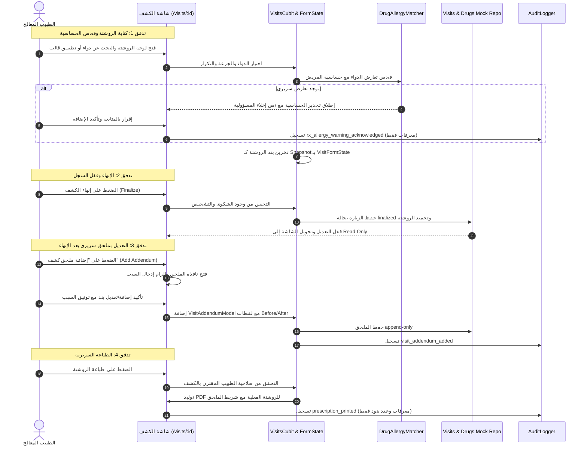
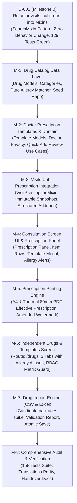

# خطة التنفيذ الشاملة — F-04b: كتالوج الأدوية والوصفات الجاهزة والروشتة السريرية (Drugs, Templates & Prescriptions)

> **المرجعية المعمارية:** مبنية على متطلبات `docs/plans/PKG-B-visit-prescription-drugs.md`، `docs/plans/F-04a-consultation.md`، `docs/plans/F-05-cashier-shifts.md`، `docs/DECISIONS.md`، و`docs/plans/handover/WHAT_IS_MISSING.md`.  
> **طبيعة المنتج:** نظام SaaS سريري متعدد المستأجرين (Multi-Tenant Clinic SaaS) خاضع لتخصيص الإعدادات لكل عميل وفرع دون تغيير الكود أو افتراض قيم صلبة خاصة بعميل بعينه.  
> **البيئة والمبادئ:** Flutter (Desktop/Web/Tablet) — Clean Architecture — Cubit واحد لكل فيتشر — Mock In-Memory بالكامل (بدون Dio وبدون backend) — صفر نصوص Hardcoded (تطابق 100% بين `ar-EG` و `en-US`) — صفر `DateTime.now()` (استخدام `CairoTimeHelper.now()` حصراً) — صفر `setState` و صفر Code-gen — حوكمة صارمة بصلاحيات Fail-Closed وSession-derived actors.  
> **توقيت التنفيذ والاعتمادية:** يبدأ تنفيذ هذه الفيتشر بالكامل بعد اكتمال F-05 بنسبة 100% (بما فيه M-6b).  
> **تاريخ آخر تدقيق برمجي وميداني:** 13-11-2026.

---

## مراجعة ذاتية للخطة (وفق §7 من AGENT_OPERATING_GUIDE)

| البند | التحقق في هذه الخطة |
| :--- | :--- |
| **بدون backend / بدون Dio** | مستودع `DrugsMockRepoImpl` في الذاكرة بالكامل يغذي الأدوية والتصنيفات والوصفات الجاهزة دون أي اتصال شبكي أو Dio أو Endpoints. |
| **بدون Entities** | الاعتماد على Models مباشرة: `DrugModel`, `DrugCategoryModel`, `PrescriptionTemplateModel`, `PrescriptionTemplateItemModel`, `PrescriptionItemModel`, `VisitAddendumModel` مع الحقول كلها Nullable. |
| **كل الحقول nullable** | جميع الحقول في الـ Models من النوع Nullable، مع استرجاع قيم افتراضية آمنة عند المعالجة (`fromJson`, `toJson`, `copyWith`, `props`). |
| **Cubit واحد لكل فيتشر** | `DrugsCubit` يدير صفحة الأدوية والوصفات الجاهزة والمرادفات المستقلة (`/drugs`). الروشتة السريرية داخل شاشة الكشف (`/visits/:id`) تُدار حصراً وبصورة ذرية عبر `VisitsCubit` القائم بالفعل لمنع ازدواج الـ Cubits وتضارب الحفظ. |
| **تخصيص الطباعة لكل فرع (SaaS)** | الاعتماد التام على بنية F-05 في الطباعة: قراءة إعدادات الطباعة للروشتة (`prescriptionPrintFormat`: A4 أو حراري 80 مم) من `CompanySettingsModel` للفرع النشط، مع السقوط الآمن على A4، وبدون بناء محرك طباعة موازٍ. |
| **ترويسة المستندات الحيادية** | اسم العيادة والشعار والهاتف والعنوان تُقرأ ديناميكياً من إعدادات الفرع النشط؛ صفر أسماء عيادات أو بيانات عملاء مكتوبة في الكود. |
| **صفر نصوص Hardcoded** | كل النصوص تستخدم بادئات الترجمة `drugs_`, `rx_`, `addendum_` بتطابق 100% بين `ar-EG.json` و `en-US.json`. |
| **صفر `DateTime.now()`** | استخدام `CairoTimeHelper.now()` القابل للحقن في كامل المنظومة بما فيها تواريخ إنشاء الأدوية، توقيت الروشتة، وتوقيت الـ Addendum. |
| **Audit Fail-Closed** | تسجيل أحداث: `drug_created`, `drug_updated`, `drug_archived`, `drug_quick_added`, `drug_reviewed`, `prescription_template_created`, `prescription_template_updated`, `prescription_template_deleted`, `visit_addendum_added`, `drugs_imported_batch`, `rx_allergy_warning_acknowledged`, `allergy_aliases_updated`, `prescription_printed` بالمعرفات والأعداد فقط وخلو تام من أي نصوص سريرية أو تشخيصات. وصفر تسجيل عند الفشل. |
| **المشتقات من الجلسة حصراً** | هوية الطبيب المنشئ للدواء أو كاتب الروشتة أو مسجل الملحق تُشتق تلقائياً من `CurrentUserProvider / SessionCubit`. |
| **العزل وحيادية النطاق** | كتالوج الأدوية والتصنيفات عام ومشترك لجميع فروع المنشأة، والوصفات الجاهزة خاصة بالطبيب صاحبها حصراً (لا يراها ولا يعدلها طبيب آخر). |
| **ثبات الروشتة (Snapshot)** | بنود الروشتة تُخزن كـ Deep Snapshot داخل الكشف؛ تعديل أو أرشفة الدواء في الكتالوج لاحقاً لا يمس أي روشتة تاريخية سابقة. |

---

## 1. التدقيق الميداني للـ Seed والبيانات القائمة (Field Seed Audit)

### 1.1 فحص الكشفين VIS-002 و VIS-003 مقابل قاعدة `FinalizeVisitUseCase`

تم فحص الكود الفعلي لـ `visits_mock_repo_impl.dart` و `finalize_visit_use_case.dart` برمجياً وكانت النتائج كالتالي:

1. **قاعدة التحقق في `FinalizeVisitUseCase` (الأسطر 50-60):**
   ```dart
   final chiefComplaint = finalContent.chiefComplaint?.trim();
   final diagnosis = finalContent.diagnosis?.trim();
   if (chiefComplaint == null ||
       chiefComplaint.isEmpty ||
       diagnosis == null ||
       diagnosis.isEmpty) {
     return const Left(
       ValidationFailure(errMessage: 'visits_finalize_missing_fields'),
     );
   }
   ```
   **القاعدة الصارمة:** لا يجوز إنهاء أي كشف (`finalized`) دون وجود **شكوى المريض (`chiefComplaint`)** و**التشخيص الطبي (`diagnosis`)** بنصوص غير فارغة.

2. **البيانات المخزنة فعلياً في الـ Seed لكشفي VIS-002 و VIS-003:**
   - **الكشف `VIS-002` (الحجز `MED-104`):**
     - `status`: `VisitStatusEnum.finalized`
     - `chiefComplaint`: `null` ⚠️ (مخالفة لقاعدة الإنهاء)
     - `diagnosis`: `'نزلة معوية حادة مع جفاف خفيف'`
     - `vitals`: `null`
     - `treatmentPlan`: `'محلول معالجة الجفاف + مضاد للتقلصات مع راحة تامة'`
     - `patientName`: `'طارق عبد العزيز'`
   - **الكشف `VIS-003` (الحجز `MED-107`):**
     - `status`: `VisitStatusEnum.finalized`
     - `chiefComplaint`: `null` ⚠️ (مخالفة لقاعدة الإنهاء)
     - `diagnosis`: `'التهاب حاد في اللوزتين'`
     - `vitals`: `null`
     - `treatmentPlan`: `'مضاد حيوي مناسب للوزن + خافض حرارة عند اللزوم'`
     - `patientName`: `'يوسف إبراهيم المنصوري'`

3. **جدولة تنفيذ التصحيح (Deferred Corrective Seed Commit):**
   - التصحيح المقترح مقبول ومطلوب لسلامة الدومين السريري.
   - **القرار الصارم:** **لا يُنفَّذ هذا التصحيح الآن**، بل يُنفَّذ كأول commit تنفيذي في F-04b بعد اكتمال وتسليم F-05 بالكامل.
   - **محتوى الـ Commit التنفيذي الأول:**
     - في `VIS-002`: وضع `chiefComplaint: 'مغص معوي حاد وإسهال متكرر منذ يومين'` وتصحيح `patientName: 'طارق عبد الرحمن علي'` وهاتفه `'+201545678901'`.
     - في `VIS-003`: وضع `chiefComplaint: 'ألم شديد بالحلق وصعوبة في البلع وارتفاع في درجة الحرارة'`.
     - *(ملاحظة معمارية: تقتصر هذه التعديلات في الـ Commit المؤجل على تصحيح الـ complaint واسم المريض وهاتفه فقط؛ أما إضافة مسودة الروشتة والروشتة المنتهية فمكانها M-3 عند بناء تكامل الروشتة السريرية)*.

### 1.2 فحص اسم المريض في Snapshot الكشف مقابل `PatientsMockRepoImpl` و `BookingsMockRepoImpl`

1. **المطابقة الميدانية:**
   - **حالة الكشف `VIS-002`:**
     - اسم المريض في Snapshot الكشف بـ `VisitsMockRepoImpl`: `'طارق عبد العزيز'`.
     - اسم المريض في الحجز المرتبط `MED-104` بـ `BookingsMockRepoImpl`: `'طارق عبد الرحمن علي'`.
     - اسم المريض في ملف المريض `PAT-000104` بـ `PatientsMockRepoImpl`: `'طارق عبد الرحمن علي'` (وهاتف: `+201545678901`).
     - **التفسير:** هذا اختلاف/خطأ طباعي في الـ Seed عند إنشاء الـ Mock الأولي للكشف `VIS-002`، حيث كان ينبغي لـ Snapshot الكشف عند إنشائه أن يطابق تماماً اسم المريض في الحجز وملف المريض.
     - **التصحيح المجدول:** تعديل اسم المريض في `VIS-002` إلى `'طارق عبد الرحمن علي'` ورقم الهاتف إلى `'+201545678901'`.
   - **حالة الكشف `VIS-003`:**
     - اسم المريض في الكشف: `'يوسف إبراهيم المنصوري'`.
     - اسم المريض في الحجز `MED-107`: `'يوسف إبراهيم المنصوري'`.
     - اسم المريض في ملف `PAT-000102`: `'يوسف إبراهيم المنصوري'`.
     - النتيجة: **متطابق 100%**.

---

## 2. الوضع الحالي والصلاحيات والحوكمة السريرية

### 2.1 الصلاحيات الفعلية المعتمدة في `RoleDefinitionModel.defaultSystemRoles()`

تم التحقق البرمجي من الصلاحيات السريرية للأدوار السبعة القائمة:

| الدور الوظيفي (`RoleId`) | `issuePrescription` | `viewConsultationNotes` | `editMedicalDiagnosis` | ملاحظات الحوكمة السريرية |
| :--- | :---: | :---: | :---: | :--- |
| **المالك (`owner`)** | ❌ (مباشر) | ❌ (مباشر)* | ❌ (مباشر) | *المالك يملك صلاحيات إدارية عامة عبر الـ Wildcard بالـ `PermissionEvaluator`، ولكن لا يمكنه ممارسة صلاحيات سريرية مقترنة بطبيب كشف إلا إذا كان معيناً كطبيب ومقترناً بكشف. |
| **مدير الفرع (`branch_manager`)** | ❌ | **✔️ نعم** | ❌ | يملك حق قراءة ملاحظات الكشف والروشتة لأغراض الإشراف الإداري (Read-Only) دون إمكانية التعديل. |
| **المدير الطبي (`medical_director`)** | ❌ | **✔️ نعم** | ❌ | إشراف سريري كامل؛ يقرأ تفاصيل الكشف وملاحظاته وروشتاته (Read-Only) دون التعديل على كشوفات الأطباء الآخرين. |
| **طبيب (`doctor`)** | **✔️ نعم** | **✔️ نعم** | **✔️ نعم** | الطبيب يملك الصلاحيات السريرية الثلاث كاملة، لكن التطبيق مقيد بشرط الفحص الميداني: `doctorId == currentUserId.linkedDoctorId`. |
| **تمريض (`nurse`)** | ❌ | ❌ | ❌ | يملك `viewMedicalRecordDiagnostics` و `recordVitals` فقط؛ ومحجوب تماماً عن قراءة ملاحظات الكشف والروشتة لمنع تسريب خصوصية العلاج. |
| **استقبال (`reception`)** | ❌ | ❌ | ❌ | محجوب تماماً عن كافة الملاحظات والروشتات السريرية؛ يقتصر دوره على الحجز والدور والخزينة. |
| **محاسب (`accountant`)** | ❌ | ❌ | ❌ | محجوب تماماً عن الشق السريري. |
| **مسؤول موارد بشرية (`hr`)** | ❌ | ❌ | ❌ | محجوب تماماً عن الشق السريري. |

### 2.2 القواعد الحاكمة للروشتة والطباعة:
1. **قراءة الروشتة:** تخضع لصلاحية `viewConsultationNotes`. كل من يملك هذه الصلاحية (الطبيب، المدير الطبي، مدير الفرع) يمكنه استعراض الروشتة بصيغة العرض فقط (Read-Only) لمن لا يملك حق التعديل.
2. **إصدار وتعديل الروشتة:** محصور حصراً بالطبيب المقترن بالكشف الجاري:
   - شرط الصلاحية: `StaffPermissionEnum.issuePrescription`.
   - شرط النطاق السريري: `visit.doctorId == sessionUser.linkedDoctorId`.
   - حالة الكشف: الكشف في حالة `inProgress` فقط (يُقفل التعديل نهائياً عند `finalized`).
3. **طباعة الروشتة السريرية:**
   - **القرار المقفول:** محصورة بطبيب الكشف حصراً (`issuePrescription` + `visit.doctorId == sessionUser.linkedDoctorId`) لضمان تسليم الروشتة المطبوعة مباشرة للمريض من يد الطبيب المعالج داخل غرفة الفحص.
   - يتم تسجيل حدث تدقيق أمني `prescription_printed` عند كل عملية طباعة.
   - **بند لاحق موثق:** استحداث صلاحية مستقلة `printPrescription` في حال رغب العميل مستقبلاً في تمكين الاستقبال من إعادة طباعة الروشتات الصادرة.
4. **الصلاحية الحصرية لكتالوج الأدوية والمرادفات:**
   - `StaffPermissionEnum.manageDrugCatalog`: تمنح حصراً للمالك والمدير الطبي.
   - تشمل: إضافة وتعديل وأرشفة الأدوية، إدارة التصنيفات، مراجعة واعتماد الأدوية المضافة سريعاً، تحرير مرادفات الحساسية (`aliases`)، واستيراد ملفات الأدوية.
   - **قاعدة حاسمة:** تحرير مرادفات الحساسية يخضع حصراً لـ `manageDrugCatalog` (ولا يجوز ربطه بـ `manageMedicalServices` أو `accessSettings`).

---

## 3. تصميم الـ Models والـ State والتحقق السريري

### 3.1 تصميم كائنات البيانات (Models) والـ Enums — جميع الحقول Nullable مع `fromJson/toJson/copyWith/==`

```dart
// Enums النظام الدوائي والسريري
enum ReviewStatusEnum {
  pending,
  approved,
  rejected,
  merged;

  String toJson() => name;
  static ReviewStatusEnum? fromJson(String? value) {
    if (value == null) return null;
    return ReviewStatusEnum.values.firstWhere(
      (e) => e.name == value,
      orElse: () => ReviewStatusEnum.pending,
    );
  }
}

enum AddendumChangeTypeEnum {
  dose,
  frequency,
  duration,
  instructions,
  discontinue,
  add,
  diagnosis;

  String toJson() => name;
  static AddendumChangeTypeEnum? fromJson(String? value) {
    if (value == null) return null;
    return AddendumChangeTypeEnum.values.firstWhere(
      (e) => e.name == value,
      orElse: () => AddendumChangeTypeEnum.instructions,
    );
  }
}

enum DrugSourceEnum {
  preset,
  custom,
  imported,
  quickAdd;

  String toJson() => name;
  static DrugSourceEnum? fromJson(String? value) {
    if (value == null) return null;
    return DrugSourceEnum.values.firstWhere(
      (e) => e.name == value,
      orElse: () => DrugSourceEnum.preset,
    );
  }
}

// 1. كائن الدواء في الكتالوج العام
class DrugModel extends Equatable {
  final String? id;
  final String? name; // الاسم التجاري (إلزامي منطقياً عبر DrugNameValidator)
  final String? scientificName; // الاسم العلمي / المادة الفعالة (اختياري)
  final String? categoryId; // معرّف التصنيف
  final String? concentration; // التركيز (مثل: 500mg, 1g, 5mg/5ml)
  final String? defaultDosage; // الجرعة المقترحة (مثل: قرص واحد)
  final String? defaultFrequency; // التكرار المقترح (مفتاح ترجمة أو نص حر)
  final String? defaultDuration; // المدة المقترحة (مفتاح ترجمة أو نص حر)
  final String? description; // ملاحظات أو تعليمات عامة
  final String? manufacturer; // اسم الشركة المصنعة كنص
  final bool? isActive; // نشط أو مؤرشف (Soft Delete)
  final bool? isQuickAdded; // هل أضيف سريعاً من شاشة الكشف؟
  final ReviewStatusEnum? reviewStatus; // pending, approved, rejected, merged
  final DrugSourceEnum? source; // preset, custom, imported, quickAdd
  final String? createdByUserId; // هوية المستخدم المنشئ للدواء
  final DateTime? createdAt; // توقيت الإنشاء عبر CairoTimeHelper
  final String? reviewedByUserId; // هوية المعتمد
  final DateTime? reviewedAt; // توقيت الاعتماد
}

// 2. تصنيف الأدوية
class DrugCategoryModel extends Equatable {
  final String? id;
  final String? nameAr;
  final String? nameEn;
  final String? description;
  final bool? isActive;
}

// 3. بروتوكول الوصفة الجاهزة الخاص بالطبيب
class PrescriptionTemplateModel extends Equatable {
  final String? id;
  final String? doctorId; // معرّف الطبيب المالك حصراً (عزل الخصوصية)
  final String? name; // اسم الوصفة (مثل: بروتوكول نزلة معوية)
  final String? description;
  final List<PrescriptionTemplateItemModel>? items;
  final bool? isActive;
  final DateTime? createdAt;
  final DateTime? updatedAt;
}

// 4. بند الدواء داخل الوصفة الجاهزة
class PrescriptionTemplateItemModel extends Equatable {
  final String? drugId;
  final String? drugName;
  final String? scientificName;
  final String? concentration;
  final String? dosage;
  final String? frequency;
  final String? duration;
  final String? instructions;
  final int? orderIndex;
}

// 5. بند الروشتة السريرية داخل الكشف (Deep Immutable Snapshot)
class PrescriptionItemModel extends Equatable {
  final String? id; // معرّف البند داخل الكشف
  final String? drugId; // معرّف الدواء الأصلي بالكتالوج
  final String? tradeName; // لقطة الاسم التجاري
  final String? scientificName; // لقطة المادة الفعالة
  final String? concentration; // لقطة التركيز
  final String? dosage; // الجرعة المقررة للحالة
  final String? frequency; // التكرار النهائي المعروض
  final String? frequencyPreset; // خيار التكرار الجاهز من القائمة (Preset)
  final String? frequencyCustom; // التكرار المخصص المكتوب حراً (Custom)
  final String? duration; // المدة النهائية المعروضة
  final String? durationPreset; // خيار المدة الجاهزة من القائمة (Preset)
  final String? durationCustom; // المدة المخصصة المكتوبة حراً (Custom)
  final String? instructions; // تعليمات خاصة بالصرف
  final int? orderIndex; // ترتيب العرض في الروشتة
  final DateTime? createdAt;
}

// 6. ملحق التعديل بعد الإنهاء (Clinical Visit Addendum)
class VisitAddendumModel extends Equatable {
  final String? id;
  final String? visitId; // الكشف المرتبط
  final String? doctorId; // طبيب الكشف صاحب التعديل
  final String? doctorName; // اسم الطبيب المشتق
  final DateTime? createdAt; // توقيت التعديل الموثق
  final String? reason; // سبب التعديل الإلزامي
  final AddendumChangeTypeEnum? changeType; // dose, frequency, duration, instructions, discontinue, add, diagnosis
  final String? affectedItemId; // معرّف البند المتأثر
  final PrescriptionItemModel? oldItemSnapshot; // لقطة ما قبل التعديل
  final PrescriptionItemModel? newItemSnapshot; // لقطة ما بعد التعديل
  final String? diagnosisBefore; // لقطة التشخيص الطبي قبل التعديل
  final String? diagnosisAfter; // لقطة التشخيص الطبي بعد التعديل
  final String? notes; // ملاحظات سريرية توضيحية
}
```

### 3.2 قوائم التكرار والمدة الجاهزة مع دعم الكتابة الحرة:
- **خيارات التكرار الجاهزة (Dropdown Presets):**
  - `rx_freq_once_daily`: "مرة واحدة يومياً" / "Once daily"
  - `rx_freq_twice_daily`: "مرتان يومياً (كل 12 ساعة)" / "Twice daily (every 12 hrs)"
  - `rx_freq_thrice_daily`: "3 مرات يومياً (كل 8 ساعات)" / "3 times daily (every 8 hrs)"
  - `rx_freq_four_times`: "4 مرات يومياً (كل 6 ساعات)" / "4 times daily (every 6 hrs)"
  - `rx_freq_as_needed`: "عند اللزوم" / "As needed (PRN)"
  - `rx_freq_before_meals`: "قبل الأكل" / "Before meals"
  - `rx_freq_after_meals`: "بعد الأكل" / "After meals"
  - `rx_freq_bedtime`: "قبل النوم" / "At bedtime"
- **خيارات المدة الجاهزة (Dropdown Presets):**
  - `rx_duration_3_days`: "3 أيام" / "3 days"
  - `rx_duration_5_days`: "5 أيام" / "5 days"
  - `rx_duration_7_days`: "أسبوع (7 أيام)" / "1 week (7 days)"
  - `rx_duration_10_days`: "10 أيام" / "10 days"
  - `rx_duration_14_days`: "أسبوعان (14 يوماً)" / "2 weeks (14 days)"
  - `rx_duration_1_month`: "شهر واحد" / "1 month"
  - `rx_duration_continuous`: "مستمر (علاج مزمن)" / "Continuous (Chronic)"
- **دعم الكتابة الحرة:** يتيح المكون اختيار أي قيمة جاهزة، أو كتابة نص مخصص في نفس الحقل بحرية تامة دون إجبار على القائمة.

### 3.3 حالة الـ Cubits وتكامل الـ State

#### 1. حالة `DrugsCubit` (`lib/features/drugs/presentation/manager/drugs_state.dart`):
```dart
class DrugsState extends Equatable {
  final RequestStatusEnum status;
  final List<DrugModel> drugs;
  final List<DrugCategoryModel> categories;
  final List<PrescriptionTemplateModel> templates;
  final List<MedicalCatalogItemModel> allergyItems; // عناصر الحساسية بالمرادفات
  final int activeTab; // 0: كتالوج الأدوية، 1: الوصفات الجاهزة، 2: الحساسية والمرادفات
  final String searchQuery;
  final String? selectedCategoryId;
  final String? reviewFilter; // 'all' | 'pending' | 'approved'
  final String? errMessage;
  final String? successMessage;
}
```

#### 2. التوسيعات على `VisitFormState` و `VisitsState` (`lib/features/visits/`):
- في `VisitFormState`:
  - `List<PrescriptionItemModel>? prescriptionItems`: بنود الروشتة الحالية بالكشف.
  - `List<VisitAddendumModel>? addenda`: الملاحق المعتمدة للكشف المنتهي.
  - `PrescriptionItemModel? editingItem`: البند الجاري تحريره في النموذج.
  - `bool isAllergyWarningDismissed`: هل تم إغلاق تحذير الحساسية يدوياً؟
- في `VisitsState`:
  - دعم مؤشرات الروشتة، قائمة الأدوية المقترحة أثناء البحث السريع، ومعالجة أخطاء الروشتة.

---

## 4. المحرك المعاد تصميمه لتحذير الحساسية الدوائية (Clinical Allergy Matcher)

### 4.1 تحديات التخزين الفعلي وقواعد المطابقة الصارمة:
1. **طبيعة البيانات القائمة:**
   حساسيات المريض في `PatientModel.allergies` هي نصوص حرة (`List<String>`) أدخلها المستخدم (مثل: `['حساسية بنسلين شديدة']` أو `['حساسية سلفا وأسبرين']`).

2. **قواعد التطبيع وخوارزمية مطابقة الكلمة الكاملة (`DrugAllergyMatcher.checkAllergy`):**
   - **قاعدة حاسمة:** **حذف قاعدة "مقطع مشترك ≥ 3 حروف" نهائياً**. المطابقة تتم حصراً على مستوى **الكلمة الكاملة (Full-Word Token Match)** بعد التطبيع الصارم، مع **حظر تام للمطابقة بالأجزاء داخل الكلمة (Strictly NO Intra-word Substring Matching)**.
   - **خطوات خوارزمية التطبيع والمطابقة:**
     - **الخطوة (أ) - التطبيع الصارم للنصوص (Strict Normalization):**
       1. تحويل كافة النصوص اللاتينية إلى أحرف صغيرة (lowercase).
       2. إزالة المسافات الزائدة في البداية والنهاية ودمج المسافات المتعددة (trim & collapse whitespace).
       3. إزالة كافة علامات التشكيل العربية (فَتْحَة، ضَمَّة، كَسْرَة، سُكُون، تَنْوِين، شَدَّة).
       4. توحيد الألفات (أ، إ، آ $\to$ ا)، توحيد الياء والياء المقصورة (ى $\to$ ي)، وتوحيد التاء المربوطة والهاء (ة $\to$ ه).
       5. تجريد الكلمات الشائعة (Stop-words Stripping):
          - العربية: `['حساسية', 'حساسيه', 'شديدة', 'شديده', 'من', 'ضد', 'تجاه', 'مرض']`.
          - الإنجليزية: `['allergy', 'allergic', 'severe', 'to', 'against']`.
       6. قواعد تجريد السوابق (Prefix Stripping Rules):
          - تجريد "ال" التعريف فقط إذا كان ما بعدها $\ge 3$ أحرف (مثل: `البنسلين` $\to$ `بنسلين`).
          - تجريد واو العطف "و" وحروف الجر "ب/ل" فقط عندما تسبق "ال" أو كلمات مستقلة، مع حماية صارمة للحروف الأصلية (Strict Guard) تمنع تجريد الحروف الجذرية للأدوية إطلاقاً (مثل: منع حذف "ب" من `بنسلين` أو `باراسيتامول`، ومنع حذف "ل" من `لوراتادين`).
       7. تجزئة النصوص (Tokenization):
          - التقسيم على علامات الترقيم الفاصلة (`/`, `-`, `+`, `،`, `,`, `(`, `)`).
          - التقسيم على الأرقام ووحدات الجرعات (`mg`, `g`, `ml`, `mcg`, `جم`, `ملغ`, `مل`) لفصل التراكيز عن الأسماء (مثل: تجزئة `Augmentin 1g` إلى `Augmentin`، وتجزئة `Amoxicillin/Clavulanate` إلى `Amoxicillin` و `Clavulanate`).
     - **الخطوة (ب) - الربط بعنصر الكتالوج (Catalog Item Lookup):**
       محاولة مطابقة كلمات نص الحساسية مع عناصر كتالوج الحساسية النشطة بعد تطبيع النصين، لجلب قائمة مرادفات المادة الفعالة والعائلة الدوائية (`aliases`).
     - **الخطوة (ج) - الفحص المتقاطع على الكلمة الكاملة (Word-Token Cross Matching):**
       مقارنة كل كلمة كاملة ناتجة عن تجريد نص الحساسية، وكلمات مرادفات عنصر الكتالوج المرتبط (`aliases`)، مع الكلمات الكاملة المكونة لـ:
       1. الاسم التجاري للدواء (`drug.name`).
       2. الاسم العلمي / المادة الفعالة (`drug.scientificName`).
     - **الخطوة (د) - منع التطابقات العشوائية والـ False Positives (No Intra-word Substring Matching):**
       - وجود مقطع من الحروف داخل كلمة أخرى لا يُعد تطابقاً نهائياً ما لم تكن الكلمة مطابقة كلياً أو مرادفاً صريحاً.
       - **أمثلة الـ False Positives المحظورة والمحمية باختبارات صريحة (بما فيها رموز اصطناعية Synthetic Tokens):**
         - دواء يحتوي اسمه على مقطع أحرف مشابه لحساسية مسجلة دون أن يكون نفس الكلمة أو مرادفاً لها:
           - فحص دواء تجريبي باسم `Aspartame / أسبارتام` ضد حساسية `'أسبرين'` $\to$ **لا تحذير** (رغم تشابه مقطع أ-س-ب-ر).
           - فحص دواء تجريبي باسم `Pension / بنسيون` ضد حساسية `'بنسلين'` $\to$ **لا تحذير** (رغم الاشتراك في 4 حروف متتالية: ب-ن-س-ي).
           - فحص مركب تجاري يحمل مقطع سلفا في سياق غير دوائي مثل `Sulfolane / سلفولان` ضد حساسية `'سلفا'` $\to$ **لا تحذير**.
           - رموز اصطناعية مركبة للاختبار الصارم: `سلفاتور_وهمي` ضد سلفا $\to$ **لا تحذير**؛ `بنسلاتين_وهمي` ضد بنسلين $\to$ **لا تحذير**؛ `Aspi_synthetic` ضد أسبرين $\to$ **لا تحذير**؛ `Penicil_mock` ضد بنسلين $\to$ **لا تحذير**.
       - **فحص صريح للمريض بلا حساسية مسجلة:**
         - مريض لديه `allergies: null` أو `allergies: []` $\to$ فحص أي دواء (Augmentin, Aspocid, Septrin, Omeprazole...) $\to$ **لا يظهر أي تحذير إطلاقاً**.
       - **توثيق الـ False Negatives المقبولة سريرياً:**
         - الأخطاء الإملائية الفادحة التي لا تغطيها مرادفات الكتالوج (Spelling typos).
         - الجموع الشاذة غير المدرجة أو التسميات العامية غير المعرفة (Unmapped colloquialisms).
         - وهنا يبرز الدور الحيوي لإخلاء المسؤولية السريرية وشريط التحذير الدائم.

3. **الـ Audit Log وقاعدة الخلو التام من النصوص الصحية (Zero Health Text in Audit):**
   - **قاعدة حاسمة:** **حذف صيغة `unmapped:${sanitizedSlug}` نهائياً**، لأنها تشتق من نص صحي سريري حساس.
   - **التسجيل الأمني المعتمد لحدث `rx_allergy_warning_acknowledged`:**
     - عند وجود عنصر كتالوج مرتبط:
       `allergyCatalogItemId: id` (مثل: `'CAT-ALL-001'`)
       مع `matchSource: 'catalog_item'`.
     - عند عدم وجود عنصر كتالوج مرتبط (مطابقة نص حر):
       `allergyCatalogItemId: null`
       مع `matchSource: 'free_text'`.
     - **حمولة الحدث (Payload) معرفات وحالات فقط:**
       `{'visitId': visitId, 'patientId': patientId, 'drugId': drugId, 'allergyCatalogItemId': catalogItemId, 'matchSource': matchSource}`.
     - **اختبار حتمي في الـ Test Suite:** التأكد عبر فحص برمجي صارم من أن حمولة التدقيق خالية تماماً من أي نص حساسية، أو أسماء أدوية، أو أي نصوص تشخيصية. وصفر تسجيل عند الفشل.

4. **الحالة السريرية للأسبرين ومضادات الالتهاب غير الستيرويدية (NSAIDs):**
   - **قاعدة حاسمة:** **حذف اختبار "Cataflam ضد حساسية الأسبرين = لا تحذير" نهائياً**؛ لتجنب تقنين معلومة سريرية غير مؤكدة (حيث أن مضادات الالتهاب غير الستيرويدية NSAIDs قد تسبب حساسية متقاطعة Cross-reactivity خطيرة مع الأسبرين لدى بعض المرضى).
   - **تعديل الحالة السلبية لمريم محمود (`PAT-000103` — حساسية سلفا وأسبرين: مخزنة كعنصرين منفصلين `['حساسية سلفا', 'حساسية أسبرين']`):**
     استبدال الحالة السلبية بدواء لا علاقة له إطلاقاً بالفئتين، وهو مثبط مضخة بروتون (Proton Pump Inhibitor - PPI) مثل `Omeprazole 20mg`:
     - صرف `Aspocid 75mg` (الاسم العلمي: `Acetylsalicylic acid / Aspirin`) $\to$ **يظهر تحذير الحساسية**.
     - صرف `Septrin` (الاسم العلمي: `Sulfamethoxazole` - متطابق مع مرادفات السلفا) $\to$ **يظهر تحذير الحساسية**.
     - صرف `Omeprazole 20mg` $\to$ **لا يظهر أي تحذير** (دون إبداء أي ادعاء تجاه فئة الـ NSAIDs).
   - **الالتزام السريري:** لا تضع الخطة أو الاختبارات أي تأكيد أو نفي للتحذير لفئة مضادات الالتهاب غير الستيرويدية (NSAIDs).
   - عنصر الكتالوج `CAT-ALL-007` ('مضادات الالتهاب غير الستيرويدية') يُترك **بدون أي مرادفات في الـ Seed** (`aliases: []`).
   - تسجيل مسألة الحساسية المتقاطعة بالكامل في قسم **الأسئلة المفتوحة** لمراجعتها بواسطة طبيب مرخص.

5. **طبيعة الـ Seed الدوائي كبيانات تجريبية غير علاجية (Mock Experimental Seed Disclaimer):**
   - كل أسماء الأدوية والمواد الفعالة والمرادفات في الـ Seed الدوائي كُتبت من معرفة عامة ولأغراض المحاكاة البرمجية والتطويرية فقط وليست مأخوذة من مرجع دوائي أو دستور أدوية رسمي معتمد.
   - يتم وسم كافة بيانات الـ Seed الدوائية بعلامة صريحة في الكود (في تعليق ترويسة ملف `drugs_mock_repo_impl.dart`، وحقل `source: DrugSourceEnum.preset`) وفي الخطة:
     **"بيانات تجريبية لأغراض الاختبار البرمجي فقط، وتحتاج مراجعة وتدقيق طبيب أو صيدلي مرخص قبل أي استخدام فعلي"**.
   - خلو تام في الترجمة (`ar-EG` و `en-US`) والواجهات من أي ادعاء بدقة أو موثوقية طبية للمعلومات المزروعة.
   - **لافتة التحذير الدائمة وإخلاء المسؤولية السريرية (Persistent Allergy Banner & Clinical Disclaimer):**
     - في شاشة الكشف السريري (`DoctorConsultationScreen`)، يتم عرض شريط دائم يوضح حساسيات المريض المسجلة مع إخلاء مسؤولية سريري صريح: *"تنبيه: محرك الحساسية أداة استرشادية مساعدة، وغياب التحذير لا يعني الأمان التام، والقرار السريري مسؤولية الطبيب المباشر."*
     - عند إضافة دواء متعارض، تفتح نافذة تأكيد تتطلب إقراراً صريحاً من الطبيب بالمتابعة، ويُسجل حدث `rx_allergy_warning_acknowledged` بالمعرفات فقط.

6. **دمج عناصر كتالوج الحساسية والأثر على الاختبارات القائمة:**
   - **الوضع الحالي لعناصر الـ Seed في `medical_catalog_mock_repo_impl.dart`:**
     - `CAT-ALL-001`: `'بنسلين'`
     - `CAT-ALL-002`: `'حساسية بنسلين شديدة'`
     - `CAT-ALL-003`: `'أسبرين'`
     - `CAT-ALL-004`: `'حساسية أسبرين'`
     - `CAT-ALL-005`: `'سلفا'`
     - `CAT-ALL-006`: `'حساسية سلفا'`
     - `CAT-ALL-007`: `'مضادات الالتهاب غير الستيرويدية'`
   - **إجراء الدمج:** دمج العناصر التكرارية (`CAT-ALL-002`, `CAT-ALL-004`, `CAT-ALL-006`) في أصولها النظيفة (`CAT-ALL-001`, `CAT-ALL-003`, `CAT-ALL-005`) مع ترحيل العبارات المدمجة إلى حقل `aliases`.
   - **حصر الاختبارات القائمة بالاسم وتأكيد عدم انكسارها:**
     1. `test/features/patients/patient_model_and_helpers_test.dart`:
        - `test('Initializes with seed allergies and chronic diseases')`: يفحص `items.length >= 10`، و `items.any((i) => i.name == 'بنسلين')` و `items.any((i) => i.name == 'سلفا')`. بعد الدمج، يتقلص عدد عناصر الحساسية من 16 إلى 13 (ما يزال $\ge 10$)، ويظل البنسلين والسلفا موجودين، فينجح الاختبار 100%.
        - `test('Searches items with Arabic normalization')`: يبحث عن `query: 'اسبرين'` ويتوقع مطابقة `'أسبرين'`، ويظل ناجحاً 100%.
        - `test('addCatalogItem adds new item and avoids duplicate insertions')`: يفحص إضافة عنصر جديد ولا يتأثر بالدمج.
     2. `test/features/patients/patient_dialogs_flow_test.dart`:
        - `test('Tags management: adds and removes allergies and chronic diseases')`: يفحص إضافة وحذف `'حساسية سلفا'` في قائمة نصوص الـ FormState، ولا يعتمد على معرّفات الـ Seed.
     3. `test/features/audit_logs/audit_logger_expansion_and_patient_access_test.dart`: لا يمس عناصر الحساسية.
   - **تأكيد عدم تأثر حساسيات المرضى (نصوص حرة):**
     حساسيات المرضى في `PatientModel.allergies` مخزنة كنصوص حرة (`List<String>`) مستقلة تماماً عن معرّفات الكتالوج (سارة: `['حساسية بنسلين شديدة']`، مريم: `['حساسية سلفا وأسبرين']`). دمج عناصر الكتالوج لا يعدل كائنات المرضى ولا نصوص الحساسية الخاصة بهم إطلاقاً.
   - **اختبار ثبات العرض (Regression Stability Test):**
     إضافة اختبار مؤتمت صريح يؤكد أن نصوص حساسيات المرضى تظهر في بطاقة المريض (`PatientProfileCard`) وشاشة الكشف السريري (`DoctorConsultationScreen`) بنفس نصوصها الأصلية دون أي تشوه أو تغيير بعد دمج عناصر الكتالوج.

7. **سيناريوهات الاختبار الإلزامية المحدثة على الـ Seed الفعلي:**
   - **سارة أحمد (`PAT-000101` — حساسية بنسلين شديدة):**
     - صرف `Augmentin 1g` (الاسم العلمي: `Amoxicillin` - متطابق مع مرادفات البنسلين) $\to$ **يظهر تحذير الحساسية**.
     - صرف `Amoxicillin 500mg` $\to$ **يظهر تحذير الحساسية**.
     - صرف `Paracetamol 500mg` $\to$ **لا يظهر أي تحذير**.
   - **مريم محمود (`PAT-000103` — حساسية سلفا وأسبرين):**
     - صرف `Aspocid 75mg` (الاسم العلمي: `Acetylsalicylic acid / Aspirin`) $\to$ **يظهر تحذير الحساسية**.
     - صرف `Septrin` (الاسم العلمي: `Sulfamethoxazole` - متطابق مع مرادفات السلفا) $\to$ **يظهر تحذير الحساسية**.
     - صرف `Omeprazole 20mg` (مثبط مضخة بروتون PPI) $\to$ **لا يظهر أي تحذير**.
   - **مريض بلا حساسية مسجلة (`allergies == null` أو فارغة):**
     - صرف أي دواء $\to$ **لا يظهر أي تحذير إطلاقاً**.
   - **فحص الكلمات المشتركة بحروف (False Positive Prevention):**
     - صرف دواء يحتوي اسمه على مقطع أحرف مشابه لحساسية مسجلة دون أن يكون نفس الكلمة أو مرادفاً لها (مثل `Aspartame` ضد أسبرين، أو `Pension` ضد بنسلين) $\to$ **لا يظهر أي تحذير**.

8. **بند تقنين معماري لاحق (Future Refactoring):**
   - توثيق أن المرحلة القادمة من المنظومة (خارج F-04b) يجب أن تنتقل لتخزين حساسيات المرضى كمعرفات عناصر كتالوج (`List<String> allergyCatalogItemIds`) بدلاً من النصوص الحرة لتفادي مشاكل عدم دقة الإدخال.

---

## 5. حوكمة الوظائف الحيوية: المرادفات، الإضافة السريعة، القوالب، والملاحق

### 5.1 حوكمة مرادفات الحساسية (Aliases Management):
- تُدار المرادفات عبر تبويب مستقل "الحساسية والمرادفات" بصفحة الأدوية (`/drugs`).
- تخضع حصراً لصلاحية `StaffPermissionEnum.manageDrugCatalog`.
- عند تعديل مرادفات أي عنصر، يُسجل فوراً حدث تدقيق أمني:
  `allergy_aliases_updated`
  الحمولة: `{'allergyCatalogItemId': id, 'aliasesCountBefore': count1, 'aliasesCountAfter': count2}`.

### 5.2 دورة حياة الدواء المضاف سريعاً (Quick-Add Drug Workflow):
1. **الدافع:** أثناء الكشف، قد يحتاج الطبيب إلى وصف دواء غير مدرج بالكتالوج ولا يملك صلاحية إدارة الكتالوج الكاملة.
2. **التنفيذ السريري:** يفتح الطبيب نافذة الإضافة السريعة، ويدخل الاسم والتركيز والمادة الفعالة.
3. **التحقق الصارم:** يمر المدخل بنفس قواعد `DrugNameValidator` (رفض الأرقام والرموز) ونفس كشف التكرار.
4. **فشل الإضافة:** إذا فشل التحقق أو أغلق الطبيب النافذة، **لا تضيع مسودة الروشتة الحالية إطلاقاً**.
5. **حالة المراجعة:** يحفظ الدواء موسوماً بـ `isQuickAdded: true` و `reviewStatus: 'pending_review'` ويسجل `createdByUserId`.
6. **اعتماد الكتالوج:** يظهر الدواء في صفحة الأدوية بعلامة برتقالية بارزة "بانتظار المراجعة"؛ ويقوم صاحب صلاحية `manageDrugCatalog` باتخاذ قرار:
   - **اعتماد (`approved`):** يصبح دواءً رسمياً في الكتالوج.
   - **دمج (`merged`):** دمجه في دواء قائم مع تحويل الروابط.
   - **أرشفة (`rejected` / `archived`):** أرشفة الدواء دون مساس بالروشتات السابقة.
7. **الـ Audit Log:**
   - عند الإضافة: `drug_quick_added` مع `{'drugId': id, 'doctorId': doctorId, 'visitId': visitId}`.
   - عند المراجعة: `drug_reviewed` مع `{'drugId': id, 'decision': decision, 'reviewedByUserId': userId}`.

### 5.3 تعامل الوصفات الجاهزة مع الأدوية المؤرشفة أو المحذوفة:
- إذا قام الطبيب بتطبيق وصفة جاهزة قديمة تحتوي على دواء تم تعطيله أو أرشفته لاحقاً:
  1. يقوم المحرك بتطبيق الأدوية النشطة السليمة فقط.
  2. يتم **تخطي الدواء المؤرشف تلقائياً** لمنع وصف علاج معطل.
  3. يظهر إشعار تنبيهي بارز للطبيب: *"تم تخطي {count} دواء مؤرشف من الوصفة الجاهزة، يرجى مراجعة الروشتة."*
  4. في شاشة إدارة القوالب، يتم وسم القالب بعلامة تحذيرية صفراء تدل على احتوائه بنوداً مؤرشفة تحتاج تحديثاً.

### 5.4 الملاحق السريرية بعد الإنهاء (Prescription & Diagnosis Addenda):
1. **تمثيل التعديل بهيكلية Before/After الشاملة:**
   لا يُخزن التعديل كنص حر فقط؛ بل ككائن `VisitAddendumModel` مدقق يحتوي:
   - `changeType`: خاضع للـ Enum الصريح `AddendumChangeTypeEnum`:
     - ملاحق الروشتة: `dose`, `frequency`, `duration`, `instructions`, `discontinue`, `add`.
     - ملحق التشخيص الطبي: `diagnosis`.
   - `oldItemSnapshot`: لقطة كاملة لبند الروشتة قبل التعديل (في ملاحق العلاج).
   - `newItemSnapshot`: لقطة كاملة لبند الروشتة بعد التعديل (في ملاحق العلاج).
   - `diagnosisBefore`: النص الأصلي للتشخيص قبل التعديل (في ملحق التشخيص).
   - `diagnosisAfter`: النص الجديد المعدل للتشخيص بعد التعديل (في ملحق التشخيص).
   - `reason`: السبب السريري الإلزامي قانونياً (يرفض الحفظ قطعياً إذا كان فارغاً).
2. **شروط وضوابط إنشاء الملحق السريري:**
   - **حالة الكشف:** الكشف منتهٍ حصراً (`visit.status == VisitStatusEnum.finalized`).
   - **شرط الطبيب المعالج:** محصور بطبيب الكشف الأصلي حصراً (`visit.doctorId == sessionUser.linkedDoctorId`).
   - **حوكمة الصلاحيات المنفصلة:**
     - ملاحق الروشتة تتطلب صلاحية: `StaffPermissionEnum.issuePrescription`.
     - ملحق التشخيص الطبي يتطلب صلاحية: `StaffPermissionEnum.editMedicalDiagnosis`.
     - وكلتا الصلاحيتين مشروطتان بكون المستخدم هو طبيب الكشف ذاته.
   - **التحقق من الاختلاف الفعلي للتشخيص:**
     - في ملحق التشخيص (`changeType == AddendumChangeTypeEnum.diagnosis`):
       يجب ألا يكون `diagnosisAfter.trim()` فارغاً، ويجب أن يختلف فعلياً عن `diagnosisBefore.trim()`؛ ويُرفض التعديل فوراً إن كان النص متطابقاً دون تغيير.
3. **مفهوم "الروشتة الفعلية" و "التشخيص الفعلي":**
   - السجل الأصلي المحفوظ عند `finalized` يظل مجمداً تاريخياً دون أي تعديل فيزيائي.
   - الملاحق تُخزن بنمط Append-Only وتُرتب زمنياً تصاعدياً حسب `createdAt`.
   - **الروشتة الفعلية (Effective Prescription):** الروشتة الأصلية + كافة ملاحق الروشتة المعتمدة.
   - **التشخيص الفعلي (Effective Diagnosis):** تشخيص آخر ملحق من نوع `diagnosis`، أو التشخيص الأصلي إن لم توجد ملاحق تشخيصية.
4. **طباعة الروشتة المعدلة بملحق:**
   - عند الطباعة، تتم طباعة **الروشتة الفعلية** متضمنة التعديلات.
   - تُعلَّم النسخة المطبوعة بشريط مميز وترويسة واضحة:
     *"نسخة معدلة بملحق سريري رقم {addendumId} بتاريخ {date} — د. {doctorName}"*.
5. **نافذة إضافة الملحق في الواجهة:**
   - زر "إضافة ملحق كشف" يظهر حصراً في الكشوفات المنتهية (`finalized`) ولطبيب الكشف صاحب الزيارة فقط.
   - يفتح حواراً متخصصاً `AddVisitAddendumDialog` لاختيار نوع التعديل (تعديل علاج / تعديل تشخيص) وإدخال السبب الإلزامي.

---

## 6. تقييم محرك استيراد الأدوية (CSV & Excel Import Engine)

### 6.1 حوكمة الاستيراد والتراجع:
1. **آلية الحفظ والمعاينة:**
   - قراءة الملف وعرض تقرير معاينة تفصيلي (أول 5 أسطر، عدد السطور السليمة، عدد السطور المرفوضة، وعدد السطور المكررة).
   - المستخدم يختار بين خيارين واضحين: **"استيراد السطور السليمة فقط"** أو **"إلغاء العملية"**.
   - عملية الحفظ نفسها تتم بصورة ذرية (Atomic Commit) في الذاكرة.
2. **سياسة حزم الـ Excel واختيار الملفات ومسار الاعتماد:**
   - **الأساس المعتمد (Default Baseline):** استيراد ملفات CSV بترميز UTF-8 هو الأساس المعتمد في المنظومة، وهو يعمل مباشرة عبر مكتبات Dart القياسية دون الحاجة لأي حزم خارجية إضافية في `pubspec.yaml`.
   - **تقييم حزم Excel واختيار الملفات (M-7 Spike):**
     - لا تتم إضافة أي حزمة خارجية جديدة إلى `pubspec.yaml` في المراحل الحالية.
     - عند الوصول إلى المايلستون M-7، سيخضع خيار إضافة حزم خارجية (مثل اختيار الملفات وقراءة Excel) لاختبار تقييمي صارم (Spike) وفق المعايير التالية:
       1. الترخيص البرمجي المتوافق مع المشاريع التجارية (MIT / BSD / Apache 2.0).
       2. التوافق التام 100% مع بيئة Web بدون تعارضات وبدون Native/JNI.
       3. أثر حجم الحزمة واستقرار الاعتماديات وعدم إحداث تعارض في إصدارات الحزم القائمة.
       4. إجراء Spike عملي ناجح لقراءة ومعالجة ملف جدول يحوي 500 سطر.
     - **السقوط الآمن (Fallback Rule):** في حال عدم تحقق كافة هذه الشروط بنسبة 100% أو تعثر الـ Spike على Web، يُلغى اعتماد حزم Excel ويُكتفى كلياً بمحرك CSV UTF-8 القياسي.
3. **متطلبات CSV ودعم الترميز الصارم (UTF-8 with BOM):**
   - دعم قراءة ومعالجة الـ BOM العربي `[0xEF, 0xBB, 0xBF]`.
   - فك الترميز بـ `utf8.decode(bytes, allowMalformed: false)`.
   - في حال كشف ترميز غير صالح (مثل Windows-1256 المعتاد عند تصدير Excel العربي):
     - يرفض المحرك الملف فوراً ويظهر رسالة خطأ واضحة ومترجمة:
       - `ar-EG`: *"ترميز الملف غير صالح (يجب أن يكون UTF-8). يرجى حفظ الملف كـ CSV (UTF-8) أو رفعه بصيغة Excel (xlsx)."*
       - `en-US`: *"Invalid file encoding (UTF-8 required). Please save file as CSV (UTF-8) or upload directly as Excel (xlsx)."*
4. **التدقيق الأمني (Audit Log):**
   - تسجيل حدث `drugs_imported_batch` بالحقول الرقمية المعقمة فقط:
     `{'importedCount': count1, 'skippedCount': count2, 'userId': userId}`.
   - خلو تام من أي نصوص حرة أو أسماء ملفات المستخدم (`fileName`) لمنع تسريب أي معلومات مسارات محلية أو بيانات حساسة.

---

## 7. تدفقات المستخدم التفاعلية (User Workflows)



---

## 8. الهيكل المعماري والمسارات المدققة برمجياً

### 8.1 التحقق الميداني من مسار الراوتر الفعلي:
- تم فحص `lib/core/routing/app_router.dart` وتأكيد أن مسار الكشف الفعلي هو:
  **`AppRouter.visits + '/:id'` أي: `/visits/:id`** حيث يعبر `:id` عن **معرّف الكشف (Visit ID مثل `VIS-001`)** وليس `bookingId`.

### 8.2 شجرة الملفات الجديدة والمعدلة للفيتشر:
```
lib/
├── core/
│   ├── enums/
│   │   └── staff_permission_enum.dart               # إضافة manageDrugCatalog
│   ├── routing/
│   │   └── app_router.dart                          # إضافة /drugs وحراسة الصلاحيات
│   └── utils/constants/
│       └── app_list.dart                            # إضافة بند الأدوية والوصفات للشريط الجانبي
├── features/
│   ├── drugs/                                       # فيتشر جديدة بالكامل
│   │   ├── data/
│   │   │   ├── models/
│   │   │   │   ├── drug_model.dart
│   │   │   │   ├── drug_category_model.dart
│   │   │   │   ├── prescription_template_model.dart
│   │   │   │   ├── prescription_template_item_model.dart
│   │   │   │   └── drugs_import_result_model.dart
│   │   │   └── repo/
│   │   │       └── drugs_mock_repo_impl.dart
│   │   ├── domain/
│   │   │   ├── helpers/
│   │   │   │   ├── drug_name_validator.dart
│   │   │   │   └── drug_allergy_matcher.dart
│   │   │   ├── repo/
│   │   │   │   └── drugs_repo.dart
│   │   │   └── use_cases/
│   │   │       ├── get_drugs_catalog_use_case.dart
│   │   │       ├── add_drug_use_case.dart
│   │   │       ├── update_drug_use_case.dart
│   │   │       ├── archive_drug_use_case.dart
│   │   │       ├── quick_add_drug_use_case.dart
│   │   │       ├── review_quick_add_drug_use_case.dart
│   │   │       ├── get_doctor_templates_use_case.dart
│   │   │       ├── save_prescription_template_use_case.dart
│   │   │       ├── delete_prescription_template_use_case.dart
│   │   │       ├── update_allergy_aliases_use_case.dart
│   │   │       └── import_drugs_batch_use_case.dart
│   │   └── presentation/
│   │       ├── manager/
│   │       │   ├── drugs_cubit.dart
│   │       │   └── drugs_state.dart
│   │       ├── pages/
│   │       │   └── drugs_page.dart                   # صفحة الأدوية والوصفات (3 تبويبات)
│   │       └── widgets/
│   │           ├── drugs_catalog_tab.dart            # تبويب 1: جدول الأدوية
│   │           ├── prescription_templates_tab.dart   # تبويب 2: قوالب الطبيب
│   │           ├── allergy_aliases_tab.dart          # تبويب 3: الحساسية والمرادفات
│   │           ├── add_edit_drug_dialog.dart
│   │           ├── add_edit_template_dialog.dart
│   │           ├── edit_allergy_aliases_dialog.dart
│   │           ├── review_quick_drug_dialog.dart
│   │           └── import_drugs_dialog.dart
│   ├── patients/                                    # تعديل كائن الكتالوج الطبي والـ Seed
│   │   ├── data/models/
│   │   │   └── medical_catalog_item_model.dart       # إضافة حقل aliases
│   │   └── data/repo/
│   │       └── medical_catalog_mock_repo_impl.dart   # تنظيف التكرار وإضافة المرادفات
│   └── visits/                                      # تكامل الروشتة السريرية
│       ├── data/models/
│       │   ├── prescription_item_model.dart
│       │   ├── visit_addendum_model.dart
│       │   └── visit_model.dart                      # دعم prescriptionItems و addenda
│       ├── domain/use_cases/
│       │   ├── add_visit_addendum_use_case.dart
│       │   └── print_prescription_use_case.dart
│       └── presentation/
│           ├── helpers/
│           │   ├── prescription_pdf_generator.dart
│           │   └── effective_prescription_calculator.dart
│           ├── manager/
│           │   ├── visits_cubit.dart                 # استخدام Mixins
│           │   ├── mixins/visit_queue_mixin.dart     # TD-001
│           │   ├── mixins/visit_vitals_mixin.dart    # TD-001
│           │   ├── mixins/visit_consultation_mixin.dart # TD-001
│           │   └── mixins/visit_prescription_mixin.dart # F-04b
│           ├── pages/
│           │   └── doctor_consultation_screen.dart   # دمج لوحة الروشتة والملاحق
│           └── widgets/
│               ├── prescription_editor_panel.dart
│               ├── prescription_item_row.dart
│               ├── apply_template_modal.dart
│               ├── drug_quick_add_modal.dart
│               ├── add_visit_addendum_dialog.dart
│               ├── visit_addenda_timeline.dart
│               └── allergy_warning_banner.dart
```

---

## 9. جدول الصلاحيات والأحداث الأمنية (RBAC & Audit Matrix)

### 9.1 مصفوفة الصلاحيات المحدثة لـ F-04b:

| الصلاحية / العملية السريرية | الاستخدام والغرض السريري | الأدوار الممنوحة لها | قيود الفحص Fail-Closed |
| :--- | :--- | :--- | :--- |
| `manageDrugCatalog` *(جديدة)* | إدارة الأدوية العامة، التصنيفات، مراجعة الأدوية المضافة سريعاً، تحرير مرادفات الحساسية، والاستيراد. | المالك (`owner`)، المدير الطبي (`medical_director`). | حجب تام عن باقي الأدوار. |
| `issuePrescription` | كتابة الروشتة وإصدارها. | الطبيب (`doctor`) فقط. | مقيدة بـ: `doctorId == sessionUser.linkedDoctorId` والكشف في تاريخ اليوم وبحالة `inProgress`. |
| **الإضافة السريعة للدواء (Quick-Add)** | إضافة دواء جديد غير مسجل مؤقتاً أثناء الفحص بانتظار المراجعة. | الطبيب المعالج فقط. | تشترط صلاحية `issuePrescription` و `doctorId == sessionUser.linkedDoctorId`. |
| **إدارة قوالب الوصفات الجاهزة** | إنشاء وتعديل وحذف بروتوكولات الوصفات الخاصة بالطبيب. | الطبيب المنشئ فقط. | معزولة تماماً: الطبيب يملك حق الوصول لقوالبه الخاصة حصراً (`doctorId == sessionUser.linkedDoctorId`). |
| **طباعة الروشتة السريرية** | طباعة الروشتة الفعلية مع ترويسة الفرع وعلامة الملحق. | طبيب الكشف فقط. | مقيدة بـ `issuePrescription` و `doctorId == sessionUser.linkedDoctorId` لمنع طباعتها من غير المعالج. |
| **إضافة ملحق للروشتة (Rx Addendum)** | تعديل أو إضافة أو إيقاف علاج لكشف مقفل. | طبيب الكشف فقط. | تشترط: `issuePrescription` + `doctorId == linkedDoctorId` + حالة `finalized` + سبب إلزامي. |
| **تعديل التشخيص بملحق (Diagnosis Addendum)** | تعديل التشخيص الطبي لكشف مقفل وتوثيق الفارق. | طبيب الكشف فقط. | تشترط: `editMedicalDiagnosis` + `doctorId == linkedDoctorId` + حالة `finalized` + سبب إلزامي + اختلاف فعلي. |
| `viewConsultationNotes` | استعراض وقراءة الروشتة والملاحظات السريرية (Read-Only). | الطبيب، المدير الطبي، مدير الفرع. | حجب تام عن التمريض، الاستقبال، والمحاسب. |

### 9.2 جدول أحداث التدقيق الأمني (Audit Events) وقائمة المفاتيح المسموحة (Whitelist):

> **قاعدة التدقيق الذهبية (Strict Whitelist Rule):**  
> كافة أحداث التدقيق الأمني تحتوي **حصراً على: معرفات (IDs)، أعداد (Counts)، قيم Enums مقننة، وطوابع زمنية**.  
> **حظر قطعي (Zero Tolerance):** يمنع تماماً تسجيل أي نصوص حرة، أو أسماء مرضى أو أطباء، أو أرقام بطاقات أو مسارات ملفات (`fileName`)، أو أي نصوص سريرية أو تشخيصات في الـ Audit Log.  
> ويتضمن جناح الاختبارات اختباراً مؤتمتاً صريحاً يفحص حقول كل حدث مسجل مقابل Whitelist بيضاء صارمة للمفاتيح المسموحة.

| اسم الحدث (`action`) | المفاتيح المسموحة بالحمولة (`Payload Whitelist`) | الوصف والضوابط السريرية |
| :--- | :--- | :--- |
| `drug_created` | `['drugId', 'categoryId', 'userId']` | إضافة دواء جديد للكتالوج العام بواسطة مسؤول الكتالوج. |
| `drug_updated` | `['drugId', 'updatedFields', 'userId']` | تعديل بيانات دواء (`updatedFields`: مصفوفة أسماء حقول فقط مثل `['concentration']`). |
| `drug_archived` | `['drugId', 'userId']` | أرشفة دواء وتعطيله من الكتالوج (Soft Delete) دون أي نصوص حرة للسبب. |
| `drug_quick_added` | `['drugId', 'visitId', 'doctorId']` | إضافة دواء سريعاً من شاشة الكشف بانتظار المراجعة. |
| `drug_reviewed` | `['drugId', 'decision', 'reviewedByUserId']` | اعتماد أو رفض أو دمج دواء مضاف سريعاً (`decision`: Enum). |
| `prescription_template_created` | `['templateId', 'doctorId', 'itemsCount']` | إنشاء قالب وصفة جاهزة للطبيب. |
| `prescription_template_updated` | `['templateId', 'doctorId', 'itemsCount']` | تعديل قالب وصفة جاهزة. |
| `prescription_template_deleted` | `['templateId', 'doctorId']` | حذف قالب وصفة جاهزة (Soft Delete). |
| `rx_allergy_warning_acknowledged`| `['visitId', 'patientId', 'drugId', 'allergyCatalogItemId', 'matchSource']` | متابعة الطبيب رغم التحذير (معرفات فقط، allergyCatalogItemId يكون null عند النص الحر، وصفر نصوص حساسية). |
| `visit_addendum_added` | `['addendumId', 'visitId', 'doctorId', 'changeType']` | إضافة ملحق تعديل بعد الإنهاء (`changeType`: Enum من AddendumChangeTypeEnum). |
| `allergy_aliases_updated` | `['allergyCatalogItemId', 'aliasesCountBefore', 'aliasesCountAfter', 'userId']` | تحديث مرادفات الحساسية بواسطة مسؤول الكتالوج (أعداد ومعرفات فقط). |
| `drugs_imported_batch` | `['importedCount', 'skippedCount', 'userId']` | استيراد دفعة أدوية (أعداد ومعرف مستخدم فقط، وخلو تام من أسماء الملفات). |
| `prescription_printed` | `['visitId', 'patientId', 'doctorId', 'itemsCount', 'isAmended']` | طباعة روشتة الكشف (معرفات وأعداد ومؤشر بولياني فقط). |

---

## 10. قائمة مفاتيح الترجمة المعتمدة (100% تطابق بين `ar-EG.json` و `en-US.json`)

```json
// بادئة الأدوية (drugs_)
"drugs_title": "الأدوية والوصفات",
"drugs_catalog_tab": "كتالوج الأدوية",
"drugs_templates_tab": "الوصفات الجاهزة",
"drugs_allergies_tab": "الحساسية والمرادفات",
"drugs_add_drug": "إضافة دواء جديد",
"drugs_edit_drug": "تعديل دواء",
"drugs_archive_drug": "أرشفة الدواء",
"drugs_trade_name": "الاسم التجاري",
"drugs_trade_name_hint": "مثال: Augmentin 1g",
"drugs_scientific_name": "المادة الفعالة (الاسم العلمي)",
"drugs_scientific_name_hint": "مثال: Amoxicillin / Clavulanic Acid",
"drugs_category": "التصنيف الدوائي",
"drugs_concentration": "التركيز",
"drugs_concentration_hint": "مثال: 500mg أو 5mg/5ml",
"drugs_dosage": "الجرعة المقترحة",
"drugs_dosage_hint": "مثال: قرص واحد أو 5 مل",
"drugs_frequency": "التكرار المقترح",
"drugs_duration": "المدة المقترحة",
"drugs_manufacturer": "الشركة المصنعة",
"drugs_manufacturer_hint": "مثال: GlaxoSmithKline أو فاركو",
"drugs_status_active": "نشط",
"drugs_status_archived": "مؤرشف",
"drugs_quick_added_badge": "بانتظار المراجعة",
"drugs_review_drug": "مراجعة الدواء",
"drugs_review_approve": "اعتماد بالكتالوج",
"drugs_review_reject": "رفض وأرشفة",
"drugs_review_merge": "دمج في دواء قائم",
"drugs_aliases_title": "مرادفات الحساسية والعائلة الدوائية",
"drugs_aliases_hint": "أدخل الكلمات والمشتقات واضغط Enter...",
"drugs_import_title": "استيراد كتالوج الأدوية",
"drugs_import_btn": "استيراد ملف (CSV / Excel)",
"drugs_import_preview": "معاينة الملف",
"drugs_import_valid_rows": "السطور السليمة",
"drugs_import_invalid_rows": "السطور المرفوضة",
"drugs_import_duplicate_rows": "السطور المكررة",
"drugs_import_confirm_valid_only": "استيراد السليمة فقط",
"drugs_import_encoding_error": "ترميز الملف غير صالح (يجب أن يكون UTF-8). يرجى حفظ الملف كـ CSV (UTF-8) أو رفعه بصيغة Excel (xlsx).",

// بادئة الروشتة (rx_)
"rx_prescription_title": "الروشتة العلاجية (Prescription)",
"rx_no_items": "لا توجد أدوية مضافة للروشتة حتى الآن",
"rx_add_drug_btn": "إضافة دواء للروشتة",
"rx_quick_add_btn": "دواء جديد غير مسجل",
"rx_apply_template_btn": "إدراج وصفة جاهزة",
"rx_template_skipped_archived": "تم تخطي {count} دواء مؤرشف من الوصفة الجاهزة",
"rx_col_drug": "الدواء والتركيز",
"rx_col_dosage": "الجرعة",
"rx_col_frequency": "التكرار",
"rx_col_duration": "المدة",
"rx_col_instructions": "تعليمات خاصة",
"rx_print_btn": "طباعة الروشتة",
"rx_print_amended_watermark": "نسخة معدلة بملحق سريري رقم {id} بتاريخ {date}",
"rx_allergy_warning_title": "تحذير حساسية دوائية محتملة!",
"rx_allergy_warning_msg": "المريض لديه حساسية مسجلة قد تتعارض مع هذا الدواء أو مادته الفعالة: {allergy}",
"rx_allergy_disclaimer": "تنبيه: هذا الفحص استرشادي مبدئي، وغياب التحذير لا يعني الأمان التام، والقرار السريري مسؤولية الطبيب المباشر.",
"rx_allergy_proceed_btn": "متابعة وإضافة الدواء رغم التحذير",
"rx_max_items_reached": "تم الوصول للحد الأقصى لبنود الروشتة (20 بنداً)",
"rx_freq_once_daily": "مرة واحدة يومياً",
"rx_freq_twice_daily": "مرتان يومياً (كل 12 ساعة)",
"rx_freq_thrice_daily": "3 مرات يومياً (كل 8 ساعات)",
"rx_freq_four_times": "4 مرات يومياً (كل 6 ساعات)",
"rx_freq_as_needed": "عند اللزوم",
"rx_freq_before_meals": "قبل الأكل",
"rx_freq_after_meals": "بعد الأكل",
"rx_freq_bedtime": "قبل النوم",
"rx_duration_3_days": "3 أيام",
"rx_duration_5_days": "5 أيام",
"rx_duration_7_days": "أسبوع (7 أيام)",
"rx_duration_10_days": "10 أيام",
"rx_duration_14_days": "أسبوعان (14 يوماً)",
"rx_duration_1_month": "شهر واحد",
"rx_duration_continuous": "مستمر (علاج مزمن)",

// بادئة الملاحق (addendum_)
"addendum_title": "الملاحق السريرية (Clinical Addenda)",
"addendum_add_btn": "إضافة ملحق كشف",
"addendum_reason_label": "سبب التعديل الإلزامي",
"addendum_reason_hint": "يرجى توضيح المبرر الطبي للتعديل بعد إقفال الكشف...",
"addendum_change_type": "نوع التعديل",
"addendum_action_add": "إضافة علاج جديد",
"addendum_action_modify": "تعديل جرعة/علاج",
"addendum_action_remove": "إيقاف/إلغاء علاج",
"addendum_before_snapshot": "البيانات السابقة",
"addendum_after_snapshot": "البيانات بعد التعديل",
"addendum_validation_error": "سبب التعديل إلزامي ومطلوب قانونياً"
```

---

## 11. خطة الاختبارات المؤتمتة الشاملة (158 اختباراً مؤتمتاً موزعة بالتفصيل)

### 11.1 التحقق الميداني من أعداد الاختبارات القائمة حالياً:
- اختبارات فيتشر الزيارات `test/features/visits/`: **129 اختباراً مؤتمتاً** (تم فحصها برمجياً بنجاح 100%).
- اختبارات المشروع الكلي: **447 اختباراً مؤتمتاً** (تم تشغيلها كاملة بنجاح 100%).
- قاعدة الثبات لـ Milestone 0 (TD-001): **بقاء الـ 129 اختباراً خضراء بنسبة 100% دون أي تعديل على كودها.**

### 11.2 توزيع الاختبارات الـ 158 الجديدة بدقة تامة:

| الملف المستهدف للاختبار | الـ Milestone | عدد الاختبارات | النطاق المغطى |
| :--- | :---: | :---: | :--- |
| `test/features/drugs/drug_name_validator_test.dart` | M-1 | **10** | فحص الطول الأدنى والأقصى، رفض الأرقام الصرفة (`'7'`, `'123123'`)، رفض الرموز الخالصة، قبول الأسماء اللاتينية والعربية المركبة، وتنظيف المسافات الزائدة. |
| `test/features/drugs/drugs_models_and_repo_test.dart` | M-1 | **12** | تسلسل `DrugModel` و `DrugCategoryModel` (`fromJson/toJson/copyWith/props`)، قراءة الكتالوج والبحث والتصفية، أرشفة الدواء (Soft Deactivation)، وتحقق مصدر الـ Seed التجريبي (`DrugSourceEnum.preset`). |
| `test/features/drugs/drug_allergy_matcher_test.dart` | M-1 | **22** | دالة `DrugAllergyMatcher`: تطابق مباشر للكلمة الكاملة، تطابق عبر الـ `aliases` (`Amoxicillin` ضد حساسية بنسلين)، تجريد الكلمات الشائعة، تجريد السوابق ("ال" بشرط $\ge 3$ وحماية واو العطف وحروف الجر الجذرية مثل بـنسلين ولـوراتادين)، تجزئة الوحدات والترقيم (`Augmentin 1g` و `Amoxicillin/Clavulanate`)، حظر المطابقة بالأجزاء داخل الكلمة (No intra-word substring match)، اختبارات منع الـ false positive للرموز الاصطناعية والكلمات المشتركة بحروف دون أن تكون مرادفة (مثل `Aspartame`, `Pension`, `Sulfolane`, `سلفاتور_وهمي`, `بنسلاتين_وهمي`, `Aspi_synthetic`, `Penicil_mock`)، فحص مريم بعنصري حساسية منفصلين (`سلفا` و `أسبرين`) ضد `Aspocid` و `Septrin`، الحالة السلبية لمريم بـ `Omeprazole 20mg` (دون أي ادعاء تجاه فئة NSAIDs)، تأكيد خلو `CAT-ALL-007` من المرادفات، وفحص عدم ظهور أي تحذير لمريض بلا حساسية مسجلة (`allergies == null` أو فارغة). |
| `test/features/drugs/prescription_templates_test.dart` | M-2 | **12** | تسلسل `PrescriptionTemplateModel`، عزل خصوصية الطبيب (`DOC-01` لا يرى أو يعدل وصفات `DOC-02`)، حفظ وحذف الوصفات، وتخطي الأدوية المؤرشفة تلقائياً مع تنبيه الطبيب. |
| `test/features/drugs/drugs_use_cases_test.dart` | M-2 | **14** | فحص Use Cases: `SearchDrugsUseCase`, `QuickAddDrugUseCase` موسوماً بـ `pending_review`، حوكمة صلاحية `manageDrugCatalog`، و Use Case اعتماد ومراجعة ودمج الأدوية المضافة سريعاً، وتحديث مرادفات الحساسية. |
| `test/features/visits/visit_prescription_mixin_test.dart` | M-3 | **14** | تفاعل `VisitPrescriptionMixin` داخل `VisitsCubit`، خيارات التكرار والمدة (Preset & Custom)، إضافة وحذف وتعديل بنود الروشتة في `VisitFormState` كـ Immutable Snapshots، ومنع تجاوز الحد الأقصى (20 بنداً). |
| `test/features/visits/visit_addendum_and_lock_test.dart` | M-3 | **14** | قفل الروشتة التام عند `finalized`، إنشاء ملحق `VisitAddendumModel` بلقطات Before/After لبنود الروشتة، ملحق تعديل التشخيص الطبي (`modifyDiagnosis`) والتحقق من الاختلاف الفعلي، منع حفظ أي ملحق بدون سبب إلزامي، قصر الملحق على طبيب الكشف، الترتيب الزمني، وحساب الروشتة الفعلية والتشخيص الفعلي. |
| `test/features/visits/consultation_prescription_panel_test.dart` | M-4 | **16** | ظهور لوحة الروشتة، تطبيق وصفة جاهزة بضغطة زر، فتح نافذة الإضافة السريعة مع بقاء المسودة دون فقدان عند الإلغاء، حوار الملحق السريري للكشف المنتهي (علاج / تشخيص)، شريط التحذير السريري الدائم، القراءة فقط لغير المحررين، واختبار ثبات عرض نصوص حساسية المريض في شاشة المريض وشاشة الكشف السريري بعد دمج عناصر كتالوج الحساسية. |
| `test/features/visits/allergy_warning_dialog_and_audit_test.dart` | M-4 | **12** | ظهور حوار التحذير السريري غير المانع عند التعارض مع إخلاء المسؤولية، متابعة الطبيب رغم التحذير، انبعاث حدث التدقيق `rx_allergy_warning_acknowledged` بالمعرفات فقط، تسجيل `matchSource: 'catalog_item'` مع المعرف، وتسجيل `matchSource: 'free_text'` مع `allergyCatalogItemId: null` عند النص الحر، واختبار تحقق حتمي من خلو كافة أحداث الـ Audit 100% من أي نصوص حساسية أو أسماء أدوية أو نصوص تشخيصية ومطابقتها التامة للـ Payload Whitelist. |
| `test/features/visits/prescription_printing_test.dart` | M-5 | **12** | توليد روشتة PDF بمقاس A4 ومقاس حراري 80 مم استناداً لإعدادات الفرع، طباعة الروشتة الفعلية متضمنة الملاحق، وسم النسخة المعدلة، حصر الطباعة بطبيب الكشف، وانبعاث حدث `prescription_printed`. |
| `test/features/drugs/drugs_page_and_cubit_test.dart` | M-6 | **12** | دورة حياة `DrugsCubit`، التنقل بين التبويبات الثلاثة (أدوية، وصفات، مرادفات الحساسية)، تعديل المرادفات بصلاحية `manageDrugCatalog` وانبعاث `allergy_aliases_updated`، وإجراءات مراجعة الأدوية المضافة سريعاً. |
| `test/features/drugs/drugs_import_engine_test.dart` | M-7 | **8** | استيراد ملفات CSV و Excel، معالجة BOM، رفض الترميزات المعطوبة كـ Windows-1256 برسالة واضحة، معاينة التقرير (سليمة/مرفوضة/مكررة)، خيار "استورد السليمة فقط"، والحفظ الذري مع تدقيق الأعداد وحظر اسم الملف من التدقيق. |
| **المجموع الإجمالي المؤتمت:** | — | **158** | **158 اختباراً مؤتمتاً بنسبة نجاح 100% دون أي اختبار فاشل.** |

---

## 12. تقسيم المراحل التنفيذية (Milestones Breakdown)



| المرحلة | النطاق والمخرجات الفنية | عدد الاختبارات | الالتزام المستقل (Git Commit) |
| :--- | :--- | :---: | :--- |
| **Commit تصحيح الـ Seed** | أول commit تنفيذي عند بدء F-04b بعد F-05: وضع الشكوى للكشفين VIS-002 و VIS-003 وتصحيح اسم مريض VIS-002 وهاتفه. | — | `fix(visits): correct finalized visits seed complaints and patient name snapshot` |
| **TD-001: إعادة هيكلة `visits_cubit.dart` (Milestone 0)** | تقسيم ملف `visits_cubit.dart` (698 سطراً) إلى Mixins: `VisitQueueMixin`, `VisitVitalsMixin`, `VisitConsultationMixin`. صفر تغيير سلوكي، وثبات تام لـ 129 اختباراً. | 0 اختبارات جديدة<br>(ثبات 129 اختباراً) | `refactor(visits): split visits cubit into focused domain mixins` |
| **M-1: Data Layer & Pure Allergy Matcher** | كائنات `DrugModel`, `DrugCategoryModel`، فاحص الاسم الصارم `DrugNameValidator`، الدالة النقية `DrugAllergyMatcher` مع تجريد الكلمات الشائعة والسوابق والوحدات ومطابقة الكلمة الكاملة ومنع الـ false positive الصريح، ومستودع `DrugsMockRepoImpl` مع علامة الـ Seed التجريبي وتنظيف تكرار عناصر الحساسية. | 44 اختباراً | `feat(F-04b-M1): drug models, pure allergy matcher and seed repo` |
| **M-2: Prescription Templates & Domain Use Cases** | كائن `PrescriptionTemplateModel`، عزل خصوصية الطبيب، تخطي الأدوية المؤرشفة، Use Cases الأدوية والوصفات والإضافة السريعة ومراجعتها (`pending_review`) وتحديث مرادفات الحساسية. | 26 اختباراً | `feat(F-04b-M2): prescription templates domain and quick add review workflow` |
| **M-3: Visits Cubit Prescription Integration** | إضافة `VisitPrescriptionMixin` لـ `VisitsCubit`، دمج بنود الروشتة في `VisitFormState` كـ Snapshots (Preset & Custom)، كائن `VisitAddendumModel` الملحق بلقطات Before/After وسبب إلزامي وملاحق التشخيص، وحساب الروشتة والتشخيص الفعليين. | 28 اختباراً | `feat(F-04b-M3): prescription form state and structured before after addenda` |
| **M-4: Consultation Screen UI & Prescription Panel** | لوحة تحرير الروشتة داخل شاشة الكشف (`PrescriptionEditorPanel`)، سطور الأدوية، نافذة إدراج الوصفة الجاهزة، نافذة الإضافة السريعة، حوار الملحق السريري، شريط تحذير الحساسية الدائم، واختبار ثبات عرض الحساسيات وتحقق حمولة الـ Audit مقابل الـ Whitelist. | 28 اختباراً | `feat(F-04b-M4): consultation prescription editor panel and allergy alerts` |
| **M-5: Prescription Printing Engine** | مولد روشتة العلاج PDF المتكيف `PrescriptionPdfGenerator` (A4 وحراري 80 مم) معتمد على إعدادات الفرع، حساب الروشتة الفعلية مع الملاحق، وسم النسخة المعدلة، وحصر الطباعة بطبيب الكشف. | 12 اختباراً | `feat(F-04b-M5): adaptive prescription pdf printing with addenda watermark` |
| **M-6: Independent Drugs & Templates Screen** | صفحة إدارة الأدوية والوصفات المستقلة (`/drugs`) بـ 3 تبويبات (أدوية، وصفات، مرادفات الحساسية)، تحرير المرادفات بصلاحية `manageDrugCatalog` وتدقيق `allergy_aliases_updated`، وحوارات مراجعة الأدوية. | 12 اختباراً | `feat(F-04b-M6): standalone drugs page with 3 tabs and allergy aliases management` |
| **M-7: Drug Import Engine (CSV & Excel)** | تقييم واعتماد حزم الاستيراد بعد الـ Spike، محرك استيراد CSV و Excel بترميز UTF-8/BOM، فحص ومعاينة الأسطر (سليمة/مرفوضة/مكررة)، وخيار "استورد السليمة فقط" بالحفظ الذري وتدقيق الأعداد مع حظر اسم الملف. | 8 اختبارات | `feat(F-04b-M7): batch drug import engine with valid only import option` |
| **M-8: Verification & Handover** | فحص المطابقة الشاملة لكافة الاختبارات الـ 158 الجديدة + الـ 447 اختباراً السابقة، التأكد من `flutter analyze = 0` و `flutter test = 100%`، والتحقق التام من تطابق الترجمات. | تدقيق شامل | `docs(F-04b): record architecture decisions and feature completion` |

---

## 13. القرارات المقفولة والأسئلة الحقيقية

### 13.1 قرارات مقفولة مثبتة (Closed Decisions):
1. **الروشتة تابعة لـ `VisitsCubit` حصراً:** شاشة الكشف يقودها كيوبت واحد فقط وبشكل ذري؛ لا يوجد كيوبت موازٍ للروشتة داخل غرفة الكشف.
2. **ثبات السجل بعد الإنهاء (Snapshot Immutability):** الروشتة المقفلة لا تُمس؛ أي تعديل لاحق يكون عبر كائن ملحق سريري (`VisitAddendumModel`) بلقطات Before/After وبسبب إلزامي ولطبيب الكشف حصراً.
3. **طباعة الروشتة لطبيب الكشف حصراً:** الطباعة مقيدة بـ `issuePrescription` + `visit.doctorId == currentUserId.linkedDoctorId`. وتترك صلاحية `printPrescription` للاستقبال كبند تطويري لاحق خارج F-04b.
4. **قراءة الروشتة:** تخضع لصلاحية `viewConsultationNotes` (متاحة كـ Read-Only للطبيب والمدير الطبي ومدير الفرع).
5. **صلاحية الكتالوج والمرادفات:** تعديل الكتالوج، التصنيفات، مراجعة الأدوية المضافة سريعاً، تحرير المرادفات، والاستيراد محصورة بصلاحية `StaffPermissionEnum.manageDrugCatalog` فقط للمالك والمدير الطبي.
6. **فحص الحساسية أداة مساعدة سريرية:** النظام لا يصادر قرار الطبيب؛ والتحذير غير مانع، وإن تابع الطبيب يُسجل حدث تدقيق أمني بالمعرفات فقط وصفر نصوص سريرية.
7. **خصوصية الوصفات الجاهزة:** قوالب الروشتات ملك للطبيب المنشئ لها فقط، بينما كتالوج الأدوية عام للمنشأة وفروعها.
8. **استبعاد كتالوج التشخيصات:** تم توثيقه كبند مؤجل في `WHAT_IS_MISSING.md`.
9. **حزم الاستيراد:** موافقة مبدئية في الخطة، والاعتماد النهائي في `pubspec.yaml` عند الوصول لمرحلة M-7 بعد استعراض pub.dev ونجاح الـ Spike على Web، مع بقاء CSV UTF-8 كأساس قياسي.
10. **تصحيح الـ Seed:** يُنفذ كأول commit تنفيذي في بداية F-04b بعد اكتمال وتسليم F-05 بالكامل.

### 13.2 الأسئلة المفتوحة الحقيقية (Real Open Questions — فئة: سريري، يحتاج مراجعة طبيب مرخص قبل التشغيل الفعلي):

1. **نطاق تغطية الحساسية المتقاطعة (Cross-Reactivity Coverage):**
   - **الأسبرين ومضادات الالتهاب غير الستيرويدية (Aspirin & NSAIDs):** هل يتم تفعيل تحذير الحساسية المتقاطعة برمجياً بين الأسبرين وكافة أدوية الـ NSAIDs (مثل الإيبوبروفين والديكلوفيناك والكيتوبروفين)، أم يُترك التقدير للطبيب المباشر دون تنبيه آلي؟ (الخيار الحالي في الخطة: حيادي ولا يتدخل برمجياً حتى ورود توجيه سريري صريح، مع ترك `CAT-ALL-007` بدون مرادفات).
   - **مركبات السلفا (Sulfonamides):** هل يشمل تحذير حساسية السلفا المضادات الحيوية فقط (مثل `Sulfamethoxazole` في `Septrin`)، أم يمتد للمركبات غير المضادة للميكروبات (Non-antibiotic sulfonamides مثل بعض مدرات البول Thiazides وخافضات السكر Sulfonylureas)؟
   - **البنسلين والسيفالوسبورينات (Penicillins & Cephalosporins):** هل يتم تفعيل تحذير الحساسية المتقاطعة بين البنسلينات والجيل الأول أو كافة أجيال السيفالوسبورينات؟

2. **اعتماد وتدقيق قوائم المرادفات السريرية (`aliases`):**
   - مراجعة وتدقيق واعتماد كافة قوائم المرادفات والأسماء العلمية والتجارية المدخلة في كتالوج الحساسية والأدوية بواسطة صيدلي إكلينيكي أو لجنة طبية مرخصة قبل وضع النظام في التشغيل والإنتاج الفعلي، للتأكد من شموليتها وخلوها من التعارضات غير المقصودة.

> ⚠️ **إشعار قانوني وسريري حاسم:**  
> لا يجوز إطلاق هذا النظام لأي منشأة طبية أو عميل فعلي دون تدقيق ومراجعة واعتماد سريري كامل لكافة بيانات الكتالوج وقواعد التعارض من قِبل لجنة طبية وصيدلانية مرخصة رسمياً.
