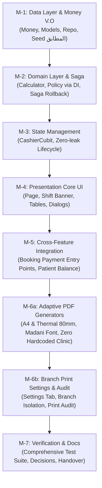

# خطة التنفيذ الشاملة — F-05: الخزينة والورديات والتحصيل (Cashier Shifts & Payments)

> **المرجعية المعمارية:** مبنية على متطلبات `docs/plans/PKG-A-treasury-billing.md` و`docs/plans/PKG-AB-integration-contract.md` و`docs/plans/handover/WHAT_IS_MISSING.md`.  
> **طبيعة المنتج:** نظام SaaS متعدد المستأجرين (Multi-Tenant Clinic SaaS) خاضع لتخصيص الإعدادات لكل عميل وفرع دون تغيير الكود أو افتراض قيم ثابتة خاصة بعميل بعينه.  
> **البيئة والمبادئ:** Flutter (Desktop/Web/Tablet) — Clean Architecture — Cubit واحد موحد لكل فيتشر — Mock In-Memory بالكامل (بدون Dio وبدون backend) — صفر نصوص Hardcoded — صفر `DateTime.now()` (استخدام `CairoTimeHelper.now()` حصراً) — صفر `setState` — حوكمة صارمة بصلاحيات Fail-Closed وSession-derived actors.

---

## مراجعة ذاتية للخطة (وفق §7 من AGENT_OPERATING_GUIDE)

| البند | التحقق في هذه الخطة |
| :--- | :--- |
| **بدون backend / بدون Dio** | مستودع `CashierMockRepoImpl` في الذاكرة بالكامل يغذي الحركات، الورديات، الفواتير، والمدفوعات دون أي اتصال شبكي أو Dio أو Endpoints. |
| **بدون Entities** | الاعتماد على Models مباشرة: `CashierShiftModel`, `PaymentTransactionModel`, `RefundTransactionModel`, `CashMovementModel` مع كلاس القيمة المالي `Money`. |
| **كل الحقول nullable** | جميع الحقول في الـ Models من النوع Nullable، مع كلاس القيمة `Money` كقيمة صحيحة غير قابلة للتجزئة (`int piastres`). |
| **Cubit واحد للفيتشر** | `CashierCubit` يدير حالة الخزينة والوردية النشطة. إعدادات الطباعة تُدار حصراً عبر `SettingsCubit` القائم بالفعل دون إنشاء Cubit جديد. |
| **تخصيص الطباعة لكل فرع (SaaS)** | دعم مقاسين: A4 القياسي والحراري 80 مم (`PrintFormat: a4, thermal80`) يُضبطان لكل نوع مستند (إيصال، تقرير، وروشتة لاحقاً) على مستوى الفرع، مع السقوط الآمن على A4. |
| **ترويسة المستندات الحيادية** | اسم العيادة والشعار والهاتف والعنوان تُقرأ ديناميكياً من إعدادات الفرع النشط (`CompanySettingsModel`)؛ صفر أسماء عيادات أو بيانات عملاء مكتوبة في الكود. |
| **سياسة الخزينة المحقونة (DI)** | كلاس `CashierPolicy` يُحقن عبر GetIt بقيم افتراضية قابلة للتخصيص لاحقاً لكل عميل/فرع دون تعديل الـ use cases. |
| **صفر نصوص Hardcoded** | كل النصوص تستخدم بادئات الترجمة `cashier_`, `shift_`, `print_settings_` بتطابق 100% بين `ar-EG.json` و `en-US.json`. |
| **صفر `DateTime.now()`** | استخدام `CairoTimeHelper.now()` القابل للحقن في كامل المنظومة بما فيها حسابات أوقات فتح الوردية والحركات. |
| **CairoTimeHelper** | حساب طوابع الوقت وبدايات ونهايات الورديات بيوم العمل التشغيلي (`businessDate`) الممتد للورديات العابرة لمنتصف الليل. |
| **Audit Fail-Closed** | تسجيل أحداث: `shift_opened`, `shift_closed`, `shift_force_closed`, `shortage_approved`, `owner_self_approved`, `payment_collected`, `payment_refunded`, `payment_voided_by_system`, `cash_movement_recorded`, `print_settings_updated` بالمعرفات والقيم القديمة/الجديدة فقط. وصفر تسجيل عند الفشل. |
| **المشتقات من الجلسة حصراً** | هوية الكاشير أو المعتمد أو المزيل تُشتق تلقائياً من `CurrentUserProvider / SessionCubit` والفرع النشط من الجلسة. |
| **عزل الفروع (Branch Isolation)** | الوردية، الحركات، وإعدادات الطباعة مقيدة بـ `branchId` النشط؛ تعديل إعدادات طباعة فرع لا يمس فرعاً آخر إطلاقاً. |

---

## 1. الوضع الحالي وما سيُعاد استخدامه

### 1.1 نمط إعدادات الفرع القائم في F-01:
- **كيف تُخزَّن إعدادات الفرع حالياً:**
  - يتم تمثيل إعدادات الفرع في كلاس `CompanySettingsModel` في `lib/features/settings/data/models/company_settings_model.dart` ويشمل: `companyName`, `logo`, `phone`, `address`, `workingDays`, `openingTime`, `closingTime`, `specialHolidays`, إلخ.
  - في مستودع `SettingsMockRepoImpl` (`lib/features/settings/data/repo/settings_mock_repo_impl.dart`):
    - تُخزن الإعدادات في قاموس في الذاكرة معزول لكل فرع: `final Map<String, CompanySettingsModel> _branchSettings = {};`.
    - يُحدد الفرع النشط ديناميكياً عبر دالة `_getActiveBranchId()` التي تقرأ `SessionCubit.state.activeBranchId` وتسقط على `branch_1` كافتراضي آمن.
    - تقرأ الإعدادات عبر `getCompanySettings()` وتُحدَّث عبر `updateCompanySettings(CompanySettingsModel)`.
    - تدعم منظومة F-01 نسخ الإعدادات بين الفروع عبر دالة `copyBranchSettings(sourceBranchId, targetBranchId, ...)`.
- **التكامل المطلوب لـ F-05:**
  - نتبع نفس النمط المعماري 100%: إضافة حقول إعدادات الطباعة كـ `PrintFormat` لكل نوع مستند داخل `CompanySettingsModel`.
  - لا ننشئ مستودعاً جديداً ولا Cubit جديداً؛ بل نستخدم `SettingsCubit` و `SettingsRepo` القائمين في `features/settings`.
  - السقوط الآمن: عند غياب أي إعداد (null)، يكون الافتراضي هو **A4**.
  - الامتداد المستقبلي: إدراج حقل `prescriptionPrintFormat` من الآن ليكون جاهزاً لفيتشر الروشتة F-04c دون الحاجة لإعادة هيكلة النموذج مستقبلاً.

### 1.2 ما هو موجود فعلياً في كود الخزينة والحجوزات:
1. **شاشة الخزينة الحالية:**
   - المسار: `AppRouter.cashier = '/cashier'` بصلاحية `StaffPermissionEnum.accessCashier`.
   - الملف: `lib/features/cashier/presentation/pages/cashier_page.dart` (بطاقة تمهيدية).
2. **كيان الحجوزات (`BookingModel`):**
   - حقول مالية: `consultationFee` (num?), `paidAmount` (num?), `paymentStatus` (`PaymentStatusEnum`: paid, unpaid, partiallyPaid).
   - جالب مشتق: `netAmount` يخصم الخصم المعتمد، و `effectivePaymentStatus` الذي يحول الحجز المجاني أو خصم 100% إلى `paid` تلقائياً.
3. **ملف المريض (`PatientModel`):**
   - يحتوي الحقول المالية التراكمية: `totalPaidAmount` و `outstandingBalance`.
   - يُرفض أرشفة أو حذف المريض في `patients_mock_repo_impl.dart` إذا كان `outstandingBalance > 0`.
4. **طرق الدفع (`PaymentMethod`):**
   - `lib/core/enums/payment_method.dart` يحتوي حالياً `enum PaymentMethod { cash, card }`.
   - التوسيع المطلوب: إضافة `bankTransfer` إلى نفس الـ Enum مع getters للترجمة، دون إنشاء Enum مكرر، وبدون `onAccount` (الآجل حجز غير مسدد وليس دفعة).
5. **الصلاحيات المالية:**
   - القائمة: `accessCashier`, `collectPayment`, `refundPayment`, `viewCashierShift`, `applyManualDiscount`, `applyBookingDiscount`.
   - المضافة: `manageCashierShifts` (للإغلاق القسري واعتماد العجز)، و `manageDrawerMovements` (للمصروفات وحركات الدرج الإدارية).

---

## 2. قائمة الملفات الكاملة للفيتشر F-05 والملفات المعدلة خارجها

### 2.1 ملفات فيتشر الخزينة والطباعة (`lib/features/cashier/` و `lib/core/`):
```
lib/core/
└── enums/
    ├── payment_method.dart                      # توسيع: cash, card, bankTransfer مع getters للترجمة
    ├── print_format.dart                        # enum: a4, thermal80 مع fromString وتسقيط على a4
    └── print_document_type.dart                 # enum: paymentReceipt, shiftReport, prescription

lib/features/cashier/
├── data/
│   ├── models/
│   │   ├── cashier_shift_model.dart              # بيانات الوردية، العهدة، المتوقع، الفعلي، العجز/الزيادة
│   │   ├── payment_transaction_model.dart        # حركة الدفع المالي (كاش/فيزا/تحويل) مع clientRequestId
│   │   ├── refund_transaction_model.dart         # حركة استرداد عكسية مدققة مرتبطة بالحركة الأصلية
│   │   ├── cash_movement_model.dart              # حركة نقدية بالدرج (مصروف نثري/إيداع/سحب)
│   │   ├── cashier_summary_metrics_model.dart    # مقاييس ملخص الوردية اليومي (كاش، بطاقة، تحويل، مصروفات)
│   │   └── enums/
│   │       ├── shift_status_enum.dart            # open, closed, closed_pending_approval, force_closed
│   │       └── cash_movement_type_enum.dart      # pettyExpense, capitalInjection, bankDeposit, ownerWithdrawal
│   └── repo/
│       └── cashier_mock_repo_impl.dart           # تطبيق المستودع في الذاكرة مع الـ Seed المتطابق
├── domain/
│   ├── contracts/
│   │   └── cashier_policy.dart                   # سياسة الخزينة المحقونة عبر DI (قيم افتراضية قابلة للتخصيص)
│   ├── helpers/
│   │   ├── money.dart                            # كلاس القيمة المالي الدقيق (قروش صحيحة int piastres)
│   │   ├── money_helper.dart                     # تحويل الجنيه إلى قروش وبالعكس عند حدود الدومين
│   │   ├── cashier_shift_calculator.dart         # حساب المتوقع بالدرج والعجز/الزيادة وإجماليات الطرق
│   │   └── payment_reconciliation_helper.dart    # مطابقة مدفوعات الحجز ومجموع الحركات وسجل الأرصدة
│   ├── repo/
│   │   └── cashier_repo.dart                     # واجهة المستودع المجردة
│   ├── use_cases/
│   │   ├── get_current_shift_use_case.dart       # استرجاع وردية الكاشير النشطة للفرع الحالي
│   │   ├── get_shift_history_use_case.dart       # استرجاع سجل الورديات للفرع (الاستقبال يرى ورديته فقط)
│   │   ├── open_cashier_shift_use_case.dart      # فتح وردية جديدة بعهدة افتتاحية (Idempotent)
│   │   ├── close_cashier_shift_use_case.dart     # إغلاق الوردية ومطابقة الجرد وفحص حد العجز
│   │   ├── force_close_shift_use_case.dart       # إغلاق قسري للوردية المتأخرة من المدير/المالك
│   │   ├── approve_shift_shortage_use_case.dart  # اعتماد عجز الوردية من المدير/المالك (المعتمد != الكاشير)
│   │   ├── record_payment_use_case.dart          # تسجيل دفعة (Saga: قيد مالي + تحديث الحجز + تعويض عكسي عند الفشل)
│   │   ├── refund_payment_use_case.dart          # استرداد حركة دفع (حركة عكسية append-only)
│   │   ├── record_cash_movement_use_case.dart    # تسجيل مصروف نثري أو حركة بالدرج (إيداع/سحب)
│   │   ├── get_cashier_metrics_use_case.dart     # استرجاع ملخص الوردية الحالي للـ Dashboard
│   │   └── params/
│   │       ├── open_shift_params.dart
│   │       ├── close_shift_params.dart
│   │       ├── force_close_shift_params.dart
│   │       ├── approve_shortage_params.dart
│   │       ├── record_payment_params.dart
│   │       ├── refund_payment_params.dart
│   │       └── cash_movement_params.dart
└── presentation/
    ├── helpers/
    │   ├── payment_action_helper.dart            # شروط ظهور وتفعيل أزرار الدفع والاسترداد
    │   ├── money_display_extension.dart          # تنسيق كلاس Money بالواجهة عبر AppFormatterHelper
    │   ├── payment_receipt_pdf_generator.dart    # مولد PDF إيصال الدفع المتكيف (A4 وحراري 80 مم)
    │   └── shift_report_pdf_generator.dart       # مولد PDF تقرير الوردية Z-Report المتكيف (A4 وحراري 80 مم)
    ├── manager/
    │   ├── cashier_cubit.dart                    # Cubit موحد للخزينة والورديات
    │   └── cashier_state.dart                    # حالة الخزينة والوردية والعمليات المنفذة
    ├── pages/
    │   └── cashier_page.dart                     # الشاشة الرئيسية للخزينة (مقسمة Tab: الوردية الحالية، السجل، الحركات)
    └── widgets/
        ├── active_shift_banner.dart              # شريط حالة الوردية العلوية (الكاشير، وقت الفتح، زر الإغلاق)
        ├── no_active_shift_view.dart             # واجهة الإرشاد لفتح وردية جديدة عند عدم وجود وردية
        ├── cashier_metrics_cards.dart            # 4 بطاقات إحصائية: نقدية الدرج، مدفوعات البطاقة، التحويلات، المصروفات
        ├── cashier_transactions_table.dart       # جدول حركات الوردية الحالية المباشرة
        ├── shift_history_table.dart              # جدول أرشيف الورديات السابقة وإقفالاتها
        ├── open_shift_dialog.dart                # حوار فتح الوردية وإدخال العهدة النقدية المقترحة
        ├── close_shift_dialog.dart               # حوار جرد وتقفيل الوردية وإظهار العجز/الزيادة
        ├── force_close_shift_dialog.dart         # حوار الإغلاق القسري للوردية المتأخرة بسبب إلزامي
        ├── approve_shortage_dialog.dart          # حوار اعتماد عجز الوردية من المدير/المالك
        ├── record_payment_dialog.dart            # حوار تسجيل دفعة لحجز أو مريض مع clientRequestId
        ├── refund_transaction_dialog.dart        # حوار استرداد دفعة بسبب إلزامي للمدير والمالك
        ├── record_cash_movement_dialog.dart      # حوار تسجيل صرف نثري أو سحب/إيداع عهدة
        ├── shift_summary_receipt_dialog.dart     # معاينة وطباعة تقرير الوردية (مع التبديل بين A4 والحراري)
        └── payment_receipt_dialog.dart           # معاينة وطباعة إيصال التحصيل (مع التبديل بين A4 والحراري)
```

### 2.2 قائمة الملفات المعدلة خارج فيتشر الخزينة:
| الملف | الغرض من التعديل |
| :--- | :--- |
| `lib/features/settings/data/models/company_settings_model.dart` | إضافة حقول إعدادات الطباعة: `receiptPrintFormat`, `shiftReportPrintFormat`, `prescriptionPrintFormat`. |
| `lib/features/settings/presentation/pages/settings_page.dart` | إضافة تبويب "إعدادات الطباعة" (`tab_print_settings`) محمي بصلاحية `accessSettings`. |
| `lib/features/settings/presentation/widgets/tabs/print_settings_tab.dart` | واجهة تبويب إعدادات الطباعة لاختيار الحجم لكل مستند وتسجيل حدث Audit. |
| `lib/features/settings/presentation/cubit/settings_cubit.dart` | دعم قراءة وحفظ إعدادات الطباعة للفرع النشط عبر دالة `updatePrintSettings`. |
| `lib/core/enums/payment_method.dart` | إضافة `bankTransfer` مع getters للترجمة والقيم. |
| `lib/core/enums/staff_permission_enum.dart` | إضافة صلاحيتي `manageCashierShifts` و `manageDrawerMovements`. |
| `lib/features/users_management/data/models/role_definition_model.dart` | تحديث `defaultSystemRoles()` لتوزيع الصلاحيات الجديدة على الأدوار. |
| `lib/features/users_management/presentation/pages/dialogs/role_permissions_matrix_dialog.dart` | إضافة الصلاحيتين الجديدتين لقسم الخزينة بمصفوفة الصلاحيات بالواجهة. |
| `lib/features/bookings/domain/repositories/bookings_repo.dart` | توفير دوال ذرية لتحديث مدفوعات الحجز من الـ Saga والتحقق من موانع الحذف. |
| `lib/features/bookings/domain/use_cases/create_booking_use_case.dart` | حجب التعيين اليدوي لـ `paidAmount` عند إنشاء الحجز (يبدأ 0 دائماً). |
| `lib/features/bookings/domain/use_cases/update_booking_use_case.dart` | منع تعديل `paidAmount` أو `paymentStatus` من واجهة تعديل الحجز. |
| `lib/features/bookings/domain/use_cases/delete_booking_use_case.dart` | منع حذف الحجز إذا كان `paidAmount > 0` مع إرجاع رسالة استرداد إلزامية. |
| `lib/features/bookings/presentation/widgets/add_edit_booking_dialog.dart` | استبدال القائمة المنسدلة لحالة الدفع بشارة عرض مشتقة للقراءة فقط (Read-only badge). |
| `lib/features/bookings/presentation/widgets/bookings_table.dart` | إضافة زر "سداد" سريع للمدفوعات الجزئية وشارة "يحتاج استرداد" للحجوزات الملغاة المسددة. |
| `lib/features/bookings/presentation/widgets/booking_card.dart` | إضافة إجراءات السداد والاسترداد السريعة وفق الصلاحيات وحالة الحجز. |
| `lib/features/bookings/presentation/pages/booking_details_page.dart` | عرض شريط سجل المدفوعات وزر طباعة الإيصال للمدفوعات المسجلة. |
| `lib/features/patients/domain/contracts/patient_balance_lookup.dart` | عقد تجريدي جديد (`PatientBalanceLookup`) لمنع الاعتماد الدائري. |
| `lib/features/patients/data/repo/patients_mock_repo_impl.dart` | حساب `outstandingBalance` فقط من الحجوزات المكتملة (`completed` / `finalized`). |
| `lib/features/patients/presentation/widgets/delete_patient_dialog.dart` | منع حذف المريض المديون بالاعتماد على الرصيد المحسوب بدقة الدومين. |
| `lib/core/services/injection_container.dart` | تسجيل `CashierPolicy` (DI)، `CashierRepo`, `CashierCubit`, والـ Use Cases في GetIt. |
| `assets/translations/ar-EG.json` & `en-US.json` | إضافة مفاتيح الخزينة والورديات وإعدادات الطباعة بالكامل بتطابق 100%. |

---

## 3. تصميم الـ Models والـ Enums وكلاس `CashierPolicy` القابل للحقن

### 3.1 كود الـ Enum الخاص بأحجام الطباعة (`PrintFormat` و `PrintDocumentType`):
```dart
enum PrintFormat {
  a4,
  thermal80;

  static PrintFormat fromString(String? val) {
    if (val == 'thermal80') return PrintFormat.thermal80;
    return PrintFormat.a4; // السقوط الآمن دائماً على A4 عند غياب الإعداد
  }
}

enum PrintDocumentType {
  paymentReceipt,
  shiftReport,
  prescription; // جاهز لـ F-04c دون تعديل
}
```

### 3.2 سياسة الخزينة المحقونة عبر DI (`CashierPolicy`):
تجريد المنظومة عن أي قيم ثابتة تخص عميلاً بعينه، وحقن كلاس السياسة عبر GetIt مع قيم افتراضية قابلة للتخصيص:
```dart
class CashierPolicy {
  final int maxUnapprovedShortagePiastres; // الافتراضي: 5000 قرش (50 ج.م)
  final int maxPettyExpensePiastres;       // الافتراضي: 20000 قرش (200 ج.م)
  final int maxShiftAgeHours;             // الافتراضي: 16 ساعة قبل الإغلاق القسري

  const CashierPolicy({
    this.maxUnapprovedShortagePiastres = 5000,
    this.maxPettyExpensePiastres = 20000,
    this.maxShiftAgeHours = 16,
  });
}
```
- **التسجيل في DI:** `getIt.registerLazySingleton<CashierPolicy>(() => const CashierPolicy());`
- **حقنها في الدومين:** تُحقن في `CloseCashierShiftUseCase`, `ForceCloseShiftUseCase`, `RecordCashMovementUseCase`. عند بناء شاشة إعدادات العميل المتقدمة مستقبلاً، يمكن توفير كلاس فرعي أو قراءة القيم من إعدادات العميل دون تغيير سطر واحد في أي Use Case.

### 3.3 كلاس القيمة المالي `Money` (دقة القروش الصحيحة `int piastres`):
```dart
class Money {
  final int piastres; // 100 قرش = 1 جنيه مصري

  const Money(this.piastres);
  const Money.zero() : piastres = 0;

  factory Money.fromPiastres(int piastres) => Money(piastres);
  factory Money.fromPounds(num pounds) => Money((pounds * 100).round());
  factory Money.fromString(String? text) {
    if (text == null || text.trim().isEmpty) return const Money.zero();
    final normalized = text.trim().replaceAll(',', '.');
    final val = double.tryParse(normalized) ?? 0.0;
    return Money((val * 100).round());
  }

  double toPounds() => piastres / 100.0;

  Money operator +(Money other) => Money(piastres + other.piastres);
  Money operator -(Money other) => Money(piastres - other.piastres);
  Money operator *(num factor) => Money((piastres * factor).round());
  bool operator <(Money other) => piastres < other.piastres;
  bool operator <=(Money other) => piastres <= other.piastres;
  bool operator >(Money other) => piastres > other.piastres;
  bool operator >=(Money other) => piastres >= other.piastres;

  @override
  bool operator ==(Object other) =>
      identical(this, other) || (other is Money && other.piastres == piastres);

  @override
  int get hashCode => piastres.hashCode;
}
```

### 3.4 توسيع `CompanySettingsModel` بإعدادات الطباعة:
```dart
// إضافات على CompanySettingsModel:
final PrintFormat? receiptPrintFormat;        // الافتراضي a4
final PrintFormat? shiftReportPrintFormat;    // الافتراضي a4
final PrintFormat? prescriptionPrintFormat;   // الافتراضي a4 (محجوز لـ F-04c)

PrintFormat get effectiveReceiptFormat => receiptPrintFormat ?? PrintFormat.a4;
PrintFormat get effectiveShiftReportFormat => shiftReportPrintFormat ?? PrintFormat.a4;
PrintFormat get effectivePrescriptionFormat => prescriptionPrintFormat ?? PrintFormat.a4;
```

---

## 4. معادلة الدرج النقدي الصارمة وسياسات العمل

النقدية المتوقعة في الدرج تحسب فقط من الحركات النقدية الفعلية:
$$\text{ExpectedCash} = \text{OpeningBalance} + \text{CashCollected} - \text{CashRefunded} - \text{PettyExpenses} + \text{CapitalInjection} - \text{BankDeposit} - \text{OwnerWithdrawal}$$

- **مدفوعات البطاقة والتحويل البنكي:** لا تدخل في الدرج النقدي مطلقاً، بل تُسجل وتُجمع في مقاييس وإحصائيات مستقلة لوردية الكاشير لمطابقتها مع إيصالات POS وكشوفات البنك.
- **حد العجز المالي:** مُحدد بـ `policy.maxUnapprovedShortagePiastres` (5000 قرش = 50.0 ج.م). ما زاد عن ذلك يتطلب اعتماد مدير مؤهل (`approver != cashier`).
- **حد المصروفات النثرية للكاشير:** مُحدد بـ `policy.maxPettyExpensePiastres` (20000 قرش = 200.0 ج.م). ما تجاوزه يتطلب صلاحية `manageDrawerMovements`.
- **الورديات العابرة لمنتصف الليل:** تاريخ يوم العمل التشغيلي `businessDate` يظل مطابقاً لتاريخ فتح الوردية (`openedAt`).
- **الحد الأقصى لعمر الوردية:** `policy.maxShiftAgeHours` (16 ساعة). بعدها تصبح متأخرة وتتطلب إغلاقاً قسرياً (`force_closed`) بواسطة المدير أو المالك.
- **اقتراح العهدة الافتتاحية:** يُقترح تلقائياً النقدية الفعلية للوردية السابقة المغلقة لنفس الكاشير والفرع، مع إلزام الكاشير بتبرير أي تعديل وتسجيل ذلك في الـ Audit.

---

## 5. بيانات الـ Seed الحقيقية (جدول مطابقة الحجوزات والورديات)

| معرف الحجز | المريض | الفرع | التاريخ والساعة | حالة الحجز | حالة الزيارة | الكشف | الخصم | الصافي | المدفوع | حركات الدفتر | طريقة الدفع | الوردية والكاشير |
| :--- | :--- | :--- | :--- | :--- | :--- | :---: | :---: | :---: | :---: | :--- | :--- | :--- |
| **MED-101** | سارة أحمد (PAT-000101) | فرع المعادي | اليوم 10:00 | in_consultation | in_progress | 300 | 0 | 300 | 300 | 300 ج.م | `card` (POS) | وردية المعادي (`USER-REC` منى إبراهيم) |
| **MED-102** | يوسف إبراهيم (PAT-000102) | فرع المعادي | اليوم 10:30 | waiting | null | 150 | 0 | 150 | 0 | 0 ج.م | — | — (حجز غير مسدد) |
| **MED-103** | مريم محمود (PAT-000103) | فرع المعادي | اليوم 11:00 | waiting | null | 450 | 0 | 450 | 450 | 450 ج.م | `cash` | وردية المعادي (`USER-REC` منى إبراهيم) |
| **MED-104** | طارق عبد الرحمن (PAT-000104)| فرع المعادي | اليوم 09:00 | completed | finalized | 150 | 0 | 150 | 150 | 150 ج.م | `cash` | وردية المعادي (`USER-REC` منى إبراهيم) |
| **MED-105** | منى الشناوي (PAT-000105) | فرع المعادي | اليوم 11:30 | postponed | null | 200 | 0 | 200 | 0 | 0 ج.م | — | — (حجز مؤجل غير مسدد) |
| **MED-106** | سارة أحمد (PAT-000101) | فرع المعادي | بعد يومين 12:00| waiting | null | 350 | 0 | 350 | 350 | 350 ج.م | `card` (POS) | وردية المعادي (`USER-REC` منى إبراهيم) |
| **MED-107** | يوسف إبراهيم (PAT-000102) | فرع المعادي | اليوم 09:15 | completed | finalized | 300 | 0 | 300 | 150 | 150 ج.م | `cash` | وردية المعادي (`USER-REC` منى إبراهيم) |
| **MED-108** | مريم محمود (PAT-000103) | فرع مدينة نصر | اليوم 12:30 | waiting | null | 300 | 0 | 300 | 300 | 300 ج.م | `bankTransfer`| وردية مدينة نصر (`USER-OWNER` أو `USER-REC-2`)|
| **MED-109** | طارق عبد الرحمن (PAT-000104)| فرع المعادي | اليوم 13:00 | waiting | null | 150 | 0 | 150 | 150 | 150 ج.م | `cash` | وردية المعادي (`USER-REC` منى إبراهيم) |
| **MED-110** | منى الشناوي (PAT-000105) | فرع المعادي | اليوم 14:00 | cancelled | null | 350 | 0 | 350 | 0 | 0 ج.م | — | — (حجز ملغي بدون سداد) |
| **MED-111** | سارة أحمد (PAT-000101) | فرع المعادي | اليوم 08:30 | no_show | null | 300 | 0 | 300 | 300 | 300 ج.م | `cash` | وردية المعادي (`USER-REC` منى إبراهيم) |

---

## 6. سيناريو الـ Saga والـ Rollback ومطابقة الأرصدة

- **معرف العملية والـ Idempotency:**
  - تكرار نفس `clientRequestId` مع نفس المعاملات يرجع الحركة المسجلة مسبقاً فوراً.
  - تكرار نفس `clientRequestId` بمعاملات مختلفة (مثل مبلغ مختلف) يُرفض فوراً كخطأ تعارض `idempotency_conflict`.
- **التراجع التلقائي (Rollback):**
  - عند تعثر تحديث الحجز في `BookingsRepo`، يتم تسجيل حركة تصفيرية عكسية `isVoidedBySystem = true` وإصدار حدث تدقيق `payment_voided_by_system`.
  - اختبار الوحدة يؤكد: بعد الـ Rollback، ترجع `expectedCashPiastres` ومقاييس الوردية متطابقة 100% مع حالتها قبل محاولة الدفع.
- **مديونية المريض:**
  - تُحسب فقط من الحجوزات المكتملة عبر عقد `ActivePatientBalanceLookup` في `features/patients/domain/contracts/`.
  - المريض `PAT-000102` (يوسف إبراهيم) مديونيته **150 ج.م** من الحجز المكتمل `MED-107`، مما يمنع حذفه بنجاح.

---

## 7. سياسات الاسترداد والاعتماد وتجربة المالك

1. **الاسترداد النقدي:** يتطلب وردية مفتوحة وينقص كاش الدرج المتوقع.
2. **الاسترداد الإلكتروني والبنكي:** لا يؤثر على نقدية الدرج، ويسجل حركة استرداد بالدفتر تعيد احتساب حالة سداد الحجز تلقائياً.
3. **حوكمة الاعتماد:** `approverUserId != cashierUserId`.
4. **استثناء المالك الفردي:** إذا حدث عجز للمالك في عيادة فردية لا يوجد بها مدير فرع آخر، يُسمح له باعتماد ورديته الذاتية استثناءً مع تسجيل قيد `owner_self_approved` في الـ Audit وشارة تحذيرية في التقرير.
5. **حالة `closed_pending_approval`:** لا تمنع الكاشير من فتح وردية جديدة في اليوم التالي، وتظل الوردية السابقة معلقة حتى اعتمادها.

---

## 8. مصفوفة الصلاحيات المحدثة (RBAC Table)

| الإجراء / العملية | الصلاحية المطلوبة من `StaffPermissionEnum` | الأدوار المصرح لها في `defaultSystemRoles()` | قيود دومينية إضافية |
| :--- | :--- | :--- | :--- |
| **فتح وردية كاشير** | `collectPayment` | الاستقبال، المحاسب، مدير الفرع، المالك | فتح لنفسه فقط في فرعه النشط بعهدة $\ge 0$ |
| **تقفيل الوردية الشخصية** | `collectPayment` | الاستقبال، المحاسب، مدير الفرع، المالك | الكاشير يقفل ورديته النشطة فقط |
| **تسجيل دفعة (كاش/فيزا/تحويل)** | `collectPayment` | الاستقبال، المحاسب، مدير الفرع، المالك | وجود وردية مفتوحة للمستخدم نفسه في الفرع |
| **تسجيل مصروف نثري ($\le 200$ ج.م)** | `collectPayment` | الاستقبال، المحاسب، مدير الفرع، المالك | وجود وردية مفتوحة وسبب ومستلم إلزامي |
| **تسجيل مصروف نثري ($> 200$ ج.م)** | `manageDrawerMovements` (جديدة) | مدير الفرع، المحاسب، المالك | اعتماد إداري للمصروفات الكبيرة |
| **حركات الدرج (إيداع/سحب/رأس مال)** | `manageDrawerMovements` (جديدة) | مدير الفرع، المحاسب، المالك | إيداع بنكي أو سحب مالك مدقق |
| **استرداد دفعة (Refund)** | `refundPayment` | مدير الفرع، المالك فقط | حركة عكسية بسبب إلزامي، لا تتجاوز المدفوع |
| **اعتماد عجز الوردية المعلق** | `manageCashierShifts` (جديدة) | مدير الفرع، المالك فقط | المعتمد $\neq$ كاشير الوردية (باستثناء المالك الفردي) |
| **إغلاق قسري للوردية (Force Close)**| `manageCashierShifts` (جديدة) | مدير الفرع، المالك فقط | سبب إلزامي ووردية متأخرة بعد 16 ساعة |
| **عرض الوردية وسجل الحركات** | `viewCashierShift` | الاستقبال (ورديته فقط)، المحاسب، مدير الفرع، المالك | عزل الفرع وعزل الكاشير للاستقبال |
| **تعديل إعدادات الطباعة للفرع** | `accessSettings` | مدير الفرع، المالك | محمي بصلاحية الإعدادات وتعديل الفرع النشط فقط |

---

## 9. أحداث التدقيق الأمني (Audit Events)

| اسم الحدث | من ينفذه | محتوى الحدث (المعرفات والقيم فقط — خلو تام من أرقام البطاقات وأسماء المرضى) |
| :--- | :--- | :--- |
| `shift_opened` | الكاشير | `shiftId`, `branchId`, `openingBalancePiastres` |
| `shift_closed` | الكاشير | `shiftId`, `expectedCashPiastres`, `actualCashCountPiastres`, `differencePiastres` |
| `shift_force_closed` | المدير / المالك | `shiftId`, `performedByUserId`, `reason` |
| `shortage_approved` | المدير / المالك | `shiftId`, `differencePiastres`, `approvedByUserId`, `reason` |
| `owner_self_approved` | المالك فقط | `shiftId`, `differencePiastres`, `ownerUserId`, `reason: owner_self_approved_single_operator` |
| `payment_collected` | الكاشير | `paymentId`, `bookingId`, `amountPiastres`, `method`, `shiftId`, `clientRequestId` |
| `payment_refunded` | المدير / المالك | `refundId`, `originalPaymentId`, `amountPiastres`, `reason`, `authorizedByUserId` |
| `payment_voided_by_system` | النظام (Saga Rollback) | `paymentId`, `bookingId`, `amountPiastres`, `reason: system_rollback` |
| `cash_movement_recorded` | الكاشير / المدير | `movementId`, `shiftId`, `movementType`, `amountPiastres`, `reason` |
| `print_settings_updated` | المدير / المالك | `branchId`, `documentType`, `oldFormat`, `newFormat`, `performedByUserId` |

---

## 10. مفاتيح الترجمة الكاملة (تطابق 100% بين `ar-EG` و `en-US`)

```json
// الخزينة والورديات
"cashier_title": "الخزينة والورديات",
"cashier_shift_active": "الوردية النشطة",
"cashier_shift_history": "سجل الورديات السابقة",
"cashier_open_shift": "فتح وردية كاشير",
"cashier_close_shift": "تقفيل الوردية",
"cashier_force_close_shift": "إغلاق قسري للوردية",
"cashier_opening_balance": "العهدة الافتتاحية",
"cashier_actual_cash": "النقدية الفعلية بالدرج",
"cashier_expected_cash": "النقدية المتوقعة بالدرج",
"cashier_difference": "الفارق (عجز / زيادة)",
"cashier_shortage": "عجز بالدرج",
"cashier_surplus": "زيادة بالدرج",
"cashier_balanced": "الدرج مطابق تماماً",
"cashier_pending_approval": "بانتظار اعتماد المدير",
"cashier_approve_shortage": "اعتماد عجز الوردية",
"cashier_record_payment": "تسجيل دفعة",
"cashier_refund_payment": "استرداد دفعة",
"cashier_petty_expense": "مصروف نثري",
"cashier_capital_injection": "إيداع رأس مال",
"cashier_bank_deposit": "إيداع بنكي",
"cashier_owner_withdrawal": "مسحوبات مالك",
"cashier_method_cash": "نقداً (كاش)",
"cashier_method_card": "بطاقة دفع / فيزا (POS)",
"cashier_method_bank": "تحويل بنكي / إنستاباي",
"cashier_no_active_shift": "لا توجد وردية مفتوحة حالياً لهذا الفرع",
"cashier_open_shift_prompt": "يرجى فتح وردية كاشير وإدخال العهدة الافتتاحية لبدء تسجيل المقبوضات",
"cashier_validation_shift_required": "لا يمكن تسجيل مدفوعات بدون وردية كاشير مفتوحة للمستخدم",
"cashier_validation_positive_amount": "المبلغ يجب أن يكون أكبر من الصفر",
"cashier_validation_exceeds_remaining": "المبلغ المدفوع يتجاوز المبلغ المتبقي على الحجز",
"cashier_validation_reason_required": "سبب العملية إلزامي",
"cashier_refund_authorized_only": "الاسترداد محصور لمدير الفرع ومالك العيادة فقط",
"cashier_approver_same_as_cashier": "لا يجوز للكاشير اعتماد عجز أو زيادة ورديته الخاصة",
"cashier_booking_has_payments": "لا يمكن حذف حجز مسجل عليه مدفوعات بالدفتر، يرجى الاسترداد أولاً",
"cashier_booking_needs_refund": "يحتاج استرداد مدفوعات",
"cashier_receipt_title": "إيصال سداد نقدية",
"cashier_z_report_title": "تقرير تقفيل الوردية (Z-Report)",
"cashier_suggested_opening_balance": "العهدة الافتتاحية المقترحة من الوردية السابقة",
"cashier_opening_balance_changed_reason": "سبب تعديل العهدة عن المقترح",

// إعدادات الطباعة على مستوى الفرع (Print Settings)
"tab_print_settings": "إعدادات الطباعة",
"print_settings_title": "إعدادات وتنسيقات الطباعة",
"print_settings_desc": "تحديد مقاس الطباعة الافتراضي لكل نوع مستند في هذا الفرع",
"print_format_a4": "ورق قياسي A4",
"print_format_a4_desc": "مناسب للطابعات المكتبية العادية والتقارير الرسمية الموسعة",
"print_format_thermal80": "طابعة فواتير حرارية (80 مم)",
"print_format_thermal80_desc": "مناسب للإيصالات السريعة وطابعات الكاشير المباشرة",
"print_doc_receipt": "إيصال سداد الخزينة",
"print_doc_receipt_desc": "المقاس المستخدم عند طباعة إيصال تحصيل دفعة الحجز أو المريض",
"print_doc_shift_report": "تقرير تقفيل الوردية (Z-Report)",
"print_doc_shift_report_desc": "المقاس المستخدم عند طباعة تقرير الجرد والإقفال اليومي",
"print_doc_prescription": "روشتة العلاج والوصفات الطبية",
"print_doc_prescription_desc": "المقاس المستخدم عند طباعة الروشتة الصادرة من الطبيب (F-04c)",
"print_settings_saved_success": "تم حفظ إعدادات الطباعة للفرع بنجاح",
"print_switch_preview_format": "تغيير مقاس المعاينة"
```

---

## 11. تفاصيل الطباعة المتكيفة وحيادية المستأجر (Printing Architecture)

### 11.1 التكيف مع المقاس (A4 مقابل Thermal 80mm):
1. **مقاس A4 القياسي (`PdfPageFormat.a4`):**
   - الأبعاد: $210 \times 297$ مم بهوامش 15 مم.
   - التخطيط: ترويسة عريضة (الشعار في زاوية واسم المنشأة والعنوان في زاوية)، شبكة من عمودين لبيانات الحركة والوردية، جدول عريض منظم بتفاصيل البنود والضرائب والخصومات، ومساحة رسمية لتوقيع الكاشير والختم.
2. **مقاس الطابعة الحرارية 80 مم (`PdfPageFormat.roll80` أو بعرض ثابت 80 مم وطول متغير ديناميكياً):**
   - الأبعاد: عرض ثابت $80\text{ مم}$ وطول متغير حسب المحتوى (`PdfPageFormat(80 * PdfPageFormat.mm, double.infinity, marginAll: 4 * PdfPageFormat.mm)`).
   - التخطيط: تخطيط **عمود واحد رأسي بالكامل (Single-column flow)**:
     - الترويسة في المنتصف بحجم خط مناسب ومضغوط (10pt).
     - فواصل أفقية منقطة أو متقطعة (`dashed divider lines`).
     - لا توجد جداول أفقية عريضة؛ بل سطور عمودية: المفتاح يميناً والقيمة يساراً.
     - باركود أو QR كود مبسط في الأسفل (إن وُجد) مع تذييل شكر مقتضب.

### 11.2 الترويسة الحيادية المقروءة من إعدادات الفرع:
- تُقرأ بيانات رأس الإيصال والتقرير من كائن `CompanySettingsModel` للفرع النشط:
  - اسم المنشأة: `settings.companyName`.
  - العنوان: `settings.address`.
  - الهاتف: `settings.phone`.
  - الشعار: `settings.logo` (إن وُجدت بايتات الشعار أو مسارها في الأصول).
- **صفر نصوص لأسماء عيادات في الكود:** لا يُكتب "عيادة النور" ولا "عيادتي" داخل المولد؛ المنظومة SaaS نظيفة تماماً وتستمد هويتها من بيانات العميل المخزنة.
- العملة وتنسيق المبالغ: عبر `AppFormatterHelper` ومفتاح `currency.tr()`.

### 11.3 أصل الخط العربي والتشكيل:
- **الملف والمكان:** `assets/fonts/madani.ttf` موجود بالفعل داخل المشروع.
- **التسجيل في pubspec:** مسجل رسمياً في `pubspec.yaml:66` تحت العائلة `madani`.
- **الرخصة:** SIL Open Font License (OFL) مفتوح المصدر للاستخدام التجاري.
- **التحميل:** يتم تحميله في المولد كبايتات عبر:
  ```dart
  final fontData = await rootBundle.load('assets/fonts/madani.ttf');
  final ttf = pw.Font.ttf(fontData);
  ```
  مع استخدام محرك تشكيل النصوص ودعم RTL المدمج في مكتبة `pdf`.
- **خطوة الفحص البصري اليدوي:** تشغيل اختبار تصدير ملفات PDF حقيقية لكلا المستندين بالحجمين (A4 وحراري 80 مم)، وفتح الملفين يدوياً للتأكد التام من عدم وجود حروف مقطعة أو مقلوبة قبل الاعتماد.

---

## 12. خطة الاختبارات الشاملة المحدثة (138 اختباراً)

### 1. `test/features/cashier/money_value_object_test.dart` (16 اختباراً):
- تحويل الجنيه إلى قروش وبالعكس.
- العمليات الحسابية والمقارنات.
- الحالات الحدية: $0.1 + 0.2 = 0.3$، وتقسيم $33.33 \times 3$ بالقروش مع توزيع قرش التقريب (Rounding Piastre).
- التحويل من نصوص (`"1.005"` $\to$ 101 قرش)، والفاصلة العربية `,` مقابل النقطة `.`.

### 2. `test/features/cashier/cashier_shift_calculator_test.dart` (14 اختباراً):
- حساب النقدية المتوقعة بالدرج بجميع أنواع الحركات.
- عزل البطاقة والتحويل عن كاش الدرج.
- التحقق من سقف العجز (50 ج.م) والتوجيه للاعتماد.

### 3. `test/features/cashier/cashier_validation_and_usecases_test.dart` (30 اختباراً):
- منع فتح أكثر من وردية نشطة.
- عدم التكرار (Idempotency): نفس المعرف والمعاملات يرجع الحركة؛ نفس المعرف بمعاملات مختلفة يرفض كتعارض.
- شروط الاعتماد واستثناء المالك الفردي (`owner_self_approved`).
- الإغلاق القسري بعد 16 ساعة.
- سقوف المصروفات النثرية وحركات الدرج الإدارية.

### 4. `test/features/cashier/payment_reconciliation_saga_test.dart` (16 اختباراً):
- ذريّة Saga الدفع (قيد الدفتر + تحديث الحجز).
- تأكيد الـ Rollback الصريح: تطابق مقاييس الوردية وكاش الدرج بنسبة 100% بعد التراجع مع حالتها قبل المحاولة.
- مطابقة حجوزات الـ Seed الـ 11 بالكامل.

### 5. `test/features/cashier/cashier_booking_integration_test.dart` (14 اختباراً):
- منع حذف الحجز إذا كان `paidAmount > 0`.
- شارة "يحتاج استرداد" عند إلغاء حجز مسدد.
- حساب مديونية المريض من الحجوزات المكتملة فقط عبر `PatientBalanceLookup`.

### 6. `test/features/cashier/cashier_rbac_matrix_test.dart` (12 اختباراً):
- مصفوفة Table-driven للأدوار السبعة.
- عزل الفروع في الحركات والورديات.

### 7. `test/features/cashier/cashier_cubit_test.dart` (10 اختبارات):
- دورة حياة الـ Cubit والتصفير عند تبديل الفرع/المستخدم وصفر Timers مفتوحة.

### 8. `test/features/cashier/cashier_ui_and_dialogs_test.dart` (10 اختبارات):
- واجهات وشريط الوردية، وحوارات الفتح والتقفيل والدفع والمصروفات.

### 9. `test/features/cashier/adaptive_pdf_generators_test.dart` (10 اختبارات — M-6a):
- توليد إيصال الدفع بمقاس A4 بنجاح مع مطابقة بنود الترويسة من إعدادات الفرع.
- توليد إيصال الدفع بمقاس 80 مم حراري بتخطيط عمودي سليم.
- توليد تقرير الوردية Z-Report بمقاس A4 مع مطابقة كافة إجماليات الطرق والمصروفات.
- توليد تقرير الوردية بمقاس 80 مم حراري.
- السقوط التلقائي على A4 عند غياب إعداد الطباعة.
- التحقق التام من خلو وثيقة PDF وسجل التدقيق من أي أرقام بطاقات ائتمانية.
- تكامل خط `madani.ttf` والتشكيل العربي السليم.

### 10. `test/features/settings/print_settings_tab_test.dart` (8 اختبارات — M-6b):
- عرض تبويب "إعدادات الطباعة" في `SettingsPage` للأدوار المصرح لها (`accessSettings`).
- حجب التبويب أو منع الحفظ للمستخدمين غير المصرح لهم.
- تغيير مقاس إيصال الدفع لفرع معين وحفظه بنجاح عبر `SettingsCubit`.
- عزل الفروع: التأكد من أن تغيير إعدادات طباعة `branch_1` لا يغير إعدادات `branch_2`.
- التحقق من تسجيل حدث التدقيق `print_settings_updated` بالقيمة القديمة والجديدة ومعرف المنفذ والفرع.
- دعم قراءة وحفظ إعداد طباعة الروشتة (`prescriptionPrintFormat`) ليكون جاهزاً لـ F-04c.

### 11. `test/features/cashier/cashier_final_audit_verification_test.dart` (8 اختبارات — M-7):
- فحص تكاملي شامل لسجل التدقيق الأمني لكافة أحداث الخزينة والطباعة.
- التحقق من عدم وجود أي تسريب للبيانات الحساسة وسلامة القيود.

**المجموع الإجمالي للاختبارات المستهدفة:** 138 اختباراً مؤتمتاً بنسبة نجاح 100%.

---

## 13. تقسيم الـ Milestones التنفيذية (كل مرحلة $\le$ يومين)

تم تقسيم بند الطباعة إلى مرحلتين مستقلتين (M-6a و M-6b) لضمان عدم تجاوز أي مرحلة يومين ولتحقيق أعلى معايير الجودة المعمارية:



| الـ Milestone | النطاق والمخرجات | المدة التقديرية | الاختبارات المستهدفة | الالتزام المستقل (Git Commit) |
| :--- | :--- | :---: | :---: | :--- |
| **M-1: Data Layer & Money** | كلاس `Money` بالقروش، توسيع `PaymentMethod`، نماذج الخزينة، `CashierMockRepoImpl` مع الـ Seed المتطابق للحجوزات الـ 11، واختبارات الترجمة. | 1.5 يوم | 16 اختباراً | `feat(F-05-M1): money value object, cashier models, repo and seed` |
| **M-2: Domain Layer & Saga** | معادلة الدرج، كلاس `CashierPolicy` المحقون بـ DI، التحقق المالي، عدم التكرار `clientRequestId`، Saga الدفع والـ Rollback العكسي، وعقد `PatientBalanceLookup`. | 1.5 يوم | 44 اختباراً | `feat(F-05-M2): cashier calculator, policy injection, payment saga` |
| **M-3: State Management** | بناء `CashierCubit` و `CashierState`، ربط الحقن `get_it`، والتصفير التلقائي عند تبديل الفرع والمستخدم بدون Timers معلقة. | يوم واحد | 10 اختبارات | `feat(F-05-M3): cashier cubit and state lifecycle` |
| **M-4: Presentation Core** | الشاشة الرئيسية للخزينة، شريط الوردية، بطاقات المقاييس، جداول الحركات والسجل، حوارات الفتح والتقفيل والمصروفات. | 2 يوم | 10 اختبارات | `feat(F-05-M4): cashier shift dashboard and management dialogs` |
| **M-5: Cross-Feature Wiring** | قفل التعديل اليدوي لحالة الدفع في الحجز، نقاط الدخول في جدول وبطاقة وتفاصيل الحجز، وربط رصيد المريض بالحجوزات المكتملة. | 1.5 يوم | 26 اختباراً | `feat(F-05-M5): booking payment entry points and patient balance contract` |
| **M-6a: Adaptive PDF Engine** | مولدات PDF للإيصال وتقرير الوردية تتكيف مع A4 و 80 مم حراري، قراءة الترويسة ديناميكياً من إعدادات الفرع، دعم خط `madani.ttf`، والفحص البصري. | 1.5 يوم | 10 اختبارات | `feat(F-05-M6a): adaptive pdf receipt and z-report generators` |
| **M-6b: Print Settings & Audit** | توسيع `CompanySettingsModel`، إضافة تبويب "إعدادات الطباعة" في `SettingsPage`، تسجيل Audit لتغيير الإعداد، والتحقق من عزل الفروع. | يوم واحد | 8 اختبارات | `feat(F-05-M6b): branch print settings tab and settings audit` |
| **M-7: Verification & Docs** | فحص المطابقة الشاملة لكافة الاختبارات (138 اختباراً)، مصفوفة الصلاحيات، تحديث `DECISIONS.md` و `PROGRESS.md`، والتأكد من `flutter analyze = 0` و `flutter test = 100%`. | يوم واحد | 8 اختبارات (شاملة) | `docs(F-05): record architecture decisions and feature completion` |

---

## 14. قرارات مغلقة مثبتة (لا تحتاج قرارات إضافية)

1. **الوردية شرط إلزامي لأي تحصيل مالي:** نقدي، بطاقة، أو تحويل بنكي. والدفعة تُسجل في وردية المستخدم الحالي فقط.
2. **سياسة الخزينة قابلة للحقن (DI Injected Policy):** `CashierPolicy` يُحقن عبر DI بقيم افتراضية لضمان قابلية استبدالها بإعدادات العميل مستقبلاً، مع توثيق شاشة تعديلها كبند مؤجل في `WHAT_IS_MISSING.md`.
3. **الطباعة المتكيفة لكل فرع:** إعدادات الطباعة تُحفظ لكل فرع ولكل نوع مستند (إيصال، تقرير، روشتة) في `CompanySettingsModel` وتُدار عبر `SettingsCubit` القائم، مع السقوط الآمن على A4.
4. **حيادية المستندات في بيئة SaaS:** الترويسة تُقرأ من الفرع، والتنسيقات النقدية من المساعد، والخط العربي مفتوح المصدر ومحلي داخل الأصول، وصفر قيم صلبة خاصة بعميل بعينه.
5. **تفاعل الخصم بعد السداد:** رفض تطبيق الخصم إذا كان الصافي أقل من المدفوع، مع توجيه صريح لإجراء استرداد يدوي أولاً.
