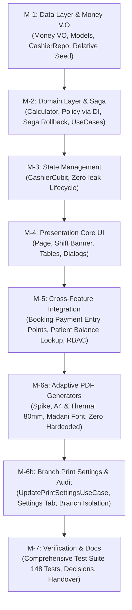

# خطة التنفيذ الشاملة — F-05: الخزينة والورديات والتحصيل (Cashier Shifts & Payments)

> **المرجعية المعمارية:** مبنية على متطلبات `docs/plans/PKG-A-treasury-billing.md` و`docs/plans/PKG-AB-integration-contract.md` و`docs/plans/handover/WHAT_IS_MISSING.md`.  
> **طبيعة المنتج:** نظام SaaS متعدد المستأجرين (Multi-Tenant Clinic SaaS) خاضع لتخصيص الإعدادات لكل عميل وفرع دون تغيير الكود أو افتراض قيم ثابتة خاصة بعميل بعينه.  
> **البيئة والمبادئ:** Flutter (Desktop/Web/Tablet) — Clean Architecture — Cubit واحد موحد لكل فيتشر — Mock In-Memory بالكامل (بدون Dio وبدون backend) — صفر نصوص Hardcoded — صفر `DateTime.now()` (استخدام `CairoTimeHelper.now()` حصراً) — صفر `setState` — حوكمة صارمة بصلاحيات Fail-Closed وSession-derived actors.  
> **تاريخ التحقق من المسارات:** تم التحقق من كافة مسارات الملفات ومطابقتها مع الكود الفعلي للمشروع بواسطة أدوات الفحص بتاريخ 11-11-2026.

---

## مراجعة ذاتية للخطة (وفق §7 من AGENT_OPERATING_GUIDE)

| البند | التحقق في هذه الخطة |
| :--- | :--- |
| **بدون backend / بدون Dio** | مستودع `CashierMockRepoImpl` في الذاكرة بالكامل يغذي الحركات، الورديات، الفواتير، والمدفوعات دون أي اتصال شبكي أو Dio أو Endpoints. |
| **بدون Entities** | الاعتماد على Models مباشرة: `CashierShiftModel`, `PaymentTransactionModel`, `RefundTransactionModel`, `CashMovementModel` مع كلاس القيمة المالي `Money`. |
| **كل الحقول nullable** | جميع الحقول في الـ Models من النوع Nullable، مع كلاس القيمة `Money` كقيمة صحيحة غير قابلة للتجزئة (`int piastres`). |
| **Cubit واحد للفيتشر** | `CashierCubit` يدير حالة الخزينة والوردية النشطة. إعدادات الطباعة تُدار حصراً عبر `SettingsCubit` القائم بالفعل دون إنشاء Cubit جديد. |
| **تخصيص الطباعة لكل فرع (SaaS)** | دعم مقاسين: A4 القياسي والحراري 80 مم (`PrintFormat: a4, thermal80`) يُضبطان لكل نوع مستند (إيصال، تقرير، وروشتة لاحقاً) على مستوى الفرع، مع السقوط الآمن على A4. |
| **ترويسة المستندات الحيادية** | اسم العيادة والشعار والهاتف والعنوان تُقرأ ديناميكياً من إعدادات الفرع النشط (`CompanySettingsModel`)؛ صفر أسماء عيادات أو بيانات عملاء مكتوبة في الكود. |
| **سياسة الخزينة المحقونة (DI)** | كلاس `CashierPolicy` يُحقن عبر GetIt بقيم افتراضية قابلة للتخصيص لاحقاً لكل عميل/فرع دون تعديل الـ use cases. |
| **صفر نصوص Hardcoded** | كل النصوص تستخدم بادئات الترجمة `cashier_`, `shift_`, `print_settings_` بتطابق 100% بين `ar-EG.json` و `en-US.json`. |
| **صفر `DateTime.now()`** | استخدام `CairoTimeHelper.now()` القابل للحقن في كامل المنظومة بما فيها حسابات أوقات فتح الوردية والحركات ونسبية الـ Seed. |
| **CairoTimeHelper** | حساب طوابع الوقت وبدايات ونهايات الورديات بيوم العمل التشغيلي (`businessDate`) الممتد للورديات العابرة لمنتصف الليل. |
| **Audit Fail-Closed** | تسجيل أحداث: `shift_opened`, `shift_closed`, `shift_force_closed`, `shortage_approved`, `owner_self_approved`, `payment_collected`, `payment_refunded`, `payment_voided_by_system`, `cash_movement_recorded`, `print_settings_updated` بالمعرفات والقيم القديمة/الجديدة فقط. وصفر تسجيل عند الفشل. |
| **المشتقات من الجلسة حصراً** | هوية الكاشير أو المعتمد أو المزيل تُشتق تلقائياً من `CurrentUserProvider / SessionCubit` والفرع النشط من الجلسة. |
| **عزل الفروع (Branch Isolation)** | الوردية، الحركات، وإعدادات الطباعة مقيدة بـ `branchId` النشط؛ تعديل إعدادات طباعة فرع لا يمس فرعاً آخر إطلاقاً. |
| **منع الاعتماد الدائري** | عقد `PatientBalanceLookup` معرّف في `features/patients/domain/contracts/` ولا يستورد أي كود من الخزينة أو الحجوزات؛ الربط يتم في طبقة التهيئة (`dependency_injection.dart`). |

---

## 1. الوضع الحالي وما سيُعاد استخدامه

### 1.1 نمط إعدادات الفرع القائم في F-01:
- **كيف تُخزَّن إعدادات الفرع حالياً:**
  - يتم تمثيل إعدادات الفرع في كلاس `CompanySettingsModel` في `lib/features/settings/data/models/company_settings_model.dart` ويشمل: `companyName`, `logo`, `phone`, `address`, `workingDays`, `openingTime`, `closingTime`, `specialHolidays`, إلخ.
  - في مستودع `SettingsMockRepoImpl` (`lib/features/settings/data/repo/settings_mock_repo_impl.dart`):
    - تُخزن الإعدادات في قاموس في الذاكرة معزول لكل فرع: `final Map<String, CompanySettingsModel> _branchSettings = {};`.
    - يُحدد الفرع النشط ديناميكياً عبر دالة `_getActiveBranchId()` التي تقرأ `SessionCubit.state.activeBranchId` وتسقط على `branch_1` كافتراضي آمن.
    - تقرأ الإعدادات عبر `getCompanySettings()` وتُحدَّث عبر `updateCompanySettings(CompanySettingsModel)`.
    - تدعم منظومة F-01 نسخ الإعدادات بين الفروع عبر دالة `copyBranchSettings(sourceBranchId, targetBranchId, ...)`.
- **سلوك `copyBranchSettings` مع إعدادات الطباعة (مقترح ومبرر):**
  - **القرار:** تُنسخ حقول الطباعة (`receiptPrintFormat`, `shiftReportPrintFormat`, `prescriptionPrintFormat`) ضمن الإعدادات المنسوخة، والسبب المعماري: المنشآت الطبية ضمن نفس المؤسسة أو الشركة تعتمد عادة مواصفات عتادية موحدة لأجهزة الطباعة في فروعها (طابعات A4 أو طابعات حرارية 80 مم)، مع توفير تأكيد صريح في الواجهة للمستخدم عند طلب النسخ.
- **التكامل المطلوب لـ F-05:**
  - نتبع نفس النمط المعماري 100%: إضافة حقول إعدادات الطباعة كـ `PrintFormat` لكل نوع مستند داخل `CompanySettingsModel`.
  - لا ننشئ مستودعاً جديداً ولا Cubit جديداً؛ بل نستخدم `SettingsCubit` القائم في `features/settings/presentation/cubit/settings_cubit.dart` مع `UpdatePrintSettingsUseCase`.
  - السقوط الآمن: عند غياب أي إعداد (null)، يكون الافتراضي هو **A4**.
  - الامتداد المستقبلي: إدراج حقل `prescriptionPrintFormat` من الآن ليكون جاهزاً لفيتشر الروشتة F-04c دون الحاجة لإعادة هيكلة النموذج مستقبلاً.

### 1.2 ما هو موجود فعلياً في كود الخزينة والحجوزات والمرضى:
1. **شاشة الخزينة الحالية:**
   - المسار: `AppRouter.cashier = '/cashier'` بصلاحية `StaffPermissionEnum.accessCashier`.
   - الملف: `lib/features/cashier/presentation/pages/cashier_page.dart` (بطاقة تمهيدية).
2. **كيان الحجوزات (`BookingModel`):**
   - حقول مالية: `consultationFee` (num?), `paidAmount` (num?), `paymentStatus` (`PaymentStatusEnum`: paid, unpaid, partiallyPaid).
   - جالب مشتق: `netAmount` يخصم الخصم المعتمد، و `effectivePaymentStatus` الذي يحول الحجز المجاني أو خصم 100% إلى `paid` تلقائياً.
3. **ملف المريض (`PatientModel`):**
   - يحتوي الحقول المالية التراكمية: `totalPaidAmount` (المسمى أيضاً `totalSpent`) و `outstandingBalance`.
   - يُرفض أرشفة أو حذف المريض في `patients_mock_repo_impl.dart` إذا كان `outstandingBalance > 0`.
4. **طرق الدفع (`PaymentMethod`):**
   - `lib/core/enums/payment_method.dart` يحتوي حالياً `enum PaymentMethod { cash, card, bankTransfer }` مع getters للترجمة، دون إنشاء Enum مكرر، وبدون `onAccount` (الآجل حجز غير مسدد وليس دفعة).
5. **الصلاحيات المالية:**
   - القائمة: `accessCashier`, `collectPayment`, `refundPayment`, `viewCashierShift`, `applyManualDiscount`, `applyBookingDiscount`, `accessSettings`.
   - المضافة: `manageCashierShifts` (للإغلاق القسري واعتماد العجز)، و `manageDrawerMovements` (لحركات الدرج الإدارية: رأس المال، الإيداع البنكي، مسحوبات المالك).

---

## 2. قائمة الملفات الكاملة للفيتشر F-05 والملفات المعدلة خارجها

### 2.1 ملفات فيتشر الخزينة والطباعة (`lib/features/cashier/` و `lib/core/`):
```
lib/core/
└── enums/
    ├── payment_method.dart                      # توسيع: cash, card, bankTransfer مع getters للترجمة
    ├── print_format.dart                        # enum: a4, thermal80 مع fromString وتسقيط على a4
    └── print_document_type.dart                 # enum: paymentReceipt, shiftReport, prescription

lib/features/cashier/
├── data/
│   ├── models/
│   │   ├── cashier_shift_model.dart              # بيانات الوردية، العهدة، المتوقع، الفعلي، العجز/الزيادة
│   │   ├── payment_transaction_model.dart        # حركة الدفع المالي (كاش/فيزا/تحويل) مع clientRequestId
│   │   ├── refund_transaction_model.dart         # حركة استرداد عكسية مدققة مرتبطة بالحركة الأصلية
│   │   ├── cash_movement_model.dart              # حركة نقدية بالدرج (مصروف نثري/إيداع/سحب)
│   │   ├── cashier_summary_metrics_model.dart    # مقاييس ملخص الوردية اليومي (كاش، بطاقة، تحويل، مصروفات)
│   │   └── enums/
│   │       ├── shift_status_enum.dart            # open, closed, closed_pending_approval, force_closed
│   │       └── cash_movement_type_enum.dart      # pettyExpense, capitalInjection, bankDeposit, ownerWithdrawal
│   └── repo/
│       └── cashier_mock_repo_impl.dart           # تطبيق المستودع في الذاكرة مع الـ Seed المتطابق النسبي
├── domain/
│   ├── contracts/
│   │   └── cashier_policy.dart                   # سياسة الخزينة المحقونة عبر DI (قيم افتراضية قابلة للتخصيص)
│   ├── helpers/
│   │   ├── money.dart                            # كلاس القيمة المالي الدقيق (قروش صحيحة int piastres)
│   │   ├── money_helper.dart                     # تحويل الجنيه إلى قروش وبالعكس عند حدود الدومين
│   │   ├── cashier_shift_calculator.dart         # حساب المتوقع بالدرج والعجز/الزيادة وإجماليات الطرق
│   │   └── payment_reconciliation_helper.dart    # مطابقة مدفوعات الحجز ومجموع الحركات وسجل الأرصدة
│   ├── repo/
│   │   └── cashier_repo.dart                     # واجهة المستودع المجردة
│   ├── use_cases/
│   │   ├── get_current_shift_use_case.dart       # استرجاع وردية الكاشير النشطة للفرع الحالي
│   │   ├── get_shift_history_use_case.dart       # استرجاع سجل الورديات للفرع (الاستقبال يرى ورديته فقط)
│   │   ├── open_cashier_shift_use_case.dart      # فتح وردية جديدة بعهدة افتتاحية (Idempotent)
│   │   ├── close_cashier_shift_use_case.dart     # إغلاق الوردية ومطابقة الجرد وفحص حد العجز
│   │   ├── force_close_shift_use_case.dart       # إغلاق قسري للوردية المتأخرة من المدير/المالك
│   │   ├── approve_shift_shortage_use_case.dart  # اعتماد عجز الوردية بحوكمة الصلاحيات واستثناء المالك الفردي
│   │   ├── record_payment_use_case.dart          # تسجيل دفعة (Saga: قيد مالي + تحديث الحجز + تعويض عكسي عند الفشل)
│   │   ├── refund_payment_use_case.dart          # استرداد حركة دفع (حركة عكسية append-only)
│   │   ├── record_cash_movement_use_case.dart    # تسجيل مصروف نثري أو حركة بالدرج (إيداع/سحب)
│   │   ├── get_cashier_metrics_use_case.dart     # استرجاع ملخص الوردية الحالي للـ Dashboard
│   │   └── params/
│   │       ├── open_shift_params.dart
│   │       ├── close_shift_params.dart
│   │       ├── force_close_shift_params.dart
│   │       ├── approve_shortage_params.dart
│   │       ├── record_payment_params.dart
│   │       ├── refund_payment_params.dart
│   │       └── cash_movement_params.dart
└── presentation/
    ├── helpers/
    │   ├── payment_action_helper.dart            # شروط ظهور وتفعيل أزرار الدفع والاسترداد
    │   ├── money_display_extension.dart          # تنسيق كلاس Money بالواجهة عبر AppFormatterHelper
    │   ├── payment_receipt_pdf_generator.dart    # مولد PDF إيصال الدفع المتكيف (A4 وحراري 80 مم)
    │   └── shift_report_pdf_generator.dart       # مولد PDF تقرير الوردية Z-Report المتكيف (A4 وحراري 80 مم)
    ├── manager/
    │   ├── cashier_cubit.dart                    # Cubit موحد للخزينة والورديات
    │   └── cashier_state.dart                    # حالة الخزينة والوردية والعمليات المنفذة
    ├── pages/
    │   └── cashier_page.dart                     # الشاشة الرئيسية للخزينة (مقسمة Tab: الوردية الحالية، السجل، الحركات)
    └── widgets/
        ├── active_shift_banner.dart              # شريط حالة الوردية العلوية (الكاشير، وقت الفتح، زر الإغلاق)
        ├── no_active_shift_view.dart             # واجهة الإرشاد لفتح وردية جديدة عند عدم وجود وردية
        ├── cashier_metrics_cards.dart            # 4 بطاقات إحصائية: نقدية الدرج، مدفوعات البطاقة، التحويلات، المصروفات
        ├── cashier_transactions_table.dart       # جدول حركات الوردية الحالية المباشرة
        ├── shift_history_table.dart              # جدول أرشيف الورديات السابقة وإقفالاتها
        ├── open_shift_dialog.dart                # حوار فتح الوردية وإدخال العهدة النقدية المقترحة
        ├── close_shift_dialog.dart               # حوار جرد وتقفيل الوردية وإظهار العجز/الزيادة
        ├── force_close_shift_dialog.dart         # حوار الإغلاق القسري للوردية المتأخرة بسبب إلزامي
        ├── approve_shortage_dialog.dart          # حوار اعتماد عجز الوردية من المدير/المالك
        ├── record_payment_dialog.dart            # حوار تسجيل دفعة لحجز أو مريض مع clientRequestId
        ├── refund_transaction_dialog.dart        # حوار استرداد دفعة بسبب إلزامي للمدير والمالك
        ├── record_cash_movement_dialog.dart      # حوار تسجيل صرف نثري أو سحب/إيداع عهدة
        ├── shift_summary_receipt_dialog.dart     # معاينة وطباعة تقرير الوردية (مع التبديل بين A4 والحراري)
        └── payment_receipt_dialog.dart           # معاينة وطباعة إيصال التحصيل (مع التبديل بين A4 والحراري)
```

### 2.2 قائمة الملفات المعدلة خارج فيتشر الخزينة (مسارات مدققة بتاريخ 11-11-2026):
| الملف الفعلي في الكود | الغرض من التعديل |
| :--- | :--- |
| `lib/features/settings/data/models/company_settings_model.dart` | إضافة حقول إعدادات الطباعة: `receiptPrintFormat`, `shiftReportPrintFormat`, `prescriptionPrintFormat` ودوال `fromJson/toJson/copyWith/==`. |
| `lib/features/settings/domain/use_cases/update_print_settings_use_case.dart` | حالة استخدام لتحديث إعدادات طباعة الفرع النشط مع فحص `accessSettings` وتدقيق `print_settings_updated`. |
| `lib/features/settings/presentation/pages/settings_page.dart` | إضافة تبويب "إعدادات الطباعة" (`tab_print_settings`) محمي بصلاحية `StaffPermissionEnum.accessSettings`. |
| `lib/features/settings/presentation/widgets/tabs/print_settings_tab.dart` | واجهة تبويب إعدادات الطباعة لاختيار الحجم لكل مستند واستدعاء الـ UseCase عبر الـ Cubit. |
| `lib/features/settings/presentation/cubit/settings_cubit.dart` | دعم قراءة وحفظ إعدادات الطباعة للفرع النشط عبر استدعاء `UpdatePrintSettingsUseCase`. |
| `lib/core/enums/payment_method.dart` | إضافة `bankTransfer` مع getters للترجمة والقيم. |
| `lib/core/enums/staff_permission_enum.dart` | إضافة صلاحيتي `manageCashierShifts` و `manageDrawerMovements`. |
| `lib/features/users_management/data/models/role_definition_model.dart` | تحديث `defaultSystemRoles()` لتوزيع الصلاحيات الجديدة على الأدوار (المالك ومدير الفرع فقط لـ `manageDrawerMovements`). |
| `lib/features/users_management/presentation/pages/dialogs/role_permissions_matrix_dialog.dart` | إضافة الصلاحيتين الجديدتين لقسم الخزينة بمصفوفة الصلاحيات بالواجهة. |
| `lib/features/bookings/domain/repo/bookings_repo.dart` | توفير دوال ذرية لتحديث مدفوعات الحجز من الـ Saga والتحقق من موانع الحذف (تم تصحيح المسار من `repositories`). |
| `lib/features/bookings/domain/use_cases/create_booking_use_case.dart` | حجب التعيين اليدوي لـ `paidAmount` عند إنشاء الحجز (يبدأ 0 دائماً). |
| `lib/features/bookings/domain/use_cases/update_booking_use_case.dart` | منع تعديل `paidAmount` أو `paymentStatus` من واجهة تعديل الحجز. |
| `lib/features/bookings/domain/use_cases/delete_booking_use_case.dart` | منع حذف الحجز إذا كان `paidAmount > 0` مع إرجاع رسالة استرداد إلزامية. |
| `lib/features/bookings/presentation/widgets/add_edit_booking_dialog.dart` | استبدال القائمة المنسدلة لحالة الدفع بشارة عرض مشتقة للقراءة فقط (Read-only badge). |
| `lib/features/bookings/presentation/widgets/bookings_table.dart` | إضافة زر "سداد" سريع للمدفوعات الجزئية وشارة "يحتاج استرداد" للحجوزات الملغاة المسددة حصراً. |
| `lib/features/bookings/presentation/widgets/booking_card.dart` | إضافة إجراءات السداد والاسترداد السريعة وفق الصلاحيات وحالة الحجز. |
| `lib/features/bookings/presentation/pages/booking_details_page.dart` | عرض شريط سجل المدفوعات وزر طباعة الإيصال للمدفوعات المسجلة. |
| `lib/features/patients/domain/contracts/patient_balance_lookup.dart` | عقد تجريدي جديد (`PatientBalanceLookup`) لمنع الاعتماد الدائري. |
| `lib/features/patients/data/repo/patients_mock_repo_impl.dart` | ربط حساب `outstandingBalance` فقط من الحجوزات المكتملة عبر حقن عقد `PatientBalanceLookup`. |
| `lib/features/patients/presentation/widgets/delete_patient_dialog.dart` | منع حذف المريض المديون بالاعتماد على الرصيد المحسوب بدقة الدومين. |
| `lib/core/dependency_injection/dependency_injection.dart` | تسجيل `CashierPolicy` (DI)، `CashierRepo`, `CashierCubit`, والـ Use Cases في GetIt (تم تصحيح المسار من `services/injection_container.dart`). |
| `assets/translations/ar-EG.json` & `en-US.json` | إضافة مفاتيح الخزينة والورديات وإعدادات الطباعة بالكامل بتطابق 100%. |

---

## 3. تصميم الـ Models والـ Enums والسياسات وكلاس `Money` المحكم

### 3.1 كود الـ Enum الخاص بأحجام الطباعة (`PrintFormat` و `PrintDocumentType`):
```dart
enum PrintFormat {
  a4,
  thermal80;

  static PrintFormat fromString(String? val) {
    if (val == 'thermal80') return PrintFormat.thermal80;
    return PrintFormat.a4; // السقوط الآمن دائماً على A4 عند غياب الإعداد
  }
}

enum PrintDocumentType {
  paymentReceipt,
  shiftReport,
  prescription; // جاهز لـ F-04c دون تعديل
}
```

### 3.2 سياسة الخزينة المحقونة عبر DI (`CashierPolicy`):
تجريد المنظومة عن أي قيم ثابتة تخص عميلاً بعينه، وحقن كلاس السياسة عبر GetIt مع قيم افتراضية قابلة للتخصيص:
```dart
class CashierPolicy {
  final int maxUnapprovedShortagePiastres; // الافتراضي: 5000 قرش (50 ج.م)
  final int maxPettyExpensePiastres;       // الافتراضي: 20000 قرش (200 ج.م)
  final int maxShiftAgeHours;             // الافتراضي: 16 ساعة قبل الإغلاق القسري

  const CashierPolicy({
    this.maxUnapprovedShortagePiastres = 5000,
    this.maxPettyExpensePiastres = 20000,
    this.maxShiftAgeHours = 16,
  });
}
```

### 3.3 كلاس القيمة المالي `Money` (دقة القروش الصحيحة `int piastres` بدون `double`):
- **التحويل من نصوص (`fromString` / `tryFromString`):**
  - يتم التحويل المباشر للأرقام الصحيحة والكسرية دون المرور عبر وسيط `double` لمنع أخطاء الدقة العائمة IEEE 754.
  - دعم الأرقام الهندية / العربية المشرقية (`٠-٩`) وتحويلها للأرقام اللاتينية (`0-9`).
  - قاعدة الفاصلة الصارمة: يُسمح **بفاصلة عشرية واحدة فقط** (`.` أو `,` أو `٫`) وبحد أقصى **خانتين عشريتين**.
  - أي مدخل غامض مثل استخدام الفاصلة كفاصل آلاف (`1,500`) أو إدخال أكثر من خانتين عشريتين يُرفض كمدخل غير صالح (`FormatException` في `fromString` و `null` في `tryFromString`).
  - قاعدة التقريب: تقريب النصف للأعلى (Round half-up).
- **التحويل من `num` قادم من كيان الحجز (`fromPounds`):**
  - إذا كان الرقم `int`: يتم ضربه مباشرة في 100 (`pounds * 100`).
  - إذا كان الرقم `double`: يتم تحويله لسلسلة نصية ثابتة مقربة لـ 4 خانات (`toStringAsFixed(4)`) ومعالجته عبر منشئ التقريب الصارم لتفادي مشكلة `1.005` التي تنتج `100.49999999999999` في Dart، ليعطي `101` قرشاً بصورة حتمية.

```dart
class Money {
  final int piastres; // 100 قرش = 1 جنيه مصري

  const Money(this.piastres);
  const Money.zero() : piastres = 0;

  factory Money.fromPiastres(int piastres) => Money(piastres);

  factory Money.fromPounds(num pounds) {
    if (pounds is int) return Money(pounds * 100);
    // طريقة آمنة لتفادي IEEE 754:
    final str = pounds.toStringAsFixed(4);
    final parsed = Money.tryFromString(str, maxDecimals: 4);
    return parsed ?? Money((pounds * 100).round());
  }

  static Money? tryFromString(String? text, {int maxDecimals = 2}) {
    if (text == null || text.trim().isEmpty) return const Money.zero();
    // 1. تحويل الأرقام الهندية إلى لاتينية
    var normalized = text.trim();
    const hindi = '٠١٢٣٤٥٦٧٨٩';
    for (int i = 0; i < hindi.length; i++) {
      normalized = normalized.replaceAll(hindi[i], '$i');
    }

    // 2. معالجة الإشارة
    bool isNegative = false;
    if (normalized.startsWith('-')) {
      isNegative = true;
      normalized = normalized.substring(1).trim();
    }

    // 3. توحيد الفاصلة العشرية
    normalized = normalized.replaceAll('٫', '.').replaceAll(',', '.');

    // 4. فحص الفاصلة وتعددها
    final dotCount = '.'.allMatches(normalized).length;
    if (dotCount > 1) return null; // مدخل غير صالح (تعدد الفواصل)

    final parts = normalized.split('.');
    final wholeStr = parts[0];
    if (wholeStr.isNotEmpty && !RegExp(r'^\d+$').hasMatch(wholeStr)) return null;
    final whole = wholeStr.isEmpty ? 0 : int.tryParse(wholeStr);
    if (whole == null) return null;

    int fractionPiastres = 0;
    if (parts.length == 2) {
      final fracStr = parts[1];
      if (!RegExp(r'^\d+$').hasMatch(fracStr)) return null;
      if (maxDecimals == 2 && fracStr.length > 2) return null; // رفض ما زاد عن خانتين

      if (fracStr.length == 1) {
        fractionPiastres = (int.tryParse(fracStr) ?? 0) * 10;
      } else if (fracStr.length == 2) {
        fractionPiastres = int.tryParse(fracStr) ?? 0;
      } else {
        // للقيم الموسعة (تقريب النصف للأعلى)
        final twoDigits = int.tryParse(fracStr.substring(0, 2)) ?? 0;
        final thirdDigit = int.tryParse(fracStr[2]) ?? 0;
        fractionPiastres = twoDigits + (thirdDigit >= 5 ? 1 : 0);
      }
    }

    final total = whole * 100 + fractionPiastres;
    return Money(isNegative ? -total : total);
  }

  factory Money.fromString(String? text) {
    if (text == null || text.trim().isEmpty) return const Money.zero();
    final result = tryFromString(text);
    if (result == null) throw FormatException('Invalid money format: $text');
    return result;
  }

  double toPounds() => piastres / 100.0;
  Money operator +(Money other) => Money(piastres + other.piastres);
  Money operator -(Money other) => Money(piastres - other.piastres);
  Money operator *(num factor) => Money((piastres * factor).round());
  bool operator <(Money other) => piastres < other.piastres;
  bool operator <=(Money other) => piastres <= other.piastres;
  bool operator >(Money other) => piastres > other.piastres;
  bool operator >=(Money other) => piastres >= other.piastres;

  @override
  bool operator ==(Object other) =>
      identical(this, other) || (other is Money && other.piastres == piastres);

  @override
  int get hashCode => piastres.hashCode;

  @override
  String toString() => '${toPounds().toStringAsFixed(2)} EGP ($piastres piastres)';
}
```

### 3.4 توسيع `CompanySettingsModel` بإعدادات الطباعة:
```dart
// إضافات على CompanySettingsModel:
final PrintFormat? receiptPrintFormat;        // الافتراضي a4
final PrintFormat? shiftReportPrintFormat;    // الافتراضي a4
final PrintFormat? prescriptionPrintFormat;   // الافتراضي a4 (محجوز لـ F-04c)

PrintFormat get effectiveReceiptFormat => receiptPrintFormat ?? PrintFormat.a4;
PrintFormat get effectiveShiftReportFormat => shiftReportPrintFormat ?? PrintFormat.a4;
PrintFormat get effectivePrescriptionFormat => prescriptionPrintFormat ?? PrintFormat.a4;
```

---

## 4. معادلة الدرج النقدي الصارمة وسياسات العمل

النقدية المتوقعة في الدرج تحسب فقط من الحركات النقدية الفعلية:
$$\text{ExpectedCash} = \text{OpeningBalance} + \text{CashCollected} - \text{CashRefunded} - \text{PettyExpenses} + \text{CapitalInjection} - \text{BankDeposit} - \text{OwnerWithdrawal}$$

- **مدفوعات البطاقة والتحويل البنكي:** لا تدخل في الدرج النقدي مطلقاً، بل تُسجل وتُجمع في مقاييس وإحصائيات مستقلة لوردية الكاشير لمطابقتها مع إيصالات POS وكشوفات البنك.
- **حد العجز المالي:** مُحدد بـ `policy.maxUnapprovedShortagePiastres` (5000 قرش = 50.0 ج.م). ما زاد عن ذلك يتطلب اعتماد مدير مؤهل (`approver != cashier`).
- **حد المصروفات النثرية للكاشير:** مُحدد بـ `policy.maxPettyExpensePiastres` (20000 قرش = 200.0 ج.م). ما تجاوزه يتطلب صلاحية `manageDrawerMovements`.
- **الورديات العابرة لمنتصف الليل:** تاريخ يوم العمل التشغيلي `businessDate` يظل مطابقاً لتاريخ فتح الوردية (`openedAt`).
- **الحد الأقصى لعمر الوردية:** `policy.maxShiftAgeHours` (16 ساعة). بعدها تصبح متأخرة وتتطلب إغلاقاً قسرياً (`force_closed`) بواسطة المدير أو المالك.
- **اقتراح العهدة الافتتاحية:** يُقترح تلقائياً النقدية الفعلية للوردية السابقة المغلقة لنفس الكاشير والفرع، مع إلزام الكاشير بتبرير أي تعديل وتسجيل ذلك في الـ Audit.

---

## 5. بيانات الـ Seed الحقيقية (جدول مطابقة الحجوزات، المستخدمين، والورديات المحسوبة)

### 5.1 جدول الفروع الفعلي في الكود:
| المعرف | الاسم | الحالة | الفرع الرئيسي |
| :--- | :--- | :--- | :--- |
| `branch_1` | فرع المعادي | نشط (`isActive: true`) | نعم (`isMain: true`) |
| `branch_2` | فرع مدينة نصر | نشط (`isActive: true`) | لا (`isMain: false`) |
| `branch_3` | فرع التجمع الخامس | غير نشط (`isActive: false`) | لا (`isMain: false`) |

### 5.2 جدول المستخدمين المرشحين ككاشير وإداريين:
| معرف المستخدم | الاسم الكامل | الدور / الصفة | الفروع المسند إليها | الصلاحيات المالية المؤهلة |
| :--- | :--- | :--- | :--- | :--- |
| `USER-OWNER` | د. طارق المنشاوي | مالك المنشأة | `branch_1`, `branch_2` | كافة الصلاحيات (`collectPayment`, `manageCashierShifts`, `manageDrawerMovements`, `refundPayment`, `accessSettings`) |
| `USER-MGR` | م. أحمد مهران | مدير الفرع | `branch_1` | `collectPayment`, `manageCashierShifts`, `manageDrawerMovements`, `refundPayment`, `accessSettings` |
| `USER-REC` | منى إبراهيم | مسؤول استقبال | `branch_1` | `collectPayment`, `viewCashierShift` |
| `USER-ACC` | محمد كمال | محاسب | `branch_1` | `collectPayment`, `viewCashierShift` (مصروفات $\le 200$ ج.م فقط) |
| `USER-REC-2` | هدى مصطفى | مسؤول استقبال (جديد) | `branch_2` | `collectPayment`, `viewCashierShift` |
| `USER-REC-TAG`| سارة العزازي | مسؤول استقبال (جديد) | `branch_3` | `collectPayment`, `viewCashierShift` |

> **أثر إضافة مستخدمي الاستقبال للـ Seed على اختبارات المستخدمين:**
> تم فحص `test/features/users_management/staff_models_and_repo_test.dart` و `staff_users_screen_and_dialogs_test.dart`، وكلاهما يعتمد التحقق الشرطي `expect(users.length, greaterThanOrEqualTo(13))`، وبالتالي فإن إضافة مستخدمي الـ Seed الجدد لا تكسر أي اختبار قائم نهائياً.

### 5.3 جدول الحجوزات ومطابقة الدفتر الفعلي:
| معرف الحجز | المريض | الفرع | التاريخ والساعة | حالة الحجز | حالة السداد | الكشف | الخصم | الصافي | المدفوع | حركات الدفتر | طريقة الدفع | الوردية والكاشير |
| :--- | :--- | :--- | :--- | :--- | :--- | :---: | :---: | :---: | :---: | :--- | :--- | :--- |
| **MED-101** | سارة أحمد (PAT-000101) | فرع المعادي (`branch_1`) | اليوم 10:00 | in_consultation | paid | 300 | 0 | 300 | 300 | 300.00 ج.م | `card` (POS) | وردية المعادي (`USER-REC` منى إبراهيم) |
| **MED-102** | يوسف إبراهيم (PAT-000102) | فرع المعادي (`branch_1`) | اليوم 10:30 | waiting | unpaid | 150 | 0 | 150 | 0 | 0.00 ج.م | — | — (حجز غير مسدد) |
| **MED-103** | مريم محمود (PAT-000103) | فرع المعادي (`branch_1`) | اليوم 11:00 | waiting | paid | 450 | 0 | 450 | 450 | 450.00 ج.م | `cash` | وردية المعادي (`USER-REC` منى إبراهيم) |
| **MED-104** | طارق عبد الرحمن (PAT-000104)| فرع المعادي (`branch_1`) | اليوم 09:00 | completed | paid | 150 | 0 | 150 | 150 | 150.00 ج.م | `cash` | وردية المعادي (`USER-REC` منى إبراهيم) |
| **MED-105** | منى الشناوي (PAT-000105) | فرع المعادي (`branch_1`) | اليوم 11:30 | postponed | unpaid | 200 | 0 | 200 | 0 | 0.00 ج.م | — | — (حجز مؤجل غير مسدد) |
| **MED-106** | سارة أحمد (PAT-000101) | فرع المعادي (`branch_1`) | بعد يومين 12:00| waiting | paid | 350 | 0 | 350 | 350 | 350.00 ج.م | `card` (POS) | وردية المعادي (`USER-REC` منى إبراهيم) |
| **MED-107** | يوسف إبراهيم (PAT-000102) | فرع المعادي (`branch_1`) | اليوم 09:15 | completed | partially_paid | 300 | 0 | 300 | 150 | 150.00 ج.م | `cash` | وردية المعادي (`USER-REC` منى إبراهيم) |
| **MED-108** | مريم محمود (PAT-000103) | فرع مدينة نصر (`branch_2`)| اليوم 12:30 | waiting | paid | 300 | 0 | 300 | 300 | 300.00 ج.م | `bankTransfer`| وردية مدينة نصر (`USER-REC-2` هدى مصطفى)|
| **MED-109** | طارق عبد الرحمن (PAT-000104)| فرع المعادي (`branch_1`) | اليوم 13:00 | waiting | paid | 150 | 0 | 150 | 150 | 150.00 ج.م | `cash` | وردية المعادي (`USER-REC` منى إبراهيم) |
| **MED-110** | منى الشناوي (PAT-000105) | فرع المعادي (`branch_1`) | اليوم 14:00 | cancelled | unpaid | 350 | 0 | 350 | 0 | 0.00 ج.م | — | — (حجز ملغي بدون سداد) |
| **MED-111** | سارة أحمد (PAT-000101) | فرع المعادي (`branch_1`) | اليوم 08:30 | no_show | paid | 300 | 0 | 300 | 300 | 300.00 ج.م | `cash` | وردية المعادي (`USER-REC` منى إبراهيم) |

### 5.4 جدول الورديات المحسوب بدقة الدومين:
| معرف الوردية | الفرع | الكاشير المسؤول | وقت الفتح (نسبي) | العهدة الافتتاحية | مقبوضات الكاش | مقبوضات البطاقة | مقبوضات التحويل | المصروفات النثرية | النقدية المتوقعة بالدرج |
| :--- | :--- | :--- | :--- | :---: | :---: | :---: | :---: | :---: | :---: |
| `SHIFT-001` | المعادي (`branch_1`) | منى إبراهيم (`USER-REC`) | اليوم 08:00 صباحاً | 1,000.00 ج.م | 1,200.00 ج.م | 650.00 ج.م | 0.00 ج.م | 150.00 ج.م (بوفيه) | **2,050.00 ج.م** (205,000 قرش) |
| `SHIFT-002` | مدينة نصر (`branch_2`) | هدى مصطفى (`USER-REC-2`) | اليوم 08:30 صباحاً | 500.00 ج.م | 0.00 ج.م | 0.00 ج.م | 300.00 ج.م | 0.00 ج.م | **500.00 ج.م** (50,000 قرش) |
| `SHIFT-003` | التجمع الخامس (`branch_3`)| سارة العزازي (`USER-REC-TAG`)| اليوم 09:00 صباحاً | 500.00 ج.م | 0.00 ج.م | 0.00 ج.م | 0.00 ج.م | 0.00 ج.م | **500.00 ج.م** (50,000 قرش) |

> **حساب الأوقات النسبية:** تُحسب كافة أوقات الـ Seed عبر دوال نسبية لـ `CairoTimeHelper.now()` لضمان عمل كافة الاختبارات بنجاح 100% مهما كان وقت التشغيل، مع تغطية اختبارات الحالات الحدية لأوقات مختلفة (07:00، 12:00، 23:30).

### 5.5 مطابقة مجاميع المرضى بعد الدفتر مع القيم المخزنة وقائمة الاختبارات المتأثرة:
- **`PAT-000101` (سارة أحمد):** إجمالي المدفوع بالدفتر = $300 + 350 + 300 = 950$ ج.م. مطابق 100% للرصيد المخزن في `PatientsMockRepoImpl` (`totalSpent: 950`, `outstandingBalance: 0`).
- **`PAT-000102` (يوسف إبراهيم):** إجمالي المدفوع بالدفتر = 150 ج.م (MED-107). مطابق 100% للرصيد المخزن (`totalSpent: 150`).
  - **المديونية المخزنة حالياً:** 300 ج.م (ناتجة عن جمع 150 ج.م من MED-102 غير المسدد + 150 ج.م المتبقية من MED-107).
  - **التحول الدوميني في M-5:** عند ربط عقد `PatientBalanceLookup` لحساب المديونية من الحجوزات المكتملة فقط، تصبح مديونيته **150 ج.م** (من MED-107 المكتمل حصراً).
  - **الاختبارات القائمة المتأثرة:** `test/features/patients/patient_model_and_helpers_test.dart` (السطرين 377 و 442) حيث يتوقعان 300 ج.م مديونية حالياً، وسيتم تحديثهما في M-5 إلى 150 ج.م.
- **`PAT-000103` (مريم محمود):** إجمالي المدفوع بالدفتر = $450 + 300 = 750$ ج.م. مطابق 100% (`totalSpent: 750`, `outstandingBalance: 0`).
- **`PAT-000104` (طارق عبد الرحمن):** إجمالي المدفوع بالدفتر = $150 + 150 = 300$ ج.م. مطابق 100% (`totalSpent: 300`, `outstandingBalance: 0`).
- **`PAT-000105` (منى فاروق الشناوي):** إجمالي المدفوع بالدفتر = 0 ج.م. المديونية المخزنة حالياً 200 ج.م (من الحجز المؤجل MED-105). عند تطبيق قاعدة الحجوزات المكتملة في M-5، تصبح مديونيتها المؤكدة 0 ج.م.

---

## 6. سيناريو الـ Saga والـ Rollback ومطابقة الأرصدة

- **معرف العملية والـ Idempotency:**
  - تكرار نفس `clientRequestId` مع نفس المعاملات يرجع الحركة المسجلة مسبقاً فوراً.
  - تكرار نفس `clientRequestId` بمعاملات مختلفة (مثل مبلغ مختلف) يُرفض فوراً كخطأ تعارض `idempotency_conflict`.
- **التراجع التلقائي (Compensating Rollback):**
  - عند تعثر تحديث الحجز في `BookingsRepo`، يتم استدعاء `CashierRepo.voidPaymentRollback(paymentId)` لتسجيل حركة تصفيرية عكسية `isVoidedBySystem = true` وإصدار حدث تدقيق `payment_voided_by_system`.
  - اختبار الوحدة يؤكد صراحة: بعد الـ Rollback، ترجع `expectedCashPiastres` ومقاييس الوردية لتتطابق بنسبة 100% مع حالتها قبل بدء محاولة الدفع.
- **مديونية المريض وعقد `PatientBalanceLookup`:**
  - تُحسب فقط من الحجوزات المكتملة عبر عقد `PatientBalanceLookup` المعرف في `features/patients/domain/contracts/patient_balance_lookup.dart`.
  - العقد تجريدي تماماً ومحقون، مما يمنع منعاً باتاً أي تبعية دائرية بين `patients` و `bookings` أو `cashier`.

---

## 7. سياسات الاسترداد والاعتماد وحوكمة المالك الفردي وحالة "لم يحضر"

1. **الاسترداد النقدي:** يتطلب وردية مفتوحة وينقص كاش الدرج المتوقع.
2. **الاسترداد الإلكتروني والبنكي:** لا يؤثر على نقدية الدرج، ويسجل حركة استرداد بالدفتر تعيد احتساب حالة سداد الحجز تلقائياً.
3. **حوكمة الاعتماد:** الأصل هو فصل المهام: `approverUserId != cashierUserId`.
4. **استثناء المالك الفردي (`owner_self_approved`):**
   - يُعرّف شرط المالك الفردي **كحالة دومينية محسوبة (Computed State):** المستخدم الحالي هو المالك (`isOwner == true` أو `role_owner`) **ولا يوجد أي مستخدم نشط آخر في نفس الفرع يمتلك صلاحية `manageCashierShifts`**.
   - إذا وجد مستخدم نشط آخر في الفرع يمتلك الصلاحية (مثل مدير الفرع)، يُرفض الاعتماد الذاتي للمالك ويلزم اعتماد ذلك المدير.
   - عند تحقق الشرط، يُسجل قيد تدقيق خاص `owner_self_approved` بالسبب: `owner_self_approved_single_operator` مع شارة تحذيرية في تقرير الوردية.
5. **حالة "لم يحضر" ومسدّد (قرار مقفول):**
   - مثل الحجز `MED-111` (سارة أحمد، مسدد 300 ج.م نقداً، حالة الحجز: `no_show`):
   - يظل المبلغ إيراداً محصلاً في الوردية ولا يظهر له شارة "يحتاج استرداد" (الشارة مخصصة حصراً للحجز الملغي `cancelled`).
   - لمدير الفرع صلاحية استرداد الدفعة يدوياً بسبب موثق إذا اقتضت سياسة المنشأة ذلك، وتظهر الحركة كاسترداد مدقق في تقرير الوردية.
6. **حالة `closed_pending_approval`:** لا تمنع الكاشير من فتح وردية جديدة في اليوم التالي، وتظل الوردية السابقة معلقة حتى اعتمادها.

---

## 8. مصفوفة الصلاحيات المحدثة (RBAC Table)

| الإجراء / العملية | الصلاحية المطلوبة من `StaffPermissionEnum` | الأدوار المصرح لها في `defaultSystemRoles()` | قيود دومينية إضافية |
| :--- | :--- | :--- | :--- |
| **فتح وردية كاشير** | `collectPayment` | الاستقبال، المحاسب، مدير الفرع، المالك | فتح لنفسه فقط في فرعه النشط بعهدة $\ge 0$ |
| **تقفيل الوردية الشخصية** | `collectPayment` | الاستقبال، المحاسب، مدير الفرع، المالك | الكاشير يقفل ورديته النشطة فقط |
| **تسجيل دفعة (كاش/فيزا/تحويل)** | `collectPayment` | الاستقبال، المحاسب، مدير الفرع، المالك | وجود وردية مفتوحة للمستخدم نفسه في الفرع |
| **تسجيل مصروف نثري ($\le 200$ ج.م)** | `collectPayment` | الاستقبال، المحاسب، مدير الفرع، المالك | وجود وردية مفتوحة وسبب ومستلم إلزامي |
| **تسجيل مصروف نثري ($> 200$ ج.م)** | `manageDrawerMovements` (جديدة) | مدير الفرع، المالك فقط (**وليس المحاسب**) | اعتماد إداري للمصروفات الكبيرة |
| **حركات الدرج (إيداع/سحب/رأس مال)** | `manageDrawerMovements` (جديدة) | مدير الفرع، المالك فقط (**وليس المحاسب**) | إيداع بنكي أو سحب مالك مدقق |
| **استرداد دفعة (Refund)** | `refundPayment` | مدير الفرع، المالك فقط | حركة عكسية بسبب إلزامي، لا تتجاوز المدفوع |
| **اعتماد عجز الوردية المعلق** | `manageCashierShifts` (جديدة) | مدير الفرع، المالك فقط | المعتمد $\neq$ كاشير الوردية (باستثناء المالك الفردي المحسوب) |
| **إغلاق قسري للوردية (Force Close)**| `manageCashierShifts` (جديدة) | مدير الفرع، المالك فقط | سبب إلزامي ووردية متأخرة بعد 16 ساعة |
| **عرض الوردية وسجل الحركات** | `viewCashierShift` | الاستقبال (ورديته فقط)، المحاسب، مدير الفرع، المالك | عزل الفرع وعزل الكاشير للاستقبال |
| **تعديل إعدادات الطباعة للفرع** | `accessSettings` | مدير الفرع، المالك | محمي بصلاحية الإعدادات وتعديل الفرع النشط فقط |

---

## 9. أحداث التدقيق الأمني (Audit Events)

| اسم الحدث | من ينفذه | محتوى الحدث (المعرفات والقيم فقط — خلو تام من أرقام البطاقات وأسماء المرضى) |
| :--- | :--- | :--- |
| `shift_opened` | الكاشير | `shiftId`, `branchId`, `openingBalancePiastres` |
| `shift_closed` | الكاشير | `shiftId`, `expectedCashPiastres`, `actualCashCountPiastres`, `differencePiastres` |
| `shift_force_closed` | المدير / المالك | `shiftId`, `performedByUserId`, `reason` |
| `shortage_approved` | المدير / المالك | `shiftId`, `differencePiastres`, `approvedByUserId`, `reason` |
| `owner_self_approved` | المالك فقط | `shiftId`, `differencePiastres`, `ownerUserId`, `reason: owner_self_approved_single_operator` |
| `payment_collected` | الكاشير | `paymentId`, `bookingId`, `amountPiastres`, `method`, `shiftId`, `clientRequestId` |
| `payment_refunded` | المدير / المالك | `refundId`, `originalPaymentId`, `amountPiastres`, `reason`, `authorizedByUserId` |
| `payment_voided_by_system` | النظام (Saga Rollback) | `paymentId`, `bookingId`, `amountPiastres`, `reason: system_rollback` |
| `cash_movement_recorded` | الكاشير / المدير | `movementId`, `shiftId`, `movementType`, `amountPiastres`, `reason` |
| `print_settings_updated` | المدير / المالك | `branchId`, `documentType`, `oldFormat`, `newFormat`, `performedByUserId` (لا يسجل عند الفشل) |

---

## 10. مفاتيح الترجمة الكاملة (تطابق 100% بين `ar-EG` و `en-US`)

```json
// الخزينة والورديات
"cashier_title": "الخزينة والورديات",
"cashier_shift_active": "الوردية النشطة",
"cashier_shift_history": "سجل الورديات السابقة",
"cashier_open_shift": "فتح وردية كاشير",
"cashier_close_shift": "تقفيل الوردية",
"cashier_force_close_shift": "إغلاق قسري للوردية",
"cashier_opening_balance": "العهدة الافتتاحية",
"cashier_actual_cash": "النقدية الفعلية بالدرج",
"cashier_expected_cash": "النقدية المتوقعة بالدرج",
"cashier_difference": "الفارق (عجز / زيادة)",
"cashier_shortage": "عجز بالدرج",
"cashier_surplus": "زيادة بالدرج",
"cashier_balanced": "الدرج مطابق تماماً",
"cashier_pending_approval": "بانتظار اعتماد المدير",
"cashier_approve_shortage": "اعتماد عجز الوردية",
"cashier_record_payment": "تسجيل دفعة",
"cashier_refund_payment": "استرداد دفعة",
"cashier_petty_expense": "مصروف نثري",
"cashier_capital_injection": "إيداع رأس مال",
"cashier_bank_deposit": "إيداع بنكي",
"cashier_owner_withdrawal": "مسحوبات مالك",
"cashier_method_cash": "نقداً (كاش)",
"cashier_method_card": "بطاقة دفع / فيزا (POS)",
"cashier_method_bank": "تحويل بنكي / إنستاباي",
"cashier_no_active_shift": "لا توجد وردية مفتوحة حالياً لهذا الفرع",
"cashier_open_shift_prompt": "يرجى فتح وردية كاشير وإدخال العهدة الافتتاحية لبدء تسجيل المقبوضات",
"cashier_validation_shift_required": "لا يمكن تسجيل مدفوعات بدون وردية كاشير مفتوحة للمستخدم",
"cashier_validation_positive_amount": "المبلغ يجب أن يكون أكبر من الصفر",
"cashier_validation_exceeds_remaining": "المبلغ المدفوع يتجاوز المبلغ المتبقي على الحجز",
"cashier_validation_reason_required": "سبب العملية إلزامي",
"cashier_refund_authorized_only": "الاسترداد محصور لمدير الفرع ومالك العيادة فقط",
"cashier_approver_same_as_cashier": "لا يجوز للكاشير اعتماد عجز أو زيادة ورديته الخاصة",
"cashier_booking_has_payments": "لا يمكن حذف حجز مسجل عليه مدفوعات بالدفتر، يرجى الاسترداد أولاً",
"cashier_booking_needs_refund": "يحتاج استرداد مدفوعات",
"cashier_receipt_title": "إيصال سداد نقدية",
"cashier_z_report_title": "تقرير تقفيل الوردية (Z-Report)",
"cashier_suggested_opening_balance": "العهدة الافتتاحية المقترحة من الوردية السابقة",
"cashier_opening_balance_changed_reason": "سبب تعديل العهدة عن المقترح",

// إعدادات الطباعة على مستوى الفرع (Print Settings)
"tab_print_settings": "إعدادات الطباعة",
"print_settings_title": "إعدادات وتنسيقات الطباعة",
"print_settings_desc": "تحديد مقاس الطباعة الافتراضي لكل نوع مستند في هذا الفرع",
"print_format_a4": "ورق قياسي A4",
"print_format_a4_desc": "مناسب للطابعات المكتبية العادية والتقارير الرسمية الموسعة",
"print_format_thermal80": "طابعة فواتير حرارية (80 مم)",
"print_format_thermal80_desc": "مناسب للإيصالات السريعة وطابعات الكاشير المباشرة",
"print_doc_receipt": "إيصال سداد الخزينة",
"print_doc_receipt_desc": "المقاس المستخدم عند طباعة إيصال تحصيل دفعة الحجز أو المريض",
"print_doc_shift_report": "تقرير تقفيل الوردية (Z-Report)",
"print_doc_shift_report_desc": "المقاس المستخدم عند طباعة تقرير الجرد والإقفال اليومي",
"print_doc_prescription": "روشتة العلاج والوصفات الطبية",
"print_doc_prescription_desc": "المقاس المستخدم عند طباعة الروشتة الصادرة من الطبيب (F-04c)",
"print_settings_saved_success": "تم حفظ إعدادات الطباعة للفرع بنجاح",
"print_switch_preview_format": "تغيير مقاس المعاينة"
```

---

## 11. تفاصيل الطباعة المتكيفة وحيادية المستأجر (Printing Architecture)

### 11.1 التكيف مع المقاس (A4 مقابل Thermal 80mm):
1. **مقاس A4 القياسي (`PdfPageFormat.a4`):**
   - الأبعاد: $210 \times 297$ مم بهوامش 15 مم.
   - التخطيط: ترويسة عريضة، شبكة عمودين، جدول عريض، توقيع الكاشير والختم.
2. **مقاس الطابعة الحرارية 80 مم:**
   - الأبعاد: عرض ثابت $80\text{ مم}$ وطول ديناميكي محسوب.
   - التخطيط: تخطيط **عمود واحد رأسي بالكامل (Single-column flow)**:
     - الترويسة في المنتصف بحجم خط مناسب ومضغوط (10pt).
     - فواصل أفقية منقطة أو متقطعة (`dashed divider lines`).
     - سطور عمودية متتالية مع شفرة QR مبسطة وتذييل مقتضب.

### 11.2 الترويسة الحيادية من إعدادات الفرع والتعامل مع الشعار:
- تُقرأ بيانات رأس الإيصال والتقرير من `CompanySettingsModel` للفرع النشط:
  - اسم المنشأة: `settings.companyName`.
  - العنوان: `settings.address`.
  - الهاتف: `settings.phone`.
  - الشعار: `settings.logo` (مسار أصل أو رابط). إذا كان الشعار غائباً أو فارغاً (`null` / empty)، يسقط المولد تلقائياً على ترويسة نصية منسقة أنيقة دون أي خطأ أو تشوه في التخطيط.
- **صفر نصوص لأسماء عيادات في الكود:** المنظومة SaaS نظيفة تماماً ومستقلة عن أسماء العيادات.

### 11.3 توثيق الـ Spike ورخصة الخط والأجهزة الحقيقية:
- **Spike التوثيقي في بداية M-6a:**
  - اختبار طباعة الرول 80 مم باستخدام حزمة `pdf` و `printing` عبر `PdfPageFormat(80 * PdfPageFormat.mm, double.infinity)`.
  - نتيجة الـ Spike المقررة: استخدام طول محسوب ديناميكياً أو تقسيم صفحات الرول لتفادي استثناءات الـ Layout غير المحدود في `PdfPreview`.
- **رخصة الخط العربي `assets/fonts/madani.ttf`:**
  - الخط مدمج في أصول المشروع (`assets/fonts/madani.ttf`, 295,928 بايت).
  - الرخصة: SIL Open Font License (OFL) مفتوح المصدر للاستخدام التجاري.
  - التغطية: يغطي الأرقام اللاتينية (`0-9`)، الأرقام العربية المشرقية (`٠-٩`)، رمز العملة (`ج.م`)، والأوزان العادية والعريضة عبر محرك التشكيل في مكتبة `pdf`.
- **إقرار الأجهزة الحقيقية والفحص البصري:**
  - يُسجل صراحة أن الطباعة الحرارية **لم تُجرب على عتاد فيزيائي حقيقي (Physical Printer)** في بيئة الـ Mock.
  - يتم التحقق البصري الدقيق للملفات المولدة بصيغة PDF لكلا الحجمين (A4 و 80 مم) واعتمادها من قبل المالك للتأكد من خلوها التام من الحروف المقلوبة أو المقطعة.

---

## 12. خطة الاختبارات الشاملة المحدثة (148 اختباراً مؤتمتاً)

### 1. `test/features/cashier/money_value_object_test.dart` (16 اختباراً — M-1):
- تحويل الجنيه إلى قروش وبالعكس.
- العمليات الحسابية والمقارنات الصارمة.
- الحالات الحدية: $0.1 + 0.2 = 0.3$ بالقروش (30 قرشاً) دون انزلاق IEEE 754.
- ضرب $33.33 \times 3$ بالقروش مع توزيع قرش التقريب (99.99 ج.م = 9999 قرشاً).
- التحويل من نصوص بدون `double`: `"1.005"` في `fromPounds` يعطي 101 قرشاً.
- معالجة الفاصلة الصريحة: قبول الفاصلة الواحدة (`.` أو `,` أو `٫`) وخانتين كحد أقصى.
- رفض المدخلات الغامضة: `1,500` أو أكثر من خانتين يُرفض كمدخل غير صالح (`FormatException` أو `null`).
- قبول الأرقام الهندية: `"٣٠٠٫٥٠"` تُحول إلى 30,050 قرشاً.
- معالجة النص الفارغ و `null` (يعطي `Money.zero()`).
- معالجة القيم السالبة (`"-50.25"` $\to$ -5025 قرشاً).

### 2. `test/features/cashier/cashier_models_and_seed_repo_test.dart` (16 اختباراً — M-1):
- اختبار تسلسل `CashierShiftModel`, `PaymentTransactionModel`, `RefundTransactionModel`, `CashMovementModel`, `CashierSummaryMetricsModel` (`fromJson/toJson/copyWith/==`).
- مطابقة الـ Seed التامة لجميع حجوزات `BookingsMockRepoImpl` الـ 11: مجموع مقبوضات الدفتر = `paidAmount` لكل حجز.
- مطابقة إجماليات المرضى بعد الدفتر مع الأرصدة المخزنة في شاشة المرضى.
- نسبية الأوقات لـ `CairoTimeHelper.now()` وتأكيد صحتها بساعات مختلفة (07:00، 12:00، 23:30).
- تطابق مفاتيح الترجمة الخاصة بـ M-1 بين `ar-EG.json` و `en-US.json`.

### 3. `test/features/cashier/cashier_shift_calculator_test.dart` (14 اختباراً — M-2):
- حساب النقدية المتوقعة بالدرج بجميع توليفات الحركات النقدية.
- العزل الحاسم لمدفوعات البطاقة والتحويل عن كاش الدرج.
- التحقق من سقف العجز (50 ج.م) والتحويل لحالة `closedPendingApproval`.
- حساب إجماليات وتوزيعات طرق الدفع في تقرير الوردية.

### 4. `test/features/cashier/cashier_validation_and_usecases_test.dart` (18 اختباراً — M-2):
- منع فتح أكثر من وردية نشطة لنفس الكاشير والفرع.
- منع فتح وردية بعهدة افتتاحية سالبة.
- عدم التكرار (Idempotency): نفس المعرف والمعاملات يرجع الحركة؛ نفس المعرف بمعاملات مختلفة يرفض كتعارض `idempotency_conflict`.
- حوكمة اعتماد العجز واستثناء المالك الفردي المحسوب (`owner_self_approved`).
- رفض الاعتماد الذاتي للمالك إذا وجد مدير فرع نشط آخر بالفرع.
- الإغلاق القسري بعد 16 ساعة بسبب إلزامي.
- سقوف المصروفات النثرية وحركات الدرج الإدارية.

### 5. `test/features/cashier/payment_reconciliation_saga_test.dart` (12 اختباراً — M-2):
- ذريّة Saga الدفع (قيد الدفتر + تحديث الحجز).
- تأكيد الـ Rollback الصريح: محاكاة فشل `BookingsRepo`، وإثبات رجوع كاش الدرج المتوقع ومقاييس الوردية لتتطابق 100% مع حالتها قبل محاولة الدفع، وصدور حدث `payment_voided_by_system`.
- مطابقة تسوية مدفوعات الحجوزات الـ 11.

### 6. `test/features/cashier/cashier_cubit_test.dart` (10 اختبارات — M-3):
- دورة حياة الـ Cubit والتصفير التلقائي عند تبديل الفرع أو المستخدم وصفر Timers مفتوحة.
- إدارة حالات الوردية النشطة والسجل والحركات.

### 7. `test/features/cashier/cashier_ui_and_dialogs_test.dart` (10 اختبارات — M-4):
- واجهة شريط الوردية النشطة وشاشة الخزينة وبطاقات المقاييس.
- حوارات فتح وتقفيل الوردية وتسجيل الدفعات والمصروفات.

### 8. `test/features/cashier/cashier_booking_integration_test.dart` (14 اختبارات — M-5):
- منع حذف الحجز إذا كان `paidAmount > 0`.
- شارة "يحتاج استرداد" عند إلغاء حجز مسدد حصراً وعدم ظهورها لحالة "لم يحضر" `no_show`.
- حساب مديونية المريض من الحجوزات المكتملة فقط عبر عقد `PatientBalanceLookup`.

### 9. `test/features/cashier/cashier_rbac_matrix_test.dart` (12 اختباراً — M-5):
- مصفوفة Table-driven للأدوار السبعة واختبار حجب الصلاحيات غير المصرح بها (Fail-Closed).
- عزل الفروع في الحركات والورديات.
- قصر `manageDrawerMovements` على المدير والمالك وحجبها عن المحاسب.

### 10. `test/features/cashier/adaptive_pdf_generators_test.dart` (10 اختبارات — M-6a):
- توليد إيصال الدفع بمقاس A4 بنجاح مع مطابقة بنود الترويسة من إعدادات الفرع.
- توليد إيصال الدفع بمقاس 80 مم حراري بتخطيط عمودي سليم.
- توليد تقرير الوردية Z-Report بمقاس A4 مع مطابقة كافة إجماليات الطرق والمصروفات.
- توليد تقرير الوردية بمقاس 80 مم حراري.
- السقوط التلقائي على A4 عند غياب إعداد الطباعة.
- التحقق التام من خلو وثيقة PDF وسجل التدقيق من أي أرقام بطاقات ائتمانية.
- تكامل خط `madani.ttf` والتشكيل العربي السليم.

### 11. `test/features/settings/print_settings_tab_test.dart` (8 اختبارات — M-6b):
- تنفيذ `UpdatePrintSettingsUseCase` والتحقق من صلاحية `StaffPermissionEnum.accessSettings`.
- رفض حفظ الإعدادات لدور بدون الصلاحية مع عدم تسجيل أي Audit عند الفشل.
- حفظ وتغيير إعدادات الطباعة للفرع النشط عبر `SettingsCubit` وتسجيل حدث `print_settings_updated`.
- عزل الفروع: التأكد من أن تعديل طباعة `branch_1` لا يغير إعدادات `branch_2`.
- التأكد من أن حفظ تبويب "معلومات المنشأة" لا يمسح أو يغير حقول إعدادات الطباعة.
- دعم قراءة وحفظ إعداد طباعة الروشتة (`prescriptionPrintFormat`) لـ F-04c.

### 12. `test/features/cashier/cashier_final_audit_verification_test.dart` (8 اختبارات — M-7):
- فحص تكاملي شامل لسجل التدقيق الأمني لكافة أحداث الخزينة والطباعة الـ 10.
- التحقق من عدم وجود أي تسريب للبيانات الحساسة وسلامة القيود.

**المجموع الإجمالي للاختبارات المستهدفة:** **148 اختباراً مؤتمتاً** بنسبة نجاح 100%.

---

## 13. تقسيم الـ Milestones التنفيذية (كل مرحلة $\le$ يومين)



| الـ Milestone | النطاق والمخرجات | المدة التقديرية | الاختبارات المستهدفة | الالتزام المستقل (Git Commit) |
| :--- | :--- | :---: | :---: | :--- |
| **M-1: Data Layer & Money** | كلاس `Money` المحكم بالقروش وبدون double، توسيع `PaymentMethod`، نماذج الخزينة، `CashierMockRepoImpl` مع الـ Seed النسبي المتطابق للحجوزات الـ 11 والورديات الـ 3. | 1.5 يوم | 32 اختباراً (16 Money + 16 Models/Repo) | `feat(F-05-M1): money value object, cashier models, repo and seed` |
| **M-2: Domain Layer & Saga** | معادلة الدرج، كلاس `CashierPolicy` المحقون بـ DI، التحقق المالي، عدم التكرار `clientRequestId`، Saga الدفع والـ Rollback العكسي، استثناء المالك الفردي المحسوب. | 1.5 يوم | 44 اختباراً (14 حاسبة + 18 UseCases + 12 Saga) | `feat(F-05-M2): cashier calculator, policy injection, payment saga and audited use cases` |
| **M-3: State Management** | بناء `CashierCubit` و `CashierState`، ربط الحقن `dependency_injection.dart`، والتصفير التلقائي عند تبديل الفرع والمستخدم بدون Timers معلقة. | يوم واحد | 10 اختبارات | `feat(F-05-M3): cashier cubit and state lifecycle` |
| **M-4: Presentation Core** | الشاشة الرئيسية للخزينة، شريط الوردية، بطاقات المقاييس، جداول الحركات والسجل، حوارات الفتح والتقفيل والمصروفات. | 2 يوم | 10 اختبارات | `feat(F-05-M4): cashier shift dashboard and management dialogs` |
| **M-5: Cross-Feature Wiring** | قفل التعديل اليدوي لحالة الدفع في الحجز، نقاط الدخول في جدول وبطاقة وتفاصيل الحجز، ربط رصيد المريض بالحجوزات المكتملة عبر `PatientBalanceLookup`، ومصفوفة الصلاحيات. | 1.5 يوم | 26 اختباراً (14 ربط حجوزات ومرضى + 12 صلاحيات) | `feat(F-05-M5): booking payment entry points and patient balance contract` |
| **M-6a: Adaptive PDF Engine** | Spike توثيقي للرول 80 مم، مولدات PDF للإيصال وتقرير الوردية تتكيف مع A4 و 80 مم حراري، قراءة الترويسة ديناميكياً من إعدادات الفرع، دعم خط `madani.ttf`، والفحص البصري. | 1.5 يوم | 10 اختبارات | `feat(F-05-M6a): adaptive pdf receipt and z-report generators` |
| **M-6b: Print Settings & Audit** | `UpdatePrintSettingsUseCase`، توسيع `CompanySettingsModel`، إضافة تبويب "إعدادات الطباعة" في `SettingsPage`، تسجيل Audit لتغيير الإعداد، والتحقق من عزل الفروع. | يوم واحد | 8 اختبارات | `feat(F-05-M6b): branch print settings tab and settings audit` |
| **M-7: Verification & Docs** | فحص المطابقة الشاملة لكافة الاختبارات الـ 148، مصفوفة الصلاحيات، تحديث `DECISIONS.md` و `PROGRESS.md`، والتأكد من `flutter analyze = 0` و `flutter test = 100%`. | يوم واحد | 8 اختبارات (شاملة) | `docs(F-05): record architecture decisions and feature completion` |

**المجموع الكلي للاختبارات عبر كافة الـ Milestones:** $32 + 44 + 10 + 10 + 26 + 10 + 8 + 8 = 148$ اختباراً (مطابق 100% لـ §12).

---

## 14. قرارات مغلقة مثبتة (لا تحتاج قرارات إضافية)

1. **الوردية شرط إلزامي لأي تحصيل مالي:** نقدي، بطاقة، أو تحويل بنكي. والدفعة تُسجل في وردية المستخدم الحالي فقط.
2. **سياسة الخزينة قابلة للحقن (DI Injected Policy):** `CashierPolicy` يُحقن عبر DI بقيم افتراضية لضمان قابلية استبدالها بإعدادات العميل مستقبلاً، مع توثيق شاشة تعديلها كبند مؤجل في `WHAT_IS_MISSING.md`.
3. **الطباعة المتكيفة لكل فرع:** إعدادات الطباعة تُحفظ لكل فرع ولكل نوع مستند (إيصال، تقرير، روشتة) في `CompanySettingsModel` وتُدار عبر `SettingsCubit` القائم، مع السقوط الآمن على A4.
4. **حيادية المستندات في بيئة SaaS:** الترويسة تُقرأ من الفرع، والتنسيقات النقدية من المساعد، والخط العربي مفتوح المصدر ومحلي داخل الأصول، وصفر قيم صلبة خاصة بعميل بعينه.
5. **تفاعل الخصم بعد السداد:** رفض تطبيق الخصم إذا كان الصافي أقل من المدفوع، مع توجيه صريح لإجراء استرداد يدوي أولاً.
6. **حالة "لم يحضر" ومسدد:** يظل المبلغ إيراداً ولا تظهر شارة "يحتاج استرداد"، وللمدير استردادها يدوياً بسبب.
7. **صلاحية حركات الدرج:** قاصرة على مدير الفرع والمالك، والمحاسب يسجل نثريات فقط ضمن سقف السياسة عبر `collectPayment`.
8. **حوكمة المالك الفردي:** استثناء محسوب فقط عند غياب أي مستخدم نشط آخر بالفرع يحمل صلاحية `manageCashierShifts`.
