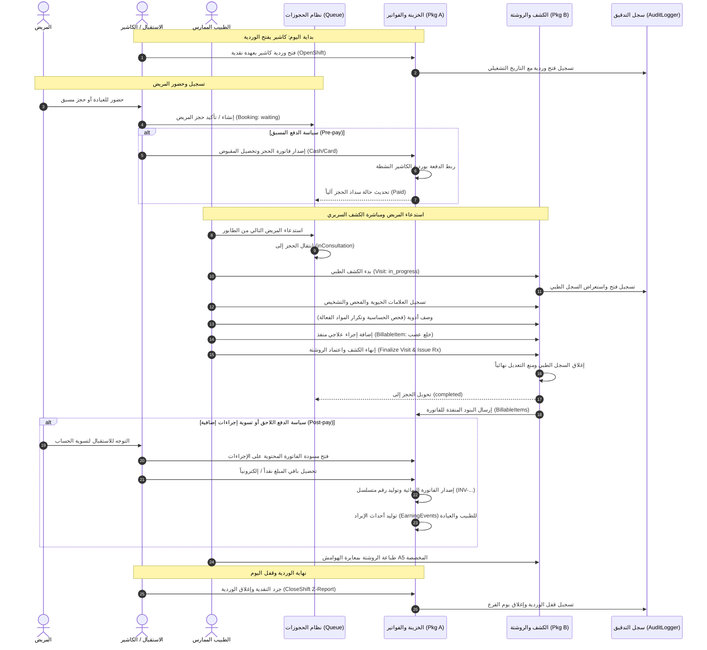
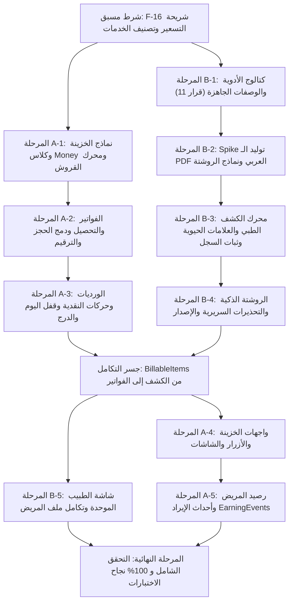

# العقد المشترك والتكامل — بين الحزمتين A و B ونظام الحجوزات والرواتب
# الملف: `docs/plans/PKG-AB-integration-contract.md`
# تكامل: الحجوزات (Queue) + الخزينة (Package A) + الكشف السريري (Package B) + الرواتب (Payroll Contract)

---

## 1. ملكية الكيانات وحوكمة البيانات (Entity Ownership)

| الكيان (Entity) | الحزمة المالكة (Owner) | الجهات المستهلكة (Consumers) | طبيعة الربط (Reference vs Snapshot) |
| :--- | :--- | :--- | :--- |
| **Booking** | إدارة الطابور والحجوزات (Queue) | الخزينة (A)، الكشف (B)، التقارير | كيان مرجعي أصلي (`bookingId`) |
| **Visit** | الكشف الطبي (Package B) | ملف المريض (F-08)، الفواتير (A) | مرجع تشغيلي، وسجل طبي محمي |
| **BillableItem** | ينتجه الكشف (B) أو الاستقبال (A) | الفواتير (A)، الرواتب (F-24) | **Snapshot كامل** للخدمة والسعر والطبيب وقت التنفيذ |
| **Invoice** | الخزينة والفواتير (Package A) | الحجوزات (اشتقاق الدفع)، المريض | كائن مالي غير قابل للتعديل بعد الإصدار |
| **Payment** | الخزينة والفواتير (Package A) | الورديات (A)، أحداث الإيراد | حركة تحصيل قطعية مربوطة بدرج ووردية |
| **CashierShift** | الخزينة والفواتير (Package A) | التقارير المالية، التسويات | عهدة ودرج الكاشير لكل فرع |
| **Refund** | الخزينة والفواتير (Package A) | الفواتير، الورديات، أحداث الإيراد | حركة استرداد مخصومة من الوردية الحالية |
| **PatientBalance** | الخزينة والفواتير (Package A) | ملف المريض (F-08)، الفواتير (A) | رصيد دائن ومدين مستقل لكل فرع |
| **Prescription** | الكشف الطبي (Package B) | الصيدلية، ملف المريض، المطبوعات | **Snapshot سريري** مستقل تماماً عن كتالوج الأدوية |
| **EarningEvent** | تنتجه الخزينة (A) عند التحصيل/الرد | مسير الرواتب والأجور (F-24/25/26) | حدث غير قابل للتعديل مفصل على مستوى البند والطبيب |

---

## 2. التسلسل الزمني الكامل لدورة المريض (End-to-End Sequence Diagram)



---

## 3. مصفوفة توافق الحالات التشغيلية (State Compatibility Matrix)

| حالة الحجز (Booking) | حالة الكشف (Visit) | حالة الفاتورة (Invoice) | الحالة التشغيلية والقيود الملزمة |
| :--- | :--- | :--- | :--- |
| `waiting` (بالانتظار) | لم يبدأ (`null`) | `draft` أو `issued` أو `paid` | مسموح. المريض ينتظر، وربما سدد مسبقاً أو لم يسدد بعد. |
| `waiting` (بالانتظار) | `in_progress` | أي حالة | ❌ **ممنوع**. لا يمكن بدء الكشف دون انتقال الحجز إلى `inConsultation`. |
| `inConsultation` (بالكشف) | `in_progress` | `draft` أو `partially_paid` أو `paid` | مسموح. الطبيب يفحص ويسجل الإجراءات في المسودة. |
| `inConsultation` (بالكشف) | `finalized` | أي حالة | ❌ **ممنوع**. إنهاء الكشف يلزم نقل الحجز فوراً إلى `completed`. |
| `completed` (مكتمل) | `finalized` | `paid` (مسددة) | الوضع المالي والطبي النموذجي للزيارة المكتملة. |
| `completed` (مكتمل) | `finalized` | `partially_paid` أو `issued` | مسموح: كشف مكتمل مع وجود مديونية على المريض (سداد آجل). |
| `completed` (مكتمل) | لم يبدأ (`null`) | أي حالة | ❌ **ممنوع**. لا يكتمل الحجز دون إتمام كشف أو تسجيل مبرر استثنائي. |
| `cancelled` (ملغى) | ملغى أو لم يبدأ | `voided` أو `refunded` | مسموح: تطبيق سياسة استرداد أو مصادرة العربون. |
| `noShow` (لم يحضر) | لم يبدأ (`null`) | `voided` أو إيراد مصادرة عربون | مسموح: لا يوجد كشف ولا توثيق سريري. |

---

## 4. القرارات التشغيلية والتكاملية الحاسمة

### 4.1 توقيت السداد (Pre-pay vs Post-pay)
- **القاعدة الحاكمة:** توقيت السداد **إعداد مرن قابل للضبط لكل فرع** في إعدادات المنشأة.
- **القاعدة الذهبية الصارمة:** **السداد لا يمنع التوثيق الطبي السريري إطلاقاً**.
  - إذا كان الفرع يعمل بنظام الدفع المسبق وحضر المريض دون دفع: يُظهر النظام شارة تحذيرية برتقالية "غير مسدد"، لكن لا يتم حظر الطبيب إطلاقاً من مباشرة الحالة وكتابة السجل الطبي والروشتة إنقاذاً للمريض وتوثيقاً للعمل السريري.

### 4.2 الطبيب المنفذ للبند وتحويل الحالات (Doctor Reassignment Rules)
- **الاستحقاق المالي يُحسب للطبيب المنفذ الفعلي للبند السريري (`performingDoctorId`) وليس طبيب الحجز الأصلي:**
  1. **التحويل قبل بدء الكشف:** يتعدل `doctorId` في الحجز وتنتقل الحالة لطابور الطبيب الجديد ويصبح هو صاحب الحق السريري والمالي.
  2. **التحويل أثناء الكشف:** إذا باشر طبيب الكشف وسجل تشخيصاً، ثم استدعى طبيباً جراحياً لإجراء عملية صغرى: يُسجل بند الكشف للطبيب الأول، بينما يُسجل بند الإجراء المنفذ باسم الطبيب الجراح كـ `performingDoctorId`.
  3. **التحويل بعد انتهاء الكشف وإصدار الفاتورة:** ممنوع تعديل الطبيب المنفذ على الفاتورة بأثر رجعي؛ وأي تصحيح يتم عبر إلغاء البند بإشعار دائن وإعادة إصداره.

### 4.3 تغير السعر بعد الحجز
- **قاعدة الـ Snapshot:** السعر المعتمد على الفاتورة هو **السعر المسجل لحظة تأكيد الحجز أو إصدار الفاتورة**.
- إذا قام المالك بتعديل سعر الكشف في الكتالوج العام بعد حجز المريض: **لا يتغير سعر حجز المريض القائم نهائياً**، حفاظاً على التزام العيادة بالسعر المتفق عليه.

### 4.4 إلغاء الحجز مع وجود عربون مسدد
- في حال إلغاء الحجز أو عدم الحضور:
  - إذا كانت سياسة الفرع "استرداد": يُنشأ إشعار استرداد (`Refund`) مرتبط بالدفعة ويُصرف من درج الكاشير.
  - إذا كانت سياسة الفرع "مصادرة العربون": يتحول العربون إلى بند إيراد مستقل (إيراد عدم حضور) دون رده للمريض.

### 4.5 الكشوفات المجانية والإعادات (Follow-ups & Re-consultations)
- عند حجز استشارة أو إعادة مجانية مطابقة لسياسة الفرع:
  - تصدر الفاتورة ببند خدمة استشارة بقيمة 0 ج.م، ويكون سبب الخصم "إعادة مجانية نظامية"، لتوثيق تقديم الخدمة دون مطالبة مالية ودون فتح فجوة في الترقيم.

### 4.6 الإجراءات الطارئة الإضافية أثناء الكشف
- إذا قرر الطبيب إجراء تدخل طبي إضافي غير مبرمج:
  - يضيف الإجراء في شاشة الكشف كـ `BillableItem`.
  - يظهر البند تلقائياً في شاشة كاشير الاستقبال فور إنهاء الكشف لتحصيل الفارق المالي من المريض.

---

## 5. تكامل أحداث الإيراد مع نظام الرواتب القادم (F-24/25/26 Payroll)

### 5.1 نموذج حدث الإيراد المعتمد (`EarningEvent`)
```dart
class EarningEvent {
  final String id;
  final String invoiceId;
  final String lineItemId;
  final String branchId;
  final String performingDoctorId;
  final List<String> assistingStaffIds; // التمريض أو الأطباء المساعدون
  final int grossAmountPiastres; // المبلغ الإجمالي للبند
  final int netAmountPiastres; // الصافي بعد خصم الخصومات
  final EarningEventTypeEnum eventType; // collection | refund
  final DateTime occurredAt;
  final String paymentId;
}
```

### 5.2 قاعدة الشلال لتوزيع الدفع الجزئي (Waterfall Allocation Rule)
- عند قيام المريض بسداد دفعة جزئية من فاتورة تحتوي على كشف وإجراء علاجي ومستهلكات:
  - **الخطوة 1:** يُخصص السداد أولاً لتغطية بنود المواد والمستهلكات ومعامل التحاليل (حق المنشأة والمورد).
  - **الخطوة 2:** ما يتبقى يُخصص للإجراءات الطبية والجراحية.
  - **الخطوة 3:** ما يتبقى في النهاية يُخصص لأجر كشف العيادة الخاص بالطبيب.
  - *التبرير:* ضمان عدم دفع عمولة أو مستحقات لطبيب على مبالغ لم تُحصل فعلياً بعد، وحماية تدفق المنشأة النقدي.

---

## 6. خطة البناء المقترحة والجدول الزمني لتداخل المراحل (Build Order)

تم ترتيب البناء بحيث تتقدم المتطلبات المسبقة والنواة الرياضية الصافية، ويتداخل العمل بين الحزمتين لمنع الانسداد:



### تبرير هذا الترتيب:
1. بناء `Money` و `F-16` أولاً يضمن أن كل الأسعار المسجلة في الحجوزات والخدمات تبنى بدقة القروش وبفئات واضحة.
2. تنفيذ Spike الـ PDF العربي مبكراً في B-2 يكشف أي عوائق في الطباعة قبل كتابة واجهات الروشتة المعقدة.
3. ربط الجسر `BRIDGE` يضمن أن الإجراءات التي يسجلها الطبيب في B-3 تتحول فوراً إلى فواتير حقيقية في A-3.

