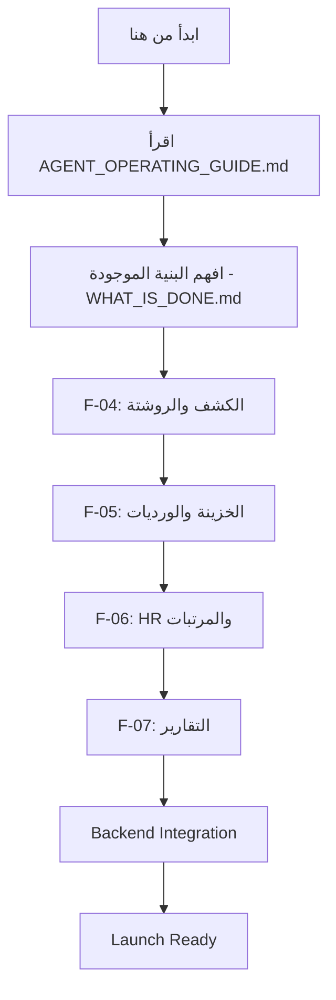

# 🚧 ما هو ناقص في مشروع عيادتي (Eyadty)
> **وثيقة تسليم للمبرمج القادم** — نوفمبر 2026
> اقرأ أولاً: [`WHAT_IS_DONE.md`](./WHAT_IS_DONE.md) و [`docs/AGENT_OPERATING_GUIDE.md`](../AGENT_OPERATING_GUIDE.md)

---

> [!IMPORTANT]
> **قبل ما تبدأ أي شغل:** اقرأ `docs/AGENT_OPERATING_GUIDE.md` بالكامل. هو القانون الحاكم للمشروع.
> المشروع كله Mock data — مفيش backend حقيقي متصل لحد دلوقتي.

---

## 📊 نظرة عامة على الوضع الحالي

```mermaid
flowchart LR
    A["✅ F-01 Branches"] --> B["✅ F-02 RBAC"]
    B --> C["✅ F-03 Audit Log"]
    C --> D["✅ F-00 Doctors"]
    D --> E["✅ Bookings UI"]
    E --> F["✅ Patients UI"]
    F --> G["✅ F-04a Consultation"]
    G --> H["⏳ F-04b Prescription & Calibration"]
    H --> I["⏳ F-05 Cashier"]
    I --> J["⏳ F-06 HR & Settlements"]
    J --> K["⏳ F-07 Analytics"]
    K --> L["⏳ F-08 Multi-Branch Settings"]
    L --> M["🔴 Backend Integration"]
```



| الفيتشر | الحالة | الأولوية |
|:---|:---:|:---:|
| ✅ F-01: الفروع | مكتمل | — |
| ✅ F-02: RBAC والمستخدمين | مكتمل | — |
| ✅ F-03: سجل النشاط | مكتمل | — |
| ✅ F-00: الأطباء والجداول | مكتمل | — |
| ✅ الحجوزات (UI) | مكتمل | — |
| ✅ المرضى (UI) | مكتمل | — |
| ✅ F-04a: الكشف الطبي ومتابعة الزيارات | مكتمل (100%) | — |
| ✅ B-DISC: الخصومات والكشوفات المجانية | مكتمل (100%) | — |
| ⏳ F-04b: الروشتة ومعايرة الطباعة والأدوية | لم يبدأ بعد | 🔴 عالية |
| ⏳ F-05: الخزينة والورديات | Skeleton فقط | 🔴 عالية |
| ⏳ F-06: HR والمرتبات | Skeleton فقط | 🟡 متوسطة |
| ⏳ F-07: التقارير والإحصائيات | Skeleton فقط | 🟡 متوسطة |
| ⏳ F-08: إعدادات متقدمة | جزئي | 🟡 متوسطة |
| 🔴 Backend Integration | لم يبدأ | 🔴 حرجة |

---

## 🔴 الأولوية القصوى: الفيتشرز الناقصة بالكامل

### 1️⃣ F-04b: الروشتة ومعايرة الطباعة وكتالوج الأدوية (Prescription & Print Calibration)
> **ملاحظة:** تم إنجاز **F-04a (محرك الكشف الطبي، العلامات الحيوية، طابور الكشوفات، الحفظ التلقائي، وإغلاق الزيارة)** بالكامل مع 129 اختباراً ناجحاً. ما تبقى من F-04 هو الشق الدوائي والطباعي أدناه.

**ما يجب بناؤه في F-04b:**

#### Layer البيانات والدومين
- `prescription_model.dart` — نموذج الروشتة (medications, dosage, frequency, duration, instructions).
- `prescription_template_model.dart` — إحداثيات وهوامش المعايرة (Canvas Bounding Box).
- `drug_model.dart` — كتالوج الأدوية والأسماء العلمية والتجارية وأشكال الجرعات.
- `save_prescription_use_case.dart` و `calibrate_print_template_use_case.dart`.

#### Layer العرض
- `PrescriptionBuilderPanel` داخل شاشة الكشف لإضافة وحذف الأدوية بالجرعات وتكرار الروشتات السابقة.
- `PrescriptionCalibrationPage` — صفحة معايرة Canvas مع Drag & Drop لتحديد هوامش الهيدر والفوتر والجدول.
- `PrescriptionPdfPreview` + زر الطباعة الفورية الصامتة.
- قوالب التشخيص والروشتات الجاهزة لتسريع عمل الطبيب.

> **مرجع التفاصيل الكاملة:** [`docs/plans/PKG-B-visit-prescription-drugs.md`](../PKG-B-visit-prescription-drugs.md)

---

### 2️⃣ F-05: الخزينة والورديات (Cashier & Shift Drawer)
**الملف الموجود حالياً:** `lib/features/cashier/presentation/pages/cashier_page.dart` (skeleton فارغ)

**ما يجب بناؤه كاملاً:**

```
lib/features/cashier/
├── data/models/
│   ├── shift_drawer_model.dart        # Opening balance, cash in/out, closing
│   ├── invoice_model.dart             # Invoice items, discounts, payment methods
│   └── cash_transaction_model.dart   # كل حركة مالية
├── data/repo/cashier_mock_repo_impl.dart
├── domain/repo/cashier_repo.dart
├── domain/use_cases/
│   ├── get_active_shift_use_case.dart
│   ├── open_shift_drawer_use_case.dart
│   ├── close_shift_drawer_use_case.dart
│   ├── create_invoice_use_case.dart
│   └── record_drawer_expense_use_case.dart
└── presentation/
    ├── manager/cashier_cubit.dart
    ├── manager/cashier_state.dart
    ├── pages/cashier_page.dart
    └── widgets/
        ├── shift_status_card.dart       # اسم الكاشير + وقت الفتح + رصيد الدرج
        ├── cashier_summary_metrics.dart # إجمالي كاش / فيزا / تحويل / تأمين
        ├── invoice_ledger_table.dart    # جدول الفواتير
        ├── open_close_shift_dialog.dart # مطابقة درج الكاشير
        └── create_invoice_dialog.dart   # إنشاء فاتورة + طباعة إيصال
```

**Workflows المطلوبة:**
1. **فتح الوردية** — الكاشير يدخل رصيد البداية (العهدة الافتتاحية)
2. **تسجيل المدفوعات** — ربط كل حجز بفاتورة مع تحديد طريقة الدفع (كاش/فيزا/آجل)
3. **تسجيل المصروفات النثرية** — صرف من الخزينة مع ذكر السبب والمستلم
4. **إغلاق الوردية (التقفيل):** `Expected Cash = Opening + Cash Payments - Expenses`، الكاشير يعد الكاش الفعلي، النظام يحسب العجز/الزيادة ويطبع تقرير الوردية

> **مرجع التفاصيل الكاملة:** [`docs/plans/PKG-A-treasury-billing.md`](../PKG-A-treasury-billing.md) و [`docs/plans/F-05-cashier-shifts.md`](../F-05-cashier-shifts.md)

> [!NOTE]
> **بنود مؤجلة لما بعد F-05 (Deferred Items):**
> - **تخصيص سياسات الخزينة لكل عميل عبر واجهة الإعدادات (Tenant Cashier Policies UI):** كلاس `CashierPolicy` مصمم ومحقون عبر DI بقيم افتراضية قابلة للاستبدال بدون تعديل الـ use cases. بناء شاشة إعدادات متقدمة لتعديل سقوف العجز والمصروفات النثرية وعمر الوردية ديناميكياً لكل مستأجر/فرع مؤجل لما بعد F-05.

---

### 3️⃣ F-06: الموارد البشرية وتسويات الأطباء (HR & Settlements)
**الملف الموجود حالياً:** `lib/features/hr/presentation/pages/hr_page.dart` (skeleton فارغ)

**ما يجب بناؤه:**

```
lib/features/hr/
├── data/models/
│   ├── doctor_settlement_model.dart   # visits, revenue, doctor share, clinic share
│   ├── employee_model.dart            # Staff payroll data
│   └── payroll_item_model.dart        # Base salary, allowances, deductions
├── data/repo/hr_mock_repo_impl.dart
├── domain/repo/hr_repo.dart
├── domain/use_cases/
│   ├── calculate_doctor_settlement_use_case.dart
│   ├── confirm_settlement_payout_use_case.dart
│   ├── get_staff_payroll_use_case.dart
│   └── record_advance_payment_use_case.dart
└── presentation/
    ├── manager/hr_cubit.dart
    ├── manager/hr_state.dart
    ├── pages/hr_page.dart
    └── widgets/
        ├── hr_filter_bar.dart           # Date range, doctor selector
        ├── doctor_settlement_table.dart  # Visits count, revenue, shares
        ├── settlement_breakdown_dialog.dart  # Itemized audit of each visit
        └── print_settlement_sheet_button.dart
```

**الحسابات المطلوبة:**
- أجر مرن: راتب ثابت + مكافآت / مبلغ لكل كشف / نسبة مئوية / مزيج
- خصم التأخير التلقائي
- سلفيات ومكافآت وخصومات مع أسباب وتواريخ
- مسير المرتبات الشهري
- تسوية الدكتور: `نصيب الدكتور = إجمالي الكشوفات × نسبة العمولة`

---

### 4️⃣ F-07: التقارير والإحصائيات (Analytics)
**الملف الموجود حالياً:** `lib/features/analytics/presentation/pages/analytics_page.dart` (skeleton فارغ)

**ما يجب بناؤه:**

```
lib/features/analytics/
├── data/models/
│   ├── clinical_analytics_model.dart  # visits/branch, peak hours, cancel rates
│   └── financial_analytics_model.dart # revenue/specialty, top doctors
├── data/repo/analytics_mock_repo_impl.dart
├── domain/repo/analytics_repo.dart
├── domain/use_cases/
│   ├── get_clinical_analytics_use_case.dart
│   └── get_financial_analytics_use_case.dart
└── presentation/
    ├── manager/analytics_cubit.dart
    ├── manager/analytics_state.dart
    ├── pages/analytics_page.dart
    └── widgets/
        ├── analytics_metric_grid.dart        # Average wait time, return rate, revenue
        ├── branch_comparison_chart.dart      # fl_chart: Revenue across branches
        ├── doctor_performance_leaderboard.dart
        └── peak_hours_heatmap.dart           # Rush hours by hour & day
```

**المؤشرات المطلوبة للمالك:**
1. إجمالي إيراد اليوم والشهر (لكل فرع ومجمع)
2. صافي الأرباح بعد خصم مستحقات الأطباء والمصروفات
3. إجمالي مديونيات المرضى غير المحصلة
4. عدد الكشوفات وحالات الحضور والانتظار لحظياً

---

## 🟡 تحسينات مطلوبة على الفيتشرز الموجودة

### 🏠 لوحة التحكم الرئيسية (Home Dashboard)
**الحالة الحالية:** `HomeDashboardPage` موجودة لكن محتواها شبه فارغ

**ما ينقصها:**
- Summary Cards ديناميكية بأرقام حقيقية من الـ Repos
- مؤشرات حيوية: إيراد اليوم، كشوفات الأمس، مرضى الانتظار الحالي
- Quick Actions: زر حجز سريع، زر فتح وردية الخزينة
- ربط مباشر مع البيانات من `BookingsCubit` و `CashierCubit`

---

### 📅 الحجوزات والطابور الحي
**ما ينقصها:**
- **ربط الكشف:** زر "بدء الكشف" ينقل المريض من الطابور إلى `VisitsPage` مع تمرير بياناته
- **حساب وقت الانتظار:** `estimatedWaitMinutes` يُحسب فعلياً من `avgConsultationDurationMinutes` للدكتور
- **حالة "داخل الكشف":** تحديث لحظي لحالة المريض عند نداءه من الطابور
- **Queue Drag & Drop:** ترتيب المرضى بالسحب والإفلات

---

### 🧑‍⚕️ المرضى
**ما ينقصها:**
- **التايم لاين الطبي الكامل:** قائمة كل الزيارات مع التشخيصات والروشتات والفواتير
- **ربط الكشف:** من ملف المريض → عرض كشوفاته السابقة وروشتاته
- **المرفقات:** رفع صور وتحاليل وأشعة مرتبطة بزيارة معينة
- **الملف العائلي:** ربط أفراد العائلة ببعض في ملف موحد (الخاصية موجودة في الموديل لكن UI ناقص)
- **تسجيل الحدث في Audit Log** عند فتح ملف المريض (`view_patient_profile`)

---

### ⚙️ الإعدادات
**ما ينقصها (Tabs فارغة أو ناقصة):**
- **Tab: Branches** — مكتمل ✅
- **Tab: Company Info** — مكتمل ✅
- **Tab: Working Schedule** — مكتمل ✅
- **Tab: Special Holidays** — مكتمل ✅
- **Tab: Medical Services** — مكتمل ✅
- **Tab: Default Pricing** — ⚠️ Tab موجودة لكن المحتوى جزئي
- **Tab: Notifications** — ⚠️ Tab موجودة لكن المحتوى placeholder
- **Tab المطلوب إضافتها: Print Templates** — نماذج الطباعة (روشتة، إيصال، فاتورة)
- **Tab المطلوب إضافتها: Roles & Permissions** — محرك تعديل أدوار الموظفين (UI matrix كامل)

---

## 🔴 الأهم: ربط Backend حقيقي

> [!CAUTION]
> المشروع كله يعمل بـ **Mock Repositories** في الذاكرة. أي بيانات تُدخل تختفي عند إعادة تشغيل التطبيق.
> ربط الـ Backend هو الخطوة الحرجة قبل أي launch حقيقي.

### ما يجب تبديله:
كل `*MockRepoImpl` يجب أن يُستبدل (أو يُضاف بجانبه) بـ `*RepoImpl` حقيقي يتصل بـ API.

| الـ Mock الحالي | الـ Real المطلوب |
|:---|:---|
| `BookingsMockRepoImpl` | `BookingsRepoImpl` → Dio + API |
| `PatientsMockRepoImpl` | `PatientsRepoImpl` → Dio + API |
| `DoctorsMockRepoImpl` | `DoctorsRepoImpl` → Dio + API |
| `BranchesMockRepoImpl` | `BranchesRepoImpl` → Dio + API |
| `SettingsMockRepoImpl` | `SettingsRepoImpl` → Dio + API |
| `StaffUsersMockRepoImpl` | `StaffUsersRepoImpl` → Dio + API |
| `AuditLogsMockRepoImpl` | `AuditLogsRepoImpl` → Dio + API |

### البنية التحتية موجودة بالفعل:
- `DioConsumer` و `AppInterceptor` موجودان في `lib/core/api/`
- `EndPoints` موجود في `lib/core/api/end_points.dart` (يحتاج تعبئة)
- `get_it` DI جاهز للتبديل بين Mock و Real

### طريقة التبديل (بدون كسر الكود):
```dart
// في dependency_injection.dart
// بدّل من:
sl.registerLazySingleton<BookingsRepo>(() => BookingsMockRepoImpl());
// إلى:
sl.registerLazySingleton<BookingsRepo>(() => BookingsRepoImpl(sl()));
```

---

## 🔧 مشاكل تقنية صغيرة تحتاج حل

### 1. Firebase (معطّل حالياً)
```yaml
# في pubspec.yaml — هذه معلّقة:
# firebase_core: ^4.11.0
# firebase_messaging: ^16.4.1
```
الكود موجود في `lib/firebase_options.dart` و `lib/core/helpers/notification_helper/`
لكن Firebase معطّل لتسريع التطوير. يحتاج إعادة تفعيل مع Backend.

### 2. Auth Flow حقيقي
`LoginPage` و `LoginCubit` موجودان لكن:
- Login Use Case يعيد Mock user بدون API
- Token management غير مكتمل
- Refresh Token logic ناقص

### 3. الترجمة (i18n) ناقصة
بعض الـ keys في `assets/translations/ar-EG.json` و `en-US.json` ناقصة أو غير متسقة.
يجب مراجعة الـ keys في الفيتشرز الجديدة.

### 4. نظام الإشعارات
`LocalNotificationService` و `FirebaseNotifications` موجودان لكن غير مفعّلَين بالكامل.

---

## 🗺️ خريطة الطريق المقترحة للمبرمج القادم



### المراحل بالترتيب:

| # | المرحلة | المدة المقدرة | الملف المرجعي |
|:---:|:---|:---:|:---|
| 1 | F-04: الكشف والروشتة + PDF Engine | 2-3 أسابيع | `PKG-B-visit-prescription-drugs.md` |
| 2 | F-05: الخزينة والورديات | 1-2 أسبوع | `PKG-A-treasury-billing.md` |
| 3 | ربط F-04 و F-05 مع الحجوزات | 3-5 أيام | `PKG-AB-integration-contract.md` |
| 4 | F-06: HR والمرتبات | 1-2 أسبوع | FEATURES_EXECUTION_PLAN.md § Feature 6 |
| 5 | F-07: التقارير والإحصائيات | 1 أسبوع | FEATURES_EXECUTION_PLAN.md § Feature 7 |
| 6 | تحسين لوحة التحكم | 3-5 أيام | FEATURES_EXECUTION_PLAN.md |
| 7 | Backend Integration (كل الـ Repos) | 2-4 أسابيع | يعتمد على API documentation |
| 8 | Firebase + Push Notifications | 1 أسبوع | — |
| 9 | QA شامل + اختبارات E2E | 1 أسبوع | — |

---

## 📋 قواعد صارمة لا تتجاوزها (من AGENT_OPERATING_GUIDE.md)

> [!WARNING]
> هذه القواعد غير قابلة للتفاوض في هذا المشروع:

1. **NO Entity Classes** — `{Name}Model` فقط في كل الطبقات (بدون `domain/entities/`)
2. **100% Nullable Models** — كل حقل `final Type? field;` بدون `required`
3. **Exactly ONE Cubit Per Feature** — ممنوع Cubits ثانوية لنفس الفيتشر
4. **Zero Hardcoded Strings** — كل نص عبر `'key'.tr()` مع ملفي الترجمة
5. **Strict Ban on `setState`** — الكل في الـ Cubit
6. **NO code-gen** — ممنوع `build_runner` / `freezed` / `json_serializable`
7. **Soft Delete فقط** لأي كيان له علاقات
8. **PermissionEvaluator** — الصلاحيات تمر منه حصراً، fail-closed دائماً
9. **CairoTimeHelper** — بدلاً من `DateTime.now()` مباشرة
10. **AuditLogger** — كل حدث حساس يتسجل
11. **`flutter analyze` = 0 issues** قبل أي commit
12. **`flutter test` = 100% pass** قبل أي commit

---

## 📂 الملفات المرجعية المهمة في `docs/plans/`

| الملف | المحتوى |
|:---|:---|
| `F-01-multi-branch-management.md` | خطة تفصيلية لإدارة الفروع (مكتمل) |
| `F-02-roles-permission-anduser-accounts.md` | خطة RBAC والصلاحيات (مكتمل) |
| `F-03-security-audit-log.md` | خطة سجل النشاط (مكتمل) |
| `PKG-A-treasury-billing.md` | 🔴 خطة الخزينة والفواتير (ناقص) |
| `PKG-B-visit-prescription-drugs.md` | 🔴 خطة الكشف والروشتة (ناقص) |
| `PKG-AB-integration-contract.md` | 🔴 عقد تكامل الحزمتين |
| `patients-records-plan-v3.md` | خطة ملف المرضى الأحدث |

---

> [!TIP]
> ابدأ بقراءة `PKG-B-visit-prescription-drugs.md` و `PKG-A-treasury-billing.md` — هما الخطوتان التاليتان مباشرة.
> المشروع مكتمل هندسياً من ناحية البنية، ما ينقص هو إكمال الـ Features وربط Backend.

