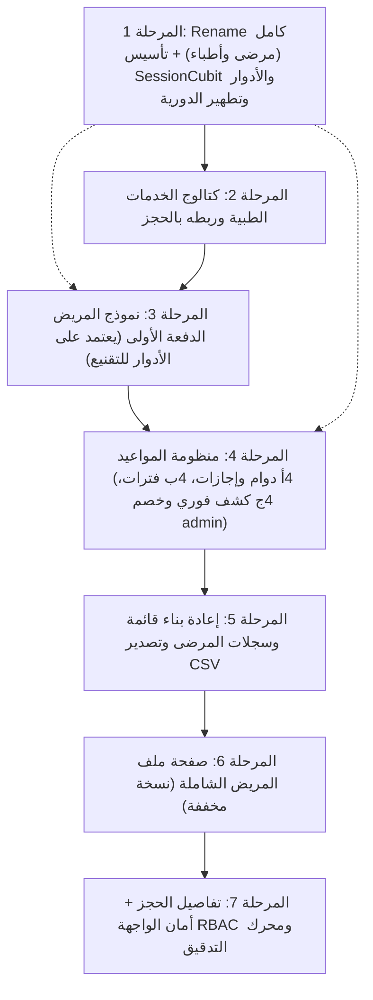

# خطة تنفيذ تفصيلية (الإصدار الثالث المعتمد - v3): تحويل فيتشر "العملاء" إلى "المرضى والسجلات الطبية" وإصلاح منظومة المواعيد

**المشروع:** عيادتي (Eyadty Clinic SaaS Dashboard)  
**تاريخ التحديث:** 07 نوفمبر 2026  
**الإصدار المعتمد:** Version 3.0 (v3 Final Plan - شاملة تأسيس الجلسة والأدوار في المرحلة 1، تفصيل الكشف الفوري وإجازات الأطباء، ومحرك التدقيق)  
**المسار المعتمد للملف:** `docs/plans/patients-records-plan-v3.md` (ونسخة مطابقة في `docs/plans/patients-records-plan-v2.md`)  
**الملف المرجعي السابق:** `docs/plans/patients-records-plan.md`

---

## فهرس الوثيقة

1. [الملخص التنفيذي وقرارات الحسم المعتمدة](#1-الملخص-التنفيذي-وقرارات-الحسم-المعتمدة)
2. [جرد الوضع الحالي الشامل](#2-جرد-الوضع-الحالي-الشامل)
3. [استراتيجية العمل بدون باك إند والـ Mock](#3-استراتيجية-العمل-بدون-باك-إند-والـ-mock)
4. [عقد الـ API الشامل المطلوب تسليمه لفريق الباك إند (API Contract)](#4-عقد-الـ-api-الشامل-المطلوب-تسليمه-لفريق-الباك-إند-api-contract)
5. [التصميم الهندسي والموديلات المحدثة](#5-التصميم-الهندسي-والموديلات-المحدثة)
6. [التقاطعات والتنسيق مع خطة كروت الطابور وتوضيح الكشف الفوري](#6-التقاطعات-والتنسيق-مع-خطة-كروت-الطابور-وتوضيح-الكشف-الفوري)
7. [مراحل التنفيذ التفصيلية (المراحل 1 إلى 7)](#7-مراحل-التنفيذ-التفصيلية-المراحل-1-إلى-7)
8. [الدفعة الثانية من الحقول والبيانات السريرية للمريض](#8-الدفعة-الثانية-من-الحقول-والبيانات-السريرية-للمريض)
9. [الوظائف والتبويبات المؤجلة وخارج النطاق الحالي](#9-الوظائف-والتبويبات-المؤجلة-وخارج-النطاق-الحالي)
10. [خطة الاختبار والتحقق وضمان الجودة](#10-خطة-الاختبار-والتحقق-وضمان-الجودة)
11. [استراتيجية الهجرة والتوافق](#11-استراتيجية-الهجرة-والتوافق)
12. [مصفوفة المخاطر والقرارات التصميمية](#12-مصفوفة-المخاطر-والقرارات-التصميمية)
13. [الديون الفنية والملاحظات الهندسية المرصودة](#13-الديون-الفنية-والملاحظات-الهندسية-المرصودة)

---

## 1. الملخص التنفيذي وقرارات الحسم المعتمدة

### 1.1 التحول المستهدف
تنتقل هذه الخطة بمنصة **"عيادتي"** من طور التأسيس المشتق من قالب خدمات التشغيل والتنظيف بالساعة إلى منظومة عيادات ومراكز طبية مصرية تخصصية متكاملة (EMR & Clinic Management). يتمحور التطوير حول ركائز هندسية متينة:
1. **السجل الطبي الموحد للمريض:** إدارة بيانات المرضى الديموغرافية والسريرية مع استيعاب خصوصية العيادات المصرية (الرقم القومي، الهاتف المصري، التنبيهات الفورية للحساسية والأمراض المزمنة، جهة اتصال الطوارئ الاختيارية، وولي أمر الأطفال).
2. **منظومة المواعيد الذكية المبنية على الفترات (Slot-Based Scheduling):** ربط الحجز بدوام الطبيب ومدة الخدمة الطبية وسعر الكشف الثابت، ومنع الإدخال اليدوي العشوائي للأوقات، مع توفير مسار الكشف الفوري (Walk-in) وإدارة التزاحم.
3. **التطهير الشامل للهوية والكوادر:** إعادة التسمية الكاملة للكوادر من "فنيين" (`technicians`) إلى "أطباء" (`doctors`)، وتطهير إعدادات المنشأة من مفاهيم شركات النظافة، وتصحيح مسمى عيادة "الباطنة".
4. **تأسيس معمارية الصلاحيات والجلسة مبكراً (Phase 1):** بناء نموذج الأدوار `UserRoleEnum` وإدارة الجلسة عبر `SessionCubit` في المرحلة 1 لتغذية متطلبات تقنيع الرقم القومي (المرحلة 3) والخصم المالي المقصور على المدير (المرحلة 4ج).

### 1.2 القرارات المحسومة نهائياً في الخطة (v3)
تم حسم وإغلاق كافة القرارات التصميمية والوظيفية دون استثناء:
1. **مكان جدول دوام وإجازات الأطباء:** في شاشة "إعدادات المنشأة" كقسم جديد لإدارة العيادات والأطباء، مع إمكانية تعديل دوام الطبيب وإجازاته من داخل صفحته (`DoctorDetailsPage`).
2. **شجرة العائلة وحذف `parentPatientId`:** شجرة العائلة مؤجلة بالكامل. تم حذف جملة "وربط شجرة العائلة" من الواجهة، و**حذف حقل `parentPatientId` نهائياً** من الموديل والعقد والاكتفاء بتسجيل ولي الأمر للأطفال عبر اسمه وهاتفه وصلة قرابته (`guardianName`, `guardianPhone`, `guardianRelation`).
3. **دمج السجلات المكررة:** مؤجل لخطة لاحقة، ونكتفي بمنع التكرار وقت الإدخال (فحص الهاتف والرقم القومي).
4. **الأرقام والتواريخ اللاتينية (0-9):** اعتماد الأرقام الدولية اللاتينية (0-9) في كل مكان عبر النظام (تواريخ، أوقات، هواتف، أسعار)، حتى في الواجهة العربية، لضمان دقة القراءة ومنع أخطاء الحسابات والجرعات.
5. **الصلاحيات والأمان:** تطبيق إخفاء الواجهة حسب الدور كحل مؤقت عبر `SessionCubit` ونموذج أدوار صريح (`admin` / `doctor` / `reception`). **نص صريح وملزم:** *"إخفاء الواجهة في تطبيق Flutter ليس حماية أمنية حقيقية، والحماية الفعلية الملزمة ضد تسريب البيانات الطبية الحساسة يجب أن تُفرض في طبقة الباك إند وقواعد البيانات عبر الـ Tokens وصلاحيات الـ API"*.
6. **تقديم إدارة الجلسة للمرحلة 1:** بناء `UserRoleEnum` و `SessionCubit` في المرحلة 1 لدعم فحص الصلاحيات وتقنيع البيانات في المراحل 3 و 4ج.
7. **زر تبديل الدور للتطوير فقط:** إظهار محول الأدوار في الهيدر حصراً في وضع التطوير `if (kDebugMode)`.
8. **حصر الخصم اليدوي على المدير (`admin` فقط):** الخصم اليدوي على سعر الكشف صلاحية حصرية لمدير المنشأة (`admin`)، ويُحظر تماماً على الطبيب أو موظف الاستقبال في كافة شاشات وأقسام النظام.
9. **اعتماد سياسة الكشف الفوري (Walk-in):** اعتُمد **الخيار (ب): إدراج فوري في طابور الانتظار بوقت "الآن" دون حجز فترة زمنية مقيدة (Floating Queue with Proximity Warning)**، مع تنبيه الموظف إذا كان لدى الطبيب موعد مجدول خلال أقل من 15-20 دقيقة، مع تمييزه بحقل `isWalkIn: true` مستقلاً عن طبيعة الكشف السريرية.
10. **اعتماد تصدير ملفات المرضى بصيغة CSV:** اعتُمد **توليد ملف CSV قياسي بترميز UTF-8 BOM بدون أي Packages**؛ يفتح على Excel باللغة العربية دون أي تشويه وبلا زيادة لحجم التطبيق.
11. **الـ Audit Log كمحرك تسجيل فقط (Logging Engine Only):** تقرر اعتماد سجل التدقيق في هذه الخطة كمحرك تسجيل على مستوى طبقة البيانات والـ Mock دون بناء شاشات عرض معقدة في المرحلة 7 لترشيد الجهد، مع إمكانية التحقق منه باختبارات الوحدة.
12. **إعادة التسمية الشاملة للأطباء (`technicians` ← `doctors`):** تنفيذ rename كامل للفولدرات والموديلات والـ Cubits والشاشات والحوارات وتصحيح عيادة "الباطنة" وتطهير بيانات "بيوريكسو".

### 1.3 قرارات تحديث نموذج وواجهات المريض (نوفمبر 2026)
تم إقرار وتطبيق التعديلات التالية على فيتشر المرضى:
1. **حذف الرقم القومي نهائياً (`nationalId`):** إزالة الرقم القومي كلياً من الموديل والمستودعات والشاشات والتحقق، وحذف كلاس `NationalIdHelper` وملفات اختباراته، وإلغاء منطق التقنيع وصلاحيات الأدوار المرتبطة به.
2. **رقم هاتف موحد وتأكيد الواتساب (`phoneHasWhatsapp`):** إلغاء الهاتف الثانوي (`secondaryPhone`)، وتوحيد الهاتف على رقم مصري رئيسي واحد مع حقل `phoneHasWhatsapp: bool?` (افتراضياً `true`)، وإظهار زر واتساب في الجدول والبطاقات والتفاصيل فقط عندما تكون القيمة `true`.
3. **تكرار الهاتف تحذير فقط:** لا يتم رفض تسجيل المريض برقم هاتف مسجل مسبقاً لأن أفراد الأسرة الواحدة يشتركون في نفس الرقم؛ يعرض النظام تحذيراً تفاعلياً مع إمكانية المتابعة والحفظ عبر `allowDuplicatePhone: true`.
4. **تاريخ آخر دورة شهرية (`lastMenstrualPeriodDate`):** خاص بالسيدات مع الحمل والرضاعة في مربع محايد؛ يُفرغ تلقائياً عند تغيير النوع لذكر.
5. **الكتالوج الطبي التفاعلي (`MedicalCatalogRepo`):** قائمة منسدلة متعددة الاختيار للحساسية والأمراض المزمنة مع تطبيع النصوص العربية (`ArabicTextHelper`) وإمكانية إضافة عناصر جديدة لحظياً دون تكرار.
6. **فصائل الدم واتجاه LTR الصارم:** عرض كافة فصائل الدم الثمانية بشرائح مرئية باتجاه LTR حصراً (`Directionality LTR`) لمنع انعكاس علامة الموجب والسالب في واجهات RTL، وبشكل متجاوب (سطر واحد للشاشات الكبيرة وسطحين للشاشات الصغيرة والمتوسطة).
7. **التحقق متعدد التبويبات (Multi-tab Validation):** فحص كافة تبويبات الفورم الثلاثة عند الحفظ، والانتقال التلقائي لأول تبويب به خطأ، وإظهار نقطة حمراء على عناوين التبويبات غير المكتملة.

---

## 2. جرد الوضع الحالي الشامل

### 2.1 جرد ما تم تنفيذه فعلياً في الكود (Current Baseline)
لتفادي تكرار العمل، رصد الفحص الميداني وجود خطوات تمهيدية نُفذت بالفعل في الكود:
* **في نصوص الترجمة (`assets/translations/ar-EG.json`):** استُبدلت بعض المفاتيح بمسميات طبية (`patient` = "المريض"، `patient_label` = "المريض"، `call_patient` = "استدعاء المريض"، `consultation_fee_label` = "سعر الكشف"، `cancelled_by_patient` = "إلغاء من المريض").
* **في موديل الحجز (`BookingModel`):** أُضيفت حقول `patientId`, `patientName`, `patientPhone`, `fileNumber`, `consultationFee`، وحقول الإلغاء والتأجيل (`cancelReason`, `cancelledAt`, `rescheduledTo`, `arrivalTime`).
* **في المساعدات الزمنية:** وُجد كلاس `CairoTimeHelper` متكامل في `lib/core/utils/helpers/cairo_time_helper.dart` يحسب توقيت القاهرة والتوقيت الصيفي المصري، وهو جاهز للتعميم وحقن الساعة.

### 2.2 جدول الفحص الميداني للملفات والكلاسات المعنية

| مسار الملف الفعلي | الكلاس / العنصر الحالي | الوظيفة الحالية | التغيير المطلوب في الخطة | الأثر المعماري |
|---|---|---|---|---|
| `lib/core/enums/user_role_enum.dart` | جديد | غير موجود | إنشاء `UserRoleEnum` بأدوار `admin`, `doctor`, `reception` | تأسيس الصلاحيات في المرحلة 1 |
| `lib/core/cubits/session_cubit.dart` | جديد | غير موجود | إنشاء `SessionCubit` و `SessionState` مسجلين في الـ DI | إدارة الجلسة في المرحلة 1 |
| `lib/core/routing/routes.dart` | `AppRouter.customers`, `technicians` | مسارات قديمة | استبدالها بـ `/patients` و `/doctors` (alias مسار العملاء اختياري) | تنظيم التوجيه المركزي |
| `lib/core/routing/app_router.dart` | مسار العملاء والفنيين | توجيه الصفحات | توجيه إلى `PatientsPage` و `DoctorsPage` وتفاصيل كل منهما | GoRouter Routing |
| `lib/core/utils/constants/app_list.dart` | `layoutItems(context)` | القائمة الجانبية (Sidebar) | تحديث المسارات والأيقونات للمرضى والأطباء | Navigation Shell |
| `lib/core/dependency_injection/dependency_injection.dart` | تسجيلات `Customers` و `Technicians` | حقن التبعيات | تسجيل `SessionCubit`, `PatientsRepo`, `DoctorsRepo`, `MedicalServicesRepo` | DI Registration |
| `lib/features/customers/` (كامل المجلد) | مجلد العملاء القديم | طبقات العملاء | إعادة تسمية المجلد بالكامل إلى `lib/features/patients/` | Clean Architecture |
| `lib/features/technicians/` (كامل المجلد) | مجلد الفنيين القديم | طبقات الفنيين | إعادة تسمية المجلد بالكامل إلى `lib/features/doctors/` وتحديث كافة الكلاسات | مواءمة الهوية الطبية |
| `lib/features/settings/data/repo/settings_mock_repo_impl.dart` | `SettingsRepoImpl` | بيانات "بيوريكسو" وعطلات قطر | استبدال بيانات المنشأة بعيادة طبية وعطلات مصر الرسمية | تطهير الهوية بالـ Mock |
| `lib/features/customers/data/models/customer_model.dart` | `CustomerModel` | موديل العميل مع حقول الدورية | استبداله بـ `PatientModel` (الدفعة الأولى) وحذف `recurrence` | نموذج خالٍ من الـ Entities |
| `lib/features/bookings/data/models/booking_model.dart` | `BookingModel` | نموذج الحجز الحالي | تنقيته من `recurrence` و `hourlyRate` وإضافة `isWalkIn` | تنظيف بقايا النظام القديم |
| `lib/features/bookings/presentation/widgets/add_edit_booking_dialog.dart` | `AddEditBookingDialog` | حوار إنشاء الحجز | تعديل التسلسل (مريض ← طبيب ← خدمة ← تاريخ ← فترات) | نموذج حجز الفترات |
| `lib/features/bookings/presentation/widgets/action_dialogs/reassign_technician_dialog.dart` | `ReassignTechnicianDialog` | تحويل الحجز لفني آخر | إعادة تسميته لـ `ReassignDoctorDialog` وعرض الفترات المتاحة | استبعاد الطبيب الحالي |
| `lib/shared/auth/presentation/widgets/login_widgets/custom_phone_field.dart` | `CustomPhoneField` | حقل الهاتف العام | تغيير كود الدولة لـ `+20` وعلم مصر والمثال `010 1234 5678` | الهوية المصرية |

---

## 3. استراتيجية العمل بدون باك إند والـ Mock

> [!IMPORTANT]
> التطبيق يعمل حالياً بوضع **Mock بالكامل (Zero Real Backend)**؛ حيث تُخزن البيانات وتُعالج بالذاكرة المؤقتة أثناء تشغيل التطبيق. تُبنى كافة الميزات على واجهات مستودعات مجردة صلبة مطابقة 100% لعقد الـ API المستقبلي، ويتم التبديل للباك إند الحقيقي عبر استبدال فئة التنفيذ في `dependency_injection.dart` فقط.

### 3.1 معمارية التبديل النظيف والتسميات المعتمدة
تسمية صريحة وموحدة للمستودعات عبر كافة الفيتشرات:
```
domain/repo/patients_repo.dart            <-- العقد المجرد (PatientsRepo)
data/repo/patients_mock_repo_impl.dart    <-- التنفيذ الوهمي الحالي (PatientsMockRepoImpl)
data/repo/patients_remote_repo_impl.dart  <-- التنفيذ المستقبلي عبر الشبكة (PatientsRemoteRepoImpl)
```
في `lib/core/dependency_injection/dependency_injection.dart`:
```dart
// تسجيل إدارة الجلسة (المرحلة 1):
getIt.registerLazySingleton<SessionCubit>(() => SessionCubit());

// أثناء مرحلة الـ Mock:
getIt.registerLazySingleton<PatientsRepo>(() => PatientsMockRepoImpl());
getIt.registerLazySingleton<DoctorsRepo>(() => DoctorsMockRepoImpl());
getIt.registerLazySingleton<MedicalServicesRepo>(() => MedicalServicesMockRepoImpl());
getIt.registerLazySingleton<BookingsRepo>(() => BookingsMockRepoImpl());
getIt.registerLazySingleton<SettingsRepo>(() => SettingsMockRepoImpl());
```

### 3.2 محاكاة قواعد العمل المعقدة في طبقة الـ Mock
1. **إدارة دور المستخدم الحالي عبر `SessionCubit`:**
   - كلاس `SessionCubit` يخزن `SessionState(currentRole: UserRoleEnum.admin)`.
   - زر تبديل الدور السريع في الهيدر يُعرض حصراً داخل شرط `if (kDebugMode)` لاختبار صلاحيات الطبيب وموظف الاستقبال في بيئة التطوير.
2. **صلاحية الخصم اليدوي (حصرية لـ `admin` فقط):**
   - يسمح بتطبيق الخصم اليدوي على سعر الكشف **حصراً للمدير (`admin`)**. إذا كان الدور الحالي `doctor` أو `reception`، تُعطل خانة الخصم تماماً في الواجهة ويتم رفض أي خصم في المستودع.
3. **توليد رقم الملف الطبي الموحد (`fileNumber`):**
   - توليد تسلسلي بالذاكرة بصيغة `PAT-` متبوعة بـ 6 خانات رقمية (`PAT-000101`, `PAT-000102`).
4. **فحص منع التكرار (الهاتف والرقم القومي):**
   - مطابقة الهاتف المصري والرقم القومي مع السجلات النشطة، والرفض بـ `ValidationFailure` عند وجود تطابق.
5. **الأرشفة المشروطة وإلغاء الأرشفة:**
   - رفض أرشفة أي مريض لديه كشوفات قادمة (`upcomingBookings > 0`) أو مديونية (`outstandingBalance > 0`). ودعم دالة `unarchivePatient`.
6. **تقنيع الرقم القومي وحماية التعديل:**
   - صيغة التقنيع الموحدة: أول 4 أرقام، 6 نجوم، آخر 4 أرقام (`2950******2348`).
   - في `PatientsMockRepoImpl`: إذا كان `sessionCubit.state.currentRole == UserRoleEnum.reception`، يُرجع الرقم مقنعاً. وإذا كان `admin` أو `doctor` يرجع كاملاً.
   - عند استدعاء `updatePatient`: إذا احتوت خانة `nationalId` على نجوم `*` أو كانت فارغة، يتجاهلها المستودع ويحتفظ بالرقم الأصلي المخزن مسبقاً دون استبداله بالنجوم.

### 3.3 بيانات الـ Mock المصرية المتسقة والواقعية

| معرف المريض | الاسم ثلاثي / رباعي | الهاتف المخزن | الرقم القومي (14 رقم) | فصيلة الدم | الحساسية والأمراض | العمر والنوع | حالة الملف وسيناريو الاختبار |
|---|---|---|---|---|---|---|---|
| `PAT-000101` | سارة أحمد عبد الله | `+201012345678` | `29505120102348` | `O+` | حساسية بنسلين شديدة | 31 سنة • أنثى | ملف مكتمل، لديها كشف اليوم |
| `PAT-000102` | يوسف إبراهيم المنصوري | `+201123456789` | `28809230104512` | `A+` | سكري النوع الثاني + ضغط | 38 سنة • ذكر | ملف مكتمل، عليه مديونية (300 ج.م) |
| `PAT-000103` | مريم محمود حسن | `+201234567890` | `31602150106724` | `B-` | حساسية سلفا وأسبرين | 10 سنوات • أنثى | **طفل قاصر (<18)**، ولي الأمر: محمود حسن |
| `PAT-000104` | طارق عبد الرحمن علي | `+201545678901` | `27011050101236` | `AB+` | أمراض قلب وشرايين | 56 سنة • ذكر | مؤمن عليه: شركة "بوبا مصر" (تغطية 80%) |
| `PAT-000105` | منى فاروق الشناوي | `+201098765432` | `null` | `unknown` | لا توجد | غير محدد • أنثى | **بيانات ناقصة (سجل مريض سابق من النظام القديم)** |
| `PAT-000106` | خالد سعيد عبد الرازق | `+201187654321` | `28204180108932` | `O-` | ربو شعبي مزمن | 44 سنة • ذكر | **ملف مؤرشف** (انتقل للعيش بمحافظة الإسكندرية) |

---

## 4. عقد الـ API الشامل المطلوب تسليمه لفريق الباك إند (API Contract)

وثيقة المواصفات الكاملة لكافة نقاط النهاية (Endpoints) المطلوبة للعيادة:

### 4.1 نقاط نهاية سجلات المرضى والكتالوج الطبي (Patients & Medical Catalog)
* `GET /api/v1/patients`: استرجاع قائمة المرضى مع الترقيم والبحث والفلاتر (`search`, `gender`, `blood_group`, `has_debt`, `is_archived`).
* `GET /api/v1/patients/:id`: استرجاع الملف الطبي الكامل للمريض. خطأ 404 عند عدم الوجود.
* `POST /api/v1/patients`: إنشاء ملف مريض جديد وتوليد `id` و `file_number`. يقبل `allow_duplicate_phone: true` لتخطي تحذير الهاتف المشترك للعائلة. الحقول: `name`, `phone`, `phone_has_whatsapp`, `date_of_birth`, `gender`, `blood_group`, `allergies`, `chronic_diseases`, `height_cm`, `weight_kg`, `is_pregnant`, `is_nursing`, `last_menstrual_period_date`, `governorate`, `city`, `detailed_address`, `emergency_contact_name`, `emergency_contact_phone`, `emergency_contact_relation`, `guardian_name`, `guardian_phone`, `guardian_relation`, `insurance_company`, `insurance_policy_number`, `insurance_coverage_percent`, `internal_notes`.
* `PUT /api/v1/patients/:id`: تعديل بيانات مريض مع دعم `allow_duplicate_phone`.
* `PATCH /api/v1/patients/:id/archive`: أرشفة المريض. أخطاء: 400 إذا كان لديه حجوزات قادمة (`CANNOT_ARCHIVE_ACTIVE_BOOKINGS`) أو مديونية (`CANNOT_ARCHIVE_DEBT_BALANCE`).
* `PATCH /api/v1/patients/:id/unarchive`: إلغاء الأرشفة واستعادة الملف للقوائم النشطة.
* `GET /api/v1/patients/by-phone`: استرجاع المرضى غير المؤرشفين المشتركين في نفس الهاتف للتحذير.
* `GET /api/v1/medical-catalog`: استرجاع قائمة عناصر الحساسية أو الأمراض المزمنة مع البحث والتطبيع العربي (`type`: `allergy` | `chronic_disease`, `query`).
* `POST /api/v1/medical-catalog`: إضافة عنصر جديد للكتالوج الطبي أثناء التسجيل لمنع التكرار والتكرار المطبّع.

### 4.2 نقاط نهاية الخدمات الطبية (Medical Services)
* `GET /api/v1/services`: استرجاع الخدمات الطبية الفعالة.
* `GET /api/v1/services/:id`: تفاصيل خدمة طبية.
* `POST /api/v1/services`: إنشاء خدمة طبية (الاسم، سعر الكشف، المدة بالدقائق، الطبيب المخصص).
* `PUT /api/v1/services/:id`: تعديل بيانات وسعر ومدة الخدمة وحالة تنشيطها.
* `DELETE /api/v1/services/:id`: حذف خدمة (يُرفض بكود 400 إذا ارتبطت بحجوزات سابقة ويوجه لتعطيلها).

### 4.3 نقاط نهاية دوام وإجازات الأطباء (Doctor Schedule & Leaves)
* `GET /api/v1/doctors/:id/schedule`: استرجاع أيام وساعات عمل الطبيب وفترات الراحة.
* `PUT /api/v1/doctors/:id/schedule`: تحديث جدول دوام الطبيب.
* `GET /api/v1/doctors/:id/leaves`: استرجاع قائمة إجازات الطبيب المسجلة.
* `POST /api/v1/doctors/:id/leaves`: تسجيل إجازة لطبيب (`start_date`, `end_date`, `reason`).
* `DELETE /api/v1/doctors/:id/leaves/:leaveId`: إلغاء إجازة مسجلة.

### 4.4 نقاط نهاية المواعيد والكشف الفوري (Bookings & Slots)
* `GET /api/v1/doctors/:id/available-slots`: استرجاع فترات اليوم المتاحة بحالاتها (`available`, `booked`, `past`, `break_time`).
* `POST /api/v1/bookings`: حجز موعد محدد الفترة. مع قفل المعاملات البنكي بالسيرفر لمنع السباق وإرجاع كود 409 عند التعارض.
* `PUT /api/v1/bookings/:id`: تعديل تفاصيل الحجز.
* `PATCH /api/v1/bookings/:id/status`: تغيير حالة الحجز (`waiting`, `in_consultation`, `completed`, `no_show`, `postponed`, `cancelled`).
* `PATCH /api/v1/bookings/:id/reassign`: تحويل الحجز لطبيب آخر مع تحديد فترة جديدة للبديل.
* `POST /api/v1/bookings/walk-in`: تسجيل كشف فوري؛ يُنشئ حجوزاً بوقت وتاريخ اليوم الحالي مع `is_walk_in: true`، وحالة `waiting` وتوليد `queue_number` دون حجز فترة مقيدة.

### 4.5 نقاط نهاية سجل التدقيق والعطلات (Audit Logs & Holidays)
* `GET /api/v1/audit-logs`: استرجاع سجلات التدقيق للمرضى والحجوزات (صلاحية `admin` فقط).
* `GET /api/v1/settings/holidays`: استرجاع عطلات المنشأة والعطلات الرسمية المصرية.
* `POST /api/v1/settings/holidays`: إضافة عطلة رسمية.
* `DELETE /api/v1/settings/holidays/:id`: حذف عطلة.

---

## 5. التصميم الهندسي والموديلات المحدثة

### 5.1 نموذج المريض المحدث (`PatientModel` - 38 حقل كودياً بدون استثناء)
الملف: `lib/features/patients/data/models/patient_model.dart`
> [!NOTE]
> تم تطهير الموديل بحذف الرقم القومي (`nationalId`) وحذف الهاتف الثانوي (`secondaryPhone`)، وإضافة تأكيد الواتساب (`phoneHasWhatsapp`) وتاريخ آخر دورة شهرية للسيدات (`lastMenstrualPeriodDate`)، ليصبح الموديل 38 حقلاً كودياً تماماً بدون حقول entities منفصلة ولا required وبدون defaults بالـ constructor.

```dart
class PatientModel extends Equatable {
  // 1. المعرفات الأساسية
  final String? id;
  final String? fileNumber;

  // 2. البيانات الشخصية والديموغرافية الأساسية
  final String? name;
  final String? phone;          // صيغة دولية موحدة: +20XXXXXXXXXX
  final bool? phoneHasWhatsapp; // افتراضياً true لتفعيل زر التواصل عبر واتساب
  final DateTime? dateOfBirth;
  final GenderEnum? gender;

  // 3. البيانات السريرية الأساسية والحيوية
  final BloodGroupEnum? bloodGroup;
  final List<String>? allergies;
  final List<String>? chronicDiseases;
  final num? heightCm;
  final num? weightKg;
  final bool? isPregnant;
  final bool? isNursing;
  final DateTime? lastMenstrualPeriodDate; // خاص بالسيدات مع فحص قيود تاريخ اليوم والميلاد

  // 4. العنوان الإقليمي
  final String? governorate;
  final String? city;
  final String? detailedAddress;

  // 5. جهة اتصال الطوارئ (اختيارية تماماً)
  final String? emergencyContactName;
  final String? emergencyContactPhone;
  final String? emergencyContactRelation;

  // 6. بيانات ولي الأمر (للأطفال دون 18 سنة - بدون parentPatientId)
  final String? guardianName;
  final String? guardianPhone;
  final String? guardianRelation;

  // 7. التأمين الصحي
  final String? insuranceCompany;
  final String? insurancePolicyNumber;
  final num? insuranceCoveragePercent;

  // 8. ملاحظات إدارية وأرشفة
  final String? internalNotes;
  final bool? isArchived;
  final DateTime? archivedAt;
  final String? archiveReason;

  // 9. إحصائيات سريرية ومالية تراكمية
  final int? totalVisitsCount;
  final num? outstandingBalance;
  final num? totalPaidAmount;
  final DateTime? lastVisitDate;
  final DateTime? upcomingBookingDate;

  // 10. طوابع الوقت
  final DateTime? createdAt;
  final DateTime? updatedAt;

  const PatientModel({
    this.id,
    this.fileNumber,
    this.name,
    this.phone,
    this.phoneHasWhatsapp,
    this.dateOfBirth,
    this.gender,
    this.bloodGroup,
    this.allergies,
    this.chronicDiseases,
    this.heightCm,
    this.weightKg,
    this.isPregnant,
    this.isNursing,
    this.lastMenstrualPeriodDate,
    this.governorate,
    this.city,
    this.detailedAddress,
    this.emergencyContactName,
    this.emergencyContactPhone,
    this.emergencyContactRelation,
    this.guardianName,
    this.guardianPhone,
    this.guardianRelation,
    this.insuranceCompany,
    this.insurancePolicyNumber,
    this.insuranceCoveragePercent,
    this.internalNotes,
    this.isArchived,
    this.archivedAt,
    this.archiveReason,
    this.totalVisitsCount,
    this.outstandingBalance,
    this.totalPaidAmount,
    this.lastVisitDate,
    this.upcomingBookingDate,
    this.createdAt,
    this.updatedAt,
  });

  // حساب السن والشهور كأرقام مجردة بدون نصوص عربية صلبة
  int? calculateAgeYears({DateTime? customNow}) {
    if (dateOfBirth == null) return null;
    final now = customNow ?? CairoTimeHelper.now();
    int years = now.year - dateOfBirth!.year;
    if (now.month < dateOfBirth!.month ||
        (now.month == dateOfBirth!.month && now.day < dateOfBirth!.day)) {
      years--;
    }
    return years >= 0 ? years : 0;
  }

  int? calculateAgeMonths({DateTime? customNow}) {
    if (dateOfBirth == null) return null;
    final now = customNow ?? CairoTimeHelper.now();
    int months = (now.year - dateOfBirth!.year) * 12 + (now.month - dateOfBirth!.month);
    if (now.day < dateOfBirth!.day) months--;
    return months >= 0 ? months : 0;
  }

  bool isChild({DateTime? customNow}) {
    final years = calculateAgeYears(customNow: customNow);
    if (years == null) return false;
    return years < 18;
  }

  double? get calculatedBmi {
    if (heightCm == null || weightKg == null || heightCm! <= 0 || weightKg! <= 0) {
      return null;
    }
    final heightMeters = heightCm! / 100.0;
    return weightKg! / (heightMeters * heightMeters);
  }

  bool get hasAllergies => allergies != null && allergies!.isNotEmpty;
  bool get hasChronicDiseases => chronicDiseases != null && chronicDiseases!.isNotEmpty;
  bool get hasIncompleteProfile => dateOfBirth == null || gender == null;
}
```

### 5.2 نموذج إجازات الأطباء (`DoctorLeaveModel`)
الملف: `lib/features/doctors/data/models/doctor_leave_model.dart`
```dart
class DoctorLeaveModel {
  final String? id;
  final String? doctorId;
  final DateTime? startDate;
  final DateTime? endDate;
  final String? reason;

  const DoctorLeaveModel({
    this.id,
    this.doctorId,
    this.startDate,
    this.endDate,
    this.reason,
  });
}
```

### 5.3 نموذج الخدمة الطبية المتوافق مع قوانين المشروع (`MedicalServiceModel`)
الملف: `lib/features/settings/data/models/medical_service_model.dart`
```dart
class MedicalServiceModel {
  final String? id;
  final String? name;
  final num? consultationFee;         // السعر الثابت للكشف (ج.م)
  final int? durationMinutes;         // مدة الكشف الافتراضية
  final bool? isActive;               // Nullable بدون default value في الكونستركتور
  final String? assignedDoctorId;
  final String? description;

  const MedicalServiceModel({
    this.id,
    this.name,
    this.consultationFee,
    this.durationMinutes,
    this.isActive,                    // التزام صارم بقاعدة: لا قيم افتراضية في الـ Constructor
    this.assignedDoctorId,
    this.description,
  });

  bool get isServiceActive => isActive ?? true;
}
```

### 5.4 نموذج الأدوار وإدارة الجلسة المتوافق مع المشروع (`SessionCubit`)
الملف: `lib/core/enums/user_role_enum.dart`
```dart
enum UserRoleEnum {
  admin,
  doctor,
  reception;

  // الخصم اليدوي حصري لـ admin فقط
  bool get canApplyManualDiscount => this == UserRoleEnum.admin;
  bool get canViewFullNationalId => this == UserRoleEnum.admin || this == UserRoleEnum.doctor;
  bool get canViewAuditLogs => this == UserRoleEnum.admin;
}
```

الملف: `lib/core/cubits/session_cubit.dart`
```dart
import 'package:equatable/equatable.dart';
import 'package:flutter_bloc/flutter_bloc.dart';
import '../enums/user_role_enum.dart';

class SessionState extends Equatable {
  final UserRoleEnum currentRole;
  final String userId;
  final String userName;

  const SessionState({
    this.currentRole = UserRoleEnum.admin,
    this.userId = 'USR-001',
    this.userName = 'د. أحمد المدير',
  });

  SessionState copyWith({
    UserRoleEnum? currentRole,
    String? userId,
    String? userName,
  }) {
    return SessionState(
      currentRole: currentRole ?? this.currentRole,
      userId: userId ?? this.userId,
      userName: userName ?? this.userName,
    );
  }

  @override
  List<Object?> get props => [currentRole, userId, userName];
}

class SessionCubit extends Cubit<SessionState> {
  SessionCubit() : super(const SessionState());

  void switchRole(UserRoleEnum role) {
    emit(state.copyWith(currentRole: role));
  }
}
```

---

## 6. التقاطعات والتنسيق مع خطة كروت الطابور وتوضيح الكشف الفوري

### 6.1 العلاقة بين "الكشف الفوري" (Walk-in) وتبويب "كشف طارئ ومستعجل" (Emergency)
نحسم صراحة الفارق الجوهري بين المفهومين لرفع أي التباس:
1. **طبيعة الكشف الإكلينيكية (`BookingTypeEnum.emergency`):**
   - يمثل **نوع الحالة الطبية والسريرية** (كشف جديد `newVisit`، استشارة ومتابعة `revisit`، أو كشف طارئ ومستعجل `emergency` لحالة حادة كألم صدري أو نزيف). هذا النوع هو ما يُعرض في تبويبات `BookingTypeTabBar` الثلاثة بالواجهة.
2. **قناة الحضور وطريقة الجدولة الإدارية (`isWalkIn: bool`):**
   - يمثل **مسار القدوم الإداري (Entry / Scheduling Channel)**؛ أي أن المريض حضر مباشرة لمقر العيادة دون حجز موعد مسبق في جدول الطبيب، ودخل طابور الانتظار بالوقت الفعلي.
   - مريض الكشف الفوري (Walk-in) قد يحضر لكشف عادي أو استشارة أو كشف طارئ مستعجل.
3. **الملكية وتوزيع الحقول:**
   - حقل `isWalkIn: bool` في `BookingModel`: **تملكه هذه الخطة** (المرحلة 4ج) ويُسجل كـ Flag إداري.
   - حقل `queueNumber: int` (رقم الطابور اليومي المتسلسل): **تملكه خطة كروت الطابور** لإدارة شاشات الاستدعاء وصالة الانتظار.
   - `BookingStatusEnum` وحالاته (`waiting`, `noShow`, `postponed`, `cancelled`): **تملكه خطة كروت الطابور بالكامل**.

| الملف / الكيان | العنصر المشترك | خطة الملكية (Owner Plan) | دور الخطة الحالية (Patients Plan) |
|---|---|---|---|
| `booking_status_enum.dart` | `noShow`, `postponed`, `cancelled` وحذف `scheduled = waiting` | **خطة كروت الطابور** | مستهلك للـ Enum فقط |
| `booking_model.dart` | حقول: `cancelReason`, `cancelledAt`, `rescheduledTo`, `queueNumber` | **خطة كروت الطابور** | استهلاك الحقول لعرض سجل التغييرات في تفاصيل الحجز |
| `booking_model.dart` | حقل: `isWalkIn: bool` | **خطة السجلات والمواعيد (هذه الخطة)** | مسار الكشف الفوري العائم |
| `booking_model.dart` | حذف حقول: `recurrence`, `hourlyRate` | **خطة السجلات والمواعيد (هذه الخطة)** | التطهير النهائي للنظام القديم |

---

## 7. مراحل التنفيذ التفصيلية (المراحل 1 إلى 7)



---

### المرحلة 1: إعادة التسمية الميكانيكية الشاملة (مرضى وأطباء) وتأسيس الجلسة
* **الهدف:** القضاء التام على مسميات "العملاء" والفنيين والخدمات المنزلية والدوريات، وتأسيس معمارية الأدوار والجلسة عبر `SessionCubit` في الـ DI، وتوطين الهوية المصرية وعيادة الباطنة، بدون ميزات سريرية جديدة.
* **جرد ما تم إنجازه مسبقاً (Skipped Items):**
  - نصوص الحجز التي عُدلت للمريض وسعر الكشف لن يُعاد لمسها.
  - إزالة `scheduled = waiting` أُسندت لخطة كروت الطابور ولن تُنفذ هنا.
  - مسار الـ alias لـ `/customers` اختياري (لوحة التحكم داخلية ولا تعتمد على Deep Links).
* **الملفات المتأثرة:**
  - `lib/core/enums/user_role_enum.dart` (ملف جديد)
  - `lib/core/cubits/session_cubit.dart` (ملف جديد)
  - `lib/core/dependency_injection/dependency_injection.dart` (تسجيل `SessionCubit`)
  - `lib/shared/app_layout/presentation/widgets/header_layout.dart` (زر تبديل الدور تحت شرط `kDebugMode`)
  - `lib/features/customers/` ← نقل وإعادة تسمية إلى `lib/features/patients/`
  - `lib/features/technicians/` ← نقل وإعادة تسمية إلى `lib/features/doctors/` بكامل ملفاتها (`DoctorModel`, `DoctorsCubit`, `DoctorsTable`, `add_edit_doctor_dialog`, إلخ)
  - `lib/features/settings/data/repo/settings_mock_repo_impl.dart` (استبدال بيانات "بيوريكسو" وعطلات قطر ببيانات عيادة مصرية وعطلات مصر الرسمية)
  - `lib/features/bookings/presentation/widgets/action_dialogs/reassign_technician_dialog.dart` → `reassign_doctor_dialog.dart`
  - `lib/features/bookings/data/models/recurrence_rule_model.dart` (حذف)
  - `lib/features/bookings/presentation/widgets/add_edit_booking_sections/booking_form_recurring_schedule.dart` (حذف)
  - `lib/features/bookings/presentation/widgets/details_sections/booking_details_recurrence_section.dart` (حذف)
  - `lib/core/routing/routes.dart` & `app_router.dart`
  - `assets/translations/ar-EG.json` & `en-US.json`
* **قائمة المهام (Checklist):**
  - [ ] إنشاء `UserRoleEnum` و `SessionCubit` وتسجيله في `dependency_injection.dart`.
  - [ ] إضافة زر محول الأدوار في الهيدر محاطاً بشرط `if (kDebugMode)` لاختبار صلاحيات الأدوار في بيئة التطوير.
  - [ ] تنفيذ الـ Rename الشامل لـ `customers` ← `patients`.
  - [ ] تنفيذ الـ Rename الشامل لـ `technicians` ← `doctors` (فولدرات، كلاسات، شاشات، وحوارات).
  - [ ] تطهير `settings_mock_repo_impl.dart` ببيانات منشأة عيادة وعطلات مصر الرسمية.
  - [ ] حذف الحجز الدوري وكلاساته بالكامل من الحجوزات والـ Mock.
  - [ ] استبدال `hourlyRate` مؤقتاً بحقل واحد `consultationFee` (سعر الكشف).
  - [ ] ضبط حقل الهاتف: كود `+20` وعلم مصر والمثال `010 1234 5678`.
  - [ ] تصحيح خطأ الكلمة لتكون عيادة **"الباطنة"** في كافة شاشات ونصوص وتخصصات النظام.
  - [ ] توحيد العملة لتكون `ج.م` / `EGP`.
* **تقدير الجهد:** كبير (3 إلى 4 أيام عمل).
* **معايير القبول:** التطبيق يبنى بدون أخطاء `flutter analyze`، واختفاء أي أثر لكلمات عملاء أو فنيين أو تنظيف.
* **الجاهزية:** كامل ومكتمل 100%.

---

### المرحلة 2: كتالوج الخدمات الطبية (Medical Services)
* **الهدف:** بناء موديول الخدمات الطبية وتحديد السعر والمدة، وربطها بالحجز.
* **الملفات المتأثرة:** `medical_service_model.dart` (بدون defaults في الـ Constructor)، `medical_services_repo.dart`، `medical_services_mock_repo_impl.dart`، `medical_services_settings_page.dart`، وربطها بـ `add_edit_booking_dialog.dart`.
* **تقدير الجهد:** متوسط (2 يوم عمل).
* **الجاهزية:** كامل في الواجهة والـ Mock.

---

### المرحلة 3: نموذج المريض الموسع (الدفعة الأولى) والإضافة السريعة
* **الهدف:** تطبيق `PatientModel` (الدفعة الأولى 38 حقلاً بدون `parentPatientId`)، حوار الإضافة السريعة وحوار التعديل المفصل، مع استنتاج البيانات من الرقم القومي ومنع التكرار وحماية الرقم المقنع بالاعتماد على `SessionCubit`.
* **الملفات المتأثرة:** `patient_model.dart`، `national_id_helper.dart`، `add_edit_patient_dialog.dart` (جهة الطوارئ اختيارية)، `quick_add_patient_dialog.dart`، و `patients_mock_repo_impl.dart`.
* **الاعتماديات:** تعتمد على المرحلة 1 (لاستخدام `SessionCubit` في محاكاة التقنيع)، والمرحلة 2.
* **تقدير الجهد:** كبير (3 إلى 4 أيام عمل).
* **الجاهزية:** كامل في الواجهة والـ Mock.

---

### المرحلة 4: منظومة المواعيد الذكية (3 أجزاء)
* **4أ: جدول دوام وإجازات الأطباء:**
  - بناء موديل `DoctorScheduleModel` وموديل `DoctorLeaveModel` (`id`, `doctorId`, `startDate`, `endDate`, `reason`).
  - شاشة إعداد الدوام والإجازات في إعدادات المنشأة ومن صفحة الطبيب `DoctorDetailsPage`.
* **4ب: مولد الفترات وشبكة الاختيار:**
  - خوارزمية `SlotGeneratorHelper` بحقن الساعة (`nowProvider`)، شبكة الفترات المتاحة، استبعاد فترات الراحة وإجازات الطبيب والمحجوز والماضي بتوقيت القاهرة، ومحاكاة خطأ 409.
* **4ج: الكشف الفوري والتحويل والخصم اليدوي:**
  - تفعيل **مسار الكشف الفوري (Walk-in)** المعتمد: زر الكشف الفوري يُدرج المريض في طابور الانتظار بوقت "الآن" مع `isWalkIn: true`، ونوع الكشف المطلوب، وتنبيه الموظف إذا كان لدى الطبيب موعد مجدول خلال أقل من 15-20 دقيقة.
  - التحويل لطبيب آخر `ReassignDoctorDialog` بالفترات المتاحة للبديل.
  - إضافة حقل الخصم اليدوي مع قيد الصلاحية الصارم: **مقصور حصراً على دور `admin` عبر `SessionCubit`**، ومعطل تماماً للطبيب وموظف الاستقبال.
* **تقدير الجهد الكلي:** كبير جداً (5 إلى 6 أيام عمل).
* **الجاهزية:** كامل في الواجهة والـ Mock.

---

### المرحلة 5: قائمة وسجلات المرضى وتصدير CSV
* **الهدف:** بناء جدول وكروت المرضى بالشارات الطبية، والترقيم الفعلي، وتصدير قائمة المرضى كملف CSV بترميز UTF-8 BOM بدون حزم خارجية.
* **الملفات المتأثرة:** `patients_page.dart`، `patients_table.dart`، `patient_card.dart`، `patients_filter_bar.dart`، و `csv_export_helper.dart`.
* **تقدير الجهد:** متوسط (2 إلى 3 أيام عمل).
* **الجاهزية:** كامل في الواجهة والـ Mock.

---

### المرحلة 6: صفحة ملف المريض الشاملة (نسخة مخففة)
* **الهدف:** مركز الملف الطبي الموحد: الكروت الأربعة، شريط تنبيهات الحساسية، والتبويبات الثلاثة الأساسية (نظرة عامة وبيانات الطوارئ، سجل الكشوفات بفلاتره الشاملة، والتاريخ الطبي المتاح بالدفعة الأولى)، وأزرار الاتصال والواتساب والأرشفة المشروطة.
* **الملفات المتأثرة:** `patient_details_page.dart` وأقسامه الداخلية.
* **تقدير الجهد:** كبير (3 إلى 4 أيام عمل).
* **الجاهزية:** كامل في الواجهة والـ Mock.

---

### المرحلة 7: تفاصيل الحجز + أمان الواجهة (RBAC) ومحرك التدقيق
* **الهدف:** زر فتح ملف المريض بالحجز، عرض العلامات الحيوية، توحيد الأرقام اللاتينية، إخفاء الواجهة حسب الدور، وتفعيل محرك سجل التدقيق (Audit Log).
* **تحديد نطاق ومواصفات الـ Audit Log في هذه الخطة:**
  > [!TIP]
  > **التوصية الهندسية المعتمدة لترشيد الجهد:** يُبنى الـ Audit Log في هذه الخطة كـ **محرك تسجيل فقط (Logging Engine Only)** في طبقة الـ Repository بالـ Mock (`AuditLogMockRepoImpl`) مع نموذج `AuditLogEntryModel`، بحيث يسجل أحداث تغيير حالة الحجز وفتح وتعديل ملف المريض برمجياً في الذاكرة دون بناء شاشات أو جداول UI مستقلة في هذه المرحلة. هذا يوفر حوالي يومين من جهد الواجهات ويركز المرحلة 7 على إخفاء التبويبات الحساسة وتوحيد الأرقام.
* **الملفات المتأثرة:**
  - `booking_details_page.dart`
  - `lib/core/utils/extensions/date_time_extentision.dart` (فرض الأرقام اللاتينية 0-9 دائماً)
  - `lib/core/data/repo/audit_log_mock_repo_impl.dart` (محرك تسجيل أحداث التدقيق بالـ Mock)
* **تقدير الجهد:** متوسط (1 إلى 1.5 يوم عمل).
* **الجاهزية:** كامل ومكتمل.

---

## 8. الدفعة الثانية من الحقول والبيانات السريرية للمريض

قائمة الحقول السريرية الثانوية المؤجلة:
1. `email` (البريد).
2. `photoUrl` (الصورة).
3. `maritalStatus` (`MaritalStatusEnum`).
4. `occupation` (المهنة).
5. `smokingStatus` (`SmokingStatusEnum`).
6. `currentMedications` (`List<String>`).
7. `pastSurgeries` (`List<String>`).
8. `familyHistoryNotes` (التاريخ العائلي).
9. `referralSource` (كيف عرف العيادة).
10. تبويب التاريخ المرضي الشامل في ملف المريض.
* **شروط البدء:** اكتمال ونشر المراحل 1 إلى 7 وجاهزية خدمة رفع الملفات بالسيرفر. جهد مقدر: 4 إلى 5 أيام عمل.

---

## 9. الوظائف والتبويبات المؤجلة وخارج النطاق الحالي

1. **الروشتات الطبية الإلكترونية:** تتطلب قاعدة بيانات تفاعلات دوائية وقوالب PDF وختماً إلكترونياً.
2. **نتائج التحاليل والأشعة والمرفقات:** تتطلب تخزيناً سحابياً لملفات PDF وصور DICOM.
3. **الفواتير وسندات القبض المفصلة:** تتطلب منظومة محاسبية ودفاتر حسابات ضريبية.
4. **المتابعة الإكلينيكية المعقدة (SOAP Notes):** منظومة سريرية تخص فحص الطبيب الفعلي.
5. **أداة دمج السجلات المكررة:** تتطلب معالجة سحابية متقدمة على قواعد البيانات.
6. **شجرة العائلة:** ميزة بيولوجية وجرافيك معقدة تم الاستغناء عنها ببيانات ولي الأمر.
7. **شاشة عرض سجلات التدقيق للمدير:** أُجلت واجهة العرض المستقلة لخطة الأمان المتقدمة واكتُفي بمحرك التسجيل.

---

## 10. خطة الاختبار والتحقق وضمان الجودة

### 10.1 اختبارات الوحدة (Unit Tests)
1. **اختبار خوارزمية الفترات والإجازات وحقن الساعة (`slot_generator_helper_test.dart`):**
   - حقن ساعة ثابتة بتوقيت القاهرة (`DateTime(2026, 11, 7, 10, 15)`): فحص تحويل الفترات السابقة لـ `past`، وحجز الفترات المحجوزة `booked`، وتأكيد تحويل فترات أيام إجازة الطبيب (`DoctorLeaveModel`) لـ `holiday`.
2. **اختبار الرقم القومي وحساب العمر (`national_id_helper_test.dart`):**
   - استخراج السن والشهور بدون أي نصوص عربية من الموديل مع حقن `customNow`.
   - اختبار ترجمة مفاتيح `age_years` و `age_months` بصيغ الجمع في الـ UI.
3. **اختبار حماية الرقم القومي المقنع عند التعديل (`patient_update_masking_test.dart`):**
   - استدعاء `updatePatient` بنموذج يحمل رقماً مقنعاً (`2950******2348`) ← التحقق من أن السجل في `PatientsMockRepoImpl` احتفظ بالرقم الأصلي (`29505120102348`) ولم يستبدله بالنجوم.
4. **اختبار إدارة الأدوار والخصم بالـ Mock (`session_and_discount_test.dart`):**
   - التحقق من رفض تطبيق الخصم اليدوي إذا كان دور الجلسة `doctor` أو `reception`، وقبوله حصراً لدور `admin`.
5. **اختبار محرك سجل التدقيق (`audit_log_engine_test.dart`):**
   - التحقق من تسجيل حدث `status_change` عند تغيير حالة الحجز، وتسجيل حدث `edit_profile` عند تعديل بيانات المريض داخل الذاكرة مع هوية المستخدم والوقت.

---

## 11. استراتيجية الهجرة والتوافق

1. **البيانات المهاجرة:** حقول الدفعة الأولى Nullable بالكامل، وشارة برتقالية `"بيانات ناقصة"` للمرضى غير مكتملي السن أو النوع.
2. **عزل المسارات القديمة:** مسار `/customers` كـ Alias اختياري، والاعتماد الأساسي على مساري `/patients` و `/doctors`.
3. **استقلالية الواجهة:** طبقات الـ UI والـ Domain لا تعرف سوى `PatientModel` و `DoctorModel`؛ والـ Mock Repos تتكفل بأي مطابقة مطلوبة.

---

## 12. مصفوفة المخاطر والقرارات التصميمية

| القرار التصميمي | البديل المرفوض | سبب اختيار القرار المعتمد (واقع الـ Mock) |
|---|---|---|
| **توليد الفترات على الكلاينت مع محاكاة قفل التعارض في الـ Mock** | الاعتماد على الباك إند غير الموجود حالياً | استجابة فورية فائقة للواجهة عند تقليب الأيام والأطباء، مع محاكاة رفض الحجز بكود 409 محلياً عند تكرار نفس الفترة، تمهيداً لقفل المعاملات الحقيقي في السيرفر عند ربط الباك إند |
| **نموذج مريض موحد `PatientModel` خالٍ من الـ Entities** | إنشاء كلاسات Entity منفصلة ومحولات (Mappers) | الالتزام الصارم بقانون المشروع: منع تضخم الأكواد والـ Mappers غير المبررة وتسهيل إدارة الحالة |
| **تأسيس `SessionCubit` في المرحلة 1** | تأجيل الصلاحيات للمرحلة 7 | تغذية متطلبات تقنيع الرقم القومي (المرحلة 3) وصلاحية الخصم للمدير (المرحلة 4ج) منذ البداية بمعمارية نظيفة |
| **حصر الخصم اليدوي على المدير `admin` فقط** | السماح للأطباء بالخصم | ضبط الحسابات المالية ومنع التلاعب في رسوم الكشوفات من الواجهة |
| **تقنيع الرقم القومي من الـ Mock Repo وحماية التعديل** | التقنيع السطحي عبر واجهة المستخدم (UI) | الأمان والخصوصية الطبية؛ ومنع إتلاف الأرقام الحقيقية باستبدالها بالنجوم عند التعديل |
| **توحيد الأرقام اللاتينية (0-9) مع الواجهة العربية** | استخدام الأرقام المشرقية (٠-٩) | المعيار الدولي المعتمد في الأنظمة الطبية والمصرفية المصرية لمنع التباس الجرعات والتواريخ والأسعار |
| **تصدير CSV بـ UTF-8 BOM بدون packages** | إضافة باكدج Excel خارجي | خفة الأداء، سرعة الإنجاز، والتوافق التام مع Excel باللغة العربية دون زيادة حجم التطبيق |
| **الكشف الفوري بطابور انتظار عائم مع التنبيه** | حجز أقرب فترة شاغرة قد تكون بعد ساعات | مراعاة واقع العيادات المصرية في التعامل مع الطوارئ دون الإخلال بالمواعيد المجدولة مسبقاً |
| **الـ Audit Log كمحرك تسجيل فقط في هذه الخطة** | بناء شاشات وجداول UI كاملة له | توفير يومين عمل من الواجهات وتركيز المرحلة 7 على إخفاء التبويبات الحساسة وتوحيد الأرقام |

---

## 13. الديون الفنية والملاحظات الهندسية المرصودة

1. **توحيد إدارة الحالة في حوارات الحجز (`BlocProvider.value`):**
   - اعتماد نمط التمرير المباشر عبر `BlocProvider.value(value: cubit)` في كافة الحوارات لمنع إعادة التهيئة العشوائية.
2. **ضبط `DateFormat` في `DateTimeExtension` للأرقام اللاتينية:**
   - فرض استخدام لغة `'en'` في الـ Formatter للأرقام والتواريخ لمنع ظهور الأرقام المشرقية (٢٠٢٦/١١/٠٧) على أي منصة.
3. **توحيد `CairoTimeHelper` كمرجع وحيد للوقت في المشروع:**
   - الاعتماد على `CairoTimeHelper.now()` بدلاً من `DateTime.now()` في كافة شاشات وموديلات النظام لضمان توحيد المواعيد والسن بتوقيت القاهرة الرسمي.

---
*تم اعتماد وثيقة الخطة v3 رسمياً كمرجع تنفيذي نهائي شامل ومطابق 100% لكافة القواعد والقرارات لبدء التنفيذ الهندسي.*

