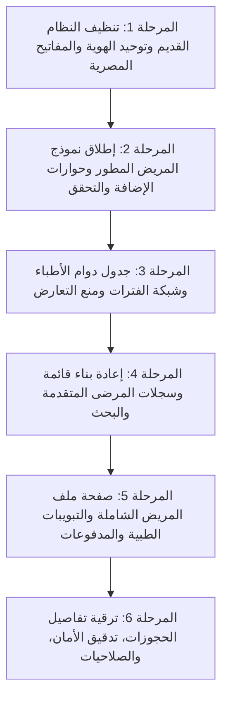

# خطة تنفيذ تفصيلية: تحويل فيتشر "العملاء" إلى "المرضى والسجلات الطبية" وإصلاح منظومة اختيار المواعيد

**مشروع:** عيادتي (Eyadty Clinic Dashboard)  
**تاريخ الإعداد:** 06 نوفمبر 2026  
**الحالة:** مسودة خطة شاملة (PLAN ONLY - قيد مراجعة المطور)  
**المسار المعتمد:** `docs/plans/patients-records-plan.md`

---

## 1. ملخص تنفيذي (Executive Summary)

### 1.1 واقع النظام الحالي (Current State)
شُيِّد تطبيق **عيادتي** في بدايته بالاعتماد على قالب وظيفي لمنصة "خدمات منزلية" (تنظيف وصيانة دورية بالساعة)، ويظهر ذلك جلياً في:
- تسميات الحقول والكلاسات (`CustomerModel`, `TechnicianModel`, `CustomersCubit`, `recurring_schedule`).
- منطق الحسابات المالية الذي يقسم سعر الكشف بناءً على مدة الدقائق بالساعة (`hourlyRate * duration / 60`).
- حقول الاتصال الافتراضية القطرية (+974 وعلم قطر وعناوين الدوحة ولوسيل والشحانية).
- غياب كامل للبيانات السريرية الأساسية (تاريخ الميلاد، فصيلة الدم، الحساسية، الأمراض المزمنة، الأدوية، التأمين، شجرة العائلة).
- حجز المواعيد يتم بإدخال يدوي حر للوقت دون التحقق من جدول دوام الطبيب الفعلي أو منع التداخل والتعارض (Slot Clashes).

### 1.2 المستهدف من التطوير (Target Transformation)
1. **التحول الكامل إلى نظام إدارة عيادات ومراكز طبية تخصصية متكامل (Clinical EMR & Clinic Management):**
   - استبدال موديول "العملاء" بموديول **"سجلات المرضى والملف الطبي الموحد"** (`PatientModel`, `PatientsCubit`, `PatientsPage`, `PatientDetailsPage`).
   - إثراء الملف الطبي بـ 28 حقلاً طبياً وشخصياً وإدارياً مع معالجة ذكية للأطفال (<18 سنة) والرقم القومي والتحذيرات السريرية الفورية (Allergy Badges).
2. **إعادة بناء منظومة حجز المواعيد من الصفر (Intelligent Slot-based Scheduling):**
   - الانتقال من الإدخال الحر للوقت إلى حجز مبني على الفترات الزمنية المتاحة (`DoctorSchedule` → `Service` → `Date` → `TimeSlot`).
   - احتساب السعر تلقائياً وفقاً للخدمة الطبية (`consultationFee`) بمعزل عن مدة الكشف.
   - منع التعارض والتداخل لحظياً (Client-side & Server-side Race Condition Guards).
   - توفير مسار الكشف الفوري (Walk-in Immediate Queue) دون الإخلال بالمواعيد المحجوزة مسبقاً.

### 1.3 أكبر 3 مخاطر تقنية (Key Technical Risks)
1. **تزامن الكود مع الباك إند (API Contract Desynchronization):** إذا كانت نقاط النهاية الحالية تعتمد على مسارات ومفاتيح قديمة (`/customers`, `customer_id`)؛ لذا سنعتمد استراتيجية **Data Transfer Object (DTO) Mapping** لعزل طبقة الواجهة والـ Domain تماماً كـ `Patient`.
2. **كسر منظومة الحجوزات القائمة (Breaking Existing Bookings):** وجود ترابط وثيق بين `BookingModel` وحقول `CustomerModel` في الحسابات والفلاتر وتصدير الجداول.
3. **سباق حجز الفترات (Slot Booking Race Conditions):** حجز موظفين اثنين لنفس الفترة في نفس اللحظة من شاشتين مختلفتين، ما يتطلب معالجة تفاعلية متماسكة في واجهة المستخدم مع متطلبات واضحة لقفل قاعدة البيانات في الباك إند.

---

## 2. جرد الوضع الحالي (Current State Audit)

### 2.1 جدول الفحص الميداني للملفات والكلاسات المعنية

| مسار الملف الفعلي | الكلاس / العنصر الحالي | الوظيفة الحالية | التغيير المطلوب | الأثر والملاحظات |
|---|---|---|---|---|
| `lib/core/routing/routes.dart` | `AppRouter.customers`, `customerDetails` | مسارات التوجيه للعملاء (`/customers`, `/customers/:id`) | تغيير الرابط إلى `/patients` و `/patients/:id` مع إبقاء alias مؤقت | يمنع كسر الروابط المباشرة القديمة |
| `lib/core/routing/app_router.dart` | `AppRouter.customers` Route definition | تعريف شاشة العملاء وتفاصيلها | توجيه إلى `PatientsPage` و `PatientDetailsPage` | تعديل العنوان في الهيدر |
| `lib/core/utils/constants/app_list.dart` | `layoutItems(context)` | القائمة الجانبية (Sidebar) | تعديل `routePath` من `AppRouter.customers` إلى `AppRouter.patients` | العنوان الحالي يقرأ `nav_patients` لكن المسار كان قديماً |
| `lib/core/dependency_injection/dependency_injection.dart` | تسجيلات `CustomersRepo`, `CustomersCubit` | حقن التبعيات للعملاء | إعادة التسمية إلى `PatientsRepo`, `PatientsCubit` وحقن use cases الجديدة | تعديل مسارات الاستدعاء في الـ `main.dart` |
| `lib/features/customers/` (المجلد بالكامل) | مجلد فيتشر العملاء | يضم data و domain و presentation للعملاء | إعادة تسمية المجلد بالكامل إلى `lib/features/patients/` وتحديث كافة الملفات الداخلية | يتبع معايير Clean Architecture و Feature Scaffold |
| `lib/features/customers/data/models/customer_model.dart` | `CustomerModel` | موديل العميل البسيط (اسم، هاتف، عنوان، دوريات) | استبداله بـ `PatientModel` الغني طبياً وإدارياً مع إلغاء حقول `recurrence` | نموذج لا يقبل null في التوافق القديم إلا بحذر |
| `lib/features/customers/data/models/customers_response_model.dart` | `CustomersResponseModel` | نموذج استجابة الترقيم لقائمة العملاء | استبداله بـ `PatientsResponseModel` | يضم `items: List<PatientModel>` |
| `lib/features/customers/data/repo/customers_repo_impl.dart` | `CustomersRepoImpl` | مستودع بيانات تجريبي يحوي بيانات وهمية لقطر والدوحة | تحويله إلى `PatientsRepoImpl` وتحديث البيانات الوهمية بالكامل لبيانات مصرية طبية | استبدال `CUST-XX` بـ `PAT-XXXX` |
| `lib/features/customers/presentation/manager/customers_cubit.dart` | `CustomersCubit` | إدارة حالة شاشات العملاء والبحث والتعديل | تحويله إلى `PatientsCubit` مع دوال إدارة الحقول الطبية وفلاتر المرضى | الالتزام بقاعدة: Cubit واحد فقط لكل فيتشر |
| `lib/features/customers/presentation/manager/customers_state.dart` | `CustomersState`, `CustomerFormState` | كلاس الحالة المشتركة للعملاء | تحويله إلى `PatientsState` و `PatientFormState` | دعم تبويبات النموذج والبيانات الطبية |
| `lib/features/customers/presentation/pages/customers_page.dart` | `CustomersPage` | الصفحة الرئيسية لقائمة العملاء | تحويلها إلى `PatientsPage` وربطها بالهيكل الطبي الجديد | شاشة متجاوبة مع `AdaptiveLayout` |
| `lib/features/customers/presentation/pages/customer_details_page.dart` | `CustomerDetailsPage` | صفحة ملف العميل | تحويلها إلى `PatientDetailsPage` بتصميم التبويبات الطبية الجديدة | تضم التاريخ المرضي والفحوصات |
| `lib/features/customers/presentation/widgets/customers_table.dart` | `CustomersTable` | جدول العملاء لسطح المكتب | تحويله إلى `PatientsTable` وتحديث الأعمدة الطبية وإلغاء عمود الجدول الدوري | استخدام `CustomTable` وفقاً لـ `dashboard-table-system` |
| `lib/features/customers/presentation/widgets/customer_card.dart` | `CustomerCard` | كارت العميل للموبايل والتابلت | تحويله إلى `PatientCard` وإظهار شارات الحساسية والأمراض المزمنة | متوافق مع `AdaptiveLayout` |
| `lib/features/customers/presentation/widgets/customers_filter_bar.dart` | `CustomersFilterBar` | شريط البحث وفلاتر العملاء | تحويله إلى `PatientsFilterBar` وإضافة فلاتر فصيلة الدم والنوع والتأمين والمديونية | يتماشى مع فلاتر البحث الطبية |
| `lib/features/customers/presentation/widgets/add_edit_customer_dialog.dart` | `AddEditCustomerDialog` | حوار إضافة وتعديل العميل (3 حقول فقط) | تحويله إلى `AddEditPatientDialog` متعدد الخطوات/التبويبات | تطبيق قاعدة Mobile Fullscreen Dialogs |
| `lib/features/customers/presentation/widgets/customer_actions_menu.dart` | `CustomerActionsMenu` | قائمة الإجراءات الثلاثية | تحويلها إلى `PatientActionsMenu` وإضافة حجز كشف، اتصال، واتساب، أرشفة | يدعم الـ Action Menu المنبثقة |
| `lib/features/customers/presentation/widgets/customer_details_sections/customer_profile_card_section.dart` | `CustomerProfileCardSection` | كارت ملخص بيانات العميل في صفحته | تحويله إلى `PatientProfileCardSection` مع شريط تنبيهات الحساسية والأمراض | يدعم استعراض البيانات الطبية السريعة |
| `lib/features/customers/presentation/widgets/customer_details_sections/customer_stats_cards_section.dart` | `CustomerStatsCardsSection` | الكروت الأربعة (زيارات فردية، دوريات، مصروفات بالريال) | استبدالها بكروت (إجمالي الكشوفات، آخر زيارة، الموعد القادم، الرصيد المستحق) | تحويل العملة إلى ج.م |
| `lib/features/customers/presentation/widgets/customer_details_sections/customer_bookings_section.dart` | `CustomerBookingsSection` | قائمة حجوزات العميل السابقة والدورية | تحويلها إلى `PatientBookingsSection` وتوسيع الفلاتر لتشمل (لم يحضر، مؤجل) | إزالة تبويب الحجوزات الدورية تماماً |
| `lib/features/bookings/data/models/booking_model.dart` | `BookingModel` | نموذج الحجز الحالي | تنقيته من حقول `CustomerModel` المضمنة واعتماد `PatientModel` وحذف `hourlyRate` | الحفاظ على توافق مؤقت عبر Getters |
| `lib/features/bookings/data/models/booking_form_options_model.dart` | `BookingCustomerOption` | خيار اختيار العميل في الدروب داون | تحويله إلى `BookingPatientOption` وإضافة فصيلة الدم وتنبيه الحساسية | يغذي `CustomStackSelector` |
| `lib/features/bookings/presentation/widgets/add_new_customer_dialog.dart` | `AddNewCustomerDialog` | حوار الإضافة السريعة داخل الحجز | تحويله إلى `QuickAddPatientDialog` (اسم، هاتف، تاريخ ميلاد، نوع) بالصيغة المصرية | حفظ فوري وربطه باختيار الحجز |
| `lib/features/bookings/presentation/widgets/add_edit_booking_dialog.dart` | `AddEditBookingDialog` | حوار إضافة وتعديل الحجز | تعديل تسلسل الاختيار (طبيب ← خدمة ← تاريخ ← فترات متاحة) وإلغاء الإدخال الحر للوقت | التوافق مع الشاشات الكاملة للموبايل |
| `lib/features/bookings/presentation/widgets/add_edit_booking_sections/booking_form_one_time_schedule.dart` | `BookingFormOneTimeSchedule` | حقول إدخال وقت البدء والانتهاء الحرة | استبدالها بمولد الفترات الزمنية المتاحة Grid Selector (`BookingFormSlotPickerSection`) | احتساب وقت الانتهاء تلقائياً |
| `lib/features/bookings/presentation/widgets/add_edit_booking_sections/booking_form_pricing_section.dart` | `BookingFormPricingSection` | إدخال سعر الساعة وحساب الإجمالي | تحويله لعرض سعر الكشف الثابت من الخدمة + حقل خصم اختياري بنسبة أو مبلغ | إلغاء تأثر السعر بمدة الدقائق |
| `lib/features/bookings/presentation/widgets/add_edit_booking_sections/booking_form_recurring_schedule.dart` | `BookingFormRecurringSchedule` | جدولة الحجوزات الدورية بالساعة | إزالة القسم بالكامل من حوار الحجز الجديد | نظام العيادات لا يعتمد حجوزات تنظيف دورية |
| `lib/features/bookings/presentation/widgets/details_sections/booking_details_customer_section.dart` | `BookingDetailsCustomerSection` | كارت العميل في صفحة الحجز | تحويله إلى `BookingDetailsPatientSection` مع زر "فتح ملف المريض" وشارات طبية | يزيل العنوان المفرط ويعرض فصيلة الدم |
| `lib/features/bookings/presentation/widgets/details_sections/booking_details_recurrence_section.dart` | `BookingDetailsRecurrenceSection` | قسم استعراض تفاصيل الدورية | إزالته بالكامل من صفحة تفاصيل الحجز | لا مكان للحجوزات الدورية في العيادات |
| `lib/features/bookings/presentation/widgets/action_dialogs/reassign_technician_dialog.dart` | `ReassignTechnicianDialog` | حوار التحويل لطبيب آخر | إزالة شارة الـ '0'، استبعاد الطبيب الحالي، وإظهار الفترات المتاحة للطبيب البديل | منع تعارض المواعيد عند التحويل |
| `lib/features/bookings/data/models/enums/booking_status_enum.dart` | `BookingStatusEnum` | الحالات الحالية للحجز | تنظيف الـ Alias المزدوج `scheduled = waiting` وتوحيد مسميات صالة الانتظار | إزالة الازدواجية في القوائم |
| `lib/shared/auth/presentation/widgets/login_widgets/custom_phone_field.dart` | `CustomPhoneField` | حقل الهاتف العام | تغيير كود الدولة الافتراضي من +974 إلى +20، العلم إلى مصر، والمثال إلى 01XXXXXXXXX | معالجة الـ Formatter والـ Validation |
| `lib/shared/function/phone_num_validation.dart` | `validateEgyptPhone` | التحقق من صحة الهاتف المصري | ربطه بالنصوص المترجمة وإلغاء النصوص العامية المكتوبة كـ hardcoded | دعم الأرقام (010, 011, 012, 015) |
| `lib/core/utils/theme/app_icons.dart` | `AppIcons.qatar` | أيقونات التطبيق | إضافة أيقونة مصر `AppIcons.egypt = 'assets/icons/egypt.svg'` | يتطلب توفير ملف الـ SVG |
| `assets/translations/ar-EG.json` & `en-US.json` | ملفات الترجمة | نصوص المنظومة | جرد واستبدال شامل لجميع مفاتيح العملاء والدوريات والريال إلى مفاتيح المرضى والعيادات | لا hardcoded strings في الكود نهائياً |

---

### 2.2 جرد النصوص والمفاتيح المترجمة والصلبة (Localization Audit)

#### أ) مفاتيح موجودة في `assets/translations/ar-EG.json` يجب تعديلها أو إعادة توجيهها:
1. `"customers": "العملاء"` ← `"المرضى"`
2. `"customers_header": "إدارة العملاء"` ← `"سجلات المرضى والملف الطبي"`
3. `"customers_subtitle": "عرض وتحديث بيانات العملاء والطلبات الخاصة بهم."` ← `"إدارة السجلات الطبية، التاريخ المرضي، والملفات الموحدة للمرضى."`
4. `"add_customer": "إضافة عميل"` ← `"إضافة مريض"`
5. `"edit_customer": "تعديل العميل"` ← `"تعديل بيانات المريض"`
6. `"customer_details": "تفاصيل العميل"` ← `"ملف المريض"`
7. `"customer_info": "بيانات العميل"` ← `"البيانات الشخصية والطبية"`
8. `"customer_since": "عميل منذ"` ← `"تاريخ فتح الملف"`
9. `"customer_bookings": "حجوزات وزيارات العميل"` ← `"كشوفات وزيارات المريض"`
10. `"no_customer_bookings": "لا توجد حجوزات مسجلة لهذا العميل حتى الآن"` ← `"لا توجد كشوفات مسجلة لهذا المريض حتى الآن"`
11. `"create_booking_for_customer": "حجز جديد للعميل"` ← `"تسجيل كشف جديد للمريض"`
12. `"search_customers_hint": "بحث باسم العميل أو الهاتف أو العنوان..."` ← `"بحث باسم المريض، رقم الهاتف، الرقم القومي، أو رقم الملف..."`
13. `"delete_customer": "حذف العميل"` ← `"أرشفة ملف المريض"`
14. `"confirm_delete_customer_title": "تأكيد حذف العميل"` ← `"تأكيد أرشفة المريض"`
15. `"confirm_delete_customer_desc": "هل أنت متأكد من رغبتك في حذف هذا العميل؟ لا يمكن التراجع عن هذا الإجراء."` ← `"هل أنت متأكد من أرشفة هذا المريض؟ سيتم نقل سجله للأرشيف وحجبه من القوائم النشطة مع بقاء تاريخه الطبي محفوظاً."`
16. `"customer": "العميل"` ← `"المريض"`
17. `"select_customer": "اختر العميل"` ← `"اختر المريض"`
18. `"add_new_customer": "إضافة عميل جديد"` ← `"إضافة مريض جديد"`
19. `"new_customer_title": "إضافة عميل جديد"` ← `"فتح ملف مريض جديد"`
20. `"customer_label": "العميل"` ← `"المريض"`
21. `"customer_unassigned": "عميل غير مسجل"` ← `"مريض غير محدد"`
22. `"save_customer": "حفظ العميل"` ← `"حفظ بيانات المريض"`
23. `"customer_name_hint": "اسم العميل"` ← `"اسم المريض ثلاثي / رباعي"`
24. `"total_spent": "إجمالي المصروفات"` ← `"إجمالي المدفوعات"`
25. `"nav_patients_subtitle": "إدارة الملف الطبي الموحد، التاريخ المرضي، وربط شجرة العائلة."` ← `"إدارة الملف الطبي الموحد، التاريخ المرضي، والمتابعة الإكلينيكية."` (حذف شجرة العائلة من الوصف لحين اعتماد تنفيذها).

#### ب) نصوص صلبة (Hardcoded Strings) تم رصدها في الكود وتحتاج لمفاتيح ترجمة فورية:
- في `lib/features/bookings/presentation/widgets/add_new_customer_dialog.dart`:
  - السطر 114: `"أدخل معلومات العميل الجديد لإضافته للمنصة."` ← استبدالها بـ `'add_patient_dialog_desc'.tr()` ("أدخل البيانات الأساسية لفتح ملف طبي وتسجيل المريض بالعيادة").
- في `lib/features/bookings/presentation/widgets/add_edit_booking_sections/booking_form_one_time_schedule.dart`:
  - السطر 33: `hintText: 'اختر موعد الحجز...'` ← استبدالها بـ `'select_appointment_date'.tr()`.
  - السطر 61: `hintText: 'وقت البدء...'` ← استبدالها بـ `'start_time_hint'.tr()`.
- في `lib/features/bookings/presentation/widgets/action_dialogs/reassign_technician_dialog.dart`:
  - السطر 73: `'$availableDoctorsCount متاح'` ← استبدالها بـ `'available_doctors_count'.tr(namedArgs: {'count': '$availableDoctorsCount'})`.
- في `lib/shared/function/phone_num_validation.dart`:
  - الأسطر 2-33: نصوص التحقق العامية (`يا ريت تكتب رقم الموبايل`، `الرقم لازم يكون 11 رقم`) ← تحويلها لمفاتيح رسمية موحدة باللغة العربية الفصحى والإنجليزية.
- في `lib/shared/auth/presentation/widgets/login_widgets/custom_phone_field.dart`:
  - السطر 148: `'ادخل رقم الهاتف...'` و السطر 152: `'ادخل رقم هاتف صحيح'` و السطر 160: `'رقم الهاتف غير مكتمل'`.

---

## 3. التصميم المقترح (Target Architecture & Design)

### 3.1 هيكل الموديلات الجديد (Domain Models)

وفقاً لقانون الهندسة الصارم للمشروع (`Absolute Engineering Laws`):
- **لا توجد كلاسات Entity منفصلة.** سنستخدم `PatientModel` و `DoctorScheduleModel` و `TimeSlotModel` مباشرة عبر كافة الطبقات.
- **جميع الحقول nullable بنسبة 100% (`final Type? property;`)** وبلا معاملات `required` في الـ Constructors لضمان الأمان التام أثناء استقبال بيانات JSON غير مكتملة.
- كتابة دوال `fromJson` و `toJson` و `copyWith` يدوياً دون استخدام code generators (Freezed/BuildRunner).

#### أ) نموذج المريض الموسع (`lib/features/patients/data/models/patient_model.dart`)
```dart
class PatientModel {
  // المعرفات الأساسية
  final String? id;                      // المعرف البرمجي الداخلي (UUID أو Mongo ID)
  final String? fileNumber;              // رقم الملف الطبي المطبوع (مثل PAT-000123)
  final String? nationalId;              // الرقم القومي المصري (14 رقم)

  // البيانات الشخصية والديموغرافية
  final String? name;                    // الاسم الكامل (ثلاثي أو رباعي)
  final String? phone;                   // رقم الهاتف الأساسي (+20XXXXXXXXXX)
  final String? secondaryPhone;          // رقم هاتف إضافي
  final String? email;                   // البريد الإلكتروني
  final DateTime? dateOfBirth;           // تاريخ الميلاد (لحساب العمر بدقة)
  final String? gender;                  // 'male' | 'female'
  final String? maritalStatus;           // 'single' | 'married' | 'divorced' | 'widowed'
  final String? occupation;              // المهنة
  final String? photoUrl;                // صورة المريض

  // العنوان الإقليمي
  final String? governorate;             // المحافظة (مثال: القاهرة، الجيزة، الإسكندرية)
  final String? city;                    // المدينة / المركز / الحي
  final String? detailedAddress;         // العنوان التفصيلي (شارع، عمارة، شقة)
  final String? legacyAddress;           // العنوان القديم (للتوافق العكسي)

  // البيانات السريرية والطبية الحيوية
  final String? bloodGroup;              // 'A+', 'A-', 'B+', 'B-', 'AB+', 'AB-', 'O+', 'O-', 'unknown'
  final List<String>? allergies;         // قائمة الحساسيات (أدوية، أطعمة، بيئية)
  final List<String>? chronicDiseases;   // قائمة الأمراض المزمنة (سكر، ضغط، ربو، قلب...)
  final List<String>? currentMedications;// الأدوية التي يتناولها بانتظام
  final List<String>? pastSurgeries;     // العمليات الجراحية السابقة
  final String? familyHistoryNotes;      // التاريخ الطبي العائلي
  final num? heightCm;                   // الطول بالسنتيمتر
  final num? weightKg;                   // الوزن بالكيلوجرام
  final String? smokingStatus;           // 'never', 'current', 'former'
  final bool? isPregnant;                // للإناث: هل هي حامل؟
  final bool? isNursing;                 // للإناث: هل هي مرضعة؟

  // بيانات ولي الأمر (للأطفال دون 18 سنة)
  final String? guardianName;            // اسم ولي الأمر
  final String? guardianPhone;           // هاتف ولي الأمر
  final String? guardianRelation;        // صلة القرابة (أب، أم، عم، وصي قانوني)
  final String? parentPatientId;         // ربط معرف ملف الأب أو الأم إذا كان مسجلاً بالنظام

  // التأمين الصحي والجهات الضامنة
  final String? insuranceCompany;        // شركة التأمين
  final String? insurancePolicyNumber;   // رقم الكارنيه / البوليصة
  final num? insuranceCoveragePercent;   // نسبة التغطية (مثال: 80%)

  // بيانات إدارية وإحصائية
  final String? referralSource;          // كيف عرف العيادة (تواصل اجتماعي، ترشيح صديق، إعلان...)
  final String? internalNotes;           // ملاحظات سكرتارية داخلية سرية
  final bool? isArchived;                // حالة الأرشفة (Soft Delete)
  final DateTime? archivedAt;            // تاريخ الأرشفة
  final String? archiveReason;           // سبب الأرشفة

  // إحصائيات سريرية ومالية مجمعة (Aggregated Stats)
  final int? totalVisitsCount;           // إجمالي الكشوفات المنفذة
  final DateTime? lastVisitDate;         // تاريخ آخر زيارة للعيادة
  final DateTime? nextAppointmentDate;   // تاريخ الموعد القادم المجدول
  final num? totalPaidAmount;            // إجمالي المدفوعات المحصلة
  final num? outstandingBalance;         // الرصيد المستحق (مديونية)

  // التوقيتات
  final DateTime? createdAt;
  final DateTime? updatedAt;

  const PatientModel({
    this.id,
    this.fileNumber,
    this.nationalId,
    this.name,
    this.phone,
    this.secondaryPhone,
    this.email,
    this.dateOfBirth,
    this.gender,
    this.maritalStatus,
    this.occupation,
    this.photoUrl,
    this.governorate,
    this.city,
    this.detailedAddress,
    this.legacyAddress,
    this.bloodGroup,
    this.allergies,
    this.chronicDiseases,
    this.currentMedications,
    this.pastSurgeries,
    this.familyHistoryNotes,
    this.heightCm,
    this.weightKg,
    this.smokingStatus,
    this.isPregnant,
    this.isNursing,
    this.guardianName,
    this.guardianPhone,
    this.guardianRelation,
    this.parentPatientId,
    this.insuranceCompany,
    this.insurancePolicyNumber,
    this.insuranceCoveragePercent,
    this.referralSource,
    this.internalNotes,
    this.isArchived,
    this.archivedAt,
    this.archiveReason,
    this.totalVisitsCount,
    this.lastVisitDate,
    this.nextAppointmentDate,
    this.totalPaidAmount,
    this.outstandingBalance,
    this.createdAt,
    this.updatedAt,
  });

  // مساعدات الحساب الآلي
  /// حساب العمر الحالي بالسنوات أو بالأشهر للرضع
  String get calculatedAgeText {
    if (dateOfBirth == null) return '';
    final now = DateTime.now();
    int years = now.year - dateOfBirth!.year;
    int months = now.month - dateOfBirth!.month;
    int days = now.day - dateOfBirth!.day;
    if (days < 0) months--;
    if (months < 0) {
      years--;
      months += 12;
    }
    if (years == 0) {
      return months == 0 ? 'حديث الولادة' : '$months شهور';
    }
    return '$years سنة';
  }

  /// هل المريض طفل قاصر (< 18 سنة) يحتاج ولي أمر؟
  bool get isChild {
    if (dateOfBirth == null) return false;
    final now = DateTime.now();
    final diffYears = (now.difference(dateOfBirth!).inDays / 365.25).floor();
    return diffYears < 18;
  }

  /// مؤشر كتلة الجسم (BMI) وحالته
  double? get calculatedBmi {
    if (heightCm == null || weightKg == null || heightCm! <= 0 || weightKg! <= 0) {
      return null;
    }
    final heightMeters = heightCm! / 100.0;
    return weightKg! / (heightMeters * heightMeters);
  }

  /// هل الملف يحوي حساسية حرجة تتطلب تحذيراً بارزاً؟
  bool get hasAllergies => allergies != null && allergies!.isNotEmpty;

  /// هل توجد بيانات ناقصة هامة (تاريخ الميلاد أو النوع)؟
  bool get hasIncompleteProfile => dateOfBirth == null || gender == null;

  // Manual fromJson, toJson, copyWith implementations following project standards...
}
```

#### ب) نموذج جدول دوام الطبيب والفترات (`DoctorScheduleModel` & `TimeSlotModel`)
يُنشأ ملف `lib/features/technicians/data/models/doctor_schedule_model.dart`:
```dart
class DoctorScheduleModel {
  final String? id;
  final String? doctorId;
  final List<DoctorWorkDayModel>? workDays;
  final int? slotDurationMinutes;      // المدة الافتراضية للفترة (مثال: 20 أو 30 دقيقة)
  final int? bufferDurationMinutes;    // وقت راحة بين الكشوفات (مثال: 5 دقائق)
  final bool? isAcceptingWalkIns;      // هل يقبل كشف فوري في نفس اليوم

  const DoctorScheduleModel({
    this.id,
    this.doctorId,
    this.workDays,
    this.slotDurationMinutes,
    this.bufferDurationMinutes,
    this.isAcceptingWalkIns,
  });
}

class DoctorWorkDayModel {
  final String? dayOfWeek;             // 'sunday', 'monday', ...
  final bool? isWorking;
  final String? startTime;             // '09:00'
  final String? endTime;               // '17:00'
  final List<DoctorBreakTimeModel>? breaks;

  const DoctorWorkDayModel({
    this.dayOfWeek,
    this.isWorking,
    this.startTime,
    this.endTime,
    this.breaks,
  });
}

class DoctorBreakTimeModel {
  final String? startTime;             // '13:00'
  final String? endTime;               // '14:00'
  final String? name;                  // 'استراحة الغداء والصلاة'

  const DoctorBreakTimeModel({this.startTime, this.endTime, this.name});
}
```

ويُنشأ ملف فترات الحجز المتاحة `lib/features/bookings/data/models/time_slot_model.dart`:
```dart
enum SlotStatusEnum {
  available,       // متاحة للحجز (خضراء / زرقاء فاتحة)
  booked,          // محجوزة مسبقاً لمريض آخر (رمادية مقفولة)
  past,            // انقضى وقتها (لليوم الحالي)
  breakTime,       // فترة استراحة الطبيب
  holiday,         // إجازة رسمية أو عطلة للطبيب
}

class TimeSlotModel {
  final DateTime? dateTime;            // التاريخ والوقت كاملاً بتوقيت القاهرة
  final String? startTime;             // '10:30'
  final String? endTime;               // '11:00'
  final SlotStatusEnum? status;
  final String? existingBookingId;     // معرف الحجز القائم لو محجوز
  final String? patientName;           // اسم المريض المحجوز له (يظهر للأدمن والاستقبال)

  const TimeSlotModel({
    this.dateTime,
    this.startTime,
    this.endTime,
    this.status,
    this.existingBookingId,
    this.patientName,
  });

  bool get isSelectable => status == SlotStatusEnum.available;
}
```

---

### 3.2 مواصفات وتغييرات الـ API والـ Backend المطلوبة

لتسهيل التنفيذ وعدم تعطيل الواجهة إذا تأخر الباك إند:
- **في Flutter:** سنعتمد طبقة تحويل مرنة (Data Mapper) في `PatientsRepoImpl` تفحص وتدعم كلاً من أسماء الحقول القديمة والجديدة.
- **توصيات محددة لفريق الباك إند (Backend Endpoints & Schema Requirements):**

#### 1. نقاط النهاية للمرضى (Patients Endpoints):
- `GET /api/v1/patients`: استرجاع قائمة المرضى (Pagination + فلاتر متقدمة: `search`, `gender`, `bloodGroup`, `hasDebt`, `insuranceCompany`, `ageGroup`).
- `GET /api/v1/patients/:id`: استرجاع الملف الطبي الكامل للمريض وسجل كشوفاته وفحوصاته.
- `POST /api/v1/patients`: إنشاء ملف مريض جديد (توليد `fileNumber` فريد مثل `PAT-000452` تلقائياً عبر Sequence بالـ DB لمنع التكرار).
- `PUT /api/v1/patients/:id`: تحديث البيانات الشخصية والطبية.
- `PATCH /api/v1/patients/:id/archive`: أرشفة المريض مع إرسال `{ "reason": "انتقل لمحافظة أخرى" }` مع فحص شرطي في الباك إند: **رفض الأرشفة بكود 400 إذا كان للمريض حجوزات قادمة (`upcomingBookings > 0`) أو فواتير غير مسددة (`outstandingBalance > 0`)**.
- `GET /api/v1/patients/check-duplicate?phone=010XXXXXXXX&nationalId=XXXXXXXXXXXXXX`: فحص فوري لعدم تكرار الهاتف أو الرقم القومي قبل الحفظ.

#### 2. نقاط النهاية للفترات ومنع التعارض (Slots & Booking Concurrency):
- `GET /api/v1/doctors/:doctorId/available-slots?date=2026-11-06&serviceId=SRV-01`: استرجاع فترات اليوم المحددة لحساب الطبيب والخدمة وحالة كل فترة (`available`, `booked`, `breakTime`).
- `POST /api/v1/bookings`:
  - **قفل الصف / المعاملة (Database Transaction with Row Locking):** تطبيق `SELECT FOR UPDATE` أو معيار تسلسلي (Pessimistic / Optimistic Locking) لمنع حجز نفس الفترة (`doctorId` + `date` + `startTime`) لمريضين في نفس الجزء من الثانية.
  - إذا تم حجز الفترة مسبقاً، يرجع الباك إند كود `409 Conflict` مع رسالة: `"الموعد المحدد تم حجزه للتو بواسطة مريض آخر، يرجى اختيار موعد بديل"`.

---

### 3.3 تصميم الشاشات وتجربة المستخدم (UI/UX Specifications)

#### أ) شاشة قائمة المرضى (`lib/features/patients/presentation/pages/patients_page.dart`)
- **شريط الفلاتر والإجراءات السريعة (`PatientsFilterBar`):**
  - حقل بحث مرن يبحث في: (الاسم، الهاتف، الرقم القومي، رقم الملف الطبي).
  - قوائم اختيار منسدلة سريعة: فصيلة الدم، النوع (ذكر/أنثى)، الفئة العمرية (أطفال/بالغين/كبار سن)، جهة التأمين، عليه مديونية.
  - أزرار إجرائية في الزاوية: زر **"تصدير Excel"**، زر **"طباعة القائمة"**، وزر بارز **"إضافة مريض جديد"**.
- **جدول سطح المكتب (`PatientsTable`):**
  - **الأعمدة المعتمدة:**
    1. `#` (الرقم التسلسلي)
    2. `رقم الملف` (Badge رمادي أنيق قابل للنسخ بنقرة واحدة).
    3. `اسم المريض` (الاسم عريض، وأسفله سطر فرعي: النوع + العمر مثل "ذكر • 34 سنة").
    4. `الهاتف` (بالتنسيق المصري `010 1234 5678`).
    5. `فصيلة الدم` (Badge أحمر بيضاوي خفيف مثل `A+` أو `O-`).
    6. `تنبيهات سريرية` (شريط Tags مدمج: أيقونة حمراء لحساسية الأدوية، شارة زرقاء للأمراض المزمنة، شارة تأمين).
    7. `آخر زيارة` (تاريخ آخر كشف تم بالعيادة).
    8. `الموعد القادم` (تاريخ الموعد القادم إن وُجد، أو "-").
    9. `الحساب المالي` (رصيد مستحق بالأحمر إن وُجد دين، أو "خالص" بالأخضر).
    10. `الإجراءات` (قائمة النقاط الثلاث `PatientActionsMenu`).
  - **سلوك النقر:** النقر على أي مكان في الصف ينقل مباشرة لملف المريض `PatientDetailsPage`.
- **كروت الموبايل والتابلت (`PatientCard`):** كارت متكامل يحوي الاسم والعمر والشارات الطبية وهاتف المريض مع زر اتصال وواتساب مباشرين.

#### ب) شاشة ملف المريض (`lib/features/patients/presentation/pages/patient_details_page.dart`)
- **الكروت الإحصائية الأربعة العلوية:**
  1. `إجمالي الكشوفات` (أيقونة العيادة + العدد الكلي).
  2. `آخر كشف تم` (تاريخ الزيارة واسم الطبيب وتخصص العيادة).
  3. `الموعد القادم` (تاريخ ووقت الكشف القادم مع عد تنازلي "خلال يومين").
  4. `الرصيد والمدفوعات` (إجمالي المدفوعات وبجانبه بالأحمر الرصيد المستحق).
- **كارت البيانات الشخصية وشريط التنبيهات السريرية:**
  - عرض الصورة، الاسم، رقم الملف، الرقم القومي، وأزرار سريعة: (اتصال مباشر، محادثة واتساب، تعديل البيانات، حجز كشف جديد، طباعة بطاقة المريض).
  - **شريط تنبيهات الحساسية والأمراض المزمنة (Clinical Alert Banner):** شريط بارز بلون أحمر تحذيري خفيف يظهر فوراً في أعلى الملف إذا كان المريض يعاني من أي حساسية دوائية (مثل البنسلين أو الأسبرين) أو أمراض مزمنة لضمان سلامة وصف العلاج.
- **تبويبات الملف الطبي المنظمة (Sub-Tabs):**
  1. `نظرة عامة والبيانات الديموغرافية`: العنوان التفصيلي، جهة اتصال الطوارئ، بيانات التأمين، وولي الأمر إن وجد.
  2. `سجل الزيارات والكشوفات`: جدول زمني بكافة كشوفات المريض بالعيادة (مع فلاتر: الكل، مكتمل، قيد الانتظار، لم يحضر، مؤجل، ملغي) مع إمكانية عرض تفاصيل كل كشف.
  3. `التاريخ المرضي الموحد`: استعراض العمليات الجراحية السابقة، الأمراض الوراثية، والأدوية المزمنة.
  4. `الروشتات والمرفقات الطبية`: مستودع الوصفات الطبية، نتائج التحاليل المعملية، وصور الأشعة مع إمكانية رفع مرفقات PDF وصور.
  5. `الفواتير والمطالبات المالية`: كشف حساب مالي تفصيلي بكل كشف والمبلغ المسدد والمتبقي وسندات القبض.
  6. `ملاحظات المتابعة الطبية`: ملاحظات سريعة يسجلها الطبيب أو التمريض عند كل زيارة.

#### ج) حوار إضافة وتعديل المريض (`AddEditPatientDialog`)
- **تصميم التبويبات المتدرجة (Multi-Step Tabs):**
  - **التبويب 1: البيانات الأساسية** (الاسم رباعي، الهاتف المصري، تاريخ الميلاد مع حاسبة عمر فورية، النوع، الرقم القومي مع استنتاج تلقائي للميلاد والنوع).
  - **التبويب 2: البيانات السريرية** (فصيلة الدم، مدخل Tags للحساسية مع إكمال تلقائي، الأمراض المزمنة، الطول والوزن مع حساب BMI التلقائي، التدخين، الحمل والرضاعة للإناث).
  - **التبويب 3: العنوان والتواصل والتأمين** (المحافظة والمدينة والعنوان التفصيلي، جهة الطوارئ، بيانات شركة التأمين ونسبة التحمل، كيف عرف العيادة).
  - **قسم شرطي يظهر تلقائياً:** إذا كان تاريخ الميلاد يقل عن 18 سنة، يفتح قسم "بيانات ولي الأمر والمسؤول القانوني".
- **حوار الإضافة السريعة داخل الحجز (`QuickAddPatientDialog`):**
  - نافذة خفيفة تطلب فقط 4 حقول إجبارية: (الاسم الكامل، رقم الهاتف، تاريخ الميلاد، النوع).
  - بمجرد الضغط على "حفظ ومتابعة"، يُنشأ ملف المريض فوراً في قاعدة البيانات برقم ملف جديد ويُدرج تلقائياً في خانة المريض في شاشة الحجز لمتابعة اختيار الموعد دون مغادرة الشاشة.

---

### 3.4 المنظومة الذكية لاختيار المواعيد وتوليد الفترات (Slot-Based Scheduling)

#### أ) التسلسل المنطقي الإلزامي في واجهة الحجز (`AddEditBookingDialog`):
```text
[1. اختيار المريض] (بحث سريع في المرضى أو زر فتح حوار الإضافة السريعة)
         ↓
[2. اختيار الطبيب] (عرض الأطباء المتاحين في العيادة وتخصصاتهم)
         ↓
[3. اختيار الخدمة الطبية] (كشف باطنة، استشارة، متابعة، فحص شامل... تحدد السعر والمدة تلقائياً)
         ↓
[4. اختيار اليوم من التقويم] (الأيام غير المتاحة أو إجازات الطبيب تكون معطلة Disabled بلون رمادي)
         ↓
[5. شبكة الفترات المتاحة Time Slots Grid] (فترات صباحية ومسائية، تعرض الحالة والأوقات)
         ↓
[6. ملخص الحساب والتأكيد] (سعر الكشف الثابت، الخصم المسموح به، وقت الانتهاء المحسوب تلقائياً)
```

#### ب) منطق توليد وعرض الفترات الزمنية (Slot Generation Engine):
1. عند اختيار الطبيب واليوم:
   - يستدعي الـ Cubit دالة `fetchDoctorDaySlots(doctorId, date, serviceDuration)`.
   - يقوم المولد باحتساب أوقات البدء من `DoctorWorkDayModel.startTime` إلى `endTime`.
   - يتم تقسيم الوقت إلى فترات مساوية لمدة الخدمة (مثال: كشف 20 دقيقة + 5 دقائق فاصلة).
   - يتم استبعاد فترات الاستراحة الرسمية المسجلة للطبيب (`DoctorBreakTimeModel`).
2. تحديد حالة كل فترة:
   - **فترة محجوزة (`booked`):** إذا وُجد حجز معتمد غير ملغي للطبيب في نفس التاريخ ونطاق الوقت، تصبح الفترة رمادية مقفولة مع إظهار اسم المريض عليها عند وقوف الفأرة (Hover Tooltip).
   - **فترة منقضية (`past`):** إذا كان اليوم المختار هو اليوم الحالي، وأصبح توقيت القاهرة الفعلي بعد وقت الفترة، تُعطل الفترة تلقائياً.
   - **فترة متاحة (`available`):** تظهر بإطار ملون جذاب جاهزة للنقر ليكون وقت البدء هو بداية الفترة، ووقت الانتهاء يُحسب تلقائياً ويُعرض كـ Read-only.
3. زر **"كشف فوري (Walk-in)"**:
   - زر سريع بجانب شبكة الفترات يُدرج المريض مباشرة في طابور الانتظار للوقت الحالي في أول خانة طوارئ، مع تسجيل نوع الحجز كـ `walkIn`، مع وضع علامة تحذيرية إذا كان الطبيب لديه كشف مجدول بعد أقل من 15 دقيقة.

#### ج) منع التعارض والسباق (Race Condition Handling):
- عند الضغط على "تأكيد الحجز"، يُرسل الطلب للباك إند.
- إذا أعاد الباك إند خطأ تعارض (`409 Conflict`) لأن مستخدماً آخر حجز الفترة في نفس اللحظة:
  1. تعرض الواجهة رسالة تنبيه بلون برتقالي: `"تم حجز هذا الموعد للتو بواسطة مريض آخر"`.
  2. يقوم الـ Cubit تلقائياً بإعادة جلب وتحديث الفترات (`refreshSlots`).
  3. تظل بيانات المريض والخدمة محفوظة في الفورم دون فقد، مع إبراز الفترات المتاحة المتبقية لاختيار إحداها بنقرة واحدة.

---

## 4. مراحل التنفيذ التفصيلية (Implementation Phases)



---

### المرحلة 1: إعادة التسمية وتطهير بقايا النظام القديم وتوطين البيئة المصرية
* **الهدف:** القضاء التام على مسميات "العملاء" و"الخدمات المنزلية بالساعة" وتصحيح نصوص الواجهة وتوطين أرقام الهاتف والعملة لمصر.
* **الملفات المتأثرة:**
  - `assets/translations/ar-EG.json` & `en-US.json`
  - `lib/core/utils/theme/app_icons.dart`
  - `lib/shared/auth/presentation/widgets/login_widgets/custom_phone_field.dart`
  - `lib/shared/function/phone_num_validation.dart`
  - `lib/core/extensions/formate_phone_number.dart`
  - `lib/features/bookings/data/repo/bookings_repo_impl.dart`
  - `lib/features/customers/data/repo/customers_repo_impl.dart`
  - `lib/features/technicians/data/models/technician_model.dart`
* **قائمة المهام (Checklist):**
  - [ ] توفير أيقونة علم مصر `assets/icons/egypt.svg` وتسجيلها في `AppIcons.egypt`.
  - [ ] تعديل `CustomPhoneField` ليكون كود الدولة الافتراضي `+20` وعلم مصر والمثال التوضيحي `010 1234 5678`.
  - [ ] تحديث `phone_num_validation.dart` بربط دوال التحقق بالمفاتيح المترجمة ودعم الأرقام المصرية (11 رقم تبدأ بـ 010, 011, 012, 015).
  - [ ] تنظيف البيانات الوهمية (Mock Data) في `customers_repo_impl.dart` و `bookings_repo_impl.dart` واستبدال عناوين الدوحة ولوسيل والشحانية وأرقام +974 بأسماء وعناوين مصرية واقعية (القاهرة، الجيزة، المعادي، مدينة نصر، التجمع الخامس...).
  - [ ] حذف صور ورموز التنظيف المنزلي (`AppImages.cleanerWomen`, `AppImages.cleanerMan`) من `technician_model.dart` واستبدالها بأيقونات وصور رمزية للأطباء والكوادر الطبية.
  - [ ] توحيد مفتاح العملة ليكون `currency` الثابت برمز `ج.م` / `EGP` في كافة الشاشات وحذف اعتماديات `qar_currency` و `sar_currency`.
* **تقدير الجهد:** متوسط (Medium).
* **معايير القبول (Acceptance Criteria):**
  - اختفاء أي ظهور لعلم قطر أو كود +974 في شاشات تسجيل المرضى والدخول والحجز.
  - لا توجد أي نصوص في التطبيق تشير إلى "تنظيف" أو "خدمات منزلية" أو "عملاء".
  - التحقق من الهاتف المصري يعمل بدقة على كافة المدخلات.

---

### المرحلة 2: بناء نموذج المريض الموسع ونظام الإضافة السريعة والتحقق
* **الهدف:** إنشاء `PatientModel` بكامل حقوله الطبية والإدارية، وتطوير حوار الإضافة والتحقق من الرقم القومي والهاتف ومنع التكرار.
* **الملفات المتأثرة:**
  - `lib/features/customers/data/models/customer_model.dart` → إنشاء `patient_model.dart`
  - `lib/features/customers/presentation/widgets/add_edit_customer_dialog.dart` → تطوير `add_edit_patient_dialog.dart`
  - `lib/features/bookings/presentation/widgets/add_new_customer_dialog.dart` → تطوير `quick_add_patient_dialog.dart`
  - `lib/core/utils/helpers/national_id_helper.dart` (ملف جديد للتحقق واستخراج بيانات الرقم القومي المصري)
* **قائمة المهام (Checklist):**
  - [ ] إنشاء كلاس `PatientModel` بـ 28 حقلاً طبياً وشخصياً وفق معايير المشروع (100% Nullable).
  - [ ] برمجة `NationalIdHelper`:
    - التحقق الرياضي من صحة الـ 14 رقماً للرقم القومي المصري وفق خوارزمية السجل المدني.
    - استنتاج تاريخ الميلاد والنوع (ذكر/أنثى) والمحافظة تلقائياً واقتراح ملئها في الفورم بمجرد كتابة الرقم القومي.
  - [ ] تصميم `AddEditPatientDialog` بثلاثة تبويبات (الأساسية، الطبية، التواصل والتأمين) مع دعم الشاشة الكاملة للموبايل (`Dialog.fullscreen`).
  - [ ] بناء حوار الإضافة السريعة `QuickAddPatientDialog` داخل الحجز بأربعة حقول أساسية فقط، وتوليد رقم الملف الطبي التلقائي (`PAT-XXXXXX`).
  - [ ] إضافة فحص منع التكرار للهاتف والرقم القومي مع تحذير الموظف إذا كان المريض مسجلاً مسبقاً.
* **تقدير الجهد:** كبير (Large).
* **معايير القبول (Acceptance Criteria):**
  - إمكانية إضافة مريض ببياناته الأساسية والطبية وحفظها بنجاح.
  - إدخال الرقم القومي يقوم بملء تاريخ الميلاد والنوع فورياً بدقة متناهية.
  - إدخال مريض عمره أقل من 18 سنة يُلزم بإدخال بيانات ولي الأمر.

---

### المرحلة 3: منظومة اختيار المواعيد وتوليد الفترات ومنع التعارض
* **الهدف:** استبدال الإدخال الحر للوقت بنظام فترات ذكي متصل بدوام الأطباء واحتساب سعر الكشف بناءً على الخدمة الطبية المختارة.
* **الملفات المتأثرة:**
  - `lib/features/technicians/data/models/doctor_schedule_model.dart` (ملف جديد)
  - `lib/features/bookings/data/models/time_slot_model.dart` (ملف جديد)
  - `lib/features/bookings/domain/helpers/slot_generator_helper.dart` (ملف خوارزمية الفترات الجديد)
  - `lib/features/bookings/presentation/widgets/add_edit_booking_dialog.dart`
  - `lib/features/bookings/presentation/widgets/add_edit_booking_sections/booking_form_one_time_schedule.dart`
  - `lib/features/bookings/presentation/widgets/add_edit_booking_sections/booking_form_pricing_section.dart`
  - `lib/features/bookings/presentation/widgets/action_dialogs/reassign_technician_dialog.dart`
* **قائمة المهام (Checklist):**
  - [ ] بناء خوارزمية `SlotGeneratorHelper` لتوليد الفترات من دوام الطبيب وإجازاته وفترات الراحة بتوقيت القاهرة.
  - [ ] استبدال حقول الوقت الحرة في `AddEditBookingDialog` بشبكة اختيار الفترات الزمنية `BookingFormSlotPickerSection`.
  - [ ] جعل وقت الانتهاء للقراءة فقط ومحسوباً آلياً من مدة الخدمة الطبية المختارة.
  - [ ] ربط سعر الكشف بالخدمة المختارة (`consultationFee`)، وإلغاء معادلة حساب السعر بالساعة القديمة تماماً.
  - [ ] إضافة زر "كشف فوري (Walk-in)" لإدخال المريض الحالي في صالة الانتظار مباشرة.
  - [ ] ربط شاشة "التحويل لطبيب آخر" (`ReassignTechnicianDialog`) بنظام الفترات المتاحة للطبيب البديل، واستبعاد الطبيب الحالي من القائمة.
  - [ ] برمجة التنبيه التفاعلي عند حدوث تعارض لحظي وتحديث الفترات فوراً.
* **تقدير الجهد:** كبير جداً (Extra Large).
* **معايير القبول (Acceptance Criteria):**
  - لا يمكن للمستخدم كتابة وقت عشوائي يدوي لحجز جديد.
  - الأيام خارج دوام الطبيب وأيام إجازاته معطلة في التقويم.
  - الفترات المحجوزة مسبقاً تظهر مقفولة ومظللة ولا يمكن النقر عليها.
  - مدة الكشف لا تؤثر على رسوم الكشف الثابتة.

---

### المرحلة 4: إعادة هندسة قائمة وسجلات المرضى والبحث والفرز المتقدم
* **الهدف:** تحويل جدول وكروت المرضى لتعكس الملف الطبي وشارات الحساسية والديون، مع ترقيم صفحات وتصدير Excel.
* **الملفات المتأثرة:**
  - `lib/features/customers/presentation/widgets/customers_table.dart` → `patients_table.dart`
  - `lib/features/customers/presentation/widgets/customer_card.dart` → `patient_card.dart`
  - `lib/features/customers/presentation/widgets/customers_filter_bar.dart` → `patients_filter_bar.dart`
  - `lib/features/customers/presentation/widgets/customer_actions_menu.dart` → `patient_actions_menu.dart`
  - `lib/features/customers/presentation/pages/customers_page.dart` → `patients_page.dart`
* **قائمة المهام (Checklist):**
  - [ ] تحديث أعمدة جدول المرضى لسطح المكتب وفقاً لمعايير `dashboard-table-system` (حذف الجدول الدوري، إضافة فصيلة الدم، السن، الشارات الطبية، الرصيد المستحق، ورقم الملف القابل للنسخ).
  - [ ] جعل كامل الصف في الجدول قابلاً للنقر لفتح ملف المريض مباشرة.
  - [ ] توسيع خيارات قائمة الإجراءات الثلاثية: (فتح الملف الطبي، حجز كشف جديد، اتصال، واتساب، تعديل، أرشفة السجل).
  - [ ] تطوير الفلاتر المتقدمة في `PatientsFilterBar`: النوع، فصيلة الدم، وجود مديونية، جهة التأمين، فئة العمر.
  - [ ] إضافة وظيفة تصدير قائمة المرضى لملف Excel وزر الطباعة.
  - [ ] تصميم حالة خلو البيانات (Empty State) برسومات وأزرار مناسبة للعيادة.
* **تقدير الجهد:** متوسط (Medium).
* **معايير القبول (Acceptance Criteria):**
  - عرض شارات الحساسية والأمراض المزمنة بلون مميز في كل صف أو كارت مريض.
  - البحث الفوري بالاسم أو الهاتف أو الرقم القومي أو رقم الملف يعمل بكفاءة تامة.
  - النقر على أي صف يفتح تفاصيل المريض فوراً.

---

### المرحلة 5: صفحة ملف المريض الشاملة (Patient EMR Hub)
* **الهدف:** بناء صفحة ملف المريض المتكاملة بتبويباتها الستة وإحصائياتها الطبية والمالية وإلغاء الدوريات القديمة.
* **الملفات المتأثرة:**
  - `lib/features/customers/presentation/pages/customer_details_page.dart` → `patient_details_page.dart`
  - `lib/features/customers/presentation/widgets/customer_details_sections/customer_stats_cards_section.dart`
  - `lib/features/customers/presentation/widgets/customer_details_sections/customer_profile_card_section.dart`
  - `lib/features/customers/presentation/widgets/customer_details_sections/customer_bookings_section.dart`
  - إضافة تبويبات جديدة: (المرفقات والتحاليل، التاريخ المرضي، الفواتير).
* **قائمة المهام (Checklist):**
  - [ ] تحويل كروت الملخص العلوية إلى: (إجمالي الكشوفات، آخر زيارة، الموعد القادم، الرصيد المستحق).
  - [ ] إضافة شريط التنبيهات السريرية البارز (Clinical Alert Bar) للحساسية والأمراض في رأس الصفحة.
  - [ ] بناء التبويبات الطبية الستة للملف الطبي (نظرة عامة، الكشوفات، التاريخ المرضي، الروشتات والتحاليل، الفواتير، المتابعة).
  - [ ] توسيع فلاتر كشوفات المريض لتشمل حالات العيادة الحديثة: (لم يحضر no_show، ومؤجل postponed) وحذف الحجوزات الدورية.
  - [ ] استبدال زر حذف العميل بـ "أرشفة ملف المريض" مع التحقق من عدم وجود حجوزات قادمة أو ديون غير مسددة.
  - [ ] إضافة أزرار الإجراء السريع: اتصال، واتساب، طباعة كارت وملخص المريض الطبي.
* **تقدير الجهد:** كبير (Large).
* **معايير القبول (Acceptance Criteria):**
  - الملف الطبي يعرض سجلاً تاريخياً إكلينيكياً متكاملاً للمريض.
  - تحذير الحساسية يظهر بوضوح لا يمكن إغفاله.
  - منع أرشفة أي مريض عليه مديونية أو له كشف قادم.

---

### المرحلة 6: ترقية شاشة تفاصيل الحجز، الأمان، وتوحيد الأرقام والتواريخ
* **الهدف:** ربط شاشة الحجز بملف المريض، توحيد نسق التواريخ والأرقام، وتطبيق معايير أمان البيانات الطبية الحساسة.
* **الملفات المتأثرة:**
  - `lib/features/bookings/presentation/pages/booking_details_page.dart`
  - `lib/features/bookings/presentation/widgets/details_sections/booking_details_customer_section.dart`
  - `lib/core/utils/extensions/date_time_extentision.dart`
  - `lib/features/bookings/presentation/helpers/booking_time_formatter.dart`
  - `lib/core/routing/routes.dart` & `app_router.dart`
* **قائمة المهام (Checklist):**
  - [ ] إضافة زر صريح "فتح ملف المريض" بجوار اسم المريض في شاشة تفاصيل الحجز.
  - [ ] إظهار سن المريض، نوعه، فصيلة دمه، وشارة الحساسية في كارت المريض داخل تفاصيل الحجز.
  - [ ] توحيد تمثيل الأرقام والتواريخ عبر التطبيق بالكامل: اعتماد الأرقام الإنجليزية/اللاتينية الموحدة (0-9) مع النص العربي، ومعالجة `DateFormat` في `date_time_extentision.dart` لإلغاء التضارب مع الأرقام المشرقية (٢٠٢٦/١١/٠٦).
  - [ ] إضافة سجل تتبع لتغييرات حالة الحجز (Audit Log: من قام بتغيير الحالة ووقت الإلغاء أو التأجيل والسبب).
  - [ ] تطبيق تقنيع (Masking) للرقم القومي بحيث يظهر منه فقط أول 4 وآخر 4 أرقام في الواجهات العامة لغير الأطباء.
  - [ ] تدقيق وتوثيق صلاحيات المستخدمين (RBAC) للوصول للسجلات الطبية والمالية.
* **تقدير الجهد:** متوسط (Medium).
* **معايير القبول (Acceptance Criteria):**
  - الانتقال السلس من تفاصيل الكشف إلى ملف المريض بنقرة واحدة.
  - كافة التواريخ والأوقات والأسعار والأرقام متناسقة وموحدة بصرياً عبر كامل النظام.
  - البيانات الطبية والسريرية محمية ومقنعة وفق ضوابط الخصوصية.

---

## 5. خطة الاختبار والتحقق (Testing & Verification Strategy)

### 5.1 اختبارات الوحدة (Unit Tests)
1. **اختبارات خوارزمية الفترات (`slot_generator_helper_test.dart`):**
   - توليد الفترات بناءً على ساعات عمل الطبيب (مثال: من 10:00 ص إلى 02:00 م بفترات 30 دقيقة = 8 فترات).
   - التحقق من استبعاد فترات الاستراحة الرسمية للطبيب.
   - التحقق من تعليم الفترات المحجوزة مسبقاً كـ `booked`.
   - التحقق من تعليم الفترات المنقضية لليوم الحالي كـ `past` وفق توقيت القاهرة.
   - التحقق من إرجاع قائمة فارغة إذا كان اليوم إجازة للطبيب أو عطلة رسمية.
2. **اختبارات الرقم القومي وحساب العمر (`patient_model_and_helpers_test.dart`):**
   - التحقق من خوارزمية الرقم القومي المصري (14 رقم صالح وغير صالح).
   - استخراج تاريخ الميلاد الصحيح للقرن العشرين (يبدأ بـ 2) والقرن الحادي والعشرين (يبدأ بـ 3).
   - استخراج النوع الصحيح (الأرقام الفردية للذكور، والزوجية للإناث).
   - التحقق من حساب العمر بالسنوات للأشخاص البالغين، وحسابه بالأشهر للرضع (< سنة).
   - التحقق من حساب مؤشر كتلة الجسم (BMI) بدقة وتفادي القسمة على صفر عند غياب الطول أو الوزن.
3. **اختبارات الفاتورة ورسوم الكشف:**
   - التأكد التام من أن رسوم الكشف ثابتة ومستقلة عن مدة الكشف بالدقائق.

### 5.2 اختبارات الواجهة والمكونات (Widget Tests)
1. **اختبار `QuickAddPatientDialog`:** التحقق من تعذر الحفظ عند ترك أحد الحقول الإجبارية فارغة، والتحقق من تنسيق رقم الهاتف المصري.
2. **اختبار `TimeSlotPickerWidget`:** التحقق من تعطيل النقر على الفترات المحجوزة، وتحديد الفترة المتاحة بنقرة واحدة، وتحديث وقت الانتهاء التلقائي.
3. **اختبار `PatientProfileCardSection`:** التأكد من ظهور شريط الحساسية الأحمر التحذيري فقط عندما يحتوي المريض على حساسية مسجلة.

### 5.3 اختبارات التوافق والتراجع (Regression & Migration Tests)
- اختبار فتح حجز قديم تم إنشاؤه في النظام القديم ومطابقته للـ Model الجديد دون حدوث أي Null Pointer Exception أو كسر في الواجهة.

---

## 6. استراتيجية الهجرة والتوافق مع البيانات القديمة (Migration Strategy)

لضمان عمل النظام بكفاءة وعدم حدوث أي انقطاع أثناء عملية الترقية:
1. **التعامل مع المرضى المسجلين مسبقاً (Legacy Customers Migration):**
   - جميع الحقول الطبية والشخصية الجديدة تكون `nullable` اختيارية عند قراءة السجلات القديمة.
   - إذا كان المريض القديم لا يملك تاريخ ميلاد أو نوعاً، يُعرض بجانب اسمه Badge تحذيري برتقالي خفيف: `"بيانات ناقصة"`.
   - عند فتح شاشة تعديل المريض القديم، لا يُمنع من الحفظ السريع، ولكن تظهر تلميحات تشجعه على استكمال تاريخ الميلاد والنوع لترقية ملفه لملف طبي كامل.
2. **عزل تسميات الـ API (DTO Mapping Pattern):**
   - حتى لو كان خادم الباك إند الحالي يستجيب بـ `customerId` أو `/api/customers`؛ يقوم الـ Repository الداخلي بترجمة هذه المفاتيح وتغذية التطبيق بـ `PatientModel` و `patientId`، بحيث تكون طبقات التطبيق الأمامية نقية 100% بمسميات المرضى والعيادات الطبية.

---

## 7. المخاطر والبدائل وقرارات التصميم (Risks & Design Decisions)

| القرار التصميمي | البديل المرفوض | سبب اختيار القرار المعتمد |
|---|---|---|
| **توليد الفترات الزمنية على الكلاينت مع التحقق بالباك إند** | الاعتماد على الباك إند فقط لتوليد كل زر فترة بكل نقرة | سرعة فائقة في استجابة الواجهة وسلاسة التقليب بين الأيام، مع الحفاظ على الأمان عبر القفل النهائي بالباك إند |
| **دمج حقول المريض في كلاس واحد `PatientModel` غني** | تقسيم المريض إلى كلاسات متعددة منفصلة (Personal, Medical, Insurance) | التزام تام بقانون المشروع الصارم: منع تعدد الكلاسات، وتبسيط الاستدعاء داخل الـ Cubits وتفادي تعقيدات الربط المتعدد |
| **إلغاء حقول الحجز الدوري (`recurrence`) تماماً من المريض والحجز** | الاحتفاظ بها وتحويلها لـ "متابعات مجدولة" | الحجز الدوري بالساعة مفهوم تجاري للخدمات المنزلية لا يناسب الممارسة الطبية؛ والمتابعات الطبية لها منظومة خاصة مختلفة تماماً |
| **حوار إضافة مريض متعدد التبويبات (Tabs)** | فورم واحد طويل يضم كافة الحقول في صفحة واحدة | منع إرهاق موظف الاستقبال، وفصل البيانات الأساسية عن البيانات السريرية المتخصصة لتسريع التسجيل اليومي |
| **توليد رقم الملف الطبي بالباك إند مع fallback محلي** | توليده فقط في الكلاينت من التاريخ والوقت | تفادي تكرار أرقام الملفات الطبية بين عدة أجهزة استقبال متصلة في نفس اللحظة |

---

## 8. أسئلة مفتوحة وقرارات محتاجة لحسم المستخدم (Open Decisions)

نضع أمامك هذه النقاط الخمس لحسمها لاعتمادها بشكل نهائي قبل البدء في التنفيذ:

1. **القرار 1: أين نضع شاشة إعداد جدول دوام الأطباء؟**
   - *الخيار أ (موصى به):* في شاشة **"إعدادات المنشأة"** (`lib/features/settings`) كتابع جديد يحمل اسم "جدول دوام الأطباء"، مع إمكانية تعديل الطبيب لساعاته أيضاً من داخل صفحته (`TechnicianDetailsPage`).
   - *الخيار ب:* حصرها فقط داخل صفحة تفاصيل الطبيب.
2. **القرار 2: مسألة "شجرة العائلة" المذكورة في نص واجهة المرضى:**
   - *الخيار أ (موصى به):* حذف جملة "وربط شجرة العائلة" حالياً من وصف الواجهة، وتأجيل بناء فيتشر شجرة العائلة ومخطط الأنساب الطبي لمرحلة لاحقة لتوفير الوقت والتركيز على قلب المنظومة (المواعيد والسجلات الطبية).
   - *الخيار ب:* تنفيذ شجرة العائلة فوراً عبر إضافة حقل ربط أفراد الأسرة في هذه المرحلة.
3. **القرار 3: دمج السجلات الطبية المكررة (Merge Duplicate Patients):**
   - *الخيار أ (موصى به):* تأجيل أداة دمج السجلات المكررة إلى مرحلة لاحقة والتركيز في هذه المرحلة على **منع التكرار المسبق** عبر فحص الهاتف والرقم القومي أثناء الإدخال.
   - *الخيار ب:* تضمين شاشة دمج السجلات ونقل الحجوزات والفواتير في هذه المرحلة.
4. **القرار 4: معيار تنسيق الأرقام والتواريخ (English vs Eastern Arabic Digits):**
   - *الخيار أ (موصى به):* توحيد كافة الأرقام عبر النظام بالكامل لتستخدم **الأرقام الدولية القياسية (0-9)** حتى في الواجهة العربية (مثل: `2026/11/06` و `010 1234 5678` و `300 ج.م`) لأنها المعيار المعتمد في الأنظمة الطبية والمصرفية المصرية لمنع أخطاء القراءة.
   - *الخيار ب:* استخدام الأرقام المشرقية/الهندية (٠-٩) في الواجهة العربية حصراً.
5. **القرار 5: تفعيل الصلاحيات الطبية والمالية (RBAC):**
   - *الخيار أ (موصى به):* تجهيز حقول الصلاحيات في كود الواجهة وإخفاء التبويبات الحساسة (مثل التاريخ الطبي أو الفواتير) بناءً على دور المستخدم، مع اعتماد حساب تجريبي حالي كـ Admin يملك كافة الصلاحيات لحين جاهزية موديول المستخدمين بالباك إند.
   - *الخيار ب:* تأجيل موضوع الصلاحيات بالكامل لحين اكتمال الـ Backend Auth.

---

## 9. ما لم يغطّه الطلب ورُصد في الكود (Technical Observations & Debt)

1. **ازدواجية استدعاءات الـ Cubit وحقن التبعيات في الـ Dialogs:**
   - في بعض الحوارات مثل `AddEditBookingDialog` و `BookingActionDialogs`، يتم فحص Cubit عبر `context.read()` ثم عمل fallback بـ `getIt<BookingsCubit>()`؛ سنقوم بتوحيد تمرير الـ Cubit مباشرة من الشاشة الأم عبر `BlocProvider.value` لضمان ثبات الحالة ومنع إعادة التهيئة غير المرغوبة.
2. **ازدواجية `BookingStatusEnum.scheduled` مع `waiting`:**
   - في `lib/features/bookings/data/models/enums/booking_status_enum.dart`، تم رصد سطر `static const BookingStatusEnum scheduled = BookingStatusEnum.waiting;`. هذا التوافق العكسي القديم تسبب في إرباك وازدواجية ظهور الحالة في بعض القوائم المنسدلة؛ ويجب تنظيفه بالكامل وجعل الحالات واضحة وصريحة.
3. **غياب موديول الخدمات الطبية (Services Catalog):**
   - لا توجد حتى الآن في الكود فيتشر لإدارة "الخدمات الطبية" وأسعارها ومددها؛ حقل الخدمة في الحجز كان مجرد نص حر `reason_for_visit`! نقترح في المرحلة 3 توفير قائمة خدمات طبية افتراضية في الـ State (مثل: كشف أول مرة، استشارة ومتابعة، غيار جراحي، رسم قلب) كخطوة تمهيدية لحين بناء موديول خدمات متكامل.
4. **تسجيلات GoRouter ومسارات الـ URL:**
   - مسار `/customers` ما زال مستخدماً في الـ Router والـ Sidebar رغم تعديل بعض العناوين ظاهرياً؛ ويجب تعديله ليصبح `/patients` مع الحفاظ على التوجيه السليم.

---
*تم إعداد هذه الخطة بعناية فائقة لتكون خارطة طريق واضحة وقابلة للتنفيذ المباشر بمجرد مراجعتك واعتمادك للقرارات المقترحة.*

